# Аштавакра-ґіта. Глава 1. Наукове представлення

> ФОРМАТ-02: кожен вірш подано пʼятьма шарами — деванагарі, українська
> транслітерація, переклад, науковий коментар з українськими паралелями,
> ілюстрація. Плюс окремо — поетичний переклад (`poetychnyi/rozdil-1.md`).
>
> **Деванагарі тут — механічна** транслітерація поля `iast` з картки
> (`scripts/iast_to_devanagari.py`), а не окреме читання за рукописом.
> **Українська транслітерація** — теж механічна (`scripts/iast_to_ukrainian.py`,
> таблиця в `docs/TRANSLITERATSIIA.md`).
> **Українські паралелі** — наша інтерпретація, а не твердження про вплив;
> реєстр і правила — `paraleli.json` і `scripts/check_ukrainian_parallels.py`.
> **Схеми** — наші власні; жодна не є історичною ілюстрацією.
>
> Цей файл згенеровано; правити треба картки й `format-v2/rozdil-1.json`,
> а не його.

## Глава 1. Питання й перші відповіді

Перша глава не викладає вчення, а робить те, чого не роблять пізніші глави: вона ставить питання і відповідає на нього не доказами, а низкою заперечень. Аштавакра не доводить, що учень вільний; він віднімає від учня все, чим той себе вважав, — стихії, варну, ашраму, діяння, навіть саму практику самадгі (1.15). Те, що лишається після цього віднімання, названо двома словами: sākṣin («свідок») і cit («усвідомлення»).

## 1.1

**Деванагарі.** कथं ज्ञानम् अवाप्नोति कथं मुक्तिर् भविष्यति । वैराग्यं च कथं प्राप्तम् एतद् ब्रूहि मम प्रभो ॥

**Українська транслітерація.** катхам джнянам авапноті катхам муктір бгавішяті | вайраґям ча катхам праптам етад брухі мама прабго ||

**Переклад.** Як здобувається знання? Як настає визволення? І як досягається безсторонність? Скажи мені це, пане.

**Науковий коментар.** Перший вірш книги — не твердження, а питання: три речі, які шукають — jñāna, mukti, vairāgya. Варто тримати в голові, що далі текст заперечить кожну з них саме як щось набуте (пор. 1.15, 2.18). prabho — звертання до Аштавакри; «пане» умовний, але не випадковий відповідник: санскритське звертання підкреслює нерівність того, хто питає, і того, хто відповідає.

**Українська паралель (наша інтерпретація, не твердження про вплив).** *Григорій Сковорода*, «Алфавіт, чи Буквар миру» (діалог). Наша паралель: Сковорода теж будує філософію як низку питань, а не як перелік відповідей, і починає з питання про себе. Це наша інтерпретація, а не твердження про вплив: доказів знайомства Сковороди з цією книгою тут не наведено.

**Ілюстрація.** 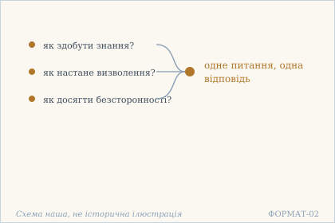 — Три питання сходяться в одну відповідь: далі глава заперечить кожне з трьох як щось набуте. Схема наша, не історична ілюстрація.

## 1.2

**Деванагарі.** मुक्तिम् इच्छसि चेत् तात विषयान् विषवत् त्यज । क्षमार्जवदयातोषसत्यं पीयूषवद् भज ॥

**Українська транслітерація.** муктім іччасі чет тата вішаян вішават тяджа | кшамарджавадаятошасатям піюшавад бгаджа ||

**Переклад.** Якщо ти прагнеш звільнення, сину, відкинь чуттєві предмети, як отруту; шануй терпимість, щирість, співчуття, вдоволеність і правдивість, як нектар.

**Науковий коментар.** Вірш задає умову входу в діалог: звільнення тут не досягають додаванням, а починають із відкидання. Пара «отрута / нектар» протиставляє не приємне й неприємне, а те, що зв’язує, і те, що живить. Другий піввірш — перелік п’яти чеснот у складеному іменнику (dvandva), тобто одна нерозривна сукупність, а не меню. Для українського перекладу принципово, що toṣa — це вдоволеність тим, що є, а не «простота»: «простота» відповідала б іншому слову (sāradya, saralatā) і в цьому переліку відсутня. Прямота ārjava — радше незігнутість, ніж «щирість» у побутовому сенсі; обраний відповідник умовний. Межі термінів див. у примітці до 1.2 в research/ashtavakra/. Твердження про значення toṣa — робоча лексикографічна оцінка, а не рецензований висновок.

**Українська паралель (ПОТРЕБУЄ ПЕРЕВІРКИ).** *українська барокова проповідь*, Києво-Могилянська гомилетика XVII ст.. ПОТРЕБУЄ ПЕРЕВІРКИ: найближча українська аналогія до пари отрута / нектар — барокова емблематика, де та сама річ буває ліками або отрутою. Ми не наводимо конкретного твору, бо не перевірили жодного тексту за джерелом, і вигадувати посилання не будемо.

**Ілюстрація.** 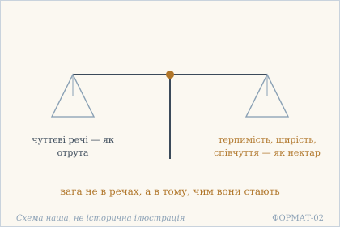 — Отрута й нектар на одній шальці: вага не в речах, а в тому, чим вони стають. Схема наша, не історична ілюстрація.

## 1.3

**Деванагарі.** न पृथ्वी न जलं नाग्निर् न वायुर् द्यौर् न वा भवान् । एषां साक्षिणम् आत्मानं चिद्रूपं विद्धि मुक्तये ॥

**Українська транслітерація.** на прітхві на джалам наґнір на ваюр дяур на ва бгаван | ешам сакшінам атманам чідрупам віддгі муктає ||

**Переклад.** Ти не земля, не вода, не вогонь, не вітер, не небо — і не є ними. Заради звільнення пізнай Атман, свідка цих [стихій], чия природа — cit.

**Науковий коментар.** Вірш будує заперечення не як список того, чим ти не є, а як зняття ототожнення: п'ять стихій — це складники тіла й світу, і шосте заперечення (na bhavān) закриває вихід через «але ж я — це щось інше». Те, що лишається, названо двома словами: sākṣin («свідок») і cidrūpa («той, чия форма — cit»). Обидва — позитивні визначення після низки заперечень, і саме вони роблять вірш не просто негативним. sākṣin тут не «спостерігач» у побутовому сенсі, а те, що не входить до складу спостережуваного; пор. вживання в 1.7 і далі. cidrūpa — bahuvrīhi, тому «чия природа — cit», а не «свідомість-форма». muktaye (dativus finalis) показує, що пізнання тут не самоціль, а умова звільнення. Переклад «знай» для viddhi — наказовий спосіб, не побажання.

**Українська паралель (наша інтерпретація, не твердження про вплив).** *Григорій Сковорода*, «Кільце. Дружня розмова про душевний мир». Наша паралель: у «Кільце» справжнє «я» теж не збігається з тілом і з речами, які людина собі приписує. Це наша асоціація за будовою думки, а не науковий висновок про запозичення.

**Ілюстрація.** 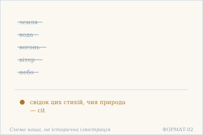 — Пʼять стихій закреслено — лишається свідок, чия природа cit. Схема наша, не історична ілюстрація.

## 1.4

**Деванагарі.** यदि देहं पृथक्कृत्य चिति विश्राम्य तिष्ठसि । अधुनैव सुखी शान्तो बन्धमुक्तो भविष्यसि ॥

**Українська транслітерація.** яді дехам прітхаккрітя чіті вішрам'я тіштхасі | адгунайва сукхі шанто бандгамукто бгавішясі ||

**Переклад.** Якщо, відокремивши тіло, ти стоїш, спочивши в cit, — то вже зараз ти будеш щасливий, умиротворений, вільний від уз.

**Науковий коментар.** Вірш дає не обіцянку на майбутнє, а умову з негайним наслідком: adhunaiva — «вже зараз», і саме це слово є смисловим центром. Майбутній час (bhaviṣyasi) тут не відсуває результат, а означає, що стан настане як прямий наслідок умови, а не через поступовий шлях. Умова потрійна: pṛthakkṛtya (відокремити тіло), viśrāmya citi (спочити в cit), tiṣṭhasi (перебувати). Три дієслова описують не дію, а спосіб стояння. citi — локатив від cit, тобто «у cit», а не «на cit»: це місце, у якому спочивають, а не об'єкт, який досягають. bandhamuktaḥ — bahuvrīhi, «той, у кого узи відпали», а не «той, кого звільнили»: суб'єкт не зазнає дії ззовні.

**Українська паралель (наша інтерпретація, не твердження про вплив).** *Леся Українка*, «Contra spem spero!». Наша паралель: у Лесі Українки дух стоїть, коли тіло вже не тримає, — і саме ця незалежність стану від тіла близька до того, що вірш називає спочити в cit. Ми не цитуємо й не твердимо впливу; це типологічна близькість, яку читач може перевірити сам.

**Ілюстрація.** 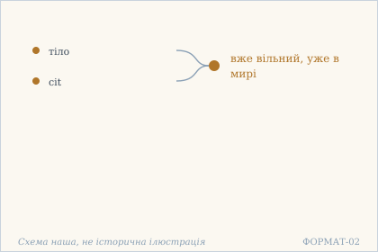 — Умова з негайним наслідком: «вже зараз» — смисловий центр вірша. Схема наша, не історична ілюстрація.

## 1.5

**Деванагарі.** न त्वं विप्रादिको वर्णो नाश्रमी नाक्षगोचरः । असङ्गो ऽसि निराकारो विश्वसाक्षी सुखी भव ॥

**Українська транслітерація.** на твам віпрадіко варно нашрамі накшаґочарах | асанґо ’сі ніракаро вішвасакші сукхі бгава ||

**Переклад.** Ти не брахман і не інший стан, не учень і не відречений, і око тебе не бачить. Ти без прив'язаності, без форми, свідок усього — будь щасливий.

**Науковий коментар.** Вірш знімає дві ознаки, за якими людину зазвичай визначають, і робить це тими самими словами, якими їх називає традиція. `varṇa` тут — суспільний стан, а не «барва» і не «звук»: `viprādika` означає «той, що починається з брахмана», тобто весь ряд чотирьох станів. `āśramin` — не «ашрама» як місце, а людина в одному з чотирьох життєвих станів. Обидва слова стоять в одному рядку з `na`, і це не пом'якшення: заперечення стосується самої тотожності, а не її гідності. Третє заперечення іншого роду: `akṣagocara` — «не в полі зору ока», тобто не об'єкт чуттєвого сприймання. Перші два знімають суспільні ознаки, третє — можливість бути побаченим узагалі. Після цього лишається тільки ствердне: `asaṅga` (без прив'язаності), `nirākāra` (без форми), `viśvasākṣin` (свідок усього) — і наказ `sukhī bhava`, «будь щасливий», єдиний імператив у вірші. Це відповідь на питання, поставлене в Issues #3: `varṇa` і `āśrama` в 1.5 не описують мудрого й не є шляхом до нього — вони названі, щоб бути знятими. Порівняй 1.6, де тим самим способом знімаються дгарма й адгарма.

**Українська паралель (наша інтерпретація, не твердження про вплив).** *Митрополит Іларіон Київський*, «Слово про закон і благодать» (XI ст.). Наша паралель: київське «Слово» розрізняє закон, що приписує стан, і благодать, що стану не потребує. Це сучасне типологічне зіставлення, а не доказ впливу; датування цієї книги науково не встановлене.

**Ілюстрація.** 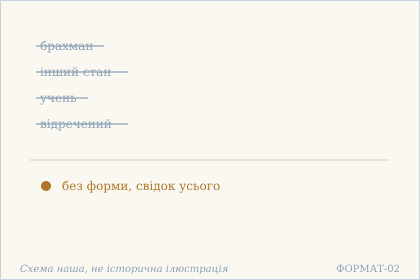 — Варна й ашрама зняті тими самими словами, якими їх називає традиція. Схема наша, не історична ілюстрація.

## 1.6

**Деванагарі.** धर्माधर्मौ सुखं दुःखं मानसानि न ते बिभो । न कर्ताऽसि न भोक्ताऽसि मुक्त एवासि सर्वदा ॥

**Українська транслітерація.** дгармадгармау сукхам духкхам манасані на те бібго | на карта’сі на бгокта’сі мукта евасі сарвада ||

**Переклад.** Дхарма й адхарма, щастя й страждання — усе це розумове, не твоє, о всепроникний. Ти не дієць і не споживач — ти вільний завжди.

**Науковий коментар.** mānasāni — «розумові»: пари не заперечуються як вигадка, а виводяться з-під авторства того, кому їх приписують. Друга половина містить рідкісну для цього тексту остаточність: mukta eva asi sarvadā — «ти вільний саме завжди». Це варто порівняти з 1.7, де стоїть muktaprāya, «майже вільний». Різниця між сусідніми віршами не стилістична, і переклад не повинен її згладжувати.

**Українська паралель (наша інтерпретація, не твердження про вплив).** *Памфіл Юркевич*, «Серце і його значення в духовному житті людини, за вченням слова Божого» (1860). Наша паралель: коли вірш каже, що дхарма й адхарма розумові, не твої, він відводить моральному судженню місце в думці, а не в речі. Юркевич розводить розум і серце інакше, ніж це робить санскритський текст, але думка про те, що мірило не тотожне людині, у нього є. Ми свідомо не цитуємо Юркевича: доступний цифровий уривок не є бібліотекою першоджерел, а український переклад твору має власні права. Тому тут названо твір, а не рядок.

**Ілюстрація.** 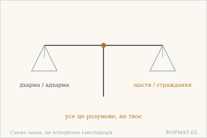 — Дхарма й адхарма, щастя й страждання важать однаково: усе це розумове. Схема наша, не історична ілюстрація.

## 1.7

**Деванагарі.** एको द्रष्टासि सर्वस्य मुक्तप्रायो ऽसि सर्वदा । अयम् एव हि ते बन्धो द्रष्टारं पश्यसीतरम् ॥

**Українська транслітерація.** еко драштасі сарвася муктапрайо ’сі сарвада | аям ева хі те бандго драштарам пашясітарам ||

**Переклад.** Ти єдиний бачитель усього — і завжди майже вільний. Уза твоя ось у чому: ти бачиш іншого бачителя, крім себе.

**Науковий коментар.** Вірш перевертає звичне уявлення про неволю. Неволя тут не в тому, що ти робиш погане, а в тому, що ти припускаєш **другого бачителя**. Слово muktaprāyaḥ («майже вільний») ужите навмисно: воно не обіцяє повноти, а показує, наскільки мало лишається. itaram («іншого») — не «щось інше», а саме інший суб'єкт спостереження: щойно з'являється другий, з'являється й уза. Це прямий зв'язок із 1.3, де лишався sākṣin («свідок») після зняття стихій: там свідок один, тут — перевірка, чи він справді один.

**Українська паралель (наша інтерпретація, не твердження про вплив).** *Григорій Сковорода*, «Ікона Алківіадська» (трактат). Наша паралель: Сковорода розрізняє тінь і річ так само, як цей вірш розрізняє побачене й того, хто бачить. Уза вірша — не в тому, що є другий бачитель, а в тому, що ми його шукаємо; Сковорода шукає так само. Це наша асоціація, не твердження про джерело.

**Ілюстрація.** 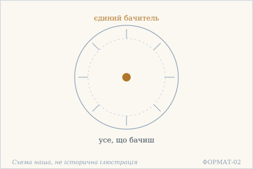 — Уза не в тому, що ти бачиш, а в тому, що припускаєш другого бачителя. Схема наша, не історична ілюстрація.

## 1.8

**Деванагарі.** अहं कर्तेत्य् अहंमानम् अहाकृष्णाहि दंशितः । नाहं कर्तेति विश्वासामृतं पीत्वा सुखी भव ॥

**Українська транслітерація.** ахам картетй ахамманам ахакрішнахі дамшітах | нахам картеті вішвасамрітам пітва сукхі бгава ||

**Переклад.** «Я діяч» — це самомніння, і воно ж укус великого чорного змія. Випивши нектар упевненості «я не діяч», будь щасливий.

**Науковий коментар.** Вірш протиставляє не дію й бездіяльність, а **два самоописи**. Змій — не докір, а образ отрути, що входить разом із думкою «я діяч». Друга пада дає не аргумент, а напій: viśvāsāmṛtam — «нектар упевненості», тобто стан, а не висновок. Звертання до 1.10 важливе: там радджа-сарпа («змія в мотузці») описує помилкове сприйняття світу, а тут змій — сама думка про авторство дії. Це той самий образ у двох ролях.

**Українська паралель (ПОТРЕБУЄ ПЕРЕВІРКИ).** *українська поезія XX ст.*, не визначено. ПОТРЕБУЄ ПЕРЕВІРКИ: образ «я діяч» як укус змія близький до української традиції самоспостереження, але конкретного твору, який можна було б назвати з певністю, ми не перевірили. Краще назвати прогалину, ніж підставити перше-ліпше ім'я.

**Ілюстрація.** 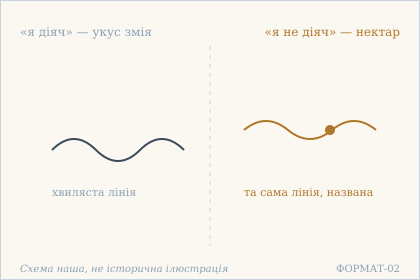 — Один і той самий образ у двох ролях: «я діяч» — укус, «я не діяч» — нектар. Схема наша, не історична ілюстрація.

## 1.9

**Деванагарі.** एको विशुद्धबोधो ऽहम् इति निश्चयवह्निना । प्रज्वाल्याज्ञानगहनं वीतशोकः सुखी भव ॥

**Українська транслітерація.** еко вішуддгабодго ’хам іті нішчаявахніна | праджваляджнянаґаханам віташоках сукхі бгава ||

**Переклад.** «Я — єдине чисте прозріння»: спаливши вогнем упевненості хащу незнання, будь без жалю й щасливий.

**Науковий коментар.** Продовження 1.8: там був «нектар упевненості», тут — «вогонь упевненості». Один і той самий niścaya діє двічі, але по-різному: напій змінює стан, вогонь знищує перешкоду. ajñānagahanaṃ — не «незнання» як абстракція, а «хаща», нетрі, у яких застрягають; саме тому потрібен вогонь, а не пояснення. vītaśokaḥ («без жалю») стоїть перед sukhī bhava, тобто жаль названо окремо від щастя — це не те саме, що його відсутність.

**Українська паралель (ПОТРЕБУЄ ПЕРЕВІРКИ).** *українська поезія*, не визначено. ПОТРЕБУЄ ПЕРЕВІРКИ: мотив випалити сумнів трапляється в українській ліриці часто, і саме тому небезпечний: будь-яке ім'я тут буде натяжкою. Потрібна конкретна розвідка за першоджерелом, а не цитата з пам'яті.

**Ілюстрація.** 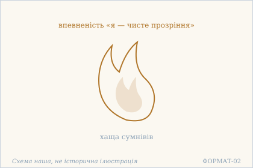 — Вогонь упевненості палить не знання, а хащу незнання. Схема наша, не історична ілюстрація.

## 1.10

**Деванагарі.** यत्र विश्वम् इदं भाति कल्पितं रज्जुसर्पवत् । आनन्दपरमानन्दः स बोधस् त्वं सुखं चर ॥

**Українська транслітерація.** ятра вішвам ідам бгаті калпітам раджджусарпават | анандапараманандах са бодгас твам сукхам чара ||

**Переклад.** Там, де все це сяє — вигадане, як змія в мотузці, — ти є те прозріння, що є радістю і найвищою радістю. Ходи щасливо.

**Науковий коментар.** Образ мотузки й змії — класичний для адвайти: помилка не в тому, що видно, а в тому, що до видимого додано. kalpitam («вигадане») стоїть одразу після viśvam, тобто вигадане саме «все», а не окремий предмет. Друга пада не заперечує світ, а переносить питання: питання не «чи є світ», а «хто той, у кому він сяє». ānandaparamānandaḥ — подвійна радість, і це не тавтологія: перша належить прозрінню, друга — тому, що за ним. Наказ sukhaṃ cara («ходи щасливо») — дієвий, а не описовий: це спосіб перебування, а не обіцянка стану.

**Українська паралель (наша інтерпретація, не твердження про вплив).** *Григорій Сковорода*, «Потоп Зміїний» (трактат). Наша паралель: у Сковороди змій — не побутова тварина, а символ оманного образу світу. Це робить «Потоп Зміїний» найближчим українським текстом до метафори змії в мотузці. Ми називаємо твір, але не твердимо, що Сковорода знав санскритський образ.

**Ілюстрація.** 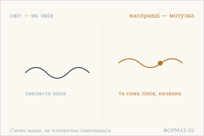 — Змія в мотузці: помилка не в тому, що видно, а в тому, що до видимого додано. Схема наша, не історична ілюстрація.

## 1.11

**Деванагарі.** मुक्ताभिमानी मुक्तो हि बद्धो बद्धाभिमान्य् अपि । किंवदन्तीह सत्येयं या मतिः सा गतिर् भवेत् ॥

**Українська транслітерація.** муктабгімані мукто хі баддго баддгабгіманй апі | кімвадантіха сатєям я матіх са ґатір бгавет ||

**Переклад.** Хто вважає себе вільним — той вільний; хто вважає себе зв'язаним — зв'язаний. Що тут ще сказати? Яке переконання, така й доля.

**Науковий коментар.** Формула `yā matiḥ sā gatiḥ` — «яке переконання, така й доля» — найпряміше місце книги про те, що стан визначається не фактом, а **самоозначенням**. `abhimānī` — не «той, хто думає» нейтрально, а той, хто **приписує собі**: той самий корінь, що в `ahaṃkāra` (1.6, 15.13). Друга половина (`kiṃvadantīha`) — риторичне «що тут казати», тобто текст сам визнає, що це звучить надто просто.

**Українська паралель (наша інтерпретація, не твердження про вплив).** *Григорій Сковорода*, «Розмова п'яти подорожніх про істинне щастя в житті». Наша паралель: у Сковороди щастя не приходить ззовні — воно вже є в людині, яка його впізнала. Це близько до «хто вважає себе вільним — той вільний», але не те саме: у вірші йдеться про визволення, а не про щастя. Розбіжність ми називаємо, а не згладжуємо.

**Ілюстрація.** 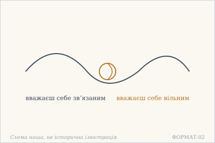 — Яке переконання, така й доля: вузол затягує й розвʼязує думка. Схема наша, не історична ілюстрація.

## 1.12

**Деванагарі.** असङ्गो निःस्पृहः शान्तो भ्रमात् संसारवान् इव ॥

**Українська транслітерація.** асанґо ніхспріхах шанто бграмат самсараван іва ||

**Переклад.** Без прив'язаності, без жадання, втихлий — через оману він видається тим, хто в сансарі.

**Науковий коментар.** Вірш короткий: у SARIT він має лише один рядок (два піди), тоді як сусідній 1.13 — два. Чи це справжня коротка форма, чи втрачена половина, за одним свідком не встановити; тому картка лишається чернеткою, а сумнів зафіксовано в `variants`. `saṃsāravān iva` — «**наче** той, хто в сансарі»: `iva` несе всю думку, бо стан у сансарі тут лише видимість, а не факт. Переклад без «наче» знищив би вірш.

**Українська паралель (наша інтерпретація, не твердження про вплив).** *Михайло Коцюбинський*, «Intermezzo» (1908). Наша паралель: у «Intermezzo» людина, відійшовши від залізних рук міста, стає тихою і саме тому вільною. Це наша асоціація за станом, а не твердження про спільне джерело: Коцюбинський пише про втому, вірш — про оману.

**Ілюстрація.** 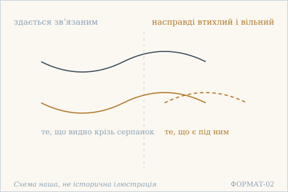 — Серпанок омани: стан у сансарі тут лише видимість, і це несе одне слово — iva. Схема наша, не історична ілюстрація.

## 1.13

**Деванагарі.** कूटस्थं बोधम् अद्वैतम् आत्मानं परिभावय । आभासो ऽहं भ्रमं मुक्त्वा भावं बाह्यम् अथान्तरम् ॥

**Українська транслітерація.** кутастхам бодгам адвайтам атманам парібгавая | абгасо ’хам бграмам муктва бгавам бахям атхантарам ||

**Переклад.** Осягай ātman як незмінне, недвоїсте усвідомлення. Відкинувши оману «я — лише відблиск», відкинь і стан зовнішній та внутрішній.

**Науковий коментар.** `kūṭastha` — буквально «той, що стоїть на вершині», усталено «незмінний, як ковадло»; це означення ātman, а не опис зусилля. `ābhāso 'ham` — «я — відблиск»: не «я ілюзія», а саме відблиск чогось іншого. Друга половина відкидає не лише внутрішнє, а й **зовнішнє** (`bāhyam atha antaram`) — і саме цей порядок, зовнішнє перед внутрішнім, варто зберегти. Вірші 1.12 і 1.13 у SARIT лежать в одному `lg`; див. `variants` картки 1.12.

**Українська паралель (наша інтерпретація, не твердження про вплив).** *Дмитро Чижевський*, «Нариси з історії філософії на Україні» (Прага, 1931). Наша паралель: Чижевський описує українську традицію як таку, де незмінним началом людини вважають не думку, а глибшу основу. Це бібліографічно перевірюване дослідження, і саме тому воно тут доречне: воно дає читачеві не цитату, а адресу, за якою той самий хід думки можна прочитати в українському матеріалі.

**Ілюстрація.** 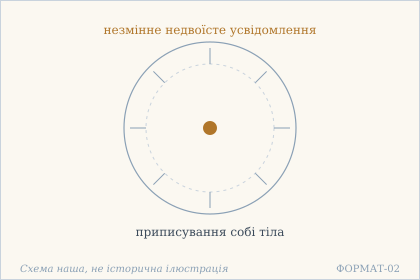 — Незмінне усвідомлення під шаром приписування: відблиск відкидають, а не шукають. Схема наша, не історична ілюстрація.

## 1.14

**Деванагарі.** देहाभिमानपाशेन चिरं बद्धो ऽसि पुत्रक । बोधो ऽहं ज्ञानखड्गेन तन् निष्कृत्य सुखी भव ॥

**Українська транслітерація.** дехабгіманапашена чірам баддго ’сі путрака | бодго ’хам джнянакхадґена тан нішкрітя сукхі бгава ||

**Переклад.** Ти довго зв'язаний мотузкою приписування собі тіла, синку. Скажи: «я — усвідомлення» — і, відсікши те мечем знання, будь щасливий.

**Науковий коментар.** Два образи в одному вірші: `pāśa` (мотузка, якою в'яжуть) і `khaḍga` (меч, яким ріжуть). Пута не «розв'язують», а **відсікають** — і це та сама різкість, що в 19.1 з кліщами й стрілою. `bodho 'ham` подано як те, що треба **сказати** собі, а не зрозуміти: переклад мусить зберегти цю мовленнєвість, бо вона й робить вірш дієвим. `putraka` («синку») — звертання наставника до учня.

**Українська паралель (наша інтерпретація, не твердження про вплив).** *Іван Франко*, поема «Мойсей» (1905). Наша паралель: у Франка народ лишається в пустелі не через брак дороги, а через рабство, яке він несе в собі. Це найближча українська річ до думки про мотузку приписування, хоч Франко говорить про народ, а вірш — про одну людину. Порівняння наше, не вплив.

**Ілюстрація.** 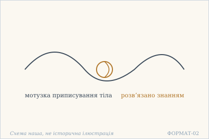 — Пута не розвʼязують, а відсікають: мотузка приписування і меч знання. Схема наша, не історична ілюстрація.

## 1.15

**Деванагарі.** निःसङ्गो निष्क्रियो ऽसि त्वं स्वप्रकाशो निरञ्जनः । अयम् एव हि ते बन्धः समाधिम् अनुतिष्ठसि ॥

**Українська транслітерація.** ніхсанґо нішкрійо ’сі твам свапракашо ніраньджанах | аям ева хі те бандгах самадгім анутіштхасі ||

**Переклад.** Ти без прив'язаності, без діяння, самосяйний, незаплямлений. Ось саме це твої пута — те, що ти вправляєшся в самадгі.

**Науковий коментар.** Вірш перевертає звичне: пута — не світ і не пристрасті, а **сама практика** самадгі. `anutiṣṭhasi` — «вправляєшся, додержуєш», дієслово старанного виконання; саме воно й назване неволею. Це найраніша заява тієї думки, що завершується в 15.20 («відкинь саму медитацію»). Для перекладу важливо не згладити різкість: текст не радить практикувати краще, він каже, що практика — і є пута.

**Українська паралель (наша інтерпретація, не твердження про вплив).** *Василь Симоненко*, «Ти знаєш, що ти — людина?» (1962). Наша паралель: Симоненко ставить гідність людини в неї саму, а не в те, що їй дають ззовні. Це близько до «самосяйний, незаплямлений», але Симоненко говорить про людську гідність у конкретній історії, а вірш — про природу усвідомлення. Ми не стираємо цієї різниці.

**Ілюстрація.** 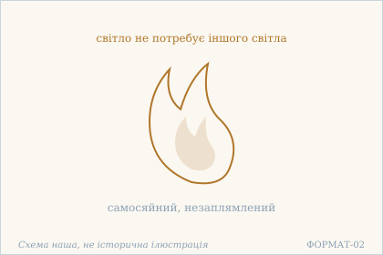 — Самосяйне світло не потребує іншого світла — і саме тому практика тут названа путами. Схема наша, не історична ілюстрація.

## 1.16

**Деванагарі.** त्वया व्याप्तम् इदं विश्वं त्वयि प्रोतं यथार्थतः । शुद्धबुद्धस्वरूपस् त्वं मा गमः क्षुद्रचित्तताम् ॥

**Українська транслітерація.** твая в'яптам ідам вішвам тваї протам ятхартхатах | шуддгабуддгасварупас твам ма ґамах кшудрачіттатам ||

**Переклад.** Цей всесвіт просякнутий тобою і справді нанизаний на тебе. Ти маєш природу чистого й просвітленого — не йди до дріб'язковості ума.

**Науковий коментар.** Два різні образи в першій половині: `vyāpta` («просякнутий, пронизаний») і `prota` («нанизаний», як на нитку). Перше — про заповнення, друге — про наскрізну нитку, на якій усе тримається. `kṣudracittatā` — «дріб'язковість ума», не «дрібні думки»: ідеться про масштаб, а не про кількість. `mā gamaḥ` — заборона, звернена до того, хто вже такий, а не до того, хто має стати.

**Українська паралель (наша інтерпретація, не твердження про вплив).** *Богдан-Ігор Антонич*, «Зелена Євангелія» (Львів: Ізмарагд, 1938). Наша паралель: у Антонича світ — не декорація, а одне живе тіло, і людина в ньому не гість. Це найближча українська річ до «всесвіт просякнутий тобою». Збірка вийшла посмертно 1938 року; жодного рядка ми не цитуємо.

**Ілюстрація.** 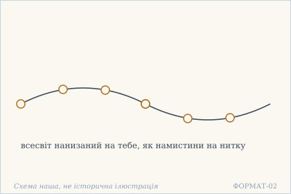 — Два образи в одній половині: просякнути (vyāpta) і нанизати (prota). Схема наша, не історична ілюстрація.

## 1.17

**Деванагарі.** निरपेक्षो निर्विकारो निर्भरः शीतलाशयः । अगाधबुद्धिर् अक्षुब्धो भव चिन्मात्रवासनः ॥

**Українська транслітерація.** нірапекшо нірвікаро нірбгарах шіталашаях | аґадгабуддгір акшубдго бгава чінматравасанах ||

**Переклад.** Без очікування, без видозмін, без тягаря, з прохолодним нутром; із незміренною думкою, незбурений — будь тим, чия схильність є сама лише свідомість.

**Науковий коментар.** Єдиний наказ у вірші — `bhava` («будь»), і він стоїть **усередині** переліку означень, а не на початку чи в кінці. `cinmātra-vāsana` — рідкісне поєднання: `vāsanā` зазвичай означає схильність, яку треба усунути (9.8), а тут вона ж стає єдиною, що лишається. Це не суперечність, а звуження: з усіх схильностей дозволена одна.

**Українська паралель (наша інтерпретація, не твердження про вплив).** *Олександр Довженко*, «Зачарована Десна» (1956). Наша паралель: у Довженка спокій — не порожнеча, а повнота, яку людина впізнає, коли перестає квапитись. Це наша асоціація; Довженко пише прозу про дитинство, а вірш — про стан без очікування.

**Ілюстрація.** 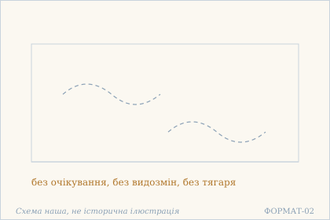 — Небо без хмар: єдиний наказ «будь» стоїть усередині переліку означень. Схема наша, не історична ілюстрація.

## 1.18

**Деванагарі.** साकारम् अनृतं विद्धि निराकारं तु निश्चलम् । एतत् तत्त्वोपदेशेन न पुनर्भवसंभवः ॥

**Українська транслітерація.** сакарам анрітам віддгі ніракарам ту нішчалам | етат таттвопадешена на пунарбгавасамбгавах ||

**Переклад.** Знай: те, що має образ, — несправжнє; а те, що без образу — непохитне. Цим настановленням про суть немає народження знову.

**Науковий коментар.** Останній вірш глави дає найрізкіше з її тверджень: `sākāra` (усе, що має образ) названо `anṛta` — несправжнім. Це не заперечення світу, а заперечення **образності** як ознаки справжнього. Друга половина обіцяє наслідок не моральний, а структурний: `na punarbhavasaṃbhavaḥ` — «немає можливості знову-народження». `upadeśa` — настановлення вчителя, те саме слово, що в 15.1; переклад мусить бути однаковим.

**Українська паралель (наша інтерпретація, не твердження про вплив).** *Григорій Сковорода*, «Алфавіт, чи Буквар миру» (діалог). Наша паралель: Сковорода послідовно розводить образ і те, що за образом стоїть, і саме на цьому розведенні тримається його символіка. Це наша інтерпретація за будовою думки, а не вказівка на джерело вірша.

**Ілюстрація.** 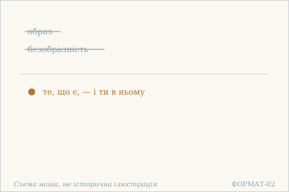 — Образ і безобразність зняті: заперечується не світ, а образність як ознака справжнього. Схема наша, не історична ілюстрація.

## 1.19

**Деванагарі.** यथैवादर्शमध्यस्थे रूपे ऽन्तः परितस् तु सः । तथैवास्मिञ् छरीरे ऽन्तः परितः परमेश्वरः ॥

**Українська транслітерація.** ятхайвадаршамадгястхе рупе ’нтах парітас ту сах | татхайвасмінь ччаріре ’нтах парітах парамешварах ||

**Переклад.** Як образ у дзеркалі — він усередині й навколо нього; так само і в цьому тілі — всередині й навколо верховний володар.

**Науковий коментар.** Пара `antaḥ … paritaḥ` («усередині … навколо») стоїть в обох половинах, і саме вона несе думку: не «всередині тіла» як у посудині, а одночасно всередині й поза. Дзеркало — єдиний образ цього вірша; важливо, що образ у дзеркалі не є дзеркалом і не віддільний від нього. `parameśvara` — єдине вживання цього слова в книзі, і воно єдине тут звучить теїстично; переклад не повинен його пом'якшувати.

**Українська паралель (наша інтерпретація, не твердження про вплив).** *Григорій Сковорода*, «Наркіс. Розмова про те: Пізнай себе» (1769–1771). Наша паралель: у «Наркіс» дзеркало води — головний образ, і Сковорода використовує його так само, як цей вірш: те, що видно в дзеркалі, є і всередині, і зовні одночасно. Ми беремо той самий діалог, що й у 1.1, але інший його образ — і кажемо про це прямо, а не вдаємо двох незалежних паралелей.

**Ілюстрація.** 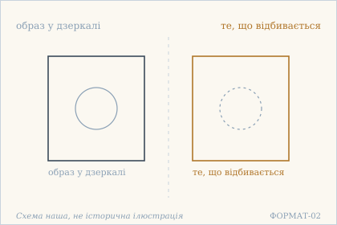 — Образ у дзеркалі не є дзеркалом і не віддільний від нього. Схема наша, не історична ілюстрація.

## 1.20

**Деванагарі.** एकं सर्वगतं व्योम बहिर् अन्तर् यथा घटे । नित्यं निरन्तरं ब्रह्म सर्वभूतगणे तथा ॥

**Українська транслітерація.** екам сарваґатам вйома бахір антар ятха ґгате | нітям нірантарам брахма сарвабгутаґане татха ||

**Переклад.** Як один усюдисущий простір — зовні й усередині глечика, так повсякчас і без перерви брахман у всій сукупності істот.

**Науковий коментар.** Класичний образ глечика: простір не ділиться стінками, хоч і здається «простором у глечику». Пара `bahiḥ antaḥ` повторює `antaḥ … paritaḥ` з 1.19, але тут вона віднесена до простору, а не до образу в дзеркалі. `nirantaram` — «без проміжку», тобто не «вічно» в часовому сенсі, а без розриву в просторі; переклад мусить це розрізняти.

**Українська паралель (ПОТРЕБУЄ ПЕРЕВІРКИ).** *українська філософська традиція*, не визначено. ПОТРЕБУЄ ПЕРЕВІРКИ: образ простору, що не ділиться стінками посудини, в українському матеріалі найчастіше приходить через Сковороду, але конкретного місця, де він говорить саме про посуд і простір, ми за джерелом не перевірили. Тому тут стоїть позначка, а не ім'я.

**Ілюстрація.** 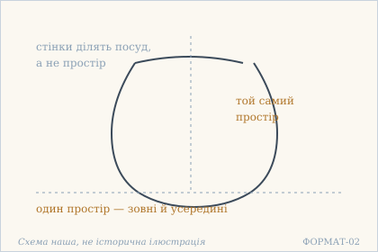 — Простір не ділиться стінками глечика: bahiḥ antaḥ повторює 1.19, але про простір. Схема наша, не історична ілюстрація.

## Поетичний переклад

Окремо, у [`poetychnyi/rozdil-1.md`](poetychnyi/rozdil-1.md). Це **наш поетичний переклад**, не канонічний і не науковий; у PDF він іде окремою частиною.
