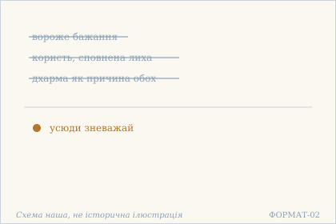
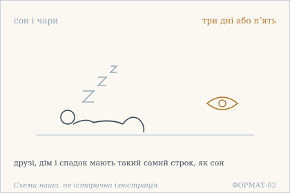
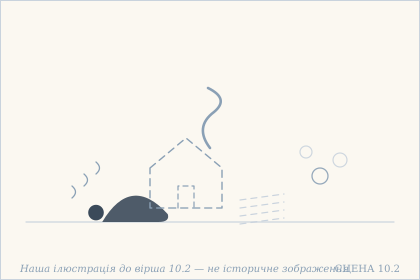
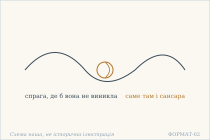
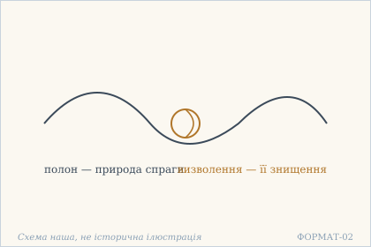
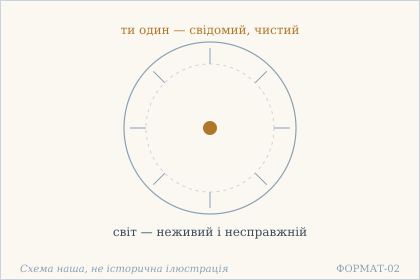
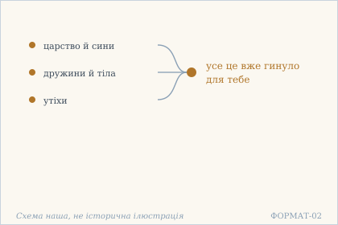
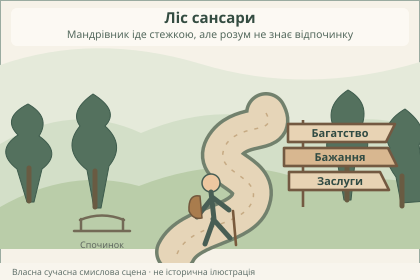
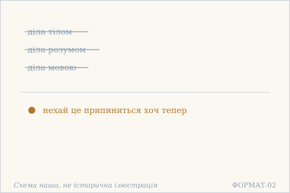

# Аштавакра-ґіта. Глава 10. Наукове представлення

> ФОРМАТ-02: кожен вірш подано шістьма шарами — деванагарі, IAST, українська
> транслітерація, переклад, науковий коментар з українськими паралелями,
> ілюстрація. Плюс окремо — поетичний переклад (`poetychnyi/rozdil-10.md`).
>
> **IAST** — те, що записано в картці (поле `iast`), без редакторських
> поправок: це єдиний шар, який не перераховується скриптом.
> **Деванагарі тут — механічна** транслітерація поля `iast` з картки
> (`scripts/iast_to_devanagari.py`), а не окреме читання за рукописом.
> **Українська транслітерація** — теж механічна (`scripts/iast_to_ukrainian.py`,
> таблиця в `docs/TRANSLITERATSIIA.md`).
> **Українські паралелі** — наша інтерпретація, а не твердження про вплив;
> реєстр і правила — `paraleli.json` і `scripts/check_ukrainian_parallels.py`.
> **Схеми** — наші власні; жодна не є історичною ілюстрацією.
> **Сцени** (`ilustratsii-naratyvni/`) — теж наші власні малюнки й теж не
> історичні: це ситуація вірша, а не поняття, і фігури там — силуети без
> облич.
>
> Цей файл згенеровано; правити треба картки й `format-v2/rozdil-10.json`,
> а не його.

## Глава 10. Досить уже

Десята глава — найрізкіша за тоном. Вона не пояснює й не доводить: вона перелічує те, що вже було, і каже досить. Спершу відкидаються бажання й користь (10.1), далі побутові речі названо сном і чарами (10.2), далі спрага названа самою сансарою (10.3–10.4). Останні три вірші звернені до минулого: усе це вже гинуло не раз, і саме тому питання стоїть не про нове, а про припинення.

## 10.1

**Деванагарі.** विहाय वैरिणं कामम् अर्थं चानर्थसंकुलं । धर्मम् अप्य् एतयोर् हेतुं सर्वत्रानादरं कुरु ॥

**IAST.** vihāya vairiṇaṃ kāmam arthaṃ cānarthasaṃkulaṃ | dharmam apy etayor hetuṃ sarvatrānādaraṃ kuru ||

**Українська транслітерація.** віхая вайрінам камам артхам чанартхасамкулам | дгармам апй етайор хетум сарватранадарам куру ||

**Переклад.** Покинувши вороже бажання і сповнену лиха користь — навіть дхарму, що є причиною обох, — усюди зневажай.

**Построкове зіставлення (редакторська чернетка, не рецензовано).**

### Рядок а

**Деванагарі (механічно з IAST).** विहाय वैरिणं कामम् अर्थं चानर्थसंकुलं

**IAST (з редакторської картки).** vihāya vairiṇaṃ kāmam arthaṃ cānarthasaṃkulaṃ

**Українська транслітерація (механічна).** віхая вайрінам камам артхам чанартхасамкулам

**Український відповідник рядка.** Покинувши вороже бажання і сповнену лиха користь —

**Коментар рядка (не рецензовано).** vihāya — дієприслівникова форма «покинувши»; vairiṇaṃ kāmam — «вороже бажання»; artham cānarthasaṃkulaṃ — «користь, сповнену лиха». Характеристика «сповнена лиха» стосується artha; не переносимо її на dharma.

### Рядок б

**Деванагарі (механічно з IAST).** धर्मम् अप्य् एतयोर् हेतुं सर्वत्रानादरं कुरु

**IAST (з редакторської картки).** dharmam apy etayor hetuṃ sarvatrānādaraṃ kuru

**Українська транслітерація (механічна).** дгармам апй етайор хетум сарватранадарам куру

**Український відповідник рядка.** навіть дхарму, що є причиною обох, — усюди зневажай.

**Коментар рядка (не рецензовано).** dharmam api — «навіть дхарму»; etayor hetuṃ — «причину обох»; sarvatra anādaraṃ kuru — наказ не надавати пошани/зневажати. Це радикальне твердження санскритського тексту, а не рекомендація нехтувати українськими законами чи людськими обов'язками.

**Коментар.** Дхарма стоїть у переліку **останньою** і з підсиленням api («навіть»): спершу відкидають бажання й користь, а потім те, що їх породжує. anartha-saṃkula («сповнене лиха») стосується саме artha, і переклад не повинен переносити цю оцінку на дхарму. «Зневажай» (anādara) — сильне слово; м'якше «не зважай» змінило б ступінь.

**Українська паралель (наша інтерпретація, не твердження про вплив).** *Пантелеймон Куліш*, «Хуторна поезія» (1882). Наша паралель: у Куліша відмова від користі теж подана як умова спокою, а не як втрата. Наше порівняння — типологічне, не твердження про джерело.

**Ілюстрація.**  — Бажання, користь і дхарма відкинуті разом. Схема наша, не історична ілюстрація.

## 10.2

**Деванагарі.** स्वप्नेन्द्रजालवत् पश्य दिनानि त्रीणि पञ्च वा । मित्रक्षेत्रधनागारदारदायादिसंपदः ॥

**IAST.** svapnendrajālavat paśya dināni trīṇi pañca vā | mitrakṣetradhanāgāradāradāyādisaṃpadaḥ ||

**Українська транслітерація.** свапнендраджалават пашя дінані тріні паньча ва | мітракшетрадганаґарадарадаядісампадах ||

**Переклад.** Дивись на друзів, поле, гроші, дім, дружину, спадок і решту багатств як на сон і чари — на три дні або п'ять.

**Построкове зіставлення (редакторська чернетка, не рецензовано).**

### Рядок а

**Деванагарі (механічно з IAST).** स्वप्नेन्द्रजालवत् पश्य दिनानि त्रीणि पञ्च वा

**IAST (з редакторської картки).** svapnendrajālavat paśya dināni trīṇi pañca vā

**Українська транслітерація (механічна).** свапнендраджалават пашя дінані тріні паньча ва

**Український відповідник рядка.** Дивись на друзів, поле, гроші, дім, дружину, спадок і решту багатств

**Коментар рядка (не рецензовано).** svapnendrajālavat — «мов сон і чари»; paśya — «дивись»; dināni trīṇi pañca vā — «три дні або п'ять». ВАЖЛИВО: українська картка починає речення з переліку речей, який у санскриті стоїть у другому піврядку. Тому наведений український сегмент — початок безперервного перекладу, а НЕ дослівна перекладна відповідність цієї санскритської половини.

### Рядок б

**Деванагарі (механічно з IAST).** मित्रक्षेत्रधनागारदारदायादिसंपदः

**IAST (з редакторської картки).** mitrakṣetradhanāgāradāradāyādisaṃpadaḥ

**Українська транслітерація (механічна).** мітракшетрадганаґарадарадаядісампадах

**Український відповідник рядка.** як на сон і чари — на три дні або п'ять.

**Коментар рядка (не рецензовано).** mitra-kṣetra-dhana-āgāra-dāra-dāyādi-saṃpadaḥ перелічує друзів, поле, гроші, дім, дружину, спадок та інші набутки. У санскриті цей перелік — другий піврядок, але український переклад виносить його перед «як на сон і чари». Смислова інверсія прозоро позначена, повний авторський переклад збережено дослівно.

**Коментар.** Перелік навмисно побутовий: не «світ» загалом, а конкретні речі, за які тримаються. «Три дні або п'ять» — не точний строк, а спосіб сказати «коротко»; переклад зберігає числа, бо вони й творять ефект. indrajāla — не просто «ілюзія», а фокус, свідома підміна видимого.

**Українська паралель (ПОТРЕБУЄ ПЕРЕВІРКИ).** *українська барокова проповідь*, не визначено. ПОТРЕБУЄ ПЕРЕВІРКИ: перелік побутових речей як сну й чару близький до барокової проповіді про марність, але конкретного твору ми не перевірили.

**Ілюстрація.**  — Людина спить, а поряд око, що не спить: усе має строк у три дні. Схема наша, не історична ілюстрація.

**Сцена.**  — Над сплячою людиною розчиняються дім, поле й монети, як сон. Наша ілюстрація до вірша 10.2 — не історичне зображення.

## 10.3

**Деванагарі.** यत्र यत्र भवेत् तृष्णा संसारं विद्धि तत्र वै । प्रौढवैराग्यम् आश्रित्य वीततृष्णः सुखी भव ॥

**IAST.** yatra yatra bhavet tṛṣṇā saṃsāraṃ viddhi tatra vai | prauḍhavairāgyam āśritya vītatṛṣṇaḥ sukhī bhava ||

**Українська транслітерація.** ятра ятра бгавет трішна самсарам віддгі татра вай | праудгавайраґям ашрітя вітатрішнах сукхі бгава ||

**Переклад.** Де б не виникла спрага — знай: саме там і сансара. Опираючись на зрілу безсторонність, стань тим, у кого спрага минула, — і будь щасливий.

**Построкове зіставлення (редакторська чернетка, не рецензовано).**

### Рядок а

**Деванагарі (механічно з IAST).** यत्र यत्र भवेत् तृष्णा संसारं विद्धि तत्र वै

**IAST (з редакторської картки).** yatra yatra bhavet tṛṣṇā saṃsāraṃ viddhi tatra vai

**Українська транслітерація (механічна).** ятра ятра бгавет трішна самсарам віддгі татра вай

**Український відповідник рядка.** Де б не виникла спрага — знай: саме там і сансара.

**Коментар рядка (не рецензовано).** yatra yatra — «де б не»; bhavet tṛṣṇā — «виникла б спрага»; saṃsāraṃ viddhi tatra vai — «знай: саме там сансара». Слово tṛṣṇā в цьому контексті означає жадання/спрагу, а не фізіологічну потребу пити.

### Рядок б

**Деванагарі (механічно з IAST).** प्रौढवैराग्यम् आश्रित्य वीततृष्णः सुखी भव

**IAST (з редакторської картки).** prauḍhavairāgyam āśritya vītatṛṣṇaḥ sukhī bhava

**Українська транслітерація (механічна).** праудгавайраґям ашрітя вітатрішнах сукхі бгава

**Український відповідник рядка.** Опираючись на зрілу безсторонність, стань тим, у кого спрага минула, — і будь щасливий.

**Коментар рядка (не рецензовано).** prauḍha-vairāgyam āśritya — «спираючись на зрілу безсторонність»; vīta-tṛṣṇaḥ — «той, у кого спрага минула»; sukhī bhava — «будь щасливий». Vairāgya не слід без окремого обґрунтування прирівнювати до байдужості до людей.

**Коментар.** Тут уперше в розділі дано не заперечення, а **вказівку**: `yatra yatra … tatra` («де б … саме там»). Сансара — не місце й не стан світу, а точка, де виникла спрага. prauḍha («зріла») важливе: безсторонність має бути витриманою, а не поривчастою. Висновок «будь щасливий» — наказ, а не побажання.

**Українська паралель (наша інтерпретація, не твердження про вплив).** *Володимир Винниченко*, «Сонячна машина» (1928). Наша паралель: у Винниченка спрага теж постає тим, що тримає людину в колі, незалежно від того, чи вона цього хоче. Наше порівняння — типологічне.

**Ілюстрація.**  — Вузол спраги: де вона виникла, там і сансара. Схема наша, не історична ілюстрація.

## 10.4

**Деванагарі.** तृष्णामात्रात्मको बन्धस् तन्नाशो मोक्ष उच्यते । भवासंसक्तिमात्रेण प्राप्तितुष्टिर् मुहुर् मुहुः ॥

**IAST.** tṛṣṇāmātrātmako bandhas tannāśo mokṣa ucyate | bhavāsaṃsaktimātreṇa prāptituṣṭir muhur muhuḥ ||

**Українська транслітерація.** трішнаматратмако бандгас таннашо мокша учяте | бгавасамсактіматрена праптітуштір мухур мухух ||

**Переклад.** Полон має природу самої лише спраги; її знищення називають визволенням. Від самої лише неприв'язаності до буття приходить вдоволеність досягнутим — знову й знову.

**Построкове зіставлення (редакторська чернетка, не рецензовано).**

### Рядок а

**Деванагарі (механічно з IAST).** तृष्णामात्रात्मको बन्धस् तन्नाशो मोक्ष उच्यते

**IAST (з редакторської картки).** tṛṣṇāmātrātmako bandhas tannāśo mokṣa ucyate

**Українська транслітерація (механічна).** трішнаматратмако бандгас таннашо мокша учяте

**Український відповідник рядка.** Полон має природу самої лише спраги; її знищення називають визволенням.

**Коментар рядка (не рецензовано).** tṛṣṇāmātrātmako bandhaḥ — «полон має природу самої лише спраги»; tan-nāśo mokṣa ucyate — «її знищення називають визволенням». Твердження є філософською дефініцією в межах твору, не історичною характеристикою всіх індійських учень.

### Рядок б

**Деванагарі (механічно з IAST).** भवासंसक्तिमात्रेण प्राप्तितुष्टिर् मुहुर् मुहुः

**IAST (з редакторської картки).** bhavāsaṃsaktimātreṇa prāptituṣṭir muhur muhuḥ

**Українська транслітерація (механічна).** бгавасамсактіматрена праптітуштір мухур мухух

**Український відповідник рядка.** Від самої лише неприв'язаності до буття приходить вдоволеність досягнутим — знову й знову.

**Коментар рядка (не рецензовано).** bhavāsaṃsaktimātreṇa — «самою лише неприв'язаністю до буття»; prāpti-tuṣṭiḥ — «вдоволеність досягнутим»; muhur muhuḥ — «знову й знову». Повтор збережений як смислова частина авторського речення.

**Коментар.** Тут полон означено **однією** ознакою — спрага, і визволення теж однією — її знищення. Це найточніше місце глави, і воно коротке; розширювати переклад не варто. `toṣa` входить сюди як складник `prāpti-tuṣṭi` («вдоволеність досягнутим»), а не як самостійна чеснота — це варто пам'ятати при звірці з 1.2, де `toṣa` стоїть окремо. `muhur muhuḥ` — не «завжди», а «раз у раз»: вдоволеність повторюється, а не тримається одного разу назавжди.

**Українська паралель (наша інтерпретація, не твердження про вплив).** *Іван Франко*, «Смерть Каїна» (1889). Наша паралель: у Франка полон теж має природу самої лише спраги, а не зовнішньої перешкоди. Наше порівняння — за будовою думки.

**Ілюстрація.**  — Один вузол у двох назвах: полон і визволення. Схема наша, не історична ілюстрація.

## 10.5

**Деванагарі.** त्वम् एकश् चेतनः शुद्धो जडं विश्वम् असत् तथा । अविद्यापि न किञ्चित् सा का बुभुत्सा तथापि ते ॥

**IAST.** tvam ekaś cetanaḥ śuddho jaḍaṃ viśvam asat tathā | avidyāpi na kiñcit sā kā bubhutsā tathāpi te ||

**Українська транслітерація.** твам екаш четанах шуддго джадам вішвам асат татха | авідяпі на кіньчіт са ка бубгутса татхапі те ||

**Переклад.** Ти один — свідомий, чистий; світ же — неживий і несправжній. Навіть незнання — аніщо. То яке в тебе, при всьому тому, бажання пізнавати?

**Построкове зіставлення (редакторська чернетка, не рецензовано).**

### Рядок а

**Деванагарі (механічно з IAST).** त्वम् एकश् चेतनः शुद्धो जडं विश्वम् असत् तथा

**IAST (з редакторської картки).** tvam ekaś cetanaḥ śuddho jaḍaṃ viśvam asat tathā

**Українська транслітерація (механічна).** твам екаш четанах шуддго джадам вішвам асат татха

**Український відповідник рядка.** Ти один — свідомий, чистий; світ же — неживий і несправжній.

**Коментар рядка (не рецензовано).** tvam ekaś cetanaḥ śuddhaḥ — «ти один — свідомий, чистий»; jaḍaṃ viśvam asat — «світ неживий та несправжній». Філософські оцінки тут належать голосу санскритського твору; не додаємо сучасних природничих висновків.

### Рядок б

**Деванагарі (механічно з IAST).** अविद्यापि न किञ्चित् सा का बुभुत्सा तथापि ते

**IAST (з редакторської картки).** avidyāpi na kiñcit sā kā bubhutsā tathāpi te

**Українська транслітерація (механічна).** авідяпі на кіньчіт са ка бубгутса татхапі те

**Український відповідник рядка.** Навіть незнання — аніщо. То яке в тебе, при всьому тому, бажання пізнавати?

**Коментар рядка (не рецензовано).** avidyāpi na kiñcit sā — «навіть незнання — аніщо»; kā bubhutsā tathāpi te — риторичне питання про бажання пізнати. Не підмінюємо bubhutsā загальним осудом науки або навчання; це позиція, висловлена віршем.

**Коментар.** `asat` тут — «несправжнє», не «зло»; це різні речі, і переклад не повинен їх зливати. Питання `kā bubhutsā` замикає коло: якщо навіть незнання ніщо, то пізнавати нічого — і саме тому питання адресоване тому, хто вже слухає пояснення. Це найгостріше місце глави: воно ставить під сумнів користь самої розмови.

**Українська паралель (ПОТРЕБУЄ ПЕРЕВІРКИ).** *українська релігійна філософія*, не визначено. ПОТРЕБУЄ ПЕРЕВІРКИ: питання, навіщо пізнавати те, що й так не є річчю, близьке до української релігійної філософії, але конкретного місця ми не звірили.

**Ілюстрація.**  — Свідомий у центрі, несправжній світ навколо. Схема наша, не історична ілюстрація.

## 10.6

**Деванагарі.** राज्यं सुताः कलत्राणि शरीराणि सुखानि च । संसक्तस्यापि नष्टानि तव जन्मनि जन्मनि ॥

**IAST.** rājyaṃ sutāḥ kalatrāṇi śarīrāṇi sukhāni ca | saṃsaktasyāpi naṣṭāni tava janmani janmani ||

**Українська транслітерація.** раджям сутах калатрані шарірані сукхані ча | самсактасяпі наштані тава джанмані джанмані ||

**Переклад.** Царство, сини, дружини, тіла й утіхи — усе це вже гинуло для тебе, прив'язаного, — з народження в народження.

**Построкове зіставлення (редакторська чернетка, не рецензовано).**

### Рядок а

**Деванагарі (механічно з IAST).** राज्यं सुताः कलत्राणि शरीराणि सुखानि च

**IAST (з редакторської картки).** rājyaṃ sutāḥ kalatrāṇi śarīrāṇi sukhāni ca

**Українська транслітерація (механічна).** раджям сутах калатрані шарірані сукхані ча

**Український відповідник рядка.** Царство, сини, дружини, тіла й утіхи —

**Коментар рядка (не рецензовано).** rājyaṃ sutāḥ kalatrāṇi śarīrāṇi sukhāni ca — перелік царства, дітей-синів, подружжя, тіл і втіх. Це дослівна предметна лексика давнього твору, а не перелік цінностей, які належить зневажати в сучасному житті.

### Рядок б

**Деванагарі (механічно з IAST).** संसक्तस्यापि नष्टानि तव जन्मनि जन्मनि

**IAST (з редакторської картки).** saṃsaktasyāpi naṣṭāni tava janmani janmani

**Українська транслітерація (механічна).** самсактасяпі наштані тава джанмані джанмані

**Український відповідник рядка.** усе це вже гинуло для тебе, прив'язаного, — з народження в народження.

**Коментар рядка (не рецензовано).** saṃsaktasyāpi — «навіть прив'язаного»; naṣṭāni tava — «вже зникали для тебе»; janmani janmani — повтор «з народження в народження». Присудок із другого піврядка в українському перекладі поєднується з переліком першого.

**Коментар.** `naṣṭāni` — доконаний дієприкметник: не «загине», а «гинуло вже не раз». Переклад має зберегти цю повторюваність, інакше вірш звучить як погроза, а він — як нагадування. Звертання адресоване цареві, і царство названо **першим** у переліку: порядок не випадковий.

**Українська паралель (ПОТРЕБУЄ ПЕРЕВІРКИ).** *українська поезія XIX ст.*, не визначено. ПОТРЕБУЄ ПЕРЕВІРКИ: думка, що все набуте вже гинуло не раз, трапляється в українській поезії, але називати твір без звірки ми не будемо.

**Ілюстрація.**  — Низка набутків, що вже гинули з народження в народження. Схема наша, не історична ілюстрація.

## 10.7

**Деванагарі.** अलम् अर्थेन कामेन सुकृतेनापि कर्मणा । एभ्यः संसारकान्तारे न विश्रान्तम् अभून् मनः ॥

**IAST.** alam arthena kāmena sukṛtenāpi karmaṇā | ebhyaḥ saṃsārakāntāre na viśrāntam abhūn manaḥ ||

**Українська транслітерація.** алам артхена камена сукрітенапі кармана | ебгях самсаракантаре на вішрантам абгун манах ||

**Переклад.** Досить уже й багатства, і бажання, і навіть добрих учинків: у цьому лісі сансари твій розум так і не знав відпочинку.

**Построкове зіставлення (редакторська чернетка, не рецензовано).**

### Рядок а

**Деванагарі (механічно з IAST).** अलम् अर्थेन कामेन सुकृतेनापि कर्मणा

**IAST (з редакторської картки).** alam arthena kāmena sukṛtenāpi karmaṇā

**Українська транслітерація (механічна).** алам артхена камена сукрітенапі кармана

**Український відповідник рядка.** Досить уже й багатства, і бажання, і навіть добрих учинків:

**Коментар рядка (не рецензовано).** alam — «досить»; arthena — «багатства», kāmena — «бажання», sukṛtenāpi karmaṇā — «навіть доброго вчинку». Наказова інтонація спрямована на припинення чіпляння, а не доказ того, що добрі діла самі по собі шкідливі.

### Рядок б

**Деванагарі (механічно з IAST).** एभ्यः संसारकान्तारे न विश्रान्तम् अभून् मनः

**IAST (з редакторської картки).** ebhyaḥ saṃsārakāntāre na viśrāntam abhūn manaḥ

**Українська транслітерація (механічна).** ебгях самсаракантаре на вішрантам абгун манах

**Український відповідник рядка.** у цьому лісі сансари твій розум так і не знав відпочинку.

**Коментар рядка (не рецензовано).** ebhyaḥ — «від них»; saṃsārakāntāre — «у лісі/хащі сансари»; na viśrāntam abhūn manaḥ — «розум не знав відпочинку». Ліс тут текстовий образ виснаження, а не конкретна географічна місцевість.

**Коментар.** `sukṛta` тут — «заслуга, добре зроблене», а не «добро» взагалі; і текст відкидає саме заслугу, ставлячи її в один ряд із багатством і бажанням. Це найнезручніше місце глави для читача, який звик, що добрі вчинки беззастережно рахуються. `kāntāra` — «ліс», образ блукання, а не місце. `alam` — «годі вже», з інтонацією втоми, а не заборони.

**Українська паралель (ПОТРЕБУЄ ПЕРЕВІРКИ).** *українська проза XX ст.*, не визначено. ПОТРЕБУЄ ПЕРЕВІРКИ: образ лісу сансари, у якому розум не знав відпочинку, близький до української прози про виснаження, але конкретного твору ми не перевірили.

**Ілюстрація.**  — Полумʼя без відпочинку: ліс сансари. Схема наша, не історична ілюстрація.

## 10.8

**Деванагарі.** कृतं न कति जन्मानि कायेन मनसा गिरा । दुःखम् आयासदं कर्म तद् अद्याप्य् उपरम्यताम् ॥

**IAST.** kṛtaṃ na kati janmāni kāyena manasā girā | duḥkham āyāsadaṃ karma tad adyāpy uparamyatām ||

**Українська транслітерація.** крітам на каті джанмані каєна манаса ґіра | духкхам аясадам карма тад адяпй упарам'ятам ||

**Переклад.** Скільки ж за ці народження зроблено тілом, розумом і мовою діл, що дають біль і втому! Тож нехай це припиниться хоч тепер.

**Построкове зіставлення (редакторська чернетка, не рецензовано).**

### Рядок а

**Деванагарі (механічно з IAST).** कृतं न कति जन्मानि कायेन मनसा गिरा

**IAST (з редакторської картки).** kṛtaṃ na kati janmāni kāyena manasā girā

**Українська транслітерація (механічна).** крітам на каті джанмані каєна манаса ґіра

**Український відповідник рядка.** Скільки ж за ці народження зроблено тілом, розумом і мовою діл,

**Коментар рядка (не рецензовано).** kṛtaṃ na kati janmāni — «скільки ж за ці народження зроблено»; kāyena manasā girā — три орудні відмінки: тілом, розумом, мовою. Українське слово «діл» з'являється в першому сегменті, хоч санскритське karma стоїть у другому, щоб зберегти чинну синтаксичну цілісність перекладу.

### Рядок б

**Деванагарі (механічно з IAST).** दुःखम् आयासदं कर्म तद् अद्याप्य् उपरम्यताम्

**IAST (з редакторської картки).** duḥkham āyāsadaṃ karma tad adyāpy uparamyatām

**Українська транслітерація (механічна).** духкхам аясадам карма тад адяпй упарам'ятам

**Український відповідник рядка.** що дають біль і втому! Тож нехай це припиниться хоч тепер.

**Коментар рядка (не рецензовано).** duḥkham āyāsadaṃ karma — «діло, що дає біль і втому»; tad adyāpy uparamyatām — побажання/наказ «нехай припиниться хоч тепер». Звернімо увагу на пасивну форму: це не безпосереднє «припини» адресатові.

**Коментар.** Потрійний інструментал — тіло, розум, мова — це класична формула трьох дверей дії, і переклад має зберегти всі три, а не згортати їх у «вчинки». `uparamyatām` — пасивний імператив: не «припини», а «нехай припиниться»; дія знімається не зусиллям того, хто діє. `adya api` — «хоч тепер», з відтінком докору, а не нейтрального «зараз». Цим віршем глава 10 закінчується.

**Українська паралель (наша інтерпретація, не твердження про вплив).** *Василь Стефаник*, «Камінний хрест» (1900). Наша паралель: у Стефаника втома від зробленого теж стає останнім аргументом людини. Наше порівняння — типологічне, не про джерело.

**Ілюстрація.**  — Діла тілом, розумом і мовою відкинуті. Схема наша, не історична ілюстрація.

## Поетичний переклад

Окремо, у [`poetychnyi/rozdil-10.md`](poetychnyi/rozdil-10.md). Це **наш поетичний переклад**, не канонічний і не науковий; у PDF він іде окремою частиною.
