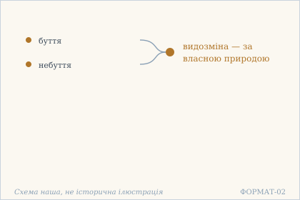
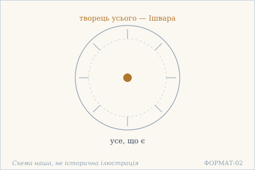
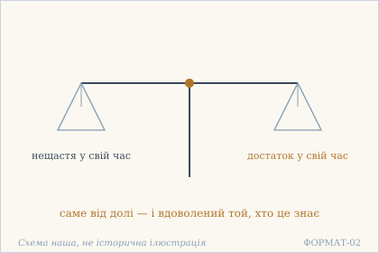
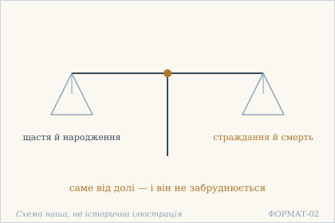
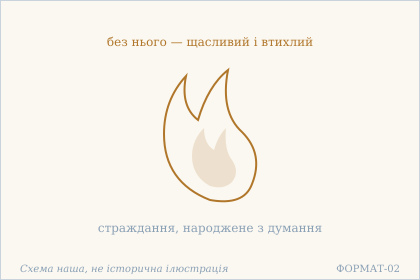
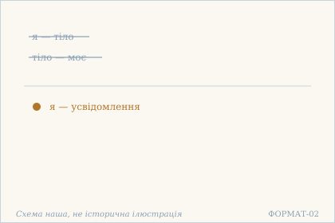
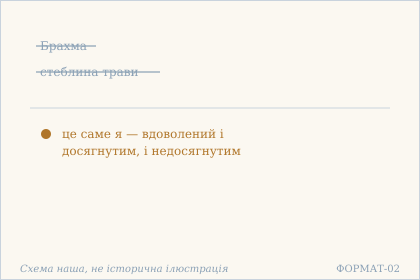
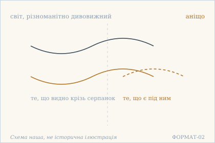

# Аштавакра-ґіта. Розділ 11. Наукове представлення

> Формат: `docs/FORMAT_V2.md`. Деванагарі — механічна транслітерація поля `iast`
> з картки (`scripts/iast_to_devanagari.py`), не окреме читання за рукописом.

## 11.1

**Деванагарі.** भावाभावविकारश् च स्वभावाद् इति निश्चयी | निर्विकारो गतक्लेशः सुखेनैवोपशाम्यति ||

**IAST.** bhāvābhāvavikāraś ca svabhāvād iti niścayī | nirvikāro gatakleśaḥ sukhenaivopaśāmyati ||

**Українська транслітерація.** бгавабгававікараш ча свабгавад іті нішчайі | нірвікаро ґатаклешах сукхенайвопашамьяті ||

**Переклад.** «Видозміна буття й небуття — за власною природою» — хто має таке переконання, той без видозмін, з минулими турбаціями, втихає легко.

**Коментар.** `niścayī` («той, хто має переконання») повторюється на початку 11.1–11.4 — це структурна формула всієї глави, і переклад має тримати її однаково. `nirvikāraḥ` уточнює: не «без змін» у сенсі нерухомості, а без **власних** видозмін від того, що змінюється назовні. `sukhena eva` («саме з легкістю») — втишення не коштує зусиль, і це важливо.

*Українська паралель (наша асоціація, не науковий консенсус).* Думка «все — за власною природою» близька до Сковородиного вчення про природу як міру в «Алфавіті»: речі рухаються не чужим наказом, а власним єством. Сковорода не знав санскриту; збіг типологічний.

**Ілюстрація.**  — Буття й небуття як видозміна за власною природою. Схема наша, не історична ілюстрація.

## 11.2

**Деванагарі.** ईश्वरः सर्वनिर्माता नेहान्य इति निश्चयी | अन्तर्गलितसर्वाशः शान्तः क्वापि न सज्जते ||

**IAST.** īśvaraḥ sarvanirmātā nehānya iti niścayī | antargalitasarvāśaḥ śāntaḥ kvāpi na sajjate ||

**Українська транслітерація.** ішварах сарванірмата неханья іті нішчайі | антарґалітасарвашах шантах квапі на садджате ||

**Переклад.** «Творець усього — Ішвара, і немає тут іншого» — хто має таке переконання, той із розчиненими всередині сподіваннями, втихлий, ніде не застрягає.

**Коментар.** Тут уперше й востаннє в книзі з'являється `īśvara` як творець — і одразу з запереченням іншого (`na iha anyaḥ`). Це не теологія, а спосіб зняти питання причини. `sajjate` — «застрягає, чіпляється»: наслідок не в тому, що людина стала всемогутньою, а в тому, що вона більше ні за що не тримається.

*Українська паралель (наша асоціація).* «Творець усього — Ішвара, і немає тут іншого» — позиція, яку Сковорода в «Наркісі» не приймає буквально: він шукає Бога не поза світом, а в глибині людини. Тут це подано як один із поглядів, які глава перелічує й відкидає.

**Ілюстрація.**  — Один творець у центрі, і немає тут іншого. Схема наша, не історична ілюстрація.

## 11.3

**Деванагарі.** आपदः संपदः काले दैवादेवेति निश्चयी | तृप्तः स्वस्थेन्द्रियो नित्यं न वाञ्छति न शोचति ||

**IAST.** āpadaḥ saṃpadaḥ kāle daivādeveti niścayī | tṛptaḥ svasthendriyo nityaṃ na vāñchati na śocati ||

**Українська транслітерація.** ападах сампадах кале дайвадеветі нішчайі | тріптах свастхендрійо нітьям на ванчхаті на шочаті ||

**Переклад.** «Нещастя й достаток у свій час — саме від долі» — хто має таке переконання, той вдоволений, із чуттями в порядку, повсякчас не бажає й не сумує.

**Коментар.** `daiva` — «доля» як те, що розподіляє, а не як примха. Формула «не бажає й не сумує» — та сама пара, що в 8.1–8.2, і переклад має її впізнавати. `svasthendriya` («із чуттями в порядку») — рідкісний складник: ідеться не про приборкання чуттів, а про їхню справність.

*Українська паралель (наша асоціація).* «Нещастя й достаток у свій час — від долі» — тон, знайомий із давньої української книжності, де плинність світу описують без докору: так само без злоби це сказано і в «Слові про змарніння світу».

**Ілюстрація.**  — Дві шальки: нещастя й достаток у свій час. Схема наша, не історична ілюстрація.

## 11.4

**Деванагарі.** सुखदुःखे जन्ममृत्यू दैवादेवेति निश्चयी | साध्यादर्शी निरायासः कुर्वन्नपि न लिप्यते ||

**IAST.** sukhaduḥkhe janmamṛtyū daivādeveti niścayī | sādhyādarśī nirāyāsaḥ kurvannapi na lipyate ||

**Українська транслітерація.** сукхадухкхе джанмамрітью дайвадеветі нішчайі | садгьядарші ніраясах курваннапі на ліпьяте ||

**Переклад.** «Щастя й страждання, народження й смерть — саме від долі» — хто має таке переконання, той, не бачачи нічого досяжного, без натуги, навіть діючи, не забруднюється.

**Коментар.** `sādhyādarśī` («той, хто не бачить досяжного») — найтонше слово глави: дія не припиняється, але зникає те, заради чого вона нібито робиться. `kurvann api na lipyate` — «навіть діючи, не забруднюється»: це не відмова від дії, а її розпредметнення. Перелік розширюється від 11.3 до 11.4 (додано народження й смерть), і це наростання навмисне.

*Українська паралель (наша асоціація).* «Щастя й страждання, народження й смерть — від долі» — те саме коло думок, що в народних думах: доля дана, і людина міряється з нею, а не сперечається. Наводимо як асоціацію за тоном, не за джерелом.

**Ілюстрація.**  — Дві шальки: народження й смерть, щастя й страждання. Схема наша, не історична ілюстрація.

## 11.5

**Деванагарі.** चिन्तया जायते दुःखं नान्यथेहेति निश्चयी | तया हीनः सुखी शान्तः सर्वत्र गलितस्पृहः ||

**IAST.** cintayā jāyate duḥkhaṃ nānyatheheti niścayī | tayā hīnaḥ sukhī śāntaḥ sarvatra galitaspṛhaḥ ||

**Українська транслітерація.** чінтая джаяте духкхам наньятхехеті нішчайі | тая хінах сукхі шантах сарватра ґалітаспріхах ||

**Переклад.** «Страждання народжується з думання, не інакше» — хто має таке переконання, той, позбавлений його, щасливий, втихлий, скрізь із опалою спрагою.

**Коментар.** `cintā` — не «думка» взагалі, а **турботливе обертання думки**, і саме воно назване джерелом страждання. Переклад «думання» тут кращий за «думка», бо остання звучить нейтрально. `galitaspṛha` («із опалою спрагою») — образ, який текст уже вживав у 11.2 (`antargalita`); словник лишається спільним.

*Українська паралель (наша асоціація).* «Страждання народжується з думання» — думка, близька до Лесиної Українки «Contra spem spero»: там біль теж описаний як те, що живе в думці, і саме тому піддається зміні.

**Ілюстрація.**  — Полумʼя, що живиться думанням. Схема наша, не історична ілюстрація.

## 11.6

**Деванагарі.** नाहं देहो न मे देहो बोधो ऽहम् इति निश्चयी | कैवल्यम् इव संप्राप्तो न स्मरत्य् अकृतं कृतम् ||

**IAST.** nāhaṃ deho na me deho bodho 'ham iti niścayī | kaivalyam iva saṃprāpto na smaraty akṛtaṃ kṛtam ||

**Українська транслітерація.** нахам дехо на ме дехо бодго ’хам іті нішчайі | кайвальям іва сампрапто на смарать акрітам крітам ||

**Переклад.** «Я не тіло, і тіло не моє; я — усвідомлення» — хто має таке переконання, той, наче досягши окремішності, не пам'ятає незробленого як зробленого.

**Коментар.** Формула «не тіло, і тіло не моє» та сама, що в 8.4 і 2.22 — тут вона подана як переконання, а не як висновок. `kaivalya` («окремішність») з'являється один раз і з `iva` («наче»): текст не каже, що стан досягнуто. `akṛtaṃ kṛtam` — «незроблене як зроблене»: ідеться не про забудькуватість, а про те, що минуле більше не рахується.

*Українська паралель (наша асоціація).* «Я не тіло, і тіло не моє; я — усвідомлення» — найближче місце до Сковородиного вчення про «внутрішню людину»: справжня людина не збігається з тілом і не залежить від нього.

**Ілюстрація.**  — Тіло й володіння тілом відкинуті: лишається усвідомлення. Схема наша, не історична ілюстрація.

## 11.7

**Деванагарі.** आब्रह्मस्तम्बपर्यन्तम् अहम् एवेति निश्चयी | निर्विकल्पः शुचिः शान्तः प्राप्ताप्राप्तविनिर्वृतः ||

**IAST.** ābrahmastambaparyantam aham eveti niścayī | nirvikalpaḥ śuciḥ śāntaḥ prāptāprāptavinirvṛtaḥ ||

**Українська транслітерація.** абрахмастамбапарьянтам ахам еветі нішчайі | нірвікалпах шучіх шантах праптапраптавінірврітах ||

**Переклад.** «Від Брахми до стеблини — це саме я» — хто має таке переконання, той без домислювання, чистий, втихлий, вдоволений і досягнутим, і недосягнутим.

**Коментар.** `ābrahmastambaparyantam` — та сама формула межі, що в 2.11 (`brahmādistambaparyantam`), і переклад має бути однаковий. `prāptāprāpta-vinirvṛta` — «вдоволений і досягнутим, і недосягнутим»: це не байдужість, а відсутність різниці між двома станами. `śuci` тут — не ритуальна чистота, а відсутність домішки, бо стоїть поруч із `nirvikalpa`.

*Українська паралель (наша асоціація).* «Від Брахми до стеблини — це саме я» — думка про всеприсутність, споріднена зі Сковородиною рівністю нерівного в «Наркісі»: ціле не більше за частку, бо міра в них одна.

**Ілюстрація.**  — Від Брахми до стеблини — це саме я. Схема наша, не історична ілюстрація.

## 11.8

**Деванагарі.** नानाश्चर्यम् इदं विश्वं न किञ्चिद् इति निश्चयी | निर्वासनः स्फूर्तिमात्रो न किञ्चिद् इव शाम्यति ||

**IAST.** nānāścaryam idaṃ viśvaṃ na kiñcid iti niścayī | nirvāsanaḥ sphūrtimātro na kiñcid iva śāmyati ||

**Українська транслітерація.** нанашчарьям ідам вішвам на кінчід іті нішчайі | нірвасанах спхуртіматро на кінчід іва шамьяті ||

**Переклад.** «Цей світ, різноманітно дивовижний, — аніщо» — хто має таке переконання, той без усталених схильностей, саме лише сяйнування, втихає, наче аніщо.

**Коментар.** Глава закінчується тим самим словом, що й почалася в 11.1: `niścayī`, але тепер воно стоїть при «аніщо». `nirvāsana` («без усталених схильностей») — те саме `vāsanā`, що в 9.8; словник спільний. `sphūrtimātra` («саме лише сяйнування») і `na kiñcid iva` («наче аніщо») разом дають обережність, яку легко втратити: текст не каже, що людина зникає, — він каже «наче».

*Українська паралель (наша асоціація).* «Цей світ, різноманітно дивовижний, — аніщо» — завершальний жест глави, той самий, що в епітафії Сковороди: світ не переможений, а просто не має чим утримати.

**Ілюстрація.**  — Дивовижний світ під серпанком: аніщо. Схема наша, не історична ілюстрація.
