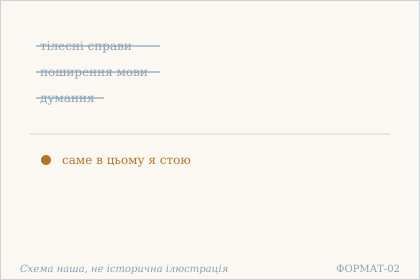
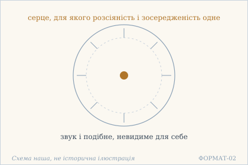
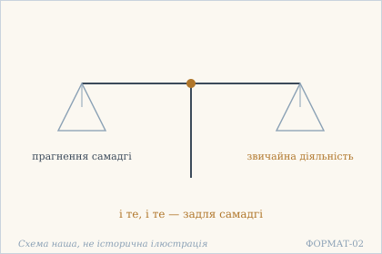
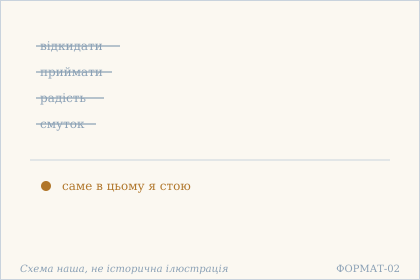
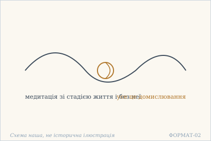
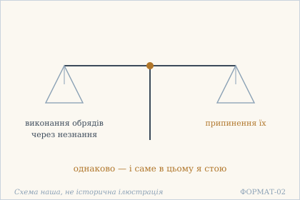
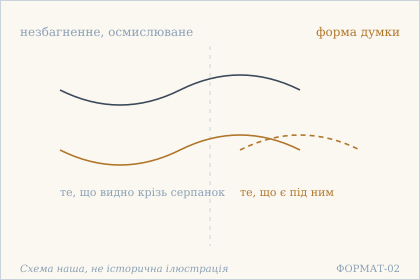
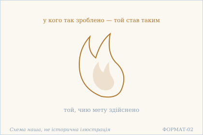

# Аштавакра-ґіта. Глава 12. Наукове представлення

> ФОРМАТ-02: кожен вірш подано пʼятьма шарами — деванагарі, українська
> транслітерація, переклад, науковий коментар з українськими паралелями,
> ілюстрація. Плюс окремо — поетичний переклад (`poetychnyi/rozdil-12.md`).
>
> **Деванагарі тут — механічна** транслітерація поля `iast` з картки
> (`scripts/iast_to_devanagari.py`), а не окреме читання за рукописом.
> **Українська транслітерація** — теж механічна (`scripts/iast_to_ukrainian.py`,
> таблиця в `docs/TRANSLITERATSIIA.md`).
> **Українські паралелі** — наша інтерпретація, а не твердження про вплив;
> реєстр і правила — `paraleli.json` і `scripts/check_ukrainian_parallels.py`.
> **Схеми** — наші власні; жодна не є історичною ілюстрацією.
>
> Цей файл згенеровано; правити треба картки й `format-v2/rozdil-12.json`,
> а не його.

## Глава 12. Саме в цьому я стою

Дванадцята глава вся закінчується тими самими словами — саме в цьому я стою, — і цей рефрен тут не приспів, а мірило: кожен вірш спершу перелічує, чого людина вже не робить, і лише потім каже, де вона стоїть. Перші три вірші йдуть від тіла до мови й далі до думки; наступні три знімають пари — приймати й відкидати, обряд і його припинення. Останній вірш не додає нічого нового: він просто називає того, хто так стоїть.

## 12.1

**Деванагарі.** कायकृत्यासहः पूर्वं ततो वाग्विस्तरासहः । अथ चिन्तासहस्तस्माद् एवम् एवाहम् आस्थितः ॥

**Українська транслітерація.** каякрітясахах пурвам тато ваґвістарасахах | атха чінтасахастасмад евам евахам астхітах ||

**Переклад.** Спершу нездатний до тілесних справ, потім нездатний до поширення мови, далі нездатний до думання — тому саме в цьому я стою.

**Построкове зіставлення (редакторська чернетка, не рецензовано).**

### Рядок а

**Деванагарі (механічно з IAST).** कायकृत्यासहः पूर्वं ततो वाग्विस्तरासहः

**IAST (з редакторської картки).** kāyakṛtyāsahaḥ pūrvaṃ tato vāgvistarāsahaḥ

**Українська транслітерація (механічна).** каякрітясахах пурвам тато ваґвістарасахах

**Український відповідник рядка.** Спершу нездатний до тілесних справ, потім нездатний до поширення мови,

**Коментар рядка (не рецензовано).** Форми kāyakṛtyāsahaḥ («нездатний до тілесних справ») і vāgvistarāsahaḥ («нездатний до розгортання мовлення») паралельні; pūrvaṃ та tataḥ послідовно означують «спершу» і «потім». Повтор asahaḥ описує неспроможність або неможливість витримати дію, а не окрему обітницю мовчання. Це граматичне спостереження, не діагноз і не соціальний припис.

### Рядок б

**Деванагарі (механічно з IAST).** अथ चिन्तासहस्तस्माद् एवम् एवाहम् आस्थितः

**IAST (з редакторської картки).** atha cintāsahastasmād evam evāham āsthitaḥ

**Українська транслітерація (механічна).** атха чінтасахастасмад евам евахам астхітах

**Український відповідник рядка.** далі нездатний до думання — тому саме в цьому я стою.

**Коментар рядка (не рецензовано).** atha вводить наступний крок, cintāsahaḥ — «нездатний до думання», tasmāt — «тому». Формула evam evāham āsthitaḥ («саме в цьому я стою») повертає мовця від переліку нездійснюваних дій до власного стану. У GRETIL і SARIT відрізняється розміщення меж слів при записі сандгі; критичну первинність жодного електронного запису тут не встановлено.

**Науковий коментар.** Тут відмова йде **не за бажанням, а через неспроможність**: `asahaḥ` — «нездатний витримати», а не «той, хто відмовився». Це рідкісний для тексту випадок, коли стан описано знизу — через те, чого людина вже не може. Формула `evam evāham āsthitaḥ` повторюється в 12.1–12.4, як `niścayī` у главі 11: переклад мусить тримати її однаково.

**Українська паралель (наша інтерпретація, не твердження про вплив).** *Василь Стус*, «Час творчості». Наша паралель: у Стуса нездатність до звичних справ теж постає не як втрата, а як те, у чому людина нарешті стоїть. Наше порівняння — типологічне.

**Ілюстрація.**  — Нездатність до тіла, мови й думки — і стояння в цьому. Схема наша, не історична ілюстрація.

## 12.2

**Деванагарі.** प्रीत्यभावेन शब्दादेर् अदृश्यत्वेन चात्मनः । विक्षेपैकाग्र्यहृदय एवम् एवाहम् आस्थितः ॥

**Українська транслітерація.** прітябгавена шабдадер адрішятвена чатманах | вікшепайкаґр'яхрідая евам евахам астхітах ||

**Переклад.** Через відсутність прихильності до звуку й подібного та через невидимість його для самого себе — серце, для якого розсіяність і зосередженість одне — саме в цьому я стою.

**Науковий коментар.** `vikṣepa-aikāgrya` в одному складнику — найважливіше місце вірша: розсіяність і зосередженість названі **одним** словом, і це не поетична вільність, а твердження, що для того, хто стоїть у собі, різниці між ними немає. `adṛśyatva` («невидимість») стосується `ātman` — себе не видно собі як об'єкт.

**Українська паралель (наша інтерпретація, не твердження про вплив).** *Леся Українка*, «У пущі» (1909). Наша паралель: у Лесі Українки зосередженість і розсіяність теж виявляються одним станом, а не двома. Наше порівняння — за будовою думки.

**Ілюстрація.**  — Серце в центрі: розсіяність і зосередженість — одне. Схема наша, не історична ілюстрація.

## 12.3

**Деванагарі.** समाध्यासादिविक्षिप्तौ व्यवहारः समाधये । एवं विलोक्य नियमम् एवम् एवाहम् आस्थितः ॥

**Українська транслітерація.** самадгясадівікшіптау в'явахарах самадгає | евам вілокя ніямам евам евахам астхітах ||

**Переклад.** Коли розсіяність походить від прагнення самадгі та подібного, то й звичайна діяльність — задля самадгі. Так побачивши це правило, саме в цьому я стою.

**Науковий коментар.** Найдошкульніший вірш глави: **прагнення самадгі саме стає розсіяністю** (`vikṣipti`). І далі — іронія, яку легко проґавити: якщо навіть буденна діяльність робиться «задля самадгі», то правило (`niyama`) виявляється всеохопним, і виходу з нього немає. Переклад мусить зберегти цю замкненість, а не зробити з неї пораду.

**Українська паралель (ПОТРЕБУЄ ПЕРЕВІРКИ).** *українська релігійна проза*, не визначено. ПОТРЕБУЄ ПЕРЕВІРКИ: думка, що звичайна діяльність і самадгі — одне, близька до української релігійної прози, але конкретного твору ми не звірили.

**Ілюстрація.**  — Дві шальки: прагнення самадгі й звичайна діяльність. Схема наша, не історична ілюстрація.

## 12.4

**Деванагарі.** हेयोपादेयविरहाद् एवं हर्षविषादयोः । अभावाद् अद्य हे ब्रह्मन् नेवम् एवाहम् आस्थितः ॥

**Українська транслітерація.** хейопадеявірахад евам харшавішадайох | абгавад адя хе брахман невам евахам астхітах ||

**Переклад.** Через відсутність того, що відкидати й приймати, а отже — через відсутність радості й смутку, нині, о Брахмане, саме в цьому я стою.

**Науковий коментар.** `he brahman` — звертання до Джанаки як до брахмана, єдине таке в розділі. Ланцюг причинний: немає пари «відкидати/приймати» → немає радості й смутку → нема чого досягати. **Відкрите питання:** у SARIT наприкінці стоїть `nevamevāhamāsthitaḥ` (sandhi `na + evameva`), і я прочитав це як ствердне `evameva` за паралелізмом. Перевірка решти глави це підтверджує лише частково: 12.5, 12.6 і 12.7 усі закінчуються на `evamevāhamāsthitaḥ` **без** `na`, тобто 12.4 — єдиний виняток у главі. Отже `na` може бути або справжнім (і тоді сенс вірша протилежний), або помилкою транскрипції. **GRETIL недоступний, другого свідка немає** — картка лишається чернеткою, а не «перевірено».

**Українська паралель (наша інтерпретація, не твердження про вплив).** *Ліна Костенко*, «Маруся Чурай» (1979). Наша паралель: у Костенко теж є стан, у якому немає що відкидати й немає чого приймати, і саме в ньому людина стоїть. Наше порівняння — типологічне.

**Ілюстрація.**  — Відкидання й приймання, радість і смуток відкинуті. Схема наша, не історична ілюстрація.

## 12.5

**Деванагарі.** आश्रमानाश्रमं ध्यानं चित्तस्वीकृतवर्जनम् । विकल्पं मम वीक्ष्य एतैर् एवम् एवाहम् आस्थितः ॥

**Українська транслітерація.** ашраманашрамам дгянам чіттасвікрітаварджанам | вікалпам мама вікшя етайр евам евахам астхітах ||

**Переклад.** Медитація зі стадією життя і без неї, прийняття й відкидання, зроблені умом, — усе це домислювання. Побачивши це в собі, через саме це я так стою.

**Науковий коментар.** Єдине місце в книзі, де `āśrama` (стадія життя) названо **поряд з її відсутністю** — і обидва варіанти відкинуті як `vikalpa`. Це важливо для нашого словника: текст не обирає між «життям у стадії» і «поза нею», він знімає саму пару. `citta-svīkṛta-varjana` — прийняття й відкидання не речей, а **вироблені умом**; переклад мусить зберегти, що йдеться про акт ума, а не про оцінку світу.

**Українська паралель (ПОТРЕБУЄ ПЕРЕВІРКИ).** *українська філософська проза*, не визначено. ПОТРЕБУЄ ПЕРЕВІРКИ: думка, що медитація й обряди є домислом, найближча до української філософської прози, але назвати твір без звірки ми не можемо.

**Ілюстрація.**  — Вузол домислу: медитація й обряд. Схема наша, не історична ілюстрація.

## 12.6

**Деванагарі.** कर्मानुष्ठानम् अज्ञानाद् यथैव उपरमस् तथा । बुद्ध्वा सम्यग् इदं तत्त्वम् एवम् एवाहम् आस्थितः ॥

**Українська транслітерація.** кармануштханам аджнянад ятхайва упарамас татха | буддгва сам'яґ ідам таттвам евам евахам астхітах ||

**Переклад.** Виконання обрядів через незнання і припинення їх — однаково. Зрозумівши правильно цю суть, я так стою.

**Науковий коментар.** `yathaiva … tathā` («так само») ставить дію й відмову від дії на один рівень — і обидві названі `ajñāna`, коли виходять із незнання. Це не заклик припинити обряди: текст каже, що припинення не краще за виконання. Переклад мусить звучати рівно, без інтонації «краще не робити».

**Українська паралель (ПОТРЕБУЄ ПЕРЕВІРКИ).** *українське бароко*, не визначено. ПОТРЕБУЄ ПЕРЕВІРКИ: рівність обряду й припинення обряду — думка, близька до барокової полеміки, але конкретного тексту ми не перевірили.

**Ілюстрація.**  — Дві шальки: обряд і його припинення — однаково. Схема наша, не історична ілюстрація.

## 12.7

**Деванагарі.** अचिन्त्यं चिन्त्यमानो ऽपि चिन्तारूपं भजत्य् असौ । त्यक्त्वा तद्भावनं तस्माद् एवम् एवाहम् आस्थितः ॥

**Українська транслітерація.** ачінтям чінтямано ’пі чінтарупам бгаджатй асау | тяктва тадбгаванам тасмад евам евахам астхітах ||

**Переклад.** Незбагненне, навіть коли його осмислюють, набирає форми думки. Тому, відкинувши те плекання, я так стою.

**Науковий коментар.** Механізм названий точно: незбагненне не залишається собою, коли його осмислюють — воно **набирає форми думки** (`cintārūpa`). Тому відкидається не предмет, а `bhāvana` — плекання, повторюване обертання. Це та сама `cintā`, що в 11.5, і словник має бути спільним.

**Українська паралель (наша інтерпретація, не твердження про вплив).** *Григорій Сковорода*, «Алфавіт, чи Буквар миру» (діалог). Наша паралель: у Сковороди незбагненне теж набирає форми думки, і саме тому його не можна втримати плеканням. Наше порівняння — типологічне.

**Ілюстрація.**  — Незбагненне під серпанком набирає форми думки. Схема наша, не історична ілюстрація.

## 12.8

**Деванагарі.** एवम् एव कृतं येन स कृतार्थो भवेद् असौ । एवम् एव स्वभावो यः स कृतार्थो भवेद् असौ ॥

**Українська транслітерація.** евам ева крітам єна са крітартхо бгавед асау | евам ева свабгаво ях са крітартхо бгавед асау ||

**Переклад.** У кого це так зроблено — той стає тим, чию мету здійснено; у кого така природа — той стає тим, чию мету здійснено.

**Науковий коментар.** Вірш повторює рядок двічі й міняє одне слово: `kṛtam` (зроблено) → `svabhāvaḥ` (природа). Це не тавтологія, а розрізнення: спершу те, що людина зробила, потім те, чим вона стала. `kṛtārtha` — «той, чию мету здійснено», усталене слово; переклад тримає його однаково в обох половинах. Глава закінчується не настановою, а констатацією.

**Українська паралель (наша інтерпретація, не твердження про вплив).** *Микола Зеров*, «Камена» (1924). Наша паралель: у Зерова завершеність теж постає як наслідок способу бачити, а не як наслідок зусилля. Наше порівняння — за будовою думки.

**Ілюстрація.**  — Полумʼя здійсненої мети. Схема наша, не історична ілюстрація.

## Поетичний переклад

Окремо, у [`poetychnyi/rozdil-12.md`](poetychnyi/rozdil-12.md). Це **наш поетичний переклад**, не канонічний і не науковий; у PDF він іде окремою частиною.
