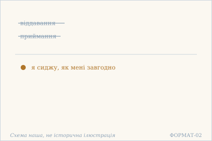
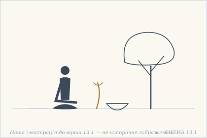
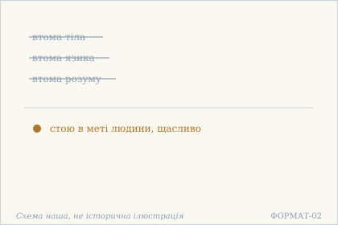
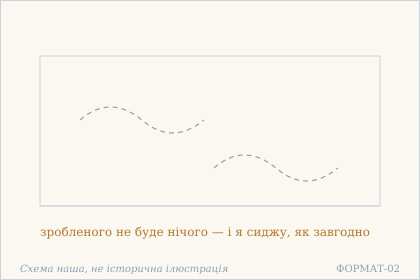
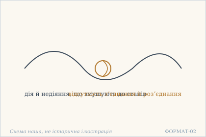
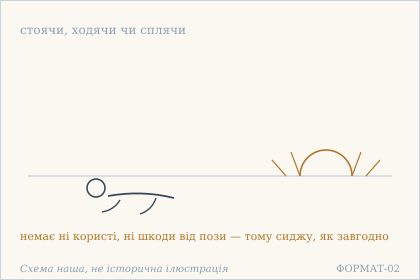
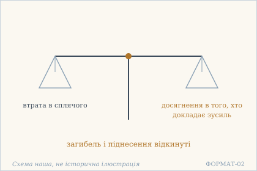
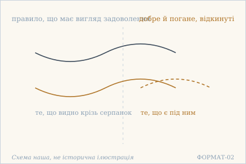

# Аштавакра-ґіта. Глава 13. Наукове представлення

> ФОРМАТ-02: кожен вірш подано пʼятьма шарами — деванагарі, українська
> транслітерація, переклад, науковий коментар з українськими паралелями,
> ілюстрація. Плюс окремо — поетичний переклад (`poetychnyi/rozdil-13.md`).
>
> **Деванагарі тут — механічна** транслітерація поля `iast` з картки
> (`scripts/iast_to_devanagari.py`), а не окреме читання за рукописом.
> **Українська транслітерація** — теж механічна (`scripts/iast_to_ukrainian.py`,
> таблиця в `docs/TRANSLITERATSIIA.md`).
> **Українські паралелі** — наша інтерпретація, а не твердження про вплив;
> реєстр і правила — `paraleli.json` і `scripts/check_ukrainian_parallels.py`.
> **Схеми** — наші власні; жодна не є історичною ілюстрацією.
> **Сцени** (`ilustratsii-naratyvni/`) — теж наші власні малюнки й теж не
> історичні: це ситуація вірша, а не поняття, і фігури там — силуети без
> облич.
>
> Цей файл згенеровано; правити треба картки й `format-v2/rozdil-13.json`,
> а не його.

## Глава 13. Я сиджу, як мені завгодно

Тринадцята глава — сім віршів і один рефрен, який стоїть у кінці кожного: я сиджу, як мені завгодно. Слово сиджу тут не про позу: глава саме й показує, що поза нічого не додає (13.5). Рефрен тримає іншу думку — що стан того, хто пізнав, не залежить ні від дії, ні від недіяння, і саме тому його не можна ані здобути, ані втратити.

## 13.1

**Деванагарі.** अकिंचनभवं स्वास्थ्यं कौपीनत्वे ऽपि दुर्लभम् । त्यागादाने विहायास्माद् अहम् आसे यथासुखम् ॥

**Українська транслітерація.** акімчанабгавам свастхям каупінатве ’пі дурлабгам | тяґадане віхаясмад ахам асе ятхасукхам ||

**Переклад.** Стан неволодіння — це бути в собі; навіть у жебрацькому поясі він рідкісний. Відкинувши віддавання й приймання, я сиджу, як мені завгодно.

**Построкове зіставлення (редакторська чернетка, не рецензовано).**

### Рядок а

**Деванагарі (механічно з IAST).** अकिंचनभवं स्वास्थ्यं कौपीनत्वे ऽपि दुर्लभम्

**IAST (з редакторської картки).** akiṃcanabhavaṃ svāsthyaṃ kaupīnatve 'pi durlabham

**Українська транслітерація (механічна).** акімчанабгавам свастхям каупінатве ’пі дурлабгам

**Український відповідник рядка.** Стан неволодіння — це бути в собі; навіть у жебрацькому поясі він рідкісний.

**Коментар рядка (не рецензовано).** akiṃcana-bhavaṃ називає стан неволодіння, а svāsthyaṃ — перебування у власному стані; це не медичне твердження про здоров’я. kaupīnatve 'pi durlabham підкреслює, що навіть зовнішня ознака аскези (стегнова пов’язка) не гарантує внутрішньої свободи.

### Рядок б

**Деванагарі (механічно з IAST).** त्यागादाने विहायास्माद् अहम् आसे यथासुखम्

**IAST (з редакторської картки).** tyāgādāne vihāyāsmād aham āse yathāsukham

**Українська транслітерація (механічна).** тяґадане віхаясмад ахам асе ятхасукхам

**Український відповідник рядка.** Відкинувши віддавання й приймання, я сиджу, як мені завгодно.

**Коментар рядка (не рецензовано).** tyāgādāne — пара «віддавання й приймання»; vihāya означає «відкинувши». Після неї aham āse yathāsukham — повторюваний рефрен глави («я сиджу, як мені завгодно»). Думка стосується ставлення до володіння, а не буквальної вимоги сидіти.

**Науковий коментар.** Найважливіше тут — svāsthya. Слово означає буквально «перебування в собі» і в сучасній мові значить «здоров'я»; у вірші воно вжите в першому сенсі, і це не метафора, а визначення: бути здоровим — значить бути в собі. Друга точність — kaupīna: жебрацький пояс названий не як приклад аскези, а як те, у чому svāsthya все одно рідкісне. Тобто зовнішня ознака відречення нічого не гарантує. Пара tyāga / ādāna («віддавання» / «приймання») — та сама, що heya / upādeya у 7.5, і тут її теж відкидають цілою, а не по частинах. РЕФРЕН ГЛАВИ. Шість із семи віршів (13.1, 13.3–13.7) закінчуються однаково: aham āse yathāsukham («я сиджу — як мені завгодно»). ās — не «бути», а саме СИДІТИ, перебувати на місці; yathāsukham — «як зручно, за бажанням». Разом це формула, яка скасовує будь-яку поставу як вимогу: не треба ні стояти, ні лежати правильно. 13.2 — єдиний вірш глави без цього рефрену, і його треба читати окремо.

**Українська паралель (наша інтерпретація, не твердження про вплив).** *Григорій Сковорода*, «Асхань. Симфонія, наречена книга Асхань, про пізнання самого себе». Наша паралель: у Сковороди бути в собі теж означає не мати нічого свого — і саме тому цей стан не залежить від достатку. Наше порівняння — типологічне.

**Ілюстрація.**  — Віддавання й приймання відкинуті: сиджу, як завгодно. Схема наша, не історична ілюстрація.

**Сцена.**  — Людина сидить під деревом, а жебрацький пояс і чаша лежать осторонь. Наша ілюстрація до вірша 13.1 — не історичне зображення.

## 13.2

**Деванагарі.** कुत्रापि खेदः कायस्य जिह्वा कुत्रापि खिद्यते । मनः कुत्रापि तत् त्यक्त्वा पुरुषार्थे स्थितः सुखम् ॥

**Українська транслітерація.** кутрапі кхедах каяся джіхва кутрапі кхідяте | манах кутрапі тат тяктва пурушартхе стхітах сукхам ||

**Переклад.** Десь втомлюється тіло, десь втомлюється язик, десь розум — відкинувши це, я стою в меті людини, щасливо.

**Построкове зіставлення (редакторська чернетка, не рецензовано).**

### Рядок а

**Деванагарі (механічно з IAST).** कुत्रापि खेदः कायस्य जिह्वा कुत्रापि खिद्यते

**IAST (з редакторської картки).** kutrāpi khedaḥ kāyasya jihvā kutrāpi khidyate

**Українська транслітерація (механічна).** кутрапі кхедах каяся джіхва кутрапі кхідяте

**Український відповідник рядка.** Десь втомлюється тіло, десь втомлюється язик,

**Коментар рядка (не рецензовано).** kutrāpi повторено двічі («десь»), зіставляючи khedaḥ kāyasya («втому тіла») та jihvā ... khidyate («втомлюється язик», тобто орган мовлення). Перший піврядок не містить ще висновку щодо того, що слід відкинути.

### Рядок б

**Деванагарі (механічно з IAST).** मनः कुत्रापि तत् त्यक्त्वा पुरुषार्थे स्थितः सुखम्

**IAST (з редакторської картки).** manaḥ kutrāpi tat tyaktvā puruṣārthe sthitaḥ sukham

**Українська транслітерація (механічна).** манах кутрапі тат тяктва пурушартхе стхітах сукхам

**Український відповідник рядка.** десь розум — відкинувши це, я стою в меті людини, щасливо.

**Коментар рядка (не рецензовано).** manaḥ kutrāpi додає третю сферу — розум; tat tyaktvā («відкинувши це») відсилає до названих утом. puruṣārthe sthitaḥ sukham — перебування в людській меті або її здійсненні, щасливо; це окрема думка, і вірш 13.2 не закінчується звичайним рефреном aham āse yathāsukham.

**Науковий коментар.** ЄДИНИЙ вірш глави без рефрену aham āse yathāsukham, і це не випадково: тут ідеться не про те, як сидіти, а про те, ЩО втомлюється. Три рівні названі поспіль — тіло, язик, розум — і кожен втомлюється «десь», тобто не завжди й не однаково. Слово kheda («втома») м'якше за duḥkha («страждання») з глави 8: це не біль, а зношування. puruṣārtha («мета людини») вжите в однині, хоч традиційно їх чотири, — тобто йдеться не про вибір між ними, а про те, що всі вони вже не потрібні.

**Українська паралель (наша інтерпретація, не твердження про вплив).** *Олександр Довженко*, «Щоденник» (1941–1956). Наша паралель: у Довженка втома тіла, мови й думки теж описується окремо, і саме розрізнення цих трьох втом показує, що людина не зводиться до жодної з них. Наше порівняння — за будовою думки.

**Ілюстрація.**  — Три втоми відкинуті: лишається мета людини. Схема наша, не історична ілюстрація.

## 13.3

**Деванагарі.** कृतं किम् अपि नैव स्याद् इति संचिन्त्य तत्त्वतः । यदा यत् कर्तुम् आयाति तत् कृत्वासे यथासुखम् ॥

**Українська транслітерація.** крітам кім апі найва сяд іті самчінтя таттватах | яда ят картум аяті тат крітвасе ятхасукхам ||

**Переклад.** Подумавши по-справжньому: «зробленого не буде нічого» — що б не випало зробити, зробивши те, я сиджу, як мені завгодно.

**Построкове зіставлення (редакторська чернетка, не рецензовано).**

### Рядок а

**Деванагарі (механічно з IAST).** कृतं किम् अपि नैव स्याद् इति संचिन्त्य तत्त्वतः

**IAST (з редакторської картки).** kṛtaṃ kim api naiva syād iti saṃcintya tattvataḥ

**Українська транслітерація (механічна).** крітам кім апі найва сяд іті самчінтя таттватах

**Український відповідник рядка.** Подумавши по-справжньому: «зробленого не буде нічого» —

**Коментар рядка (не рецензовано).** kṛtaṃ kim api naiva syād задає заперечення результату дії; iti saṃcintya tattvataḥ означає «так розваживши по суті». Оптатив syāt не варто без пояснення підмінювати твердженням, що жодна дія фізично не відбувається.

### Рядок б

**Деванагарі (механічно з IAST).** यदा यत् कर्तुम् आयाति तत् कृत्वासे यथासुखम्

**IAST (з редакторської картки).** yadā yat kartum āyāti tat kṛtvāse yathāsukham

**Українська транслітерація (механічна).** яда ят картум аяті тат крітвасе ятхасукхам

**Український відповідник рядка.** що б не випало зробити, зробивши те, я сиджу, як мені завгодно.

**Коментар рядка (не рецензовано).** yadā yat kartum āyāti описує те, що випадає зробити; tat kṛtvāse поєднує «зробивши те» з «сиджу». Рефрен yathāsukham збережено у чинному перекладі: відсутність привласнення результату не заперечує самого виконання дії.

**Науковий коментар.** Парадокс у тому, що дія не скасовується: yadā yat kartum āyāti («коли що випадає зробити») — дієслово āyāti означає саме те, що приходить само, без запрошення. Отже, діють, але без того, хто міг би зарахувати її собі. kṛtvāse — злитна форма kṛtvā + āse, і в ній дві дії стоять впритул: зробивши — сиджу. Умова naiva syāt («нехай не буде») стоїть у optativus, тобто це не констатація, а спосіб бачення, прийнятий заздалегідь. РЕФРЕН ГЛАВИ. Шість із семи віршів (13.1, 13.3–13.7) закінчуються однаково: aham āse yathāsukham («я сиджу — як мені завгодно»). ās — не «бути», а саме СИДІТИ, перебувати на місці; yathāsukham — «як зручно, за бажанням». Разом це формула, яка скасовує будь-яку поставу як вимогу: не треба ні стояти, ні лежати правильно. 13.2 — єдиний вірш глави без цього рефрену, і його треба читати окремо.

**Українська паралель (ПОТРЕБУЄ ПЕРЕВІРКИ).** *українська філософська лірика*, не визначено. ПОТРЕБУЄ ПЕРЕВІРКИ: думка, що зробленого не буде нічого, близька до української філософської лірики, але конкретного твору ми не звірили.

**Ілюстрація.**  — Небо без хмар: зробленого не буде нічого. Схема наша, не історична ілюстрація.

## 13.4

**Деванагарі.** कर्मनैष्कर्म्यनिर्बन्धभावा देहस्थयोगिनः । संयोगायोगविरहाद् अहम् आसे यथासुखम् ॥

**Українська транслітерація.** карманайшкарм'янірбандгабгава дехастхайоґінах | самйоґайоґавірахад ахам асе ятхасукхам ||

**Переклад.** У йога, що перебуває в тілі, є стани, до яких його змушують дія й недіяння; та через відсутність з'єднання й роз'єднання я сиджу, як мені завгодно.

**Построкове зіставлення (редакторська чернетка, не рецензовано).**

### Рядок а

**Деванагарі (механічно з IAST).** कर्मनैष्कर्म्यनिर्बन्धभावा देहस्थयोगिनः

**IAST (з редакторської картки).** karmanaiṣkarmyanirbandhabhāvā dehasthayoginaḥ

**Українська транслітерація (механічна).** карманайшкарм'янірбандгабгава дехастхайоґінах

**Український відповідник рядка.** У йога, що перебуває в тілі, є стани, до яких його змушують дія й недіяння;

**Коментар рядка (не рецензовано).** Складне слово karmanaiṣkarmyanirbandhabhāvā зіставляє дію (karma), недіяння (naiṣkarmya) й наполягання або примус (nirbandha); dehasthayoginaḥ вказує на йога, який перебуває в тілі. Це твердження про напругу між двома способами поведінки, а не доказ певної історичної школи.

### Рядок б

**Деванагарі (механічно з IAST).** संयोगायोगविरहाद् अहम् आसे यथासुखम्

**IAST (з редакторської картки).** saṃyogāyogavirahād aham āse yathāsukham

**Українська транслітерація (механічна).** самйоґайоґавірахад ахам асе ятхасукхам

**Український відповідник рядка.** та через відсутність з'єднання й роз'єднання я сиджу, як мені завгодно.

**Коментар рядка (не рецензовано).** saṃyogāyogavirahād — аблативна конструкція з ідеєю відсутності з'єднання й нез'єднання. Далі aham āse yathāsukham повертає рефрен особистого перебування; не слід перетворювати це на припис відмовитися від щоденних обов’язків.

**Науковий коментар.** Слово nirbandha («змушування») — ключове: доки є тіло, є й примус то до дії, то до недіяння, і жоден вибір не вільний. saṃyoga / ayoga («з'єднання» / «роз'єднання») — пара з мови йоги, де з'єднання зазвичай означає зв'язок з об'єктом; тут відкидається сама можливість такого зв'язку. Зверни увагу на порядок: спершу визнано примус (він є), потім названо те, чого немає (з'єднання). Вірш не обіцяє свободи від тіла — лише від рахунку. РЕФРЕН ГЛАВИ. Шість із семи віршів (13.1, 13.3–13.7) закінчуються однаково: aham āse yathāsukham («я сиджу — як мені завгодно»). ās — не «бути», а саме СИДІТИ, перебувати на місці; yathāsukham — «як зручно, за бажанням». Разом це формула, яка скасовує будь-яку поставу як вимогу: не треба ні стояти, ні лежати правильно. 13.2 — єдиний вірш глави без цього рефрену, і його треба читати окремо.

**Українська паралель (ПОТРЕБУЄ ПЕРЕВІРКИ).** *українська релігійна проза*, не визначено. ПОТРЕБУЄ ПЕРЕВІРКИ: розрізнення з'єднання й роз'єднання як того, що змушує людину до станів, найближче до української релігійної прози, але назвати твір без звірки ми не можемо.

**Ілюстрація.**  — Вузол дії й недіяння розвʼязано. Схема наша, не історична ілюстрація.

## 13.5

**Деванагарі.** अर्थानर्थौ न मे स्थित्या गत्या न शयनेन वा । तिष्ठन् गच्छन् स्वपन् तस्माद् अहम् आसे यथासुखम् ॥

**Українська транслітерація.** артханартхау на ме стхітя ґатя на шаянена ва | тіштхан ґаччан свапан тасмад ахам асе ятхасукхам ||

**Переклад.** Ні користі, ні шкоди немає мені від стояння, ходіння чи лежання — тому, стоячи, ходячи чи сплячи, я сиджу, як мені завгодно.

**Построкове зіставлення (редакторська чернетка, не рецензовано).**

### Рядок а

**Деванагарі (механічно з IAST).** अर्थानर्थौ न मे स्थित्या गत्या न शयनेन वा

**IAST (з редакторської картки).** arthānarthau na me sthityā gatyā na śayanena vā

**Українська транслітерація (механічна).** артханартхау на ме стхітя ґатя на шаянена ва

**Український відповідник рядка.** Ні користі, ні шкоди немає мені від стояння, ходіння чи лежання —

**Коментар рядка (не рецензовано).** arthānarthau — двоїна «користь і шкода»; sthityā, gatyā, śayanena — орудні форми «стоянням, рухом, лежанням». Це оцінка способів тілесного перебування, а не заборона ходити чи лежати.

### Рядок б

**Деванагарі (механічно з IAST).** तिष्ठन् गच्छन् स्वपन् तस्माद् अहम् आसे यथासुखम्

**IAST (з редакторської картки).** tiṣṭhan gacchan svapan tasmād aham āse yathāsukham

**Українська транслітерація (механічна).** тіштхан ґаччан свапан тасмад ахам асе ятхасукхам

**Український відповідник рядка.** тому, стоячи, ходячи чи сплячи, я сиджу, як мені завгодно.

**Коментар рядка (не рецензовано).** tiṣṭhan, gacchan, svapan — три дієприкметники «стоячи, йдучи, сплячи»; tasmād — «тому». Слідом aham āse yathāsukham зберігає словесний парадокс «сиджу» попри зміну постави; рефрен уособлює сталість внутрішнього ставлення, а не конкретну фізичну позу.

**Науковий коментар.** Найгостріший парадокс глави, і він у самій граматиці: три дієприкметники (tiṣṭhan, gacchan, svapan — «стоячи, ходячи, сплячи») стоять поруч із дієсловом āse («сиджу»). Формально це суперечність, і вона навмисна: ās тут уже не про поставу тіла, а про перебування взагалі. Пара artha / anartha («користь» / «шкода») — та сама, що в 7.2 vṛddhi / kṣati, і знову відкидається цілою: не «немає шкоди», а немає ні того, ні того. РЕФРЕН ГЛАВИ. Шість із семи віршів (13.1, 13.3–13.7) закінчуються однаково: aham āse yathāsukham («я сиджу — як мені завгодно»). ās — не «бути», а саме СИДІТИ, перебувати на місці; yathāsukham — «як зручно, за бажанням». Разом це формула, яка скасовує будь-яку поставу як вимогу: не треба ні стояти, ні лежати правильно. 13.2 — єдиний вірш глави без цього рефрену, і його треба читати окремо.

**Українська паралель (наша інтерпретація, не твердження про вплив).** *Василь Стефаник*, «Камінний хрест» (1900). Наша паралель: у Стефаника тілесне положення людини теж не міняє того, що з нею сталося всередині. Наше порівняння — типологічне.

**Ілюстрація.**  — Людина під зайшлим сонцем: поза не додає ні користі, ні шкоди. Схема наша, не історична ілюстрація.

## 13.6

**Деванагарі.** स्वपतो नास्ति मे हानिः सिद्धिर् यत्नवतो न वा । नाशोल्लासौ विहायास्माद् अहम् आसे यथासुखम् ॥

**Українська транслітерація.** свапато насті ме ханіх сіддгір ятнавато на ва | нашолласау віхаясмад ахам асе ятхасукхам ||

**Переклад.** У сплячого немає мені втрати, як і немає досягнення в того, хто докладає зусиль; відкинувши загибель і піднесення, я сиджу, як мені завгодно.

**Построкове зіставлення (редакторська чернетка, не рецензовано).**

### Рядок а

**Деванагарі (механічно з IAST).** स्वपतो नास्ति मे हानिः सिद्धिर् यत्नवतो न वा

**IAST (з редакторської картки).** svapato nāsti me hāniḥ siddhir yatnavato na vā

**Українська транслітерація (механічна).** свапато насті ме ханіх сіддгір ятнавато на ва

**Український відповідник рядка.** У сплячого немає мені втрати, як і немає досягнення в того, хто докладає зусиль;

**Коментар рядка (не рецензовано).** svapataḥ (у сандгі svapato) — родовий однини дієприкметника «той, хто спить»; na asti — «немає»; me — «мені / в мене»; hāniḥ — «втрата». siddhiḥ (у сандгі siddhir) — «успіх, досягнення»; yatnavataḥ (у сандгі yatnavato) — «того, хто докладає зусиль»; na vā завершує заперечення щодо досягнення. Це не наказ спати або відмовитися від праці: рядок зіставляє дві оцінки — втрату й здобуток.

### Рядок б

**Деванагарі (механічно з IAST).** नाशोल्लासौ विहायास्माद् अहम् आसे यथासुखम्

**IAST (з редакторської картки).** nāśollāsau vihāyāsmād aham āse yathāsukham

**Українська транслітерація (механічна).** нашолласау віхаясмад ахам асе ятхасукхам

**Український відповідник рядка.** відкинувши загибель і піднесення, я сиджу, як мені завгодно.

**Коментар рядка (не рецензовано).** nāśa-ullāsau — двоїна, «загибель і піднесення»; vihāya — дієприслівникова форма «відкинувши». Форма vihāyāsmād передає злиття vihāya + asmāt («від цього / тому»); точний синтаксичний зв'язок варто окремо перевірити за друкованими джерелами. aham āse yathāsukham — «я сиджу, як мені завгодно». Рефрен глави не скасовує потреби уважно розглядати межу слів і сандгі.

**Науковий коментар.** Вірш будується на запереченні двох протилежних чеснот: сон не шкодить, зусилля не дає. Тим самим знімається сама вісь, на якій тримається будь-яка практика, — «старанність». ullāsa («піднесення») — слово з відтінком радості, не просто зростання; у парі з nāśa («загибель») воно описує не події, а те, як людина їх переживає. Порівняй 3.9, де похвала й мука були описані однією граматичною формою: тут той самий хід, але на рівні оцінки. РЕФРЕН ГЛАВИ. Шість із семи віршів (13.1, 13.3–13.7) закінчуються однаково: aham āse yathāsukham («я сиджу — як мені завгодно»). ās — не «бути», а саме СИДІТИ, перебувати на місці; yathāsukham — «як зручно, за бажанням». Разом це формула, яка скасовує будь-яку поставу як вимогу: не треба ні стояти, ні лежати правильно. 13.2 — єдиний вірш глави без цього рефрену, і його треба читати окремо.

**Українська паралель (наша інтерпретація, не твердження про вплив).** *Ліна Костенко*, «Берестечко» (1999). Наша паралель: у Костенко теж є стан, у якому ні сон, ні зусилля не дають ні втрати, ні досягнення. Наше порівняння — за будовою думки.

**Ілюстрація.**  — Дві шальки: втрата й досягнення — обидві відкинуті. Схема наша, не історична ілюстрація.

## 13.7

**Деванагарі.** सुखादिरूपा नियमं भावेष्व् आलोक्य भूरिशः । शुभाशुभे विहायास्माद् अहम् आसे यथासुखम् ॥

**Українська транслітерація.** сукхадірупа ніямам бгавешв алокя бгурішах | шубгашубге віхаясмад ахам асе ятхасукхам ||

**Переклад.** Побачивши не раз у всіх станах те правило, що має вигляд задоволення, — відкинувши добре й погане, я сиджу, як мені завгодно.

**Построкове зіставлення (редакторська чернетка, не рецензовано).**

### Рядок а

**Деванагарі (механічно з IAST).** सुखादिरूपा नियमं भावेष्व् आलोक्य भूरिशः

**IAST (з редакторської картки).** sukhādirūpā niyamaṃ bhāveṣv ālokya bhūriśaḥ

**Українська транслітерація (механічна).** сукхадірупа ніямам бгавешв алокя бгурішах

**Український відповідник рядка.** Побачивши не раз у всіх станах те правило, що має вигляд задоволення, —

**Коментар рядка (не рецензовано).** bhāveṣv — місцевий множини «у станах»; ālokya — дієприслівникова форма «побачивши»; bhūriśaḥ — «багаторазово». Чинна IAST-картка має niyamaṃ («правило»), що відображено в її українському перекладі; SARIT має aniyamaṃ («відсутність правила»). Це змістове різночитання не розв'язано, а sukhādirūpā також має проблемне граматичне узгодження. Построковість фіксує читання картки, не видає його за доведений оригінал.

### Рядок б

**Деванагарі (механічно з IAST).** शुभाशुभे विहायास्माद् अहम् आसे यथासुखम्

**IAST (з редакторської картки).** śubhāśubhe vihāyāsmād aham āse yathāsukham

**Українська транслітерація (механічна).** шубгашубге віхаясмад ахам асе ятхасукхам

**Український відповідник рядка.** відкинувши добре й погане, я сиджу, як мені завгодно.

**Коментар рядка (не рецензовано).** śubhāśubhe — двоїна «добре й погане»; vihāya — «відкинувши»; у vihāyāsmād видно сандгі з asmāt («із цього / тому»). aham āse — «я сиджу», а yathāsukham — «як мені зручно». Це повторюваний фінал глави 13, але він не вирішує різночитання niyamaṃ / aniyamaṃ у першому піврядку.

**Науковий коментар.** Найважче місце глави, і не через сенс, а через текст. Свідки розходяться в одному слові: SARIT подає aniyamaṃ («безладдя, відсутність правила»), GRETIL — niyamaṃ («правило»). Сенс при цьому стає ПРОТИЛЕЖНИМ: побачити, що все, що має вигляд задоволення, насправді безладдя — або що воно підлягає правилу. Крім того, форма sukhādirūpā (жіночий рід, однина) не узгоджується ні з niyamaṃ/aniyamaṃ (середній рід), ні з bhāveṣu (множина, чоловічий/середній). Найімовірніше, обидва свідки успадкували зіпсоване читання, і правильним було sukhādirūpāṇi (середній рід, множина) — «речі, чия подоба — задоволення тощо». У перекладі взято читання SARIT, але це ВИБІР, а не розв'язання: потрібен третій свідок. РЕФРЕН ГЛАВИ. Шість із семи віршів (13.1, 13.3–13.7) закінчуються однаково: aham āse yathāsukham («я сиджу — як мені завгодно»). ās — не «бути», а саме СИДІТИ, перебувати на місці; yathāsukham — «як зручно, за бажанням». Разом це формула, яка скасовує будь-яку поставу як вимогу: не треба ні стояти, ні лежати правильно. 13.2 — єдиний вірш глави без цього рефрену, і його треба читати окремо.

**Українська паралель (ПОТРЕБУЄ ПЕРЕВІРКИ).** *українська барокова поезія*, не визначено. ПОТРЕБУЄ ПЕРЕВІРКИ: правило, що має вигляд задоволення, близьке до барокового мотиву оманливої втіхи, але конкретного тексту ми не перевірили.

**Ілюстрація.**  — Серпанок задоволення: під ним — добре й погане. Схема наша, не історична ілюстрація.

## Поетичний переклад

Окремо, у [`poetychnyi/rozdil-13.md`](poetychnyi/rozdil-13.md). Це **наш поетичний переклад**, не канонічний і не науковий; у PDF він іде окремою частиною.
