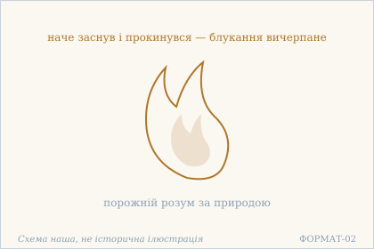
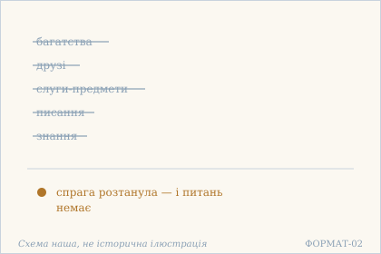
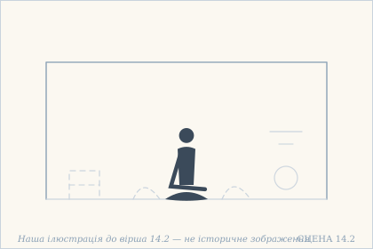
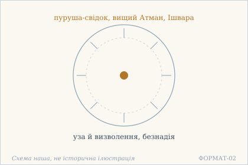
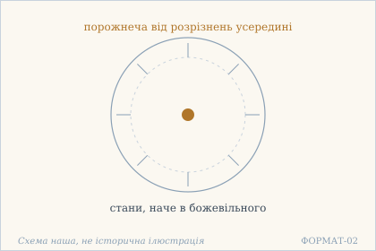

# Аштавакра-ґіта. Глава 14. Наукове представлення

> ФОРМАТ-02: кожен вірш подано шістьма шарами — деванагарі, IAST, українська
> транслітерація, переклад, науковий коментар з українськими паралелями,
> ілюстрація. Плюс окремо — поетичний переклад (`poetychnyi/rozdil-14.md`).
>
> **IAST** — те, що записано в картці (поле `iast`), без редакторських
> поправок: це єдиний шар, який не перераховується скриптом.
> **Деванагарі тут — механічна** транслітерація поля `iast` з картки
> (`scripts/iast_to_devanagari.py`), а не окреме читання за рукописом.
> **Українська транслітерація** — теж механічна (`scripts/iast_to_ukrainian.py`,
> таблиця в `docs/TRANSLITERATSIIA.md`).
> **Українські паралелі** — наша інтерпретація, а не твердження про вплив;
> реєстр і правила — `paraleli.json` і `scripts/check_ukrainian_parallels.py`.
> **Схеми** — наші власні; жодна не є історичною ілюстрацією.
> **Сцени** (`ilustratsii-naratyvni/`) — теж наші власні малюнки й теж не
> історичні: це ситуація вірша, а не поняття, і фігури там — силуети без
> облич.
>
> Цей файл згенеровано; правити треба картки й `format-v2/rozdil-14.json`,
> а не його.

## Глава 14. Порожній розум

Чотирнадцята глава — чотири вірші, і всі вони про те саме з різних боків: коли спрага згасла, питання про набутки стають безпредметними. Перший вірш описує такого, хто наче заснув і прокинувся; другий перелічує те, чого вже нема про що питати; третій знімає саму турботу про визволення; четвертий визнає, що ззовні таку людину годі відрізнити від божевільної.

## 14.1

**Деванагарі.** प्रकृत्या शून्यचित्तो यः प्रमादाद् भावभावनः । निद्रितो बोधित इव क्षीणसंसरणो हि सः ॥

**IAST.** prakṛtyā śūnyacitto yaḥ pramādād bhāvabhāvanaḥ | nidrito bodhita iva kṣīṇasaṃsaraṇo hi saḥ ||

**Українська транслітерація.** пракрітя шунячітто ях прамадад бгавабгаванах | нідріто бодгіта іва кшінасамсарано хі сах ||

**Переклад.** Хто за природою має порожній розум — навіть якщо з недбальства плекає [в собі] стани, — той наче заснув і прокинувся: блукання його вичерпане.

**Построкове зіставлення (редакторська чернетка, не рецензовано).**

### Рядок а

**Деванагарі (механічно з IAST).** प्रकृत्या शून्यचित्तो यः प्रमादाद् भावभावनः

**IAST (з редакторської картки).** prakṛtyā śūnyacitto yaḥ pramādād bhāvabhāvanaḥ

**Українська транслітерація (механічна).** пракрітя шунячітто ях прамадад бгавабгаванах

**Український відповідник рядка.** Хто за природою має порожній розум — навіть якщо з недбальства плекає [в собі] стани,

**Коментар рядка (не рецензовано).** Конструкція prakṛtyā śūnyacitto yaḥ характеризує того, чий розум за природою порожній; pramādād bhāvabhāvanaḥ додає застереження про недбалість та плекання станів. Це початок вислову, не встановлення окремої школи тлумачення.

### Рядок б

**Деванагарі (механічно з IAST).** निद्रितो बोधित इव क्षीणसंसरणो हि सः

**IAST (з редакторської картки).** nidrito bodhita iva kṣīṇasaṃsaraṇo hi saḥ

**Українська транслітерація (механічна).** нідріто бодгіта іва кшінасамсарано хі сах

**Український відповідник рядка.** — той наче заснув і прокинувся: блукання його вичерпане.

**Коментар рядка (не рецензовано).** Друга половина подає порівняння nidrito bodhita iva й завершення kṣīṇasaṃsaraṇo hi saḥ. Форма kṣīṇasaṃsaraṇo лишається читанням чинної картки; цифрове kṣīṇasaṃsmaraṇo іншого свідка не визнано тут помилкою чи рукописно вирішеним варіантом.

**Коментар.** Вірш навмисно знімає вимогу старанності. pramādāt («через недбальство») — це не похвала, але й не докір: недбальство нічого не змінює, бо порожнеча розуму тут не досягнута, а природна (prakṛtyā). Складене bhāvabhāvana («плекання станів») описує звичну роботу розуму — і вона названа марною. nidritaḥ / bodhitaḥ iva («наче заснулий і розбуджений») — не два стани, а один, побачений із двох боків: людина прокинулась, але ще не ворушиться. БУДОВА ГЛАВИ. Глава 14 не має спільного рефрену — на відміну від 5, 6 і 13. Натомість усі чотири вірші тримаються однієї думки, поданої з чотирьох боків: хто такий цей чоловік зсередини (14.1), що для нього зникає (14.2), про що він уже не турбується (14.3) і як його бачать ззовні (14.4).

**Українська паралель (наша інтерпретація, не твердження про вплив).** *Євген Плужник*, «Рання осінь» (1927). Наша паралель: у Плужника людина, що наче заснула й прокинулася, теж опиняється поза власним блуканням. Наше порівняння — типологічне.

**Ілюстрація.**  — Полумʼя, що прокинулося: блукання вичерпане. Схема наша, не історична ілюстрація.

## 14.2

**Деванагарі.** क्व धनानि क्व मित्राणि क्व मे विषयदस्यवः । क्व शास्त्रं क्व च विज्ञानं यदा मे गलिता स्पृहा ॥

**IAST.** kva dhanāni kva mitrāṇi kva me viṣayadasyavaḥ | kva śāstraṃ kva ca vijñānaṃ yadā me galitā spṛhā ||

**Українська транслітерація.** ква дганані ква мітрані ква ме вішаядасявах | ква шастрам ква ча віджнянам яда ме ґаліта спріха ||

**Переклад.** Де багатства, де друзі, де мої слуги — чуттєві предмети? Де писання, де знання — коли в мене розтанула спрага?

**Построкове зіставлення (редакторська чернетка, не рецензовано).**

### Рядок а

**Деванагарі (механічно з IAST).** क्व धनानि क्व मित्राणि क्व मे विषयदस्यवः

**IAST (з редакторської картки).** kva dhanāni kva mitrāṇi kva me viṣayadasyavaḥ

**Українська транслітерація (механічна).** ква дганані ква мітрані ква ме вішаядасявах

**Український відповідник рядка.** Де багатства, де друзі, де мої слуги — чуттєві предмети?

**Коментар рядка (не рецензовано).** Повтор kva («де?») створює низку риторичних питань: про багатства, друзів і viṣayadasyavaḥ — «слуг», пов'язаних із чуттєвими предметами. Відповідник взято з чинного перекладу, без нового тлумачення складу.

### Рядок б

**Деванагарі (механічно з IAST).** क्व शास्त्रं क्व च विज्ञानं यदा मे गलिता स्पृहा

**IAST (з редакторської картки).** kva śāstraṃ kva ca vijñānaṃ yadā me galitā spṛhā

**Українська транслітерація (механічна).** ква шастрам ква ча віджнянам яда ме ґаліта спріха

**Український відповідник рядка.** Де писання, де знання — коли в мене розтанула спрага?

**Коментар рядка (не рецензовано).** Питання kva śāstraṃ kva ca vijñānaṃ продовжує перелік, а yadā me galitā spṛhā вводить умову: зникнення жаги. Не слід автоматично сприймати цей образ як історичну критику української науки чи освіти.

**Коментар.** П'ять разів kva («де») — і жодної відповіді: питання не шукає місця, а показує, що місця немає. Зверни увагу на viṣayadasyavaḥ («раби предметів»): предмети названі не панами, а слугами, і це перевертає звичну картину — не вони тримають людину, а вона їх утримує. galitā («розтанула, опала») — слово про те, що сходить само, як пух або як лушпиння; спрага не переможена, вона зійшла. БУДОВА ГЛАВИ. Глава 14 не має спільного рефрену — на відміну від 5, 6 і 13. Натомість усі чотири вірші тримаються однієї думки, поданої з чотирьох боків: хто такий цей чоловік зсередини (14.1), що для нього зникає (14.2), про що він уже не турбується (14.3) і як його бачать ззовні (14.4).

**Українська паралель (наша інтерпретація, не твердження про вплив).** *Богдан-Ігор Антонич*, «Зелена Євангелія» (1938). Наша паралель: в Антонича питання де багатства, де друзі теж обертається на порожній перелік, коли згасає спрага. Наше порівняння — за образом.

**Ілюстрація.**  — Багатства, друзі, писання й знання відпадають. Схема наша, не історична ілюстрація.

**Сцена.**  — Порожній двір: обриси речей, друзів і слуг лишилися, а їх самих немає. Наша ілюстрація до вірша 14.2 — не історичне зображення.

## 14.3

**Деванагарі.** विज्ञाते साक्षिपुरुषे परमात्मनि चेश्वरे । नैराश्ये बन्धमोक्षे च न चिन्ता मुक्तये मम ॥

**IAST.** vijñāte sākṣipuruṣe paramātmani ceśvare | nairāśye bandhamokṣe ca na cintā muktaye mama ||

**Українська транслітерація.** віджняте сакшіпуруше параматмані чешваре | найрашє бандгамокше ча на чінта муктає мама ||

**Переклад.** Коли пізнано пурушу-свідка, вищого Атмана й Ішвару — а також безнадію, узу й визволення — у мене немає турботи про визволення.

**Построкове зіставлення (редакторська чернетка, не рецензовано).**

### Рядок а

**Деванагарі (механічно з IAST).** विज्ञाते साक्षिपुरुषे परमात्मनि चेश्वरे

**IAST (з редакторської картки).** vijñāte sākṣipuruṣe paramātmani ceśvare

**Українська транслітерація (механічна).** віджняте сакшіпуруше параматмані чешваре

**Український відповідник рядка.** Коли пізнано пурушу-свідка, вищого Атмана й Ішвару —

**Коментар рядка (не рецензовано).** Перший піврядок подає locativus vijñāte та низку означень: sākṣipuruṣe, paramātmani, ceśvare. Український текст картки передає свідка, вищого Атмана й Ішвару; питання їхнього доктринального співвідношення потребує окремого коментаря.

### Рядок б

**Деванагарі (механічно з IAST).** नैराश्ये बन्धमोक्षे च न चिन्ता मुक्तये मम

**IAST (з редакторської картки).** nairāśye bandhamokṣe ca na cintā muktaye mama

**Українська транслітерація (механічна).** найрашє бандгамокше ча на чінта муктає мама

**Український відповідник рядка.** а також безнадію, узу й визволення — у мене немає турботи про визволення.

**Коментар рядка (не рецензовано).** Другий піврядок згадує nairāśye, bandhamokṣe й заперечення турботи na cintā muktaye mama. Це редакторське граматичне пояснення наявного перекладу, не самостійна незалежна колація цифрових свідків.

**Коментар.** Тут уперше в книзі з'являється складене sākṣipuruṣa — «пуруша-свідок». Це не те саме, що просто ātman: sākṣin додає саме те, що свідок не бере участі, а лише присутній при. Найтонше — перелік: у ньому стоять поруч Ішвара і nairāśya («безнадія»), уза й визволення, тобто протилежності названі в одному ряді й пізнані разом. Тому й na cintā muktaye («немає турботи про визволення»): коли визволення пізнане як одне з пари, турбуватися про нього нема про що. БУДОВА ГЛАВИ. Глава 14 не має спільного рефрену — на відміну від 5, 6 і 13. Натомість усі чотири вірші тримаються однієї думки, поданої з чотирьох боків: хто такий цей чоловік зсередини (14.1), що для нього зникає (14.2), про що він уже не турбується (14.3) і як його бачать ззовні (14.4).

**Українська паралель (ПОТРЕБУЄ ПЕРЕВІРКИ).** *українська релігійна філософія*, не визначено. ПОТРЕБУЄ ПЕРЕВІРКИ: перелік пізнаного, після якого зникає турбота про визволення, близький до української релігійної філософії, але конкретного місця ми не звірили.

**Ілюстрація.**  — Свідок у центрі: уза й визволення втрачають вагу. Схема наша, не історична ілюстрація.

## 14.4

**Деванагарі.** अन्तर्विकल्पशून्यस्य बहिः स्वच्छन्दचारिणः । भ्रान्तस्येव दशास् तास् तास् तादृशा एव जानते ॥

**IAST.** antarvikalpaśūnyasya bahiḥ svacchandacāriṇaḥ | bhrāntasyeva daśās tās tās tādṛśā eva jānate ||

**Українська транслітерація.** антарвікалпашуняся бахіх сваччандачарінах | бгрантасєва дашас тас тас тадріша ева джанате ||

**Переклад.** У того, хто всередині порожній від розрізнень, а зовні ходить, як сам захоче, стани бувають усякі, наче в божевільного; і знають його тільки такі самі, як він.

**Построкове зіставлення (редакторська чернетка, не рецензовано).**

### Рядок а

**Деванагарі (механічно з IAST).** अन्तर्विकल्पशून्यस्य बहिः स्वच्छन्दचारिणः

**IAST (з редакторської картки).** antarvikalpaśūnyasya bahiḥ svacchandacāriṇaḥ

**Українська транслітерація (механічна).** антарвікалпашуняся бахіх сваччандачарінах

**Український відповідник рядка.** У того, хто всередині порожній від розрізнень, а зовні ходить, як сам захоче,

**Коментар рядка (не рецензовано).** Вираз antarvikalpaśūnyasya / bahiḥ svacchandacāriṇaḥ зіставляє внутрішню свободу від розрізнень та зовнішню довільність руху. Обидва означення стосуються тієї самої постаті; порівняння не є медичним описом.

### Рядок б

**Деванагарі (механічно з IAST).** भ्रान्तस्येव दशास् तास् तास् तादृशा एव जानते

**IAST (з редакторської картки).** bhrāntasyeva daśās tās tās tādṛśā eva jānate

**Українська транслітерація (механічна).** бгрантасєва дашас тас тас тадріша ева джанате

**Український відповідник рядка.** стани бувають усякі, наче в божевільного; і знають його тільки такі самі, як він.

**Коментар рядка (не рецензовано).** Порівняння bhrāntasyeva та форми daśās tās tās змальовують різні видимі стани; tādṛśā eva jānate обмежує коло тих, хто їх розуміє. Український відповідник лишено чинним, не заявляючи історичного впливу на українських авторів.

**Коментар.** bhrānta означає і «заблукалий», і «божевільний» — двозначність тут не прикраса, а точність: ззовні така людина не відрізняється від божевільної, бо різниця всередині, а всередину не видно. tādṛśāḥ eva («лише такі ж») закриває тему пізнання: зрозуміти його може тільки той, хто в такому самому стані, тобто свідчення ззовні неможливе. Це прямий виклик будь-якому зовнішньому описові, і він поставлений останнім віршем глави. БУДОВА ГЛАВИ. Глава 14 не має спільного рефрену — на відміну від 5, 6 і 13. Натомість усі чотири вірші тримаються однієї думки, поданої з чотирьох боків: хто такий цей чоловік зсередини (14.1), що для нього зникає (14.2), про що він уже не турбується (14.3) і як його бачать ззовні (14.4).

**Українська паралель (наша інтерпретація, не твердження про вплив).** *Василь Стус*, «Веселий цвинтар» (1985). Наша паралель: у Стуса людину теж знають тільки такі самі, як вона, — і саме це, а не осуд, стає мірою. Наше порівняння — типологічне.

**Ілюстрація.**  — Порожній усередині, різний зовні. Схема наша, не історична ілюстрація.

## Поетичний переклад

Окремо, у [`poetychnyi/rozdil-14.md`](poetychnyi/rozdil-14.md). Це **наш поетичний переклад**, не канонічний і не науковий; у PDF він іде окремою частиною.
