# Аштавакра-ґіта. Глава 15. Наукове представлення

> ФОРМАТ-02: кожен вірш подано пʼятьма шарами — деванагарі, українська
> транслітерація, переклад, науковий коментар з українськими паралелями,
> ілюстрація. Плюс окремо — поетичний переклад (`poetychnyi/rozdil-15.md`).
>
> **Деванагарі тут — механічна** транслітерація поля `iast` з картки
> (`scripts/iast_to_devanagari.py`), а не окреме читання за рукописом.
> **Українська транслітерація** — теж механічна (`scripts/iast_to_ukrainian.py`,
> таблиця в `docs/TRANSLITERATSIIA.md`).
> **Українські паралелі** — наша інтерпретація, а не твердження про вплив;
> реєстр і правила — `paraleli.json` і `scripts/check_ukrainian_parallels.py`.
> **Схеми** — наші власні; жодна не є історичною ілюстрацією.
> **Сцени** (`ilustratsii-naratyvni/`) — теж наші власні малюнки й теж не
> історичні: це ситуація вірша, а не поняття, і фігури там — силуети без
> облич.
>
> Цей файл згенеровано; правити треба картки й `format-v2/rozdil-15.json`,
> а не його.

## Глава 15. Живи легко

Пʼятнадцята глава — двадцять віршів, і в ній кілька разів звучить те саме, що стало її назвою: живи легко. Це не заклик до безтурботності, а висновок із попереднього: якщо ти не тіло й не діяч (15.4–15.5), то приріст і втрата до тебе не доходять (15.10–15.11). Глава довга, бо повторює ту саму думку з різних боків, і в кінці доходить до найрадикальнішого: відкинути саму медитацію (15.20).

## 15.1

**Деванагарі.** यथातथोपदेशेन कृतार्थः सत्त्वबुद्धिमान् । आजीवम् अपि जिज्ञासुः परस् तत्र विमुह्यति ॥

**Українська транслітерація.** ятхататхопадешена крітартхах саттвабуддгіман | аджівам апі джіджнясух парас татра вімухяті ||

**Переклад.** Хто має ясний розум, той здійснює мету настановою «як є»; а допитливий, хоч би все життя шукав, — інший у цьому збивається з пуття.

**Построкове зіставлення (редакторська чернетка, не рецензовано).**

### Рядок а

**Деванагарі (механічно з IAST).** यथातथोपदेशेन कृतार्थः सत्त्वबुद्धिमान्

**IAST (з редакторської картки).** yathātathopadeśena kṛtārthaḥ sattvabuddhimān

**Українська транслітерація (механічна).** ятхататхопадешена крітартхах саттвабуддгіман

**Український відповідник рядка.** Хто має ясний розум, той здійснює мету настановою «як є»;

**Коментар рядка (не рецензовано).** yathātathopadeśena — орудний відмінок «через настанову» з неоднозначним yathā-tathā: у чинному українському перекладі «як є», проте можливе й інше тлумачення способу навчання; kṛtārthaḥ — «той, хто досяг мети», sattvabuddhimān — «той, чий розум ясний». Граматично це описаний стан учня, а не емпіричне твердження, ніби освіта непотрібна.

### Рядок б

**Деванагарі (механічно з IAST).** आजीवम् अपि जिज्ञासुः परस् तत्र विमुह्यति

**IAST (з редакторської картки).** ājīvam api jijñāsuḥ paras tatra vimuhyati

**Українська транслітерація (механічна).** аджівам апі джіджнясух парас татра вімухяті

**Український відповідник рядка.** а допитливий, хоч би все життя шукав, — інший у цьому збивається з пуття.

**Коментар рядка (не рецензовано).** ājīvam api — «хоч би протягом життя», jijñāsuḥ — «той, хто прагне знати», paraḥ (у сандгі paras) — «інший», tatra — «тут/у цьому», vimuhyati — «плутається, збивається з пуття». Протиставлення ясності й нескінченного пошуку належить голосу вірша; воно саме собою не засуджує всіх дослідників чи навчання.

**Науковий коментар.** `sattvabuddhimān` — «той, чий розум ясний» — стоїть як умова, а не як наслідок: спершу ясність, потім настанова. `yathātathā` («як є») я читаю як прислівник способу при `upadeśa`; інше можливе прочитання — «настанова „так-не-так“», тобто безладний навчальний текст, і тоді сенс інший. Друга половина протиставляє не знання незнанню, а **ясність допитливості**: `jijñāsu` тут не похвала. Це узгоджується з 9.2, де втихає саме `bubhutsā`.

**Українська паралель (наша інтерпретація, не твердження про вплив).** *Памфіл Юркевич*, «Серце і його значення в духовному житті людини» (1860). Наша паралель: коли вірш протиставляє ясний розум допитливому, він ставить настанову вище за пошук. Юркевич теж відводить пізнанню місце, підпорядковане цілому, а не навпаки. Наше порівняння — за будовою думки.

**Ілюстрація.** 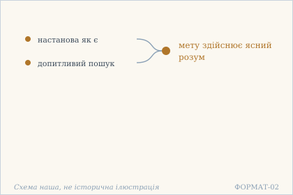 — Дві дороги: настанова як є і довгий пошук. Схема наша, не історична ілюстрація.

## 15.2

**Деванагарі.** मोक्षो विषयवैरस्यं बन्धो वैषयिको रसः । एतावद् एव विज्ञानं यथेच्छसि तथा कुरु ॥

**Українська транслітерація.** мокшо вішаявайрасям бандго вайшаїко расах | етавад ева віджнянам ятхеччасі татха куру ||

**Переклад.** Визволення — коли чуттєве втрачає свій смак; неволя — коли воно й далі вабить. Ось і все розуміння. Чини, як бажаєш.

**Построкове зіставлення (редакторська чернетка, не рецензовано).**

### Рядок а

**Деванагарі (механічно з IAST).** मोक्षो विषयवैरस्यं बन्धो वैषयिको रसः

**IAST (з редакторської картки).** mokṣo viṣayavairasyaṃ bandho vaiṣayiko rasaḥ

**Українська транслітерація (механічна).** мокшо вішаявайрасям бандго вайшаїко расах

**Український відповідник рядка.** Визволення — коли чуттєве втрачає свій смак; неволя — коли воно й далі вабить.

**Коментар рядка (не рецензовано).** mokṣo (mokṣaḥ) — «визволення», viṣayavairasyaṃ — «втрата смаку до чуттєвих предметів»; bandho (bandhaḥ) — «зв'язаність, неволя», vaiṣayiko rasaḥ — «смак до чуттєвого». Рима понять працює через rasa — смак, а не заборону самих матеріальних речей. Це філософська дефініція у творі, а не медичний опис втрати смакових відчуттів.

### Рядок б

**Деванагарі (механічно з IAST).** एतावद् एव विज्ञानं यथेच्छसि तथा कुरु

**IAST (з редакторської картки).** etāvad eva vijñānaṃ yathecchasi tathā kuru

**Українська транслітерація (механічна).** етавад ева віджнянам ятхеччасі татха куру

**Український відповідник рядка.** Ось і все розуміння. Чини, як бажаєш.

**Коментар рядка (не рецензовано).** etāvad eva vijñānaṃ — «ось і все розуміння/розрізнення»; yathecchasi (yathā icchasi) — «як бажаєш», tathā kuru — «так чини», наказовий спосіб від kṛ. Формула залишає простір дії після пояснення визволення, але в санскриті немає окремого слова «анархія» чи безумовної політичної програми; будь-яке таке зіставлення було б сучасною інтерпретацією.

**Науковий коментар.** Протиставлення viṣaya-vairasyaṃ і vaiṣayika rasaḥ побудовано на образі «смаку»: прив'язаність визначається не самим існуванням предметів, а ставленням до них. Фінальне yathecchasi tathā kuru стоїть після etāvad eva vijñānaṃ; тому «чини, як бажаєш» не слід відривати від попереднього визначення визволення. Формула не містить слова «анархія» і сама собою не обґрунтовує твердження про політичне вчення; порівняння з анархізмом належить до окремого сучасного інтерпретаційного есе, а не до перекладу. Джерельна база цієї чернетки: SARIT verse_15.2 і GRETIL Avg_15.2; незалежна санскритологічна рецензія ще потрібна.

**Українська паралель (наша інтерпретація, не твердження про вплив).** *Григорій Сковорода*, «Убогий Жайворонок». Наша паралель: у Сковороди смак до речей теж є мірилом неволі, а не самі речі. Наше порівняння — типологічне, не твердження про джерело.

**Ілюстрація.** 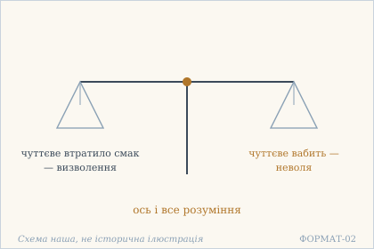 — Дві шальки: смак чуттєвого і його відсутність. Схема наша, не історична ілюстрація.

## 15.3

**Деванагарі.** वाग्मिप्राज्ञमहोद्योगं जनं मूकजडालसम् । करोति तत्त्वबोधो ऽयम् अतस् त्यक्तो बुभुक्षुभिः ॥

**Українська транслітерація.** ваґміпраджнямаходйоґам джанам мукаджадаласам | кароті таттвабодго ’ям атас тякто бубгукшубгіх ||

**Переклад.** Це пізнання суті робить красномовних, тямущих і вельми завзятих людей німими, тупими й лінивими — тому голодні його відкидають.

**Науковий коментар.** Найдошкульніше місце глави, і воно **сатиричне**: пізнання суті не підносить людину, а відбирає в неї красномовство, тямущість і завзятість. `bubhukṣubhiḥ` — «голодними»: тими, хто заробляє словом і зусиллям. Тобто текст сам пояснює, чому його вчення не користується попитом, і робить це без жалю. Переклад мусить зберегти різкість трьох пар, не пом'якшуючи їх до «мовчазних, спокійних, бездіяльних».

**Українська паралель (ПОТРЕБУЄ ПЕРЕВІРКИ).** *українська барокова проповідь*, не визначено. ПОТРЕБУЄ ПЕРЕВІРКИ: думка, що знання суті робить красномовних німими, близька до барокової проповіді про марність учення, але конкретного тексту ми не перевірили.

**Ілюстрація.** 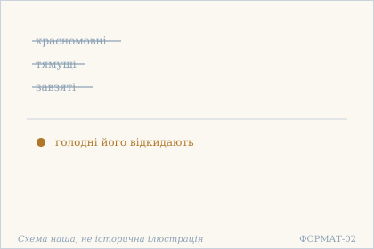 — Красномовні й завзяті стають німими. Схема наша, не історична ілюстрація.

## 15.4

**Деванагарі.** न त्वं देहो न ते देहो भोक्ता कर्ता न वा भवान् । चिद्रूपो ऽसि सदा साक्षी निरपेक्षः सुखं चर ॥

**Українська транслітерація.** на твам дехо на те дехо бгокта карта на ва бгаван | чідрупо ’сі сада сакші нірапекшах сукхам чара ||

**Переклад.** Ти не тіло, і тіло не твоє; і не ти — той, хто споживає чи чинить. Ти маєш природу свідомості, повсякчас свідок, без залежності — живи легко.

**Науковий коментар.** `sākṣin` («свідок») тут єдиний раз у главі й стоїть у трійці з `cidrūpa` і `nirapekṣa`; переклад мусить тримати його як термін, а не як метафору. `sukhaṃ cara` — наказовий спосіб, «живи легко»: це не опис стану, а запрошення. Формула «не тіло, і тіло не твоє» та сама, що в 8.4, 11.6 і 2.22 — тут до неї додано заперечення **діяча й споживача**, чого в тих місцях не було.

**Українська паралель (наша інтерпретація, не твердження про вплив).** *Григорій Сковорода*, «Наркіс. Розмова про те: Пізнай себе». Наша паралель: у Сковороди справжня людина теж не є ані тілом, ані тим, хто споживає. Наше порівняння — типологічне.

**Ілюстрація.** 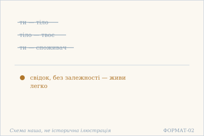 — Тіло й споживач відкинуті: лишається свідок. Схема наша, не історична ілюстрація.

## 15.5

**Деванагарі.** रागद्वेषौ मनोधर्मौ न मनस् ते कदाचन । निर्विकल्पो ऽसि बोधात्मा निर्विकारः सुखं चर ॥

**Українська транслітерація.** раґадвешау манодгармау на манас те кадачана | нірвікалпо ’сі бодгатма нірвікарах сукхам чара ||

**Переклад.** Пристрасть і відраза — властивості ума, і ум ніколи не твій. Ти без домислювання, твоя суть — усвідомлення, ти без видозмін — живи легко.

**Науковий коментар.** Ланцюг тут двоступеневий: спершу `rāga`/`dveṣa` віднесено до `manas`, а потім заперечено сам `manas` як власність. `nirvikāra` («без видозмін») — те саме слово, що в 11.1; словник спільний. `sukhaṃ cara` повторює 15.4 дослівно, і в перекладі це має бути той самий вислів — інакше зникне наскрізний рефрен глави.

**Українська паралель (наша інтерпретація, не твердження про вплив).** *Микола Хвильовий*, «Я (Романтика)» (1924). Наша паралель: у Хвильового пристрасть і відраза теж показані як властивості ума, а не як голос самої речі. Наше порівняння — за способом бачити.

**Ілюстрація.** 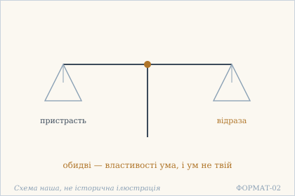 — Дві шальки: пристрасть і відраза — обидві не твої. Схема наша, не історична ілюстрація.

## 15.6

**Деванагарі.** सर्वभूतेषु चात्मानं सर्वभूतानि चात्मनि । विज्ञाय निरहंकारो निर्ममस् त्वं सुखी भव ॥

**Українська транслітерація.** сарвабгутешу чатманам сарвабгутані чатмані | віджняя нірахамкаро нірмамас твам сукхі бгава ||

**Переклад.** Пізнавши себе у всіх істотах і всі істоти — у собі, ти без «я-роблю», без «моє» — будь щасливий.

**Науковий коментар.** Двобічність тут обов'язкова: `ātmānam` у всіх істотах **і** всі істоти в `ātman`. Переклад, що зберіг лише один напрямок, втрачає суть. `nirahaṃkāra`/`nirmama` — не «скромний» і не «безкорисливий», а буквально «без `ahaṃkāra`» і «без `mama`»: два займенники, від яких відмовляються. `sukhī bhava` — наказовий спосіб, як і `sukhaṃ cara` у 15.4–15.5.

**Українська паралель (наша інтерпретація, не твердження про вплив).** *Митрополит Іларіон Київський*, «Слово про закон і благодать» (XI ст.). Наша паралель: у київському Слові теж є думка, що людина впізнає себе не в собі одній. Наше порівняння — типологічне; датування цієї книги науково не встановлене.

**Ілюстрація.** 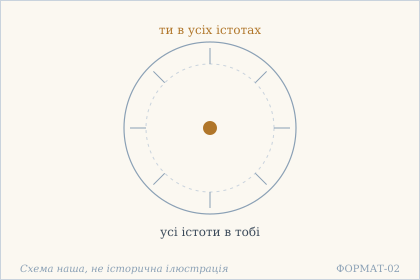 — Взаємне перебування: ти в усіх, усі в тобі. Схема наша, не історична ілюстрація.

## 15.7

**Деванагарі.** विश्वं स्फुरति यत्रेदं तरङ्गा इव सागरे । तत्त्वम् एव न सन्देहश् चिन्मूर्ते विज्वरो भव ॥

**Українська транслітерація.** вішвам спхураті ятредам таранґа іва саґаре | таттвам ева на сандехаш чінмурте віджваро бгава ||

**Переклад.** Те, в чому цей всесвіт постає, як хвилі в морі, — це саме ти, немає сумніву, о втілення свідомості; будь без трепету.

**Науковий коментар.** Образ хвиль і моря — єдиний такий у книзі, і він робить роботу, яку не робить жодне означення: хвиля не **відмінна** від моря й не **тотожна** йому як річ. `cinmūrte` — звертання «о втілення свідомості», споріднене з `cidrūpa` у 15.4; переклад мусить тримати спільний корінь. `vijvara` («без трепету») — від `jvara`, гарячка; це не спокій, а відсутність пропасниці.

**Українська паралель (наша інтерпретація, не твердження про вплив).** *Богдан-Ігор Антонич*, «Ротації» (1938). Наша паралель: в Антонича всесвіт теж постає як хвиля в морі, а не як споруда. Наше порівняння — за образом.

**Ілюстрація.** 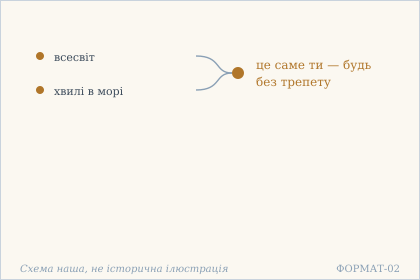 — Всесвіт як хвилі в морі: це саме ти. Схема наша, не історична ілюстрація.

## 15.8

**Деванагарі.** श्रद्धत्स्व तात श्रद्धत्स्व नात्र मोहं कुरुष्व भोः । ज्ञानस्वरूपो भगवान् आत्मा त्वं प्रकृतेः परः ॥

**Українська транслітерація.** шраддгатсва тата шраддгатсва натра мохам курушва бгох | джнянасварупо бгаґаван атма твам пракрітех парах ||

**Переклад.** Повір, любий, повір; не роби тут затьмарення, друже. Твоя суть — знання; бгаґаван ātman — ти, понад природою.

**Науковий коментар.** Єдине місце в книзі, де вчення вимагає **віри** — і вимагає двічі, повтором `śraddhatsva`. Це суперечить загальній настанові тексту «перевір сам», і я не згладжую цю суперечність: вона є. `bhagavān ātmā` — рідкісне поєднання, де `ātman` названо `bhagavant`; переклад мусить зберегти обидва слова, не зводячи до «Бог у тобі». `prakṛteḥ paraḥ` — «понад природою», тобто не складник її.

**Українська паралель (ПОТРЕБУЄ ПЕРЕВІРКИ).** *українська релігійна поезія*, не визначено. ПОТРЕБУЄ ПЕРЕВІРКИ: пряме звертання повір, любий із повторенням близьке до української релігійної поезії, але конкретного твору ми не звірили.

**Ілюстрація.** 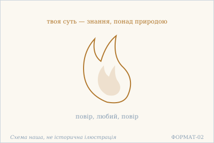 — Полумʼя знання: повір — і не роби затьмарення. Схема наша, не історична ілюстрація.

## 15.9

**Деванагарі.** गुणैः संवेष्टितो देहस् तिष्ठत्य् आयाति याति च । आत्मा न गन्ता नागन्ता किम् एनम् अनुशोचसि ॥

**Українська транслітерація.** ґунайх самвештіто дехас тіштхатй аяті яті ча | атма на ґанта наґанта кім енам анушочасі ||

**Переклад.** Тіло, обгорнуте гунами, стоїть, приходить і йде; ātman не йде і не приходить — чого ти за ним жалкуєш?

**Науковий коментар.** Заперечення подвійне й симетричне: `na gantā na agantā` — не йде **і не приходить**, тобто не підпадає під жоден бік пари. Питання `kim enam anuśocasi` — пряме звертання до того, хто сумує; у главі це вже друге таке звертання після 15.6, і разом вони задають тон: не пояснення, а докір. `anuśocasi` — «жалкуєш за ним», не «сумуєш» взагалі.

**Українська паралель (наша інтерпретація, не твердження про вплив).** *Тарас Шевченко*, «Марія» (1859). Наша паралель: у Шевченка те, що не йде й не приходить, теж протиставлене тілу, яке приходить і відходить. Наше порівняння — типологічне, не про джерело.

**Ілюстрація.** 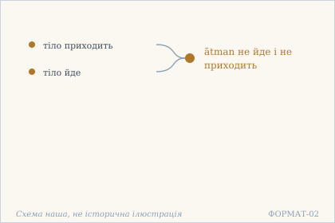 — Тіло приходить і йде, а те, що бачить, стоїть. Схема наша, не історична ілюстрація.

**Сцена.** 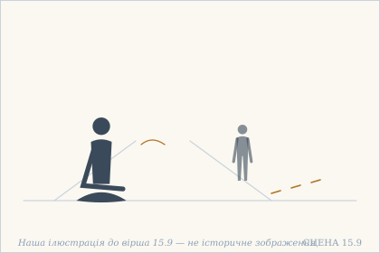 — Тіло йде дорогою, лишаючи сліди, а той, хто сидить, не йде. Наша ілюстрація до вірша 15.9 — не історичне зображення.

## 15.10

**Деванагарі.** देहस् तिष्ठतु कल्पान्तं गच्छत्य् अद्यैव वा पुनः । क्व वृद्धिः क्व च वा हानिस् तव चिन्मात्ररूपिणः ॥

**Українська транслітерація.** дехас тіштхату калпантам ґаччатй адяйва ва пунах | ква вріддгіх ква ча ва ханіс тава чінматрарупінах ||

**Переклад.** Нехай тіло стоїть до кінця світового періоду — або нехай іде хоч сьогодні. Де приріст і де втрата для тебе, чия природа — сама лише свідомість?

**Науковий коментар.** Пара наказових способів (`tiṣṭhatu` … `gacchatu`) задає байдужість до тривалості життя: обидва варіанти рівноцінні. `kalpānta` («кінець світового періоду») — не поетична гіпербола, а максимально можливий строк, і саме тому друга частина звучить різко: `adya eva` («хоч сьогодні»). `cinmātrarūpa` («чия природа — сама лише свідомість») — те саме, що `cinmūrte` у 15.7 і `cidrūpa` у 15.4; словник лишається спільним.

**Українська паралель (наша інтерпретація, не твердження про вплив).** *Ліна Костенко*, «Сад нетанучих скульптур» (1987). Наша паралель: у Костенко питання про приріст і втрату теж виявляється поставленим не до тієї міри. Наше порівняння — за будовою думки.

**Ілюстрація.** 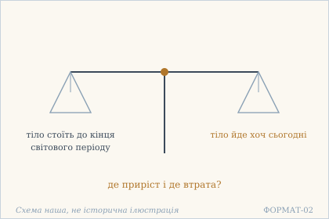 — Дві шальки: тіло надовго і тіло на день. Схема наша, не історична ілюстрація.

## 15.11

**Деванагарі.** त्वय्य् अनन्तमहाम्भोधौ विश्ववीचिः स्वभावतः । उदेतु वास्तम् आयातु न ते वृद्धिर् न वा क्षतिः ॥

**Українська транслітерація.** твайй анантамахамбгодгау вішвавічіх свабгаватах | удету вастам аяту на те вріддгір на ва кшатіх ||

**Переклад.** У тобі, безмежному великому океані, хвиля всесвіту за власною природою нехай піднімається або спадає — немає в тебе ні приросту, ні втрати.

**Науковий коментар.** Той самий образ, що в 15.7, але розгорнутий: там хвилі були в морі, тут ти **сам** — океан, і всесвіт — одна хвиля в ньому. `svabhāvataḥ` («за власною природою») важливе: хвиля не робиться нею ззовні, вона така за природою. Пара `vṛddhi`/`kṣati` повторює 15.10 дослівно — це рефрен двох віршів, і в перекладі він мусить звучати однаково.

**Українська паралель (наша інтерпретація, не твердження про вплив).** *Олександр Довженко*, «Поема про море» (1956). Наша паралель: у Довженка хвиля теж не додає й не забирає нічого в моря, у якому вона піднялася. Наше порівняння — за образом.

**Ілюстрація.** 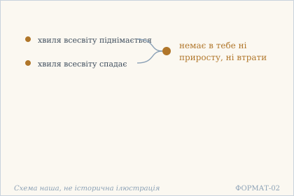 — Хвиля всесвіту в безмежному океані. Схема наша, не історична ілюстрація.

## 15.12

**Деванагарі.** तात चिन्मात्ररूपो ऽसि न ते भिन्नम् इदं जगत् । अतः कस्य कथं कुत्र हेयोपादेयकल्पना ॥

**Українська транслітерація.** тата чінматрарупо ’сі на те бгіннам ідам джаґат | атах кася катхам кутра хейопадеякалпана ||

**Переклад.** Любий, твоя природа — сама лише свідомість; цей світ не відмінний від тебе. Тому — для кого, як і де вигадувати те, що відкидати й приймати?

**Науковий коментар.** Три питання підряд (`kasya katham kutra`) — не риторичний повтор, а розбір по трьох осях: для кого, яким чином, де. `kalpanā` — не «вибір», а **вигадування**: текст не каже, що вибір між добрим і поганим складний, він каже, що його нема кому робити. `tāta` — те саме ласкаве звертання, що в 9.2 і 15.8.

**Українська паралель (наша інтерпретація, не твердження про вплив).** *Іван Вишенський*, «Книжка» (кінець XVI ст.). Наша паралель: у Вишенського світ теж не відділений від того, хто його бачить, і саме тому вибір між прийняти й відкинути втрачає предмет. Наше порівняння — типологічне.

**Ілюстрація.** 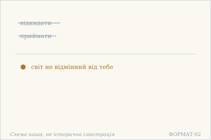 — Відкидати й приймати нічого: світ не відмінний від тебе. Схема наша, не історична ілюстрація.

## 15.13

**Деванагарі.** एकस्मिन् अव्यये शान्ते चिदाकाशे ऽमले त्वयि । कुतो जन्म कुतो कर्म कुतो ऽहंकार एव च ॥

**Українська транслітерація.** екасмін ав'яє шанте чідакаше ’мале тваї | куто джанма куто карма куто ’хамкара ева ча ||

**Переклад.** У тобі — одному, незмінному, втихлому, незаплямованому просторі свідомості — звідки народження, звідки діяння, звідки ж «я-роблю»?

**Науковий коментар.** `cidākāśa` («простір свідомості») — єдине таке складне слово в книзі; переклад мусить лишити його як термін, а не як метафору. Чотири означення (`eka`, `avyaya`, `śānta`, `amala`) звужують значення до одного, і кожне наступне сильніше. Три `kutaḥ` ідуть у порядку виникнення: народження → діяння → `ahaṃkāra`, і останнє поставлене як те, що робить перші два можливими.

**Українська паралель (ПОТРЕБУЄ ПЕРЕВІРКИ).** *українська містична проза*, не визначено. ПОТРЕБУЄ ПЕРЕВІРКИ: питання, звідки народження й діяння в тому, що незмінне, найближче до української містичної прози, але назвати твір без звірки ми не можемо.

**Ілюстрація.** 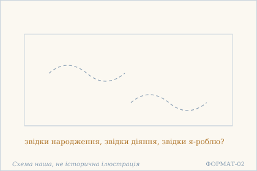 — Порожній простір свідомості: звідки народження й діяння?. Схема наша, не історична ілюстрація.

## 15.14

**Деванагарі.** यद् त्वं पश्यसि तत्रैकस् त्वम् एव प्रतिभाससे । किं पृथग् भासते स्वर्णात् कटकाङ्गदनूपुरम् ॥

**Українська транслітерація.** яд твам пашясі татрайкас твам ева пратібгасасе | кім прітхаґ бгасате сварнат катаканґаданупурам ||

**Переклад.** Те, що ти бачиш, — там сяєш один саме ти. Чи сяє окремо від золота браслет, наруч або ножна прикраса?

**Науковий коментар.** Риторичне питання з відповіддю «ні»: три прикраси названі поіменно, щоб показати, що різниця між ними — лише форма, а речовина одна. Це той самий хід, що з хвилями в 15.7 і 15.11, але тут він зроблений на **речі**, а не на стихії. `pratibhāsase` — «сяєш, постаєш», споріднене з `sphurati` в 15.7; переклад мусить тримати цю спорідненість.

**Українська паралель (наша інтерпретація, не твердження про вплив).** *Григорій Сковорода*, «Ікона Алківіадська». Наша паралель: у Сковороди прикраса й золото теж співвідносяться як видиме й те, що в ньому сяє. Наше порівняння — за образом.

**Ілюстрація.** 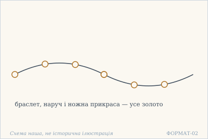 — Прикраси на нитці: усі вони — золото. Схема наша, не історична ілюстрація.

**Сцена.** 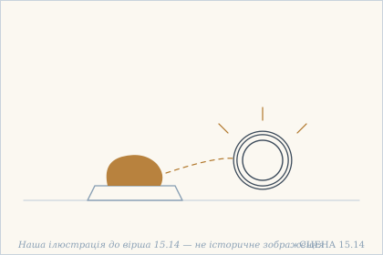 — Злиток золота на плиті й браслет поруч: окремо від золота браслет не сяє. Наша ілюстрація до вірша 15.14 — не історичне зображення.

## 15.15

**Деванагарі.** अयं सो ऽहम् अयं नाहम् विभागम् इति संत्यज । सर्वम् आत्मेति निश्चित्य निःसंकल्पः सुखी भव ॥

**Українська транслітерація.** аям со ’хам аям нахам вібгаґам іті самтяджа | сарвам атметі нішчітя ніхсамкалпах сукхі бгава ||

**Переклад.** «Це — він, це я; це — не я» — відкинь такий поділ. Вирішивши, що все — ātman, будь без побудов і щасливий.

**Науковий коментар.** Тут відкидається не одна зі сторін поділу, а **сама навичка ділити**: `vibhāgam … saṃtyaja`. `niḥsaṃkalpa` — не «без думок», а без `saṃkalpa`, наміру-побудови, тобто без попереднього складання того, що має бути. Це те саме слово, що `kalpanā` в 15.12, і переклад мусить бути спорідненим.

**Українська паралель (наша інтерпретація, не твердження про вплив).** *Микола Зеров*, «Камена» (1924). Наша паралель: у Зерова поділ на це і не це теж знімається ясністю, а не зусиллям. Наше порівняння — типологічне.

**Ілюстрація.** 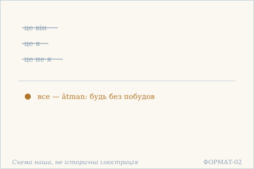 — Поділ на це і не це відкинуто: усе — ātman. Схема наша, не історична ілюстрація.

## 15.16

**Деванагарі.** तवैवाज्ञानतो विश्वं त्वम् एकः परमार्थतः । त्वत्तो ऽअन्यो नास्ति संसारी नासंसारी च कश्चन ॥

**Українська транслітерація.** тавайваджнянато вішвам твам еках парамартхатах | тватто ’анйо насті самсарі насамсарі ча кашчана ||

**Переклад.** Всесвіт — саме через твоє незнання; у справжньому сенсі ти один. Немає іншого, ніж ти — ні того, хто в сансарі, ні того, хто поза нею.

**Науковий коментар.** Заперечення знову симетричне: немає ні `saṃsārī`, ні `asaṃsārī` — тобто не існує ні того, хто в сансарі, ні того, хто з неї вийшов. Це найрадикальніше з тверджень глави, і його легко зіпсувати перекладом «немає ні сансари, ні визволення»: у тексті йдеться про **осіб**, а не про стани. `paramārthataḥ` («у справжньому сенсі») — усталений термін, не «насправді» в побутовому значенні.

**Українська паралель (ПОТРЕБУЄ ПЕРЕВІРКИ).** *українська філософська проза*, не визначено. ПОТРЕБУЄ ПЕРЕВІРКИ: думка, що всесвіт постає через незнання, найближча до української філософської прози, але конкретного твору ми не перевірили.

**Ілюстрація.** 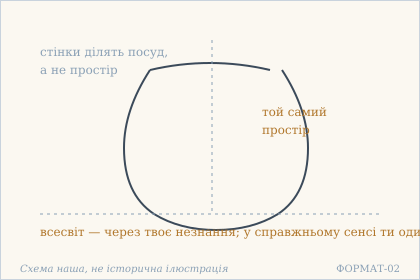 — Всесвіт як горщик, а простір — один. Схема наша, не історична ілюстрація.

## 15.17

**Деванагарі.** भ्रान्तिमात्रम् इदं विश्वं न किञ्चिद् इति निश्चयी । निर्वासनः स्फूर्तिमात्रो न किञ्चिद् इव शाम्यति ॥

**Українська транслітерація.** бгрантіматрам ідам вішвам на кіньчід іті нішчаї | нірвасанах спхуртіматро на кіньчід іва шам'яті ||

**Переклад.** «Цей всесвіт — саме лише блукання, аніщо» — хто має таке переконання, той без усталених схильностей, саме лише сяйнування, втихає, наче аніщо.

**Науковий коментар.** **Цей вірш майже дослівно збігається з 11.8.** Різниця лише в першому складнику: тут `bhrāntimātram` («саме лише блукання»), там `nānāścaryam` («різноманітно дивовижне»). Друга половина — `nirvāsanaḥ sphūrtimātro na kiñcid iva śāmyati` — ідентична в обох місцях. Це не помилка картки й не недогляд: текст справді повторює формулу, змінюючи лише означення світу. Я зберіг переклад другої половини **дослівно той самий**, що в 11.8, щоб повтор було видно. `bhrānti` — «блукання» в сенсі омани-ходіння, не «ілюзія» як технічний термін.

**Українська паралель (наша інтерпретація, не твердження про вплив).** *Іван Франко*, «Мойсей» (1905). Наша паралель: у Франка блукання теж може виявитися тим, що не має власної суті. Наше порівняння — типологічне.

**Ілюстрація.** 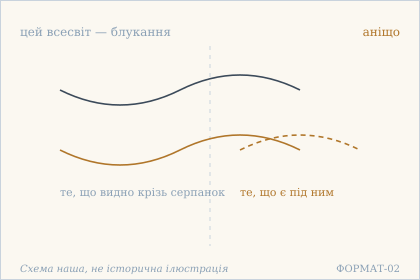 — Всесвіт під серпанком: блукання, аніщо. Схема наша, не історична ілюстрація.

## 15.18

**Деванагарі.** एक एव भवाम्भोधाव् आसीद् अस्ति भविष्यति । न ते बन्धो ऽस्ति मोक्षो वा कृतकृत्यः सुखं चर ॥

**Українська транслітерація.** ека ева бгавамбгодгав асід асті бгавішяті | на те бандго ’сті мокшо ва крітакрітях сукхам чара ||

**Переклад.** Один-єдиний в океані буття — був, є, буде. Немає в тебе ні пут, ні визволення; той, чию справу зроблено, — живи легко.

**Науковий коментар.** `na te bandho 'sti mokṣo vā` — та сама симетрична пара, що в 15.16: немає ні пут, ні визволення. Переклад мусить тримати їх **як пару**, бо звичне «ти вільний» знищило б думку. Три часи (`āsīt asti bhaviṣyati`) стоять у ряд, як у 19.3, але там вони скасовувалися, а тут стверджуються. `kṛtakṛtya` — те саме, що `kṛtārtha` в 12.8, і переклад має бути спорідненим.

**Українська паралель (наша інтерпретація, не твердження про вплив).** *Василь Стус*, «Час творчості». Наша паралель: у Стуса той, чию справу зроблено, теж не має ні пут, ні визволення — він просто живе. Наше порівняння — за будовою думки.

**Ілюстрація.** 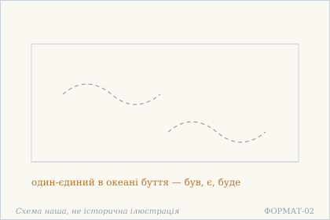 — Один в океані буття: був, є, буде. Схема наша, не історична ілюстрація.

## 15.19

**Деванагарі.** मा संकल्पविकल्पाभ्यां चित्तं क्षोभय चिन्मय । उपशाम्य सुखं तिष्ठ स्वात्मन्य् आनन्दविग्रहे ॥

**Українська транслітерація.** ма самкалпавікалпабгям чіттам кшобгая чінмая | упашам'я сукхам тіштха сватманй анандавіґрахе ||

**Переклад.** Не збурюй ум наміром і домислюванням, о сповнений свідомості. Втихнувши, стій легко у собі — втіленні блаженства.

**Науковий коментар.** `saṃkalpa` і `vikalpa` названі парою як те, що збурює: перше — складання наміру, друге — роздвоєння-домислювання. Це ті самі два корені, що в 15.12 (`kalpanā`) і 15.15 (`niḥsaṃkalpa`), і разом вони утворюють послідовний словник глави. `ānandavigraha` («втілення блаженства») — єдине таке поєднання в книзі; це не «блаженна людина», а означення **себе**.

**Українська паралель (наша інтерпретація, не твердження про вплив).** *Павло Тичина*, «Сонячні кларнети» (1918). Наша паралель: у Тичини втихнути й стояти легко теж означає перестати збурювати те, що й так сяє. Наше порівняння — за образом.

**Ілюстрація.** 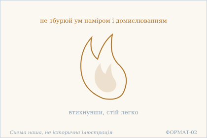 — Полумʼя без вітру: втихнувши, стій легко. Схема наша, не історична ілюстрація.

## 15.20

**Деванагарі.** त्यजैव ध्यानं सर्वत्र मा किञ्चिद् धृदि धारय । आत्मा त्वं मुक्त एवासि किं विमृश्य करिष्यसि ॥

**Українська транслітерація.** тяджайва дгянам сарватра ма кіньчід дгріді дгарая | атма твам мукта евасі кім вімрішя карішясі ||

**Переклад.** Відкинь саму медитацію, скрізь не тримай нічого в серці. Ти — ātman, ти вже вільний: що ти робитимеш, далі розмірковуючи?

**Науковий коментар.** Останній вірш глави відкидає **медитацію** — те, з чого починалася майже вся релігійна практика. `tyaja eva` з підсиленням: не «зменш», а «відкинь саме». `mukta eva asi` — «ти вже вільний», і `eva` тут не прикраса: без нього фраза звучала б як обіцянка. Завершальне питання `kiṃ … kariṣyasi` не закликає до дії — воно показує, що робити нічого. Це узгоджується з 15.3, де пізнання суті відбирає завзятість.

**Українська паралель (наша інтерпретація, не твердження про вплив).** *Леся Українка*, «Оргія» (1913). Наша паралель: у Лесі Українки відкинути саму медитацію — це теж крок, а не втрата, бо мета вже не попереду. Наше порівняння — типологічне.

**Ілюстрація.** 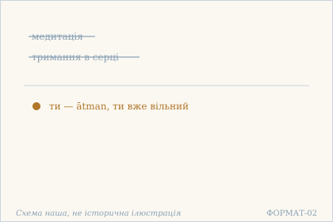 — Медитація відкинута: ти вже вільний. Схема наша, не історична ілюстрація.

## Поетичний переклад

Окремо, у [`poetychnyi/rozdil-15.md`](poetychnyi/rozdil-15.md). Це **наш поетичний переклад**, не канонічний і не науковий; у PDF він іде окремою частиною.
