# Аштавакра-ґіта. Глава 16. Наукове представлення

> ФОРМАТ-02: кожен вірш подано пʼятьма шарами — деванагарі, українська
> транслітерація, переклад, науковий коментар з українськими паралелями,
> ілюстрація. Плюс окремо — поетичний переклад (`poetychnyi/rozdil-16.md`).
>
> **Деванагарі тут — механічна** транслітерація поля `iast` з картки
> (`scripts/iast_to_devanagari.py`), а не окреме читання за рукописом.
> **Українська транслітерація** — теж механічна (`scripts/iast_to_ukrainian.py`,
> таблиця в `docs/TRANSLITERATSIIA.md`).
> **Українські паралелі** — наша інтерпретація, а не твердження про вплив;
> реєстр і правила — `paraleli.json` і `scripts/check_ukrainian_parallels.py`.
> **Схеми** — наші власні; жодна не є історичною ілюстрацією.
>
> Цей файл згенеровано; правити треба картки й `format-v2/rozdil-16.json`,
> а не його.

## Глава 16. Поки не забудеш усе

Шістнадцята глава починається й закінчується тим самим: спокою не буде, поки не забудеш усе. Між цими двома віршами — одинадцять спроб сказати те саме інакше: через натугу (16.3), через чотири цілі людини (16.5), через пару потяг і відраза (16.8). Останній вірш навмисно повертає читача до початку й додає, що навіть боги-наставники тут не помічники.

## 16.1

**Деванагарі.** आचक्ष्व शृणु वा तात । नानाशास्त्राण्यनेकशः । तथापि न तव स्वास्थ्यं । सर्वविस्मरणाद् ऋते ॥

**Українська транслітерація.** ачакшва шріну ва тата | нанашастранянекашах | татхапі на тава свастхям | сарвавісмаранад ріте ||

**Переклад.** Розповідай чи слухай, любий, хоч би скільки різних наук, — спокою тобі не буде, поки не забудеш усе.

**Науковий коментар.** Глава відкривається не запереченням знання, а запереченням його достатності. Дія в парі «говорити / слухати» охоплює обидві ролі вченого — того, хто навчає, і того, хто вчиться, — і обидві виявляються однаково неспроможними. Ключове слово — svāsthya, «перебування в собі»: воно описує стан, а не досягнення, і саме тому його не можна здобути додаванням знань. Умова поставлена одна й негативна: sarvavismaraṇa, забуття всього. Текст не пояснює, що саме забути й як; традиційні коментарі читають це як забуття розрізнень і набутих уявлень, але сам вірш такого тлумачення не містить. Не сказано тут і про ātman, cit чи sākṣin — жодного з цих термінів у вірші немає.

**Українська паралель (наша інтерпретація, не твердження про вплив).** *Григорій Сковорода*, «Байки харківські» (1774). Наша паралель: у Сковороди багато знаного теж не дає спокою, поки не зміниться сам спосіб тримати знане. Наше порівняння — типологічне.

**Ілюстрація.** 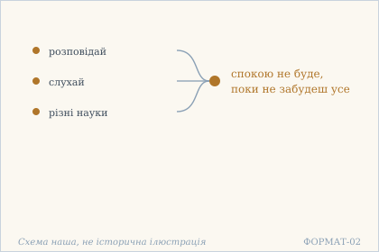 — Багато наук, що не дають спокою. Схема наша, не історична ілюстрація.

## 16.2

**Деванагарі.** भोगं कर्म समाधिं वा । कुरु विज्ञ तथापि ते । चित्तं निरस्तसर्वाशम् । अत्यर्थं रोचयिष्यति ॥

**Українська транслітерація.** бгоґам карма самадгім ва | куру віджня татхапі те | чіттам нірастасарвашам | атяртхам рочаїшяті ||

**Переклад.** Насолоджуйся, дій або зосереджуйся, обізнаний, — та по-справжньому смакуватиме тобі лише тоді, коли розум відкине всі надії.

**Науковий коментар.** Вірш перебирає три типові стратегії: чуттєву насолоду, дію (обряд, обов'язок) і зосередження — тобто весь набір засобів, які зазвичай пропонують як шлях. Заперечення тут не в тому, що ці заняття погані: їх дозволено робити далі. Змінено умову смаку — він з'являється не від заняття, а від відсутності надії (nirasta-sarvāśa). Це тонша думка, ніж «відмовся від усього»: не дію скасовано, а припинено сподівання, вкладене в дію. Через каузативну форму rocayiṣyati речення можна зрозуміти й так, що смак дає сама дія, коли її не супроводжує надія; переклад вище тримає саме цю, слабшу вимогу. Традиційні коментарі тут бачать указівку на нішкаху (недіяння-зречення), але текст слова «недіяння» не містить.

**Українська паралель (наша інтерпретація, не твердження про вплив).** *Леся Українка*, «У пущі» (1909). Наша паралель: у Лесі Українки смак до дії теж з'являється лише тоді, коли розум відпускає надії. Наше порівняння — за будовою думки.

**Ілюстрація.** 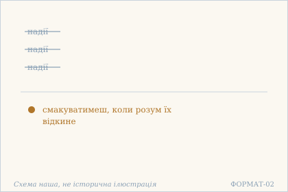 — Надії відкинуті — і тоді смак повертається. Схема наша, не історична ілюстрація.

## 16.3

**Деванагарі.** आयासात् सकलो दुःखी । नैनं जानाति कश्चन । अनेनैवोपदेशेन । धन्यः प्राप्नोति निर्वृतिम् ॥

**Українська транслітерація.** аясат сакало духкхі | найнам джанаті кашчана | аненайвопадешена | дганях прапноті нірврітім ||

**Переклад.** Від натуги всі нещасні, і ніхто з них цього не бачить. Блаженний же досягає вгамування самим лише цим настановленням.

**Построкове зіставлення (редакторська чернетка, не рецензовано).**

### Рядок а

**Деванагарі (механічно з IAST).** आयासात् सकलो दुःखी नैनं जानाति कश्चन

**IAST (з редакторської картки).** āyāsāt sakalo duḥkhī nainaṃ jānāti kaścana

**Українська транслітерація (механічна).** аясат сакало духкхі найнам джанаті кашчана

**Український відповідник рядка.** Від натуги всі нещасні, і ніхто з них цього не бачить.

**Коментар рядка (не рецензовано).** āyāsāt — аблатив причини: «від надмірної натуги»; sakalo duḥkhī узагальнює людське страждання. na enam jānāti kaścana означає «цього ніхто не знає»: займенник enam указує на щойно висловлену тезу, а не на конкретну історичну особу. Це перший друкований піврядок, без вигаданої окремої настанови.

### Рядок б

**Деванагарі (механічно з IAST).** अनेनैवोपदेशेन धन्यः प्राप्नोति निर्वृतिम्

**IAST (з редакторської картки).** anenaivopadeśena dhanyaḥ prāpnoti nirvṛtim

**Українська транслітерація (механічна).** аненайвопадешена дганях прапноті нірврітім

**Український відповідник рядка.** Блаженний же досягає вгамування самим лише цим настановленням.

**Коментар рядка (не рецензовано).** anena eva upadeśena — «саме цим настановленням» (орудний); dhanyaḥ — «блаженний», prāpnoti — теперішній час «досягає», nirvṛtim — знахідний «вгамування». Вірш не уточнює ні способу передавання настанови, ні конкретної української філософської аналогії; їх не слід додавати до слів першоджерела.

**Науковий коментар.** Вірш ставить діагноз: причина страждання — āyāsa, натуга, а не брак чогось. Друга половина вводить протиставлення між тими, хто не бачить, і тим, хто чує настановлення; але текст не пояснює, що саме робить це настановлення дієвим — чи зміст, чи готовність слухача. Порівняння з 16.1 показує, що «настановлення» тут не нове знання, а вказівка на припинення натуги: обидва вірші зводять причину до дії, яку треба припинити, а не до відомостей, які треба додати. Термінів ātman, cit, sākṣin, vairāgya, toṣa, āśrama у вірші немає.

**Українська паралель (ПОТРЕБУЄ ПЕРЕВІРКИ).** *українська філософська лірика*, не визначено. ПОТРЕБУЄ ПЕРЕВІРКИ: думка, що від натуги всі нещасні, близька до української філософської лірики, але конкретного твору ми не звірили.

**Ілюстрація.** 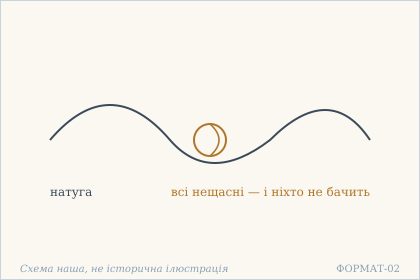 — Вузол натуги: всі нещасні, і ніхто не бачить. Схема наша, не історична ілюстрація.

## 16.4

**Деванагарі.** व्यापारे खिद्यते यस् तु । निमेषोन्मेषयोर् अपि । तस्यालस्यधुरीणस्य । सुखं नान्यस्य कस्यचित् ॥

**Українська транслітерація.** в'япаре кхідяте яс ту | німешонмешайор апі | тасяласядгурінася | сукхам наняся касячіт ||

**Переклад.** Кому важко навіть повіки звести — той перший серед лінивих: немає щастя ні йому, ні комусь іншому [такому].

**Науковий коментар.** Вірш різкий за тоном: він не співчуває втомі, а виставляє її на посміх. Найменша дія — повіки звести — уже вимірює, скільки сили лишилося. Разом із 16.3 це дає цікаву пару: там натуга робить нещасним, а тут відсутність сили на найменшу дію теж не веде до щастя. Отже текст не хвалить і неробства: він описує глухий кут, у якому будь-яке ставлення до дії — і надмірне, і нульове — однаково не дає спокою. Друга половина двозначна (див. граматику), і від вибору залежить, чи вірш картає лінивого, чи взагалі відмовляє в щасті всім, крім нього. Традиційні коментарі читають це як осуд лінощів; сам текст такого висновку не формулює.

**Українська паралель (наша інтерпретація, не твердження про вплив).** *Іван Франко*, «Зівʼяле листя» (1896). Наша паралель: у Франка безсилля теж описане без жалю й без поблажливості, як стан, а не як провина. Наше порівняння — за способом бачити.

**Ілюстрація.** 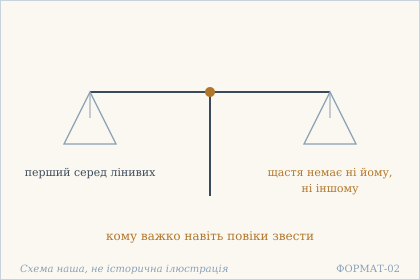 — Дві шальки: лінощі й відсутність щастя. Схема наша, не історична ілюстрація.

## 16.5

**Деванагарі.** इदं कृतम् इदं नेति । द्वन्द्वैर् मुक्तं यदा मनः । धर्मार्थकाममोक्षेषु । निरपेक्षं तदा भवेत् ॥

**Українська транслітерація.** ідам крітам ідам неті | двандвайр муктам яда манах | дгармартхакамамокшешу | нірапекшам тада бгавет ||

**Переклад.** Коли розум звільниться від пари «це я зробив — а це ні», він стане байдужим і до дгарми, і до артги, і до ками, і до мокші.

**Науковий коментар.** Тут уперше в главі названо чотири цілі людини — і всі чотири поставлено в один ряд як те, до чого розум стає байдужим. Це сильніше, ніж заперечення однієї з них: дгарма й мокша втрачають привілей бути «правильними» цілями. Механізм указано точно: не самі цілі пошкоджують розум, а пара оцінок «зробив / не зробив», у якій вони постають. Слово mokṣa тут ужите як назва четвертої цілі, а не як стан; тому переклад передає його як «мокша», не «звільнення», щоб не змішати з 20.12, де mukti стоїть у низці заперечень. Оптатив bhavet робить речення умовним: це не обіцянка, а опис умови.

**Українська паралель (наша інтерпретація, не твердження про вплив).** *Олександр Потебня*, «Думка й мова» (1862). Наша паралель: Потебня теж показує, що пара «я зробив — а це ні» є справою думки, а не речей. Наше порівняння — типологічне.

**Ілюстрація.** 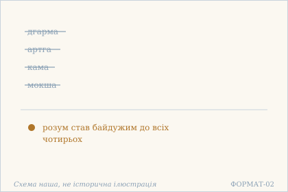 — Чотири цілі людини відпадають разом. Схема наша, не історична ілюстрація.

## 16.6

**Деванагарі.** विरक्तो विषयद्वेष्टा । रागी विषयलोलुपः । ग्रहमोक्षविहीनस् तु । न विरक्तो न रागवान् ॥

**Українська транслітерація.** віракто вішаядвешта | раґі вішаялолупах | ґрахамокшавіхінас ту | на віракто на раґаван ||

**Переклад.** Відвернений — це той, хто ненавидить чуттєве; пристрасний — той, хто до нього жадібний. А хто не хапає і не відкидає — той уже ні відвернений, ні пристрасний.

**Науковий коментар.** Вірш руйнує звичну шкалу «пристрасть погано, відверненість добре». Ненависть до чуттєвого поставлено в один ряд із жадобою: обидві — рух навколо того самого предмета, лише з різним знаком. Тому virakta тут не чеснота, а діагноз. Справжня межа проведена за іншим критерієм — graha і mokṣa, хапання й відкидання, тобто сама реакція, а не її напрям. Важливо, що vairāgya — термін, якого в цьому вірші немає: є virakta, дієприкметник, і його якраз поставлено під сумнів. Хто шукає тут похвалу відреченню, той прочитає вірш навпаки.

**Українська паралель (наша інтерпретація, не твердження про вплив).** *Михайло Коцюбинський*, «Intermezzo» (1908). Наша паралель: у Коцюбинського той, хто не хапає й не відкидає, теж стоїть поза парою відвернений і пристрасний. Наше порівняння — типологічне.

**Ілюстрація.** 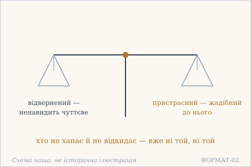 — Дві шальки: відвернений і пристрасний. Схема наша, не історична ілюстрація.

## 16.7

**Деванагарі.** हेयोपादेयता तावत् । संसारविटपाङ्कुरः । स्पृहा जीवति यावद् वै । निर्विचारदशास्पदम् ॥

**Українська транслітерація.** хейопадеята тават | самсаравітапанкурах | спріха джіваті явад вай | нірвічарадашаспадам ||

**Переклад.** Розрізнення «відкинути це, взяти те» — лише пагін на дереві сансари; він росте, доки жива жадоба, а жадоба — осідок життя без роздуму.

**Науковий коментар.** Метафора дерева працює в двох напрямках: пагін — це те, що видно, і водночас те, що тримає корінь. Розрізнення «відкинути / взяти» тут не мудрість, а симптом. Друга половина вказує на причину: жадоба (spṛhā) і стан без роздуму (nirvicāra-daśā) живлять одне одного — без роздуму легко бажати, а бажання не потребує роздуму. Варто зауважити, що vijñāna, viveka чи vicāra в позитивному значенні тут не з'являються: текст не пропонує «правильного розрізнення» на противагу хибному, він указує на розрізнення як таке. Це не заклик до нерозумності; сам вірш — акт розрізнення, і ця суперечність у тексті лишається нерозв'язаною.

**Українська паралель (наша інтерпретація, не твердження про вплив).** *Іван Франко*, «Мойсей» (1905). Наша паралель: у Франка розрізнення відкинути це, взяти те теж постає як пагін, що росте з живого кореня. Наше порівняння — за образом.

**Ілюстрація.** 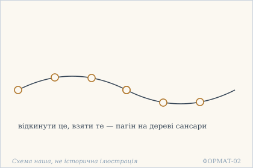 — Пагін на дереві сансари: відкинути й узяти. Схема наша, не історична ілюстрація.

## 16.8

**Деванагарі.** प्रवृत्तौ जायते रागो । निवृत्तौ द्वेष एव हि । निर्द्वन्द्वो बालवद् धीमान् । एवम् एव व्यवस्थितः ॥

**Українська транслітерація.** правріттау джаяте раґо | нівріттау двеша ева хі | нірдвандво балавад дгіман | евам ева в'явастхітах ||

**Переклад.** Коли дієш — народжується потяг, коли спиняєшся — відраза. Мудрий, вільний від цієї пари, стоїть так, як стоїть дитина.

**Науковий коментар.** Вірш дає механіку пари: потяг і відраза не два окремі почуття, а два боки одного маятника, і кожен викликає інший. Тому вихід не в тому, щоб обрати бік (діяти або спинитися), а в тому, щоб вийти з коливання. Порівняння з дитиною — єдиний образ, який текст пропонує замість опису стану; воно нічого не доводить, а показує. Це місце часто читають як «природність» (akṛtrima) у дусі пізніших інтерпретацій, але слово «природний» у вірші відсутнє; є лише bālavat, «як дитина». Не названо тут і ātman чи cit: вірш говорить про механіку реагування, не про природу свідомості.

**Українська паралель (наша інтерпретація, не твердження про вплив).** *Григорій Сковорода*, «Алфавіт, чи Буквар миру» (діалог). Наша паралель: у Сковороди дитина теж стоїть як міра простоти, недосяжної для того, хто вже знає. Наше порівняння — типологічне.

**Ілюстрація.** 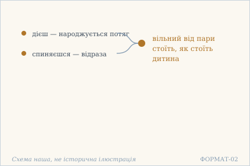 — Потяг і відраза, а поза ними — дитина. Схема наша, не історична ілюстрація.

## 16.9

**Деванагарі.** हातुम् इच्छति संसारं । रागी दुःखजिहासया । वीतरागो हि निर्दुःखस् । तस्मिन्न् अपि न खिद्यति ॥

**Українська транслітерація.** хатум іччаті самсарам | раґі духкхаджіхасая | вітараґо хі нірдухкхас | тасмінн апі на кхідяті ||

**Переклад.** Пристрасний хоче втекти з сансари, бо хоче позбутися страждання. А в кого пристрасті вже немає, той не страждає — і навіть у сансарі не мучиться.

**Науковий коментар.** Тут показано пастку: бажання вийти з сансари саме є пристрастю, і тому воно тримає в сансарі. Межа проходить не між «у сансарі» і «поза сансарі», а між наявністю й відсутністю пристрасті. Формула nirduḥkhaḥ ... na khidyati подвійна: спершу стан (немає страждання), потім поведінка (не мучиться навіть там). Це не обіцянка, що все стане приємним, а вказівка, що сама присутність сансари перестає бути мірилом. Слово vairāgya, яке тут напрошується, у вірші не вжите: є vītarāga, «той, у кого пристрасть пішла», — опис, а не назва чесноти.

**Українська паралель (наша інтерпретація, не твердження про вплив).** *Василь Стус*, «Палімпсести». Наша паралель: у Стуса втеча від страждання теж не приносить того, чого шукали. Наше порівняння — за будовою думки.

**Ілюстрація.** 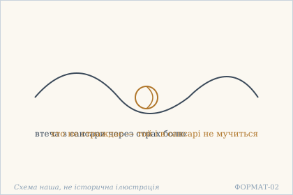 — Вузол втечі: страх болю тримає міцніше. Схема наша, не історична ілюстрація.

## 16.10

**Деванагарі.** यस्याभिमानो मोक्षे ऽपि । देहे ऽपि ममता तथा । न च ज्ञानी न वा योगी । केवलं दुःखभाग् असौ ॥

**Українська транслітерація.** ясябгімано мокше ’пі | дехе ’пі мамата татха | на ча джняні на ва йоґі | кевалам духкхабгаґ асау ||

**Переклад.** Якщо людина претендує навіть на звільнення і водночас відчуває тіло як «своє», вона не знавець і не йог — вона просто має свою частку страждання.

**Науковий коментар.** Найгостріше місце глави: під підозру потрапляє не лише прив'язаність до тіла, а й зацікавленість у звільненні. abhimāna — слово з присмаком претензії, і саме воно стоїть поруч із mokṣa. Друга частина вірша — тверезий висновок: із двох претензій не виростає ані знання (jñānī), ані практика (yogī), лишається тільки частка страждання (duḥkha-bhāj). Тут mukti не названо — є mokṣa; ані ātman, ані cit у вірші немає. Традиційні коментарі часто перетворюють це на заклик відмовитися від бажання звільнення; текст робить слабше й точніше твердження — він заперечує претензію, а не саму мету.

**Українська паралель (наша інтерпретація, не твердження про вплив).** *Памфіл Юркевич*, «Серце і його значення в духовному житті людини» (1860). Наша паралель: коли вірш каже, що претензія на звільнення при відчутті тіла як свого нічого не дає, він розводить слово й стан. Юркевич розводить їх так само рішуче. Наше порівняння — за способом розрізняти.

**Ілюстрація.** 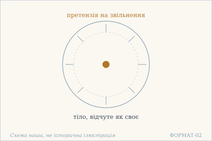 — Претензія на волю й відчуття тіла як свого. Схема наша, не історична ілюстрація.

## 16.11

**Деванагарі.** हरो यद्य् उपदेष्टा ते । हरिः कमलजो ऽपि वा । तथापि न तव स्वास्थ्यं । सर्वविस्मरणाद् ऋते ॥

**Українська транслітерація.** харо ядй упадешта те | харіх камаладжо ’пі ва | татхапі на тава свастхям | сарвавісмаранад ріте ||

**Переклад.** Навіть якби твоїм наставником був сам Шіва, Вішну чи Брахма, — спокою тобі не буде, поки не забудеш усе.

**Науковий коментар.** Глава закінчується тим самим реченням, що й почалася (пор. 16.1), з однією заміною: замість «наук» — імена найвищих богів. Це обрамлення робить висновок сильнішим: не допомогло знання — не допоможе й найвищий авторитет, бо обидва додають, а умова вимагає віднімання. Ототожнення Гара з Шівою, Гарі з Вішну і Камаладжі з Брахмою — загальноприйняте в традиції, і текст його не пояснює; тут воно подане як тлумачення, а не як сказане у вірші. Слово svāsthya повторене з 16.1 дослівно, і саме воно, а не mukti, є метою в цій главі.

**Українська паралель (ПОТРЕБУЄ ПЕРЕВІРКИ).** *українська релігійна проза*, не визначено. ПОТРЕБУЄ ПЕРЕВІРКИ: думка, що й самі боги не дадуть спокою, поки людина не забуде все, близька до української релігійної прози, але конкретного твору ми не перевірили.

**Ілюстрація.** 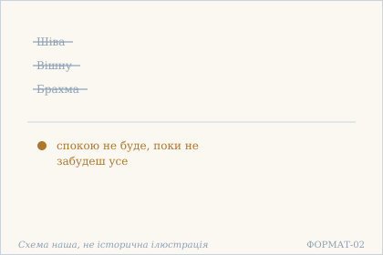 — Навіть боги-наставники не дають спокою. Схема наша, не історична ілюстрація.

## Поетичний переклад

Окремо, у [`poetychnyi/rozdil-16.md`](poetychnyi/rozdil-16.md). Це **наш поетичний переклад**, не канонічний і не науковий; у PDF він іде окремою частиною.
