# Аштавакра-ґіта. Глава 17. Наукове представлення

> ФОРМАТ-02: кожен вірш подано пʼятьма шарами — деванагарі, українська
> транслітерація, переклад, науковий коментар з українськими паралелями,
> ілюстрація. Плюс окремо — поетичний переклад (`poetychnyi/rozdil-17.md`).
>
> **Деванагарі тут — механічна** транслітерація поля `iast` з картки
> (`scripts/iast_to_devanagari.py`), а не окреме читання за рукописом.
> **Українська транслітерація** — теж механічна (`scripts/iast_to_ukrainian.py`,
> таблиця в `docs/TRANSLITERATSIIA.md`).
> **Українські паралелі** — наша інтерпретація, а не твердження про вплив;
> реєстр і правила — `paraleli.json` і `scripts/check_ukrainian_parallels.py`.
> **Схеми** — наші власні; жодна не є історичною ілюстрацією.
> **Сцени** (`ilustratsii-naratyvni/`) — теж наші власні малюнки й теж не
> історичні: це ситуація вірша, а не поняття, і фігури там — силуети без
> облич.
>
> Цей файл згенеровано; правити треба картки й `format-v2/rozdil-17.json`,
> а не його.

## Глава 17. Звільнений

Сімнадцята глава — портрет, а не настанова. У ній майже немає наказів: вірші описують, що робить і чого не робить звільнений, і щоразу повертаються до одного — він у собі. Найдивніші місця — 17.10 і 17.20: текст прямо відмовляється назвати його стан, і ця відмова тут не поетична фігура, а точність.

## 17.1

**Деванагарі.** तेन ज्ञानफलं प्राप्तं । योगाभ्यासफलं तथा । तृप्तः स्वच्छेन्द्रियो नित्यम् । एकाकी रमते तु यः ॥

**Українська транслітерація.** тена джнянапхалам праптам | йоґабгясапхалам татха | тріптах сваччендрійо нітям | екакі рамате ту ях ||

**Переклад.** Хто вдоволений, чиї чуття прозорі й хто завжди сам — той і справді радіє: він уже має плід знання і плід вправ у йозі.

**Науковий коментар.** Глава 17 описує того, хто вже пройшов, і починається з переліку, а не з доказу. Показово, що «плід знання» і «плід йоги» поставлено поруч як одне й те саме досягнення: текст не протиставляє пізнання й практику, він каже, що обидві дали те саме. Слово tṛpta, «вдоволений, насичений», тут ключове: воно описує не досягнення, а відсутність голоду. Поруч стоїть ekākī, «самотній», — не як сум, а як відсутність потреби в іншому. Термін toṣa, який напрошується як відповідник, у вірші не вжитий: є tṛpta від √tṛp; це різні, хоч і близькі слова, і змішувати їх не слід.

**Українська паралель (наша інтерпретація, не твердження про вплив).** *Григорій Сковорода*, «Розмова пʼяти подорожніх про істинне щастя в житті». Наша паралель: у Сковороди вдоволеність теж постає як плід, а не як вихідна умова. Наше порівняння — типологічне.

**Ілюстрація.** 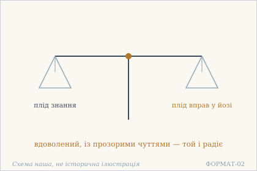 — Дві шальки: плід знання і плід вправ. Схема наша, не історична ілюстрація.

## 17.2

**Деванагарі.** न कदाचिज् जगत्य् अस्मिंस् । तत्त्वज्ञो हन्त खिद्यति । यत एकेन तेनेदं । पूर्णं ब्रह्माण्डमण्डलम् ॥

**Українська транслітерація.** на кадачідж джаґатй асмімс | таттваджньо ханта кхідяті | ята екена тенедам | пурнам брахмандамандалам ||

**Переклад.** Ніколи в цьому світі не мучиться той, хто знає істину: о, тим одним сповнене все — усе коло світів.

**Науковий коментар.** Аргумент вірша — від повноти до відсутності страждання: мучитися може лише той, кому чогось бракує, а бракувати нічого, якщо ціле вже сповнене. «Коло Брахми» (brahmāṇḍa-maṇḍala) — не філософський термін, а образ усесвіту як замкненої кулі; цим підкреслено, що поза ним нічого немає й тому додати нічого. Слово tattva тут означає «істинне, дійсне», а не «категорію» школи санкх'я. Вигук hanta зберігає розмовну інтонацію, і в перекладі він вартий збереження: це не доказ, а подив. Про ātman, cit чи sākṣin вірш не говорить.

**Українська паралель (наша інтерпретація, не твердження про вплив).** *Памфіл Юркевич*, «Серце і його значення в духовному житті людини» (1860). Наша паралель: коли вірш каже, що той, хто знає істину, не мучиться, він ставить знання в джерело стану, а не в наслідок. Юркевич шукає це джерело інакше — наше порівняння за будовою думки.

**Ілюстрація.** 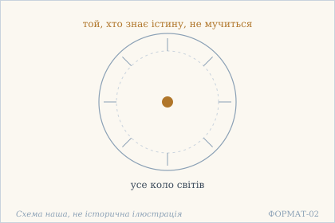 — Усе коло світів у центрі — і той, хто не мучиться. Схема наша, не історична ілюстрація.

## 17.3

**Деванагарі.** न जातु विषयाः के ऽपि । स्वारामं हर्षयन्त्य् अमी । सल्लकीपल्लवप्रीतम् । इवेभं निम्बपल्लवाः ॥

**Українська транслітерація.** на джату вішаях ке ’пі | сварамам харшаянтй амі | саллакіпаллавапрітам | івебгам німбапаллавах ||

**Переклад.** Жодні чуттєві речі не тішать того, кому втіха — у ньому самому, як не тішить слона, що любить пагони салакі, гірке листя німби.

**Науковий коментар.** Порівняння побудоване на смаку: слон має улюблену їжу й тому не бере іншої, хоч вона й лежить поруч. Так і тут — відмова не від болю й не з аскези, а від того, що не смакує. Це важливо для розуміння глави: йдеться не про придушення бажання, а про зміну мірила. Обидві рослини названі конкретно, і це робить образ побутовим, а не абстрактним; жодного філософського терміна в цьому вірші немає — ні ātman, ні cit, ні mukti.

**Українська паралель (наша інтерпретація, не твердження про вплив).** *Іван Вишенський*, «Книжка» (кінець XVI ст.). Наша паралель: у Вишенського втіха ззовні теж не замінює втіхи всередині. Наше порівняння — типологічне.

**Ілюстрація.** 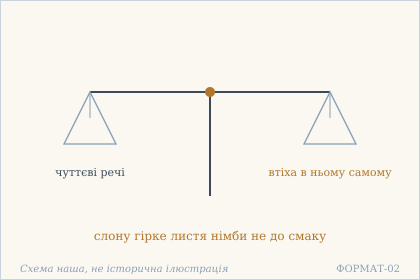 — Дві шальки: чуттєві речі й втіха всередині. Схема наша, не історична ілюстрація.

**Сцена.** 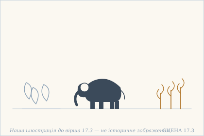 — Слон обходить гірке листя й тягнеться до пагонів, бо має свою втіху. Наша ілюстрація до вірша 17.3 — не історичне зображення.

## 17.4

**Деванагарі.** यस् तु भोगेषु भुक्तेषु । न भवत्य् अधिवासितः । अभुक्तेषु निराकाङ्क्षी । तादृशो भवदुर्लभः ॥

**Українська транслітерація.** яс ту бгоґешу бгуктешу | на бгаватй адгівасітах | абгуктешу ніраканкші | тадрішо бгавадурлабгах ||

**Переклад.** Хто вже зазнаних утіх не тягне за собою, як просякнутий їхнім запахом, і не прагне незазнаних — така людина в цьому світі рідкість.

**Науковий коментар.** Вірш розрізняє дві небезпеки, які зазвичай зливаються: пам'ять про зазнану втіху (adhivāsita, «просоченість») і потяг до ще не зазнаної. Перша тонша за другу, бо не вимагає жодного бажання — досить, щоб минуле лишило смак. Саме тому такий стан названо рідкісним: відмовитися від того, чого ще немає, легко; перестати носити в собі те, що було, — важко. Слово vairāgya тут не вжите, хоч саме його зазвичай ставлять на це місце; текст обходиться описом.

**Українська паралель (наша інтерпретація, не твердження про вплив).** *Тарас Шевченко*, «І мертвим, і живим…» (1845). Наша паралель: у Шевченка рідкість людини, яка не тягне за собою зазнаного й не прагне незазнаного, теж названа прямо. Наше порівняння — типологічне.

**Ілюстрація.** 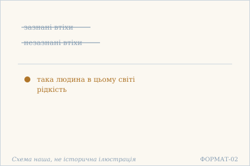 — Зазнане й незазнане не тягне за собою. Схема наша, не історична ілюстрація.

## 17.5

**Деванагарі.** बुभुक्षुर् इह संसारे । मुमुक्षुर् अपि दृश्यते । भोगमोक्षनिराकाङ्क्षी । विरलो हि महाशयः ॥

**Українська транслітерація.** бубгукшур іха самсаре | мумукшур апі дрішяте | бгоґамокшаніраканкші | вірало хі махашаях ||

**Переклад.** У цьому світі видно і тих, хто голодний до нього, і тих, хто прагне звільнення. Але хто не прагне ні втіх, ні звільнення — такий великий і рідкісний.

**Науковий коментар.** Два дезидеративи (bubhukṣu, mumukṣu) поставлено в один граматичний ряд, і цим сказано головне: бажання звільнитися має ту саму форму, що й бажання насолоди. Різниця лише в предметі, не в структурі. Тому третій член ряду — той, хто не прагне ані того, ані того, — і є рідкісний. Це не пропозиція байдужості: вірш не каже, що така людина чогось не робить, він каже, що вона не прагне. Традиційні коментарі часто додають, що такий уже вільний; сам текст цього слова не вживає — ні mukta, ні mukti тут немає.

**Українська паралель (наша інтерпретація, не твердження про вплив).** *Ліна Костенко*, «Маруся Чурай» (1979). Наша паралель: у Костенко той, хто не прагне ні втіх, ні волі, теж постає як найрідкісніший. Наше порівняння — за будовою думки.

**Ілюстрація.** 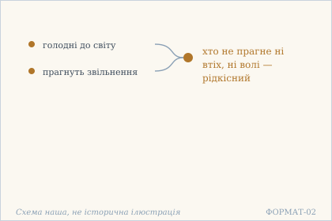 — Дві дороги прагнення — і третя, порожня. Схема наша, не історична ілюстрація.

## 17.6

**Деванагарі.** धर्मार्थकाममोक्षेषु । जीविते मरणे तथा । कस्याप्य् उदारचित्तस्य । हेयोपादेयता न हि ॥

**Українська транслітерація.** дгармартхакамамокшешу | джівіте маране татха | касяпй ударачіттася | хейопадеята на хі ||

**Переклад.** Для великодушної людини немає «відкинути» й «узяти» — ні щодо дгарми, артги, ками й мокші, ні щодо життя й смерті.

**Науковий коментар.** Той самий перелік, що в 16.5, але розширений життям і смертю: текст послідовно відмовляється визнавати будь-яку пару за ієрархію. Слово udāracitta, «великодушний», — єдина оцінка в вірші, і вона стосується не поведінки, а обсягу: вузьке серце мусить вибирати, широке не має потреби. Зверніть увагу, що мокша знову стоїть у переліку цілей, а не як стан — той самий ужиток, що в 16.5. Термінів ātman, cit, sākṣin, vairāgya тут немає.

**Українська паралель (наша інтерпретація, не твердження про вплив).** *Микола Зеров*, «Камена» (1924). Наша паралель: у Зерова відсутність відкинути й узяти теж є ознакою великодушності, а не байдужості. Наше порівняння — типологічне.

**Ілюстрація.** 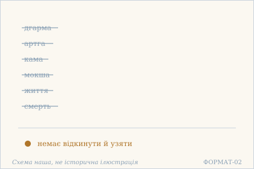 — Шість пар відкинуті: немає ні відкинути, ні взяти. Схема наша, не історична ілюстрація.

## 17.7

**Деванагарі.** वाञ्छा न विश्वविलये । न द्वेषस् तस्य च स्थितौ । यथा जीविकया तस्माद् । धन्य आस्ते यथा सुखं ॥

**Українська транслітерація.** ваньчча на вішвавілає | на двешас тася ча стхітау | ятха джівікая тасмад | дганя асте ятха сукхам ||

**Переклад.** Він не бажає, щоб світ загинув, і не має відрази до того, що світ триває. Тому блаженний сидить собі спокійно, як завгодно, — і живе з того, що має.

**Науковий коментар.** Вірш відкидає обидві есхатологічні пристрасті: і прагнення кінця світу, і відразу до його продовження. Це не байдужість до долі світу, а відмова вкладати в неї власне бажання. Друга половина — про спосіб життя: āste yathā sukham, «сидить як завгодно», поруч із yathā jīvikayā, «як дає прожиток». Разом це опис зовнішньої невимогливості, а не аскетичної програми; жодного слова про практику, обітницю чи стан життя (āśrama) тут немає.

**Українська паралель (наша інтерпретація, не твердження про вплив).** *Олександр Довженко*, «Зачарована Десна» (1956). Наша паралель: у Довженка вміння жити з того, що маєш, теж подане як спокій, а не як бідність. Наше порівняння — за образом.

**Ілюстрація.** 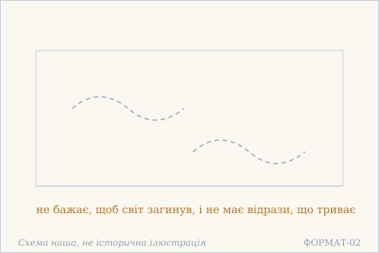 — Небо без хмар: світ може йти й стояти. Схема наша, не історична ілюстрація.

## 17.8

**Деванагарі.** कृतार्थो ऽनेन ज्ञानेनेत्य् । एवं गलितधीः कृती । पश्यन् शृण्वन् स्पृशन् जिघ्रन्न् । अश्नन्न् आस्ते यथा सुखं ॥

**Українська транслітерація.** крітартхо ’нена джняненетй | евам ґалітадгіх кріті | пашян шрінван спрішан джіґгранн | ашнанн асте ятха сукхам ||

**Переклад.** «Цим знанням я досяг мети» — і з цим, уже розтанувши розумом, він живе собі як завгодно: дивиться, слухає, торкається, нюхає, їсть.

**Науковий коментар.** Вірш цікавий тим, що єдине висловлювання, яке він цитує («цим знанням я досяг мети»), подане як думка, що вже відпрацювала себе: далі — не аргумент, а перелік найпростіших дій. Дієприкметники paśyan, śṛṇvan, spṛśan, jighran, aśnan ідуть без жодного оцінного слова; саме ця нейтральність і є змістом. galitadhī, «розталий розум», — образ, що не має філософського статусу терміна, і його не слід плутати з citta-vṛtti-nirodha інших текстів: тут нічого не спиняють, а лише констатують, що тримати вже нічого. Порядок дій (бачення, слух, дотик, нюх, їжа) повторений у 17.12, де до нього додано ще рух і мову.

**Українська паралель (наша інтерпретація, не твердження про вплив).** *Павло Тичина*, «Сонячні кларнети» (1918). Наша паралель: у Тичини дивитися, слухати, торкатися теж стає способом жити, коли мету вже досягнуто. Наше порівняння — за образом.

**Ілюстрація.** 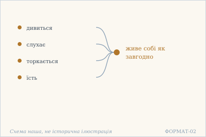 — П'ять чуттів як спосіб жити. Схема наша, не історична ілюстрація.

## 17.9

**Деванагарі.** शून्या दृष्टिर् वृथा चेष्टा । विकलानीन्द्रियाणि च । न स्पृहा न विरक्तिर् वा । क्षीणसंसारसागरे ॥

**Українська транслітерація.** шуня дріштір врітха чешта | вікаланіндріяні ча | на спріха на вірактір ва | кшінасамсарасаґаре ||

**Переклад.** Порожній погляд, марні рухи, чуття ніби понівечені; ні прагнення, ні відвернення — бо океан сансари в ньому висох.

**Науковий коментар.** Опис зовні непривабливий, і це навмисне: збоку такий стан виглядає як згасання. Три ознаки — порожній погляд, марна діяльність, немічні чуття — узяті з того, як людину бачать інші, а не з її самовідчуття. Локатив абсолютний kṣīṇasaṃsārasāgare ставить причину в кінці, і вона перевертає оцінку: це не втрата сил, а вичерпаність океану, який раніше треба було перепливати. Пара spṛhā / virakti знову знята — обидві названі як те, чого немає. Тут доречно сказати прямо: ані mukti, ані ātman, ані cit у вірші немає, і саме тому він не дає приводу назвати цей стан «звільненням» — це слово з'явиться в главі 20.

**Українська паралель (ПОТРЕБУЄ ПЕРЕВІРКИ).** *українська поезія XX ст.*, не визначено. ПОТРЕБУЄ ПЕРЕВІРКИ: образ порожнього погляду й ніби понівечених чуттів близький до української поезії, але конкретного твору ми не звірили.

**Ілюстрація.** 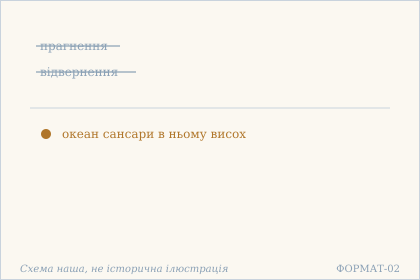 — Прагнення й відвернення відпали: океан висох. Схема наша, не історична ілюстрація.

## 17.10

**Деванагарі.** न जागर्ति न निद्राति । नोन्मीलति न मीलति । अहो परदशा क्वापि । वर्तते मुक्तचेतसः ॥

**Українська транслітерація.** на джаґарті на нідраті | нонмілаті на мілаті | ахо парадаша квапі | вартате муктачетасах ||

**Переклад.** Він не пильнує і не спить, не розплющує й не заплющує очей. О диво: розум вільної людини перебуває в якомусь зовсім іншому стані.

**Науковий коментар.** Вірш будує заперечення парами — не-сон / не-пильність, не-розплющення / не-заплющення — так, що кожна пара замикає обидві можливості. Описати такий стан звичайними словами неможливо, і текст цього не приховує: він каже лише paradaśā, «інший стан», не називаючи його. Це місце легко перетворити на містичну загадку; варто пам'ятати, що йдеться про опис збоку, а не про техніку. Слова «свідомість» (cit) чи «свідок» (sākṣin) тут немає — є muktacetas, «вільний розумом», і це єдине, що сказано про того, хто так перебуває.

**Українська паралель (ПОТРЕБУЄ ПЕРЕВІРКИ).** *українська містична проза*, не визначено. ПОТРЕБУЄ ПЕРЕВІРКИ: опис стану, що не є ні сном, ні пильністю, найближчий до української містичної прози, але назвати твір без звірки ми не можемо.

**Ілюстрація.** 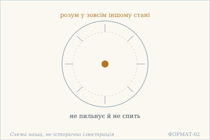 — Стан поза сном і пильністю. Схема наша, не історична ілюстрація.

## 17.11

**Деванагарі.** सर्वत्र दृश्यते स्वस्थः । सर्वत्र विमलाशयः । समस्तवासना मुक्तो । मुक्तः सर्वत्र राजते ॥

**Українська транслітерація.** сарватра дрішяте свастхах | сарватра вімалашаях | самаставасана мукто | муктах сарватра раджате ||

**Переклад.** Усюди він у собі, усюди його нутро чисте; вільний від усіх звичних слідів, звільнений сяє всюди.

**Науковий коментар.** Вірш побудований на повторі sarvatra і на подвійному mukta — «вільний [від васанових слідів]» і «звільнений». Це єдине місце глави, де сказано, від чого саме вільний: від vāsanā, звичних залишкових схильностей. Слово це важливе й легко перекладається неточно: vāsanā — не думка й не бажання, а слід, який минуле лишає в способі реагування. Порівняння з 16.7 показує, що там ішлося про той самий механізм з іншого боку: жадоба живиться станом без роздуму. rājate, «сяє», — дієслово панування, а не сяйва лампи; у перекладі збережено саме це.

**Українська паралель (наша інтерпретація, не твердження про вплив).** *Василь Стус*, «Палімпсести». Наша паралель: у Стуса звільненість від звичних слідів теж описана як сяйво, а не як порожнеча. Наше порівняння — типологічне.

**Ілюстрація.** 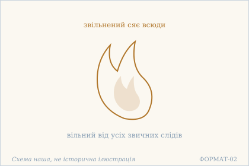 — Полумʼя без слідів: сяє всюди. Схема наша, не історична ілюстрація.

## 17.12

**Деванагарі.** पश्यन् शृण्वन् स्पृशन् जिघ्रन्न् । अश्नन् गृह्णन् वदन्व्रजन् । ईहितानीहितैर् मुक्तो । मुक्त एव महाशयः ॥

**Українська транслітерація.** пашян шрінван спрішан джіґгранн | ашнан ґріхнан ваданвраджан | іхітаніхітайр мукто | мукта ева махашаях ||

**Переклад.** Дивиться, слухає, торкається, нюхає, їсть, бере, говорить, ходить — і вільний від «бажаного» й «небажаного». Він справді звільнений, цей великий душею.

**Науковий коментар.** Перелік дій тут довший, ніж у 17.8: додано брати, говорити, ходити. Це вже не лише сприйняття, а й активне втручання у світ — і воно нічим не відрізняється від решти. Повтор muktaḥ ... mukta eva звучить як поправка до читача, який готовий заперечити: мовляв, як це вільний, коли він бере й говорить. Відповідь — уточнення, від чого саме він вільний: від пари īhita / anīhita. Це не звільнення від дій, а звільнення від поділу дій на жадані й нежадані.

**Українська паралель (наша інтерпретація, не твердження про вплив).** *Михайло Коцюбинський*, «Intermezzo» (1908). Наша паралель: у Коцюбинського звичайні дії теж не суперечать свободі від бажаного й небажаного. Наше порівняння — за будовою думки.

**Ілюстрація.** 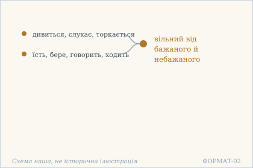 — Звичайні дії без бажаного й небажаного. Схема наша, не історична ілюстрація.

**Сцена.** 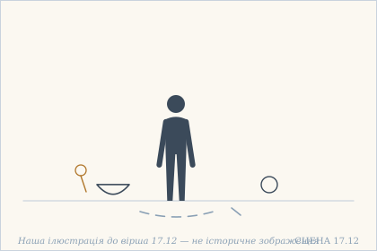 — Людина йде повз чашу, квітку й плід, торкаючись їх, і ніщо її не тримає. Наша ілюстрація до вірша 17.12 — не історичне зображення.

## 17.13

**Деванагарі.** न निन्दति न च स्तौति । न हृष्यति न कुप्यति । न ददाति न गृह्णाति । मुक्तः सर्वत्र नीरसः ॥

**Українська транслітерація.** на ніндаті на ча стауті | на хрішяті на куп'яті | на дадаті на ґріхнаті | муктах сарватра нірасах ||

**Переклад.** Не гудить і не хвалить, не тішиться й не гнівається, не дає й не бере — звільнений усюди без смаку до всього.

**Науковий коментар.** Шість дієслів ідуть трьома парами, і кожна пара охоплює протилежності: осуд і хвала, радість і гнів, давання й брання. Схема та сама, що в 16.8 і 16.10: не вибір між протилежностями, а вихід із самої пари. Останнє слово, nīrasa, навмисно негарне — воно забирає в цього стану будь-яку привабливість. Це варто зберегти в перекладі: текст не обіцяє блаженства, він описує відсутність смаку. Слів mukti чи ātman тут немає — лише muktaḥ як означення.

**Українська паралель (наша інтерпретація, не твердження про вплив).** *Григорій Сковорода*, «Вдячний Еродій» (трактат). Наша паралель: у Сковороди відсутність смаку до всього теж не є втратою смаку, а зміною його предмета. Наше порівняння — типологічне.

**Ілюстрація.** 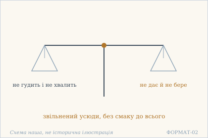 — Дві шальки: хвала й осуд — обидві порожні. Схема наша, не історична ілюстрація.

## 17.14

**Деванагарі.** सानुरागां स्त्रियं दृष्ट्वा । मृत्युं वा समुपस्थितम् । अविह्वलमनाः स्वस्थो । मुक्त एव महाशयः ॥

**Українська транслітерація.** санураґам стріям дріштва | мрітюм ва самупастхітам | авіхваламанах свастхо | мукта ева махашаях ||

**Переклад.** Побачивши жінку, повну пристрасті, або смерть, що вже насувається, він не збентежиться: він у собі, він справді звільнений, цей великий душею.

**Науковий коментар.** Вірш випробовує рівність на двох найсильніших подразниках — бажанні й страхові — і ставить їх в один граматичний ряд. Це не твердження про безстатевість чи безстрашність як чесноти: сказано лише, що розум не хитається (avihvala). Зверніть увагу, що йдеться про зустріч, а не про відмову від неї: текст не радить уникати ні того, ні того. Традиційні коментарі читають це як доказ рівності до приємного й болісного; сам вірш називає лише два конкретні випадки, і узагальнення тут — робота читача.

**Українська паралель (наша інтерпретація, не твердження про вплив).** *Леся Українка*, «Камінний господар» (1912). Наша паралель: у Лесі Українки зустріч зі смертю теж не збентежує того, хто вже в собі. Наше порівняння — за будовою думки.

**Ілюстрація.** 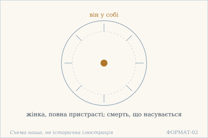 — Пристрасть і смерть навколо — він у собі. Схема наша, не історична ілюстрація.

## 17.15

**Деванагарі.** सुखे दुःखे नरे नार्यां । संपत्सु च विपत्सु च । विशेषो नैव धीरस्य । सर्वत्र समदर्शिनः ॥

**Українська транслітерація.** сукхе духкхе наре нар'ям | сампатсу ча віпатсу ча | вішешо найва дгірася | сарватра самадаршінах ||

**Переклад.** У щасті й у горі, в чоловікові й у жінці, в удачі й у біді — для стійкого, хто всюди бачить однаково, різниці немає.

**Науковий коментар.** Перелік пар тут не філософський, а побутовий: щастя й горе, чоловік і жінка, удача й біда. Пару «чоловік і жінка» не слід вичитувати як твердження про стать у метафізичному сенсі: вона стоїть у ряді з іншими парами й означає лише, що оцінка не змінюється залежно від того, з ким маєш справу. sama-darśin — «той, хто бачить рівно», і це єдиний пізнавальний термін у вірші. Слова ātman, cit, sākṣin тут немає; «рівність бачення» не тотожна ані «свідку», ані «свідомості».

**Українська паралель (наша інтерпретація, не твердження про вплив).** *Іван Франко*, «Смерть Каїна» (1889). Наша паралель: у Франка різниця між щастям і горем теж зникає для того, хто бачить однаково. Наше порівняння — типологічне.

**Ілюстрація.** 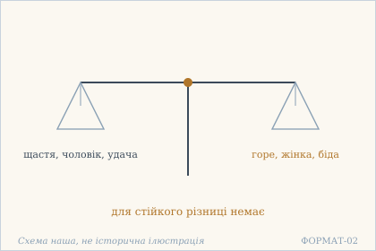 — Дві шальки, що стоять рівно: щастя й горе. Схема наша, не історична ілюстрація.

## 17.16

**Деванагарі.** न हिंसा नैव कारुण्यं । नौद्धत्यं न च दीनता । नाश्चर्यं नैव च क्षोभः । क्षीणसंसरणे नरे ॥

**Українська транслітерація.** на хімса найва каруням | науддгатям на ча діната | нашчар'ям найва ча кшобгах | кшінасамсаране наре ||

**Переклад.** Ні насильства, ні жалю, ні зарозумілості, ні приниженості, ні здивування, ні збурення — немає цього в людині, в якої скінчилося блукання.

**Науковий коментар.** Найнезвичніше тут — заперечення kāruṇya, жалю, поруч із запереченням hiṃsā, насильства. Звична етична схема вимагає одного й забороняє друге; вірш знімає обидва як ознаки того, хто ще всередині оцінки. Заперечено також āścarya, подив: стан не містить нічого несподіваного, бо немає точки, з якої щось могло б здивувати. Це місце легко прочитати як виправдання байдужості до чужого болю — і такий докір до тексту висловлювали; сам вірш, однак, описує не поведінку, а відсутність реакцій у людини, в якої вже немає нічого попереду.

**Українська паралель (наша інтерпретація, не твердження про вплив).** *Ольга Кобилянська*, «Земля» (1902). Наша паралель: у Кобилянської відсутність насильства й зарозумілості теж є ознакою людини, в якої скінчилося блукання. Наше порівняння — типологічне.

**Ілюстрація.** 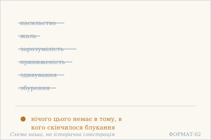 — Шість рухів, яких немає в звільненого. Схема наша, не історична ілюстрація.

## 17.17

**Деванагарі.** न मुक्तो विषयद्वेष्टा । न वा विषयलोलुपः । असंसक्तमना नित्यं । प्राप्ताप्राप्तम् उपाश्नुते ॥

**Українська транслітерація.** на мукто вішаядвешта | на ва вішаялолупах | асамсактамана нітям | праптапраптам упашнуте ||

**Переклад.** Звільнений не ненавидить чуттєвих речей і не жадібний до них; його розум ні до чого не прив'язаний, і він бере те, що прийшло, і те, що не прийшло.

**Науковий коментар.** Вірш повторює схему 16.6, але додає дію: не лише немає ненависті й жадоби, а й є прийняття того, що трапляється. Це відповідь на очевидне заперечення — якщо немає потягу, чи не стане людина пасивною? Текст відповідає дієсловом upāśnute, «споживає, приймає»: дія не зникає, зникає прив'язаність до її результату. Тут знову немає ні vairāgya, ні mukti як термінів: muktaḥ — означення, а не назва стану.

**Українська паралель (наша інтерпретація, не твердження про вплив).** *Євген Плужник*, «Рання осінь» (1927). Наша паралель: у Плужника розум, ні до чого не прив'язаний, теж бере те, що прийшло, і не сумує за тим, що не прийшло. Наше порівняння — за будовою думки.

**Ілюстрація.** 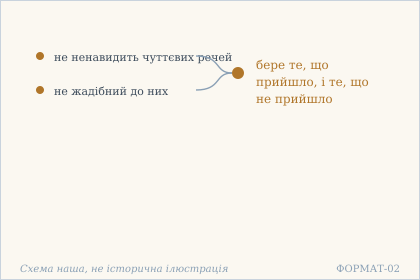 — Бере й те, що прийшло, і те, що не прийшло. Схема наша, не історична ілюстрація.

## 17.18

**Деванагарі.** समाधानासमाधान । हिताहितविकल्पनाः । शून्यचित्तो न जानाति । कैवल्यम् इव संस्थितः ॥

**Українська транслітерація.** самадганасамадгана | хітахітавікалпанах | шунячітто на джанаті | кайвалям іва самстхітах ||

**Переклад.** Розрізнень «зібраний я чи ні», «корисно це чи шкідливо» порожній розум уже не знає: він стоїть ніби в самотності.

**Науковий коментар.** Порожній розум (śūnyacitta) тут не мета, а причина незнання розрізнень: якщо немає з чим порівнювати, нема чого й розрізняти. Важливо, що серед переліку стоїть samādhāna — той самий корінь, що в samādhi, який у 16.2 був одним із трьох занять. Тут він опиняється в ряді vikalpanā, тобто серед уявних побудов. kaivalya вжите обережно, з iva, «наче»: текст не каже, що це і є звільнення, а каже, що стан схожий на нього. У главі 20 kaivalya з'явиться знову — уже в переліку того, чого немає.

**Українська паралель (наша інтерпретація, не твердження про вплив).** *Володимир Свідзінський*, «Медобір» (1975, посмертно). Наша паралель: у Свідзінського самотність теж постає як стан, у якому розрізнення втрачають сенс. Наше порівняння — за образом.

**Ілюстрація.** 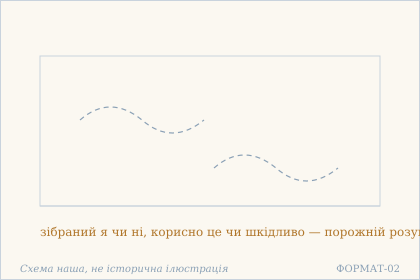 — Самотність порожнього розуму. Схема наша, не історична ілюстрація.

## 17.19

**Деванагарі.** निर्ममो निरहंकारो । न किंचिद् इति निश्चितः । अन्तर्गलितसर्वाशः । कुर्वन्न् अपि करोति न ॥

**Українська транслітерація.** нірмамо нірахамкаро | на кімчід іті нішчітах | антарґалітасарвашах | курванн апі кароті на ||

**Переклад.** Без «моє» і без «я роблю», з певністю, що немає нічого, — усі його надії розтанули зсередини, і він навіть діючи не діє.

**Науковий коментар.** Вірш зводить докупи три заперечення — «моє», «я роблю», «щось є» — і робить висновок про дію. Остання пада, kurvann api karoti na, — класична формула недіяння в діянні; вона не означає, що тіло спинилося, а що дію не приписують собі. Саме тут свідки розходяться: SARIT має na lipyate, «не зазнає плям», і подає karoti na в дужках як варіант. Обидві формули відомі з інших текстів, і вибір між ними змінює акцент — онтологічний («не діє») чи етичний («не плямується»). Яке читання первісне, за двома свідками не встановлюється.

**Українська паралель (наша інтерпретація, не твердження про вплив).** *Богдан-Ігор Антонич*, «Зелена Євангелія» (1938). Наша паралель: в Антонича дія без діяча теж описана як природний рух. Наше порівняння — типологічне.

**Ілюстрація.** 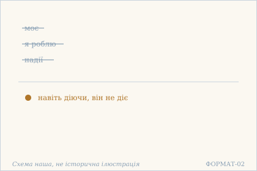 — Моє, я роблю й надії розтанули. Схема наша, не історична ілюстрація.

## 17.20

**Деванагарі.** मनःप्रकाशसम्मोह । स्वप्नजाड्यविवर्जितः । दशां काम् अपि संप्राप्तो । भवेद् गलितमानसः ॥

**Українська транслітерація.** манахпракашасаммоха | свапнаджадявіварджітах | дашам кам апі сампрапто | бгавед ґалітаманасах ||

**Переклад.** Він вільний і від ясності розуму, і від затьмарення, і від сну, і від заціпеніння — і досяг якогось [невідомого] стану, цей чоловік із розталим розумом.

**Науковий коментар.** Перелік станів розуму навмисно незвичний: до нього входять не лише затьмарення, сон і заціпеніння, а й prakāśa — ясність. Тобто заперечено не тільки погані стани, а й добрий: ясність розуму тут така сама ознака розуму, як і сон. Останній стан названо неозначено, daśāṃ kām api, і текст не намагається його описати. Форма bhavet (оптатив) додає обережності: «міг би стати», а не «став». Це останній вірш глави, і він лишає читача без назви того, про що йшлося двадцять віршів.

**Українська паралель (ПОТРЕБУЄ ПЕРЕВІРКИ).** *українська філософська проза*, не визначено. ПОТРЕБУЄ ПЕРЕВІРКИ: опис стану поза ясністю, затьмаренням, сном і заціпенінням найближчий до української філософської прози, але конкретного твору ми не перевірили.

**Ілюстрація.** 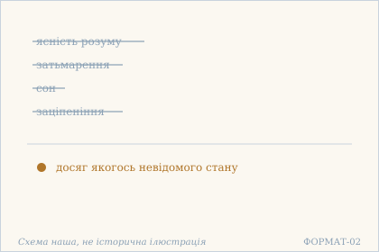 — Чотири стани розуму відпали: лишається невідомий. Схема наша, не історична ілюстрація.

## Поетичний переклад

Окремо, у [`poetychnyi/rozdil-17.md`](poetychnyi/rozdil-17.md). Це **наш поетичний переклад**, не канонічний і не науковий; у PDF він іде окремою частиною.
