# Аштавакра-ґіта. Глава 18. Наукове представлення

> ФОРМАТ-02: кожен вірш подано пʼятьма шарами — деванагарі, українська
> транслітерація, переклад, науковий коментар з українськими паралелями,
> ілюстрація. Плюс окремо — поетичний переклад (`poetychnyi/rozdil-18.md`).
>
> **Деванагарі тут — механічна** транслітерація поля `iast` з картки
> (`scripts/iast_to_devanagari.py`), а не окреме читання за рукописом.
> **Українська транслітерація** — теж механічна (`scripts/iast_to_ukrainian.py`,
> таблиця в `docs/TRANSLITERATSIIA.md`).
> **Українські паралелі** — наша інтерпретація, а не твердження про вплив;
> реєстр і правила — `paraleli.json` і `scripts/check_ukrainian_parallels.py`.
> **Схеми** — наші власні; жодна не є історичною ілюстрацією.
> **Сцени** (`ilustratsii-naratyvni/`) — теж наші власні малюнки й теж не
> історичні: це ситуація вірша, а не поняття, і фігури там — силуети без
> облич.
>
> Цей файл згенеровано; правити треба картки й `format-v2/rozdil-18.json`,
> а не його.

## Глава 18. Сто віршів про того, хто вільний

Вісімнадцята глава — половина всієї книги за обсягом: сто віршів. Вона не будує вчення, а перебирає його з усіх боків: кожен вірш — це та сама думка, сказана інакше, і саме повтор і є формою. Читачеві варто знати, що тут немає розвитку від вірша до вірша; є один стан, описаний сто разів, і кілька віршів (18.31–18.39) прямо говорять про те, що вправляння й зусилля цього стану не дають.

## 18.1

**Деванагарі.** यस्य बोधोदये तावत् स्वप्नवद् भवति भ्रमः । तस्मै सुखैकरूपाय नमः शान्ताय तेजसे ॥

**Українська транслітерація.** яся бодгодає тават свапнавад бгаваті бграмах | тасмай сукхайкарупая намах шантая теджасе ||

**Переклад.** Той, з чиїм пробудженням усвідомлення омана стає наче сон, — тому, чия єдина природа щастя, уклін: втихлому, сяйному.

**Науковий коментар.** Глава 18 відкривається єдиним у книзі `namaḥ` — поклоном. До цього текст усі 17 глав звертався до читача на «ти», а тут раптом з'являється третя особа: уклін комусь іншому. `tāvat … svapnavat` — не «омана зникла», а «омана стала наче сон»: вона не анульована, а переведена в інший регістр. Переклад мусить тримати саме це, а не «звільнився від омани».

**Українська паралель (наша інтерпретація, не твердження про вплив).** *Григорій Сковорода*, «Сад божественних пісень». Наша паралель: у Сковороди пробудження теж описується як те, з чим омана стає сном, а не як те, що додає нових знань. Наше порівняння — типологічне.

**Ілюстрація.** 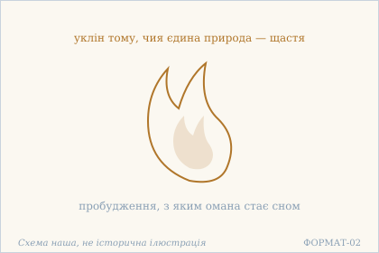 — Полумʼя пробудження: омана стає сном. Схема наша, не історична ілюстрація.

## 18.2

**Деванагарі.** अर्जयित्वाखिलान् अर्थान् भोगान् आप्नोति पुष्कलान् । न हि सर्वपरित्यागम् अन्तरेण सुखी भवेत् ॥

**Українська транслітерація.** арджаїтвакхілан артхан бгоґан апноті пушкалан | на хі сарвапарітяґам антарена сукхі бгавет ||

**Переклад.** Здобувши всі блага, людина отримує рясні насолоди — але без повного зречення всього вона не стане щасливою.

**Науковий коментар.** Вірш прямо зіставляє накопичення й щастя і не заперечує першого: насолоди справді приходять (āpnoti, дійсний спосіб). Заперечується лише висновок — sukhī bhavet стоїть в optativus («став би»), тобто це не факт, а умова, яка не виконується. Найсильніше слово — sarvaparityāga («зречення ВСЬОГО»): не більшості, не зайвого, а всього без останку. ПРИМІТКА ПРО ОБСЯГ. Глава 18 — найдовша в книзі: 99 віршів, третина тексту. Вона опрацьовується БЛОКАМИ. Ця картка належить до блоку 18.2–18.10; вірш 18.1 опрацьовано окремо (PR АҐ-18.1), а 18.11–18.99 ще не мають карток.

**Українська паралель (наша інтерпретація, не твердження про вплив).** *Григорій Сковорода*, «Убогий Жайворонок». Наша паралель: у Сковороди без зречення теж немає щастя, хоч би скільки благ зібралося. Наше порівняння — типологічне, не твердження про джерело.

**Ілюстрація.** 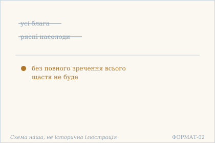 — Блага й насолоди без зречення. Схема наша, не історична ілюстрація.

## 18.3

**Деванагарі.** कर्तव्यदुःखमार्तण्डज्वालादग्धान्तरात्मनः । कुतः प्रशमपीयूषधारासारम् ऋते सुखम् ॥

**Українська транслітерація.** картав'ядухкхамартандаджваладаґдгантаратманах | кутах прашамапіюшадгарасарам ріте сукхам ||

**Переклад.** У того, чий внутрішній Атман спалений полум'ям сонця страждання від належного, — звідки візьметься щастя без суті потоку нектару вгамування?

**Науковий коментар.** mārtaṇḍa («сонце») буквально означає «той, що народився з мертвого яйця» — сонячне божество; тут воно вжите як звичайна назва сонця, але образ жорстокий: сонце не світить, а палить. Складене kartavyaduḥkha («страждання від належного») — точна діагностика: палить не біль як такий, а думка про те, що ще треба зробити. Друга половина вводить pīyūṣa («нектар») і praśama («вгамування») як єдині ліки, і це та сама логіка, що в 2.16 («немає інших ліків»).

**Ілюстрація.** 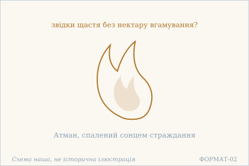 — Полумʼя страждання в серці. Схема наша, не історична ілюстрація.

## 18.4

**Деванагарі.** भवो ऽयं भावनामात्रो न किंचित् परमार्थतः । नास्त्य् अभावः स्वभावानां भावाभावविभाविनाम् ॥

**Українська транслітерація.** бгаво ’ям бгаванаматро на кімчіт парамартхатах | настй абгавах свабгаванам бгавабгававібгавінам ||

**Переклад.** Це буття — тільки уявлення, у вищому сенсі — ніщо. І немає небуття для тих речей, що розрізняють буття й небуття.

**Науковий коментар.** Вірш робить подвійний хід, і його легко прочитати наполовину. Спершу: буття — лише bhāvanā («уявлення»), і за остаточною істиною (paramārthataḥ) воно ніщо. Далі — несподіване: abhāvaḥ nāsti, «небуття немає» — тобто заперечується не лише буття, а й його відсутність. І заперечення стосується саме тих, хто розрізняє (vibhāvin): для того, хто ставить питання «є чи немає», обидві відповіді хибні. Це найточніше формулювання того, що в 2.14 було подано через athavā («або ж»).

**Ілюстрація.** 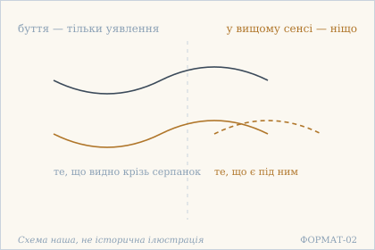 — Буття під серпанком: уявлення. Схема наша, не історична ілюстрація.

## 18.5

**Деванагарі.** न दूरं न च सङ्कोचाल् लब्धम् एवात्मनः पदम् । निर्विकल्पं निरायासं निर्विकारं निरञ्जनम् ॥

**Українська транслітерація.** на дурам на ча санкочал лабдгам еватманах падам | нірвікалпам ніраясам нірвікарам ніраньджанам ||

**Переклад.** Стопа Атмана не далеко і не досягається стисненням — вона вже досягнута: без розрізнень, без зусилля, без змін, без плями.

**Науковий коментар.** Заперечуються два способи промахнутися: уявити мету далекою (dūram) або досягти її напруженням (saṅkoca — буквально «стиснення», звуження себе). Далі чотири nir- означення стоять без дієслова й без сполучників — це не опис шляху, а перелік того, чого в досягнутому немає. nirāyāsa («без зусилля») стоїть другим, одразу після nirvikalpa, і це відповідь на saṅkoca: те, що досягнуте без стиснення, і далі не потребує зусиль.

**Українська паралель (наша інтерпретація, не твердження про вплив).** *Тарас Шевченко*, «Подражаніє Екклезіястові» (1845). Наша паралель: у Шевченка те, що не далеко й не близько, теж не досягається зусиллям. Наше порівняння — за будовою думки.

**Ілюстрація.** 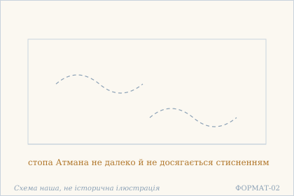 — Стопа Атмана: не далеко й не близько. Схема наша, не історична ілюстрація.

## 18.6

**Деванагарі.** व्यामोहमात्रविरतौ स्वरूपादानमात्रतः । वीतशोका विराजन्ते निरावरणदृष्टयः ॥

**Українська транслітерація.** в'ямохаматравіратау сварупаданаматратах | віташока віраджанте ніраваранадріштаях ||

**Переклад.** Коли припиняється сама лише завороженість, це вже й є прийняття власної природи: ті, чий зір без покрову, сяють, вільні від смутку.

**Науковий коментар.** Двічі повторене mātra («лише») робить основну роботу: припиняється ЛИШЕ завороженість — нічого не додається, і приймається ЛИШЕ власна природа — нічого не набувається. Тобто між двома половинами немає переходу, вони те саме, побачене з двох боків. nirāvaraṇa («без покрову») — точне слово: покров не усувається зусиллям, він просто не накидається. І зір (dṛṣṭi) тут не метафора знання, а саме зір.

**Ілюстрація.** 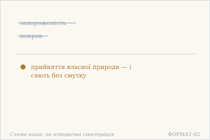 — Завороженість припинилася — зір без покрову. Схема наша, не історична ілюстрація.

## 18.7

**Деванагарі.** समस्तं कल्पनामात्रम् आत्मा मुक्तः सनातनः । इति विज्ञाय धीरो हि किम् अभ्यस्यति बालवत् ॥

**Українська транслітерація.** самастам калпанаматрам атма муктах санатанах | іті віджняя дгіро хі кім абгясяті балават ||

**Переклад.** Знаючи, що все разом — тільки побудова уяви, а Атман вільний і споконвічний, — чого ж мудрий вправляється, як дитина?

**Науковий коментар.** abhyasyati — дієслово повторювальної вправи (звідси «абг'яса» в йозі), і саме воно тут висміяне. Порівняння bālavat («як дитина») не образливе, а точне: дитина повторює те саме, поки не навчиться, — а тут навчатися вже нема кому й нема чого. sanātana («споконвічний») стоїть при ātmā і знімає час: те, що не почалося, не потребує вправи.

**Українська паралель (наша інтерпретація, не твердження про вплив).** *Леся Українка*, «Лісова пісня» (драма-феєрія). Наша паралель: у Лесі Українки Мавка живе без вправи й без мети, і саме тому її безпосередність читається як те, чого мудрий не потребує шукати. Це наша інтерпретація, а не твердження про вплив.

**Ілюстрація.** 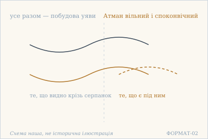 — Побудова уяви й вільний Атман. Схема наша, не історична ілюстрація.

## 18.8

**Деванагарі.** आत्मा ब्रह्मेति निश्चित्य भावाभावौ च कल्पितौ । निष्कामः किं विजानाति किं ब्रूते च करोति किम् ॥

**Українська транслітерація.** атма брахметі нішчітя бгавабгавау ча калпітау | нішкамах кім віджанаті кім бруте ча кароті кім ||

**Переклад.** Встановивши, що Атман — це Брахман, а буття й небуття — вигадані, — що безбажанний знає, що говорить, що робить?

**Науковий коментар.** Три питання в кінці — про знання, мову й дію — охоплюють усі три способи, якими людина взагалі себе виявляє. Кожне залишене без відповіді, і це не риторика заради ефекту: якщо буття й небуття вигадані, то питання «що є» втрачає ґрунт, а разом із ним і три відповіді. Формула ātmā brahma («Атман — це Брахман») тут не висновок, а niścaya — встановлене рішення, після якого питання стають безпредметними.

**Ілюстрація.** 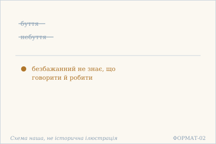 — Буття й небуття вигадані: мовчання безбажанного. Схема наша, не історична ілюстрація.

## 18.9

**Деванагарі.** अयं सो ऽहम् अयं नाहम् इति क्षीणा विकल्पनाः । सर्वम् आत्मेति निश्चित्य तूष्णीभूतस्य योगिनः ॥

**Українська транслітерація.** аям со ’хам аям нахам іті кшіна вікалпанах | сарвам атметі нішчітя тушнібгутася йоґінах ||

**Переклад.** У йога, що став безмовним, вичерпані розрізнення «це він», «це я», «це не я», — бо він встановив: «все — Атман».

**Науковий коментар.** Вірш побудований як речення без головного дієслова: kṣīṇāḥ («вичерпані») — присудок, але вся конструкція стоїть у родовому (tūṣṇībhūtasya yoginaḥ), тобто описує стан, а не подію. tūṣṇībhūta («той, хто став безмовним») — не обітниця мовчання, а наслідок: розрізнення вичерпалися, і говорити нема про що. Три формули в лапках — «це він», «це я», «це не я» — це не філософські тези, а щоденна робота розуму, названа вголос.

**Українська паралель (наша інтерпретація, не твердження про вплив).** *Митрополит Іларіон Київський*, «Слово про закон і благодать» (XI ст.). Наша паралель: у київському Слові встановлення теж знімає розрізнення, а не додає нового. Наше порівняння — типологічне; датування цієї книги науково не встановлене.

**Ілюстрація.** 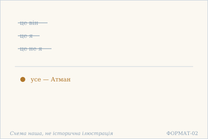 — Три розрізнення відкинуті: усе — Атман. Схема наша, не історична ілюстрація.

## 18.10

**Деванагарі.** न विक्षेपो न चैकाग्र्यं नातिबोधो न मूढता । न सुखं न च वा दुःखम् उपशान्तस्य योगिनः ॥

**Українська транслітерація.** на вікшепо на чайкаґр'ям натібодго на мудгата | на сукхам на ча ва духкхам упашантася йоґінах ||

**Переклад.** У вгамованого йога немає ні розсіяності, ні зосередженості, ні надмірного знання, ні затьмареності, ні щастя, ні страждання.

**Науковий коментар.** Три пари, і кожна заперечує обидва боки. Найважливіша перша: vikṣepa і aikāgrya — розсіяність і зосередженість — це те, чим зазвичай міряють стан розуму, і тут обидва відсутні, тобто міряти нічим. Друга пара (atibodha / mūḍhatā) забирає різницю між мудрим і дурним, третя (sukha / duḥkha) — між приємним і болісним. Це та сама схема, що в 19.4–19.7, але тут вона подана як опис, а не як питання.

**Ілюстрація.** 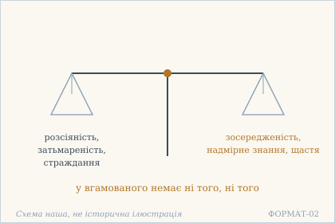 — Дві шальки, яких немає у вгамованого. Схема наша, не історична ілюстрація.

## 18.11

**Деванагарі.** स्वाराज्ये भैक्ष्यवृत्तौ च लाभालाभे जने वने । निर्विकल्पस्वभावस्य न विशेषो ऽस्ति योगिनः ॥

**Українська транслітерація.** свараджє бгайкшявріттау ча лабгалабге джане ване | нірвікалпасвабгавася на вішешо ’сті йоґінах ||

**Переклад.** У власному царстві чи в житті з подаяння, у здобутку й нездобутку, серед людей чи в лісі — для йогина, чия природа без домислювання, немає різниці.

**Науковий коментар.** Чотири пари протилежностей названі поіменно — царство й милостиня, здобуток і втрата, люди й ліс — щоб жодну не лишити поза дією. `svārājya` — не «своє царство» як володіння, а само-володарювання, стан, у якому немає над собою нікого; у главі 18 це слово трапляється не раз, і переклад має бути сталим. `viśeṣa` — «різниця», не «перевага».

**Українська паралель (наша інтерпретація, не твердження про вплив).** *Олександр Довженко*, «Зачарована Десна» (1956). Наша паралель: у Довженка багатство й убогість місця теж не міняють того, хто вміє жити. Наше порівняння — за образом.

**Ілюстрація.** 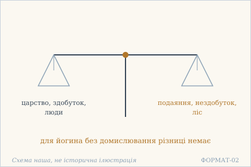 — Дві шальки: царство й життя з подаяння. Схема наша, не історична ілюстрація.

## 18.12

**Деванагарі.** क्व धर्मः क्व च वा कामः क्व चार्थः क्व विवेकता । इदं कृतम् इदं नेति द्वन्द्वैर् मुक्तस्य योगिनः ॥

**Українська транслітерація.** ква дгармах ква ча ва камах ква чартхах ква вівеката | ідам крітам ідам неті двандвайр муктася йоґінах ||

**Переклад.** Де дгарма, де бажання, де користь, де вміння розрізняти? У йога, вільного від пар протилежностей, — «це зроблено, це ні» — немає нічого з цього.

**Науковий коментар.** Той самий зачин, що в 19.2, але з іншим висновком: там було «у мене, що стоїть у власній величі», тут — «у вільного від пар». Пара «зроблено / не зроблено» — це dvandva у найпростішому вигляді: оцінка дії за наслідком. Вірш каже, що разом із парами зникає й сама можливість зарахувати щось як зроблене.

**Ілюстрація.** 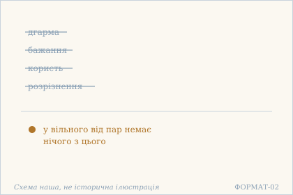 — Дгарма, бажання, користь і розрізнення відпали. Схема наша, не історична ілюстрація.

## 18.13

**Деванагарі.** कृत्यं किम् अपि नैवास्ति न कापि हृदि रञ्जना । यथाजीवनम् एवेह जीवन्मुक्तस्य योगिनः ॥

**Українська транслітерація.** крітям кім апі найвасті на капі хріді раньджана | ятхаджіванам евеха джіванмуктася йоґінах ||

**Переклад.** Немає нічого, що слід зробити, і жодної вподоби в серці — у йога, звільненого ще за життя, все йде просто як живеться, тут-таки.

**Науковий коментар.** jīvanmukta («звільнений за життя») — технічний термін адвайти: форма jīvanmuktasya засвідчена у 18.13, а jīvanmuktaḥ — також у 18.26; споріднений іменник jīvanmukti («звільнення за життя») трапляється в 18.80 і 20.4 (за SARIT та GRETIL). Друга половина — найважча: yathājīvanam може читатися як «протягом усього життя» (прислівник) або як «як живеться» (порівняння). SARIT і GRETIL членують по-різному, і обидва прочитання дають сенс. rañjanā («вподоба, забавка») точніше за «бажання»: це те, що фарбує — те саме слово, від якого rāga («пристрасть») і «фарба».

**Українська паралель (наша інтерпретація, не твердження про вплив).** *Григорій Сковорода*, «Сад божественних пісень» (збірка). Наша паралель: у Сковороди вдоволення приходить не від здобутого, а від згоди з тим, що випало, — і це близько до думки, що немає чого зробити, коли все йде як живеться. Це наша асоціація, а не твердження про вплив.

**Ілюстрація.** 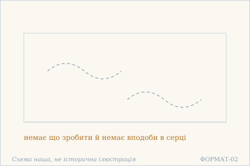 — Нічого не слід зробити: все йде як живеться. Схема наша, не історична ілюстрація.

**Сцена.** 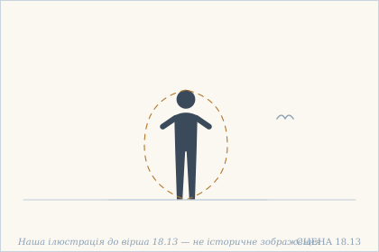 — Людина стоїть з відкритими долонями, обведена ще одним, пунктирним контуром. Наша ілюстрація до вірша 18.13 — не історичне зображення.

## 18.14

**Деванагарі.** क्व मोहः क्व च वा विश्वं क्व तद् ध्यानं क्व मुक्तता । सर्वसङ्कल्पसीमायां विश्रान्तस्य महात्मनः ॥

**Українська транслітерація.** ква мохах ква ча ва вішвам ква тад дгянам ква муктата | сарвасанкалпасімаям вішрантася махатманах ||

**Переклад.** Де омана, де світ, де те споглядання, де сам стан свободи — у великого духом, що спочив у межі всіх задумів?

**Науковий коментар.** Чотири питання, і останнє найсміливіше: питається й про muktatā — стан свободи. saṅkalpa («задум») тут ключове: межа всіх задумів — це не межа думок, а межа намірів, тобто те, де закінчується будь-яке «хай буде так». Саме там і спочиває mahātman, і тому навіть свобода не має місця як мета.

**Ілюстрація.** 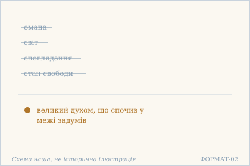 — Омана, світ, споглядання й свобода відпали. Схема наша, не історична ілюстрація.

## 18.15

**Деванагарі.** येन विश्वम् इदं दृष्टं स नास्तीति करोतु वै । निर्वासनः किं कुरुते पश्यन्न् अपि न पश्यति ॥

**Українська транслітерація.** єна вішвам ідам дріштам са настіті кароту вай | нірвасанах кім куруте пашянн апі на пашяті ||

**Переклад.** Нехай той, ким побачений цей світ, каже, що його немає, — а що робить той, у кого не лишилося слідів? Він і бачить, і не бачить.

**Науковий коментар.** nāstīti karotu («нехай робить „нема“») — формула заперечення, подана як дія, яку можна виконувати. Протиставлений їй nirvāsanaḥ: не той, хто заперечує, а той, у кого не лишилося vāsanā — слідів, навичок, залишків минулого досвіду. Остання половина — найточніша: paśyann api na paśyati («хоч бачить — не бачить») не парадокс заради ефекту, а опис: бачення є, а впізнавання як «свого» немає.

**Українська паралель (ПОТРЕБУЄ ПЕРЕВІРКИ).** *українська містична проза*, не визначено. ПОТРЕБУЄ ПЕРЕВІРКИ: стан, у якому людина і бачить, і не бачить, найближчий до української містичної прози, але конкретного твору ми не звірили.

**Ілюстрація.** 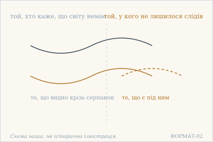 — Світ, якого немає, і той, хто не має слідів. Схема наша, не історична ілюстрація.

## 18.16

**Деванагарі.** येन दृष्टं परं ब्रह्म सो ऽहं ब्रह्मेति चिन्तयेत् । किं चिन्तयति निश्चिन्तो द्वितीयं यो न पश्यति ॥

**Українська транслітерація.** єна дріштам парам брахма со ’хам брахметі чінтаєт | кім чінтаяті нішчінто двітіям йо на пашяті ||

**Переклад.** Нехай той, ким побачено вище Брахмо, повторює: «я — Брахман». А що думає той, хто вільний від думки й не бачить нічого другого?

**Науковий коментар.** Формула so 'haṃ brahma («я — Брахман») подана як cintayet — те, що можна МІРКУВАТИ, тобто тримати в думці. Протиставлений їй niścintaḥ («без думки») — і питання kim cintayati показує, що для нього міркування вже не робота. dvitīya («друге») — точний термін: не «інше» взагалі, а те, що стоїть поряд із першим. Хто не бачить другого, тому нема з чим ототожнюватися.

**Ілюстрація.** 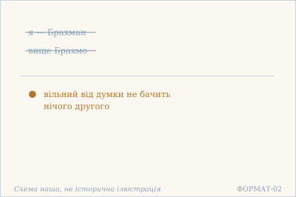 — Я — Брахман сказано; вільного від думки не питають. Схема наша, не історична ілюстрація.

## 18.17

**Деванагарі.** दृष्टो येनात्मविक्षेपो निरोधं कुरुते त्व् असौ । उदारस् तु न विक्षिप्तः साध्याभावात् करोति किम् ॥

**Українська транслітерація.** дрішто єнатмавікшепо ніродгам куруте тв асау | ударас ту на вікшіптах садгябгават кароті кім ||

**Переклад.** Хто побачив у собі розсіяння, той береться його спиняти. Але великодухий не розсіяний — і, коли немає чого досягати, що йому робити?

**Науковий коментар.** Вірш ділить людей на два типи за однією ознакою — чи бачать вони в собі розсіяння. Для першого nirodha («припинення») є справою; для другого sādhya («досяжне») просто немає, бо немає від чого відштовхуватися. Слово udāra («великодухий») ужите тут не як похвала, а як точна ознака: широкий — отже, не звужений до одного напрямку, а тому й не може бути «розсіяним» у поганому сенсі.

**Українська паралель (наша інтерпретація, не твердження про вплив).** *Олександр Потебня*, «Думка й мова» (праця). Наша паралель: Потебня показує, що помітити власну розсіяність можна лише там, де вже є розрізнення, — тобто сама спроба спиняти розсіяння вже передбачає того, хто її має. Це наша інтерпретація, а не твердження про вплив.

**Ілюстрація.** 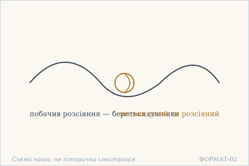 — Вузол розсіяння, якого немає в великодухого. Схема наша, не історична ілюстрація.

## 18.18

**Деванагарі.** धीरो लोकविपर्यस्तो वर्तमानो ऽपि लोकवत् । न समाधिं न विक्षेपं न लेपं स्वस्य पश्यति ॥

**Українська транслітерація.** дгіро локавіпар'ясто вартамано ’пі локават | на самадгім на вікшепам на лепам свася пашяті ||

**Переклад.** Мудрий, збочений разом зі світом, поводиться як увесь світ — і не бачить у себе ні самадгі, ні розсіяння, ні налипання.

**Науковий коментар.** Найсміливіше місце блоку: dhīra описаний як lokaviparyasta — «збочений разом зі світом». Це не докір, а точність: він поводиться як усі, і ззовні його не відрізнити. Три заперечення (samādhi, vikṣepa, lepa) забирають і високу практику, і її відсутність, і забрудненість — тобто всю шкалу, якою зазвичай міряють. Порівняй 14.4, де така людина постає «як божевільна»: тут те саме сказано спокійніше й точніше.

**Ілюстрація.** 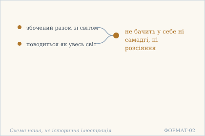 — Мудрий, збочений разом зі світом. Схема наша, не історична ілюстрація.

## 18.19

**Деванагарі.** भावाभावविहीनो यस् तृप्तो निर्वासनो बुधः । नैव किंचित् कृतं तेन लोकदृष्ट्या विकुर्वता ॥

**Українська транслітерація.** бгавабгававіхіно яс тріпто нірвасано будгах | найва кімчіт крітам тена локадріштя вікурвата ||

**Переклад.** Тим, хто позбавлений буття й небуття, хто вдоволений, без слідів і тверезий, — не зроблено нічого, хоч з погляду світу він діє.

**Науковий коментар.** Вірш розводить дві оцінки однієї дії: lokadṛṣṭyā («з погляду світу») дія є, а kṛtam («зроблене») не накопичується. Це та сама думка, що в 13.3, але тут вона подана як висновок, а не як питання. tṛpta («вдоволений») стоїть у переліку ознак не випадково: незадоволеність — те, що змушує зараховувати дії собі.

**Ілюстрація.** 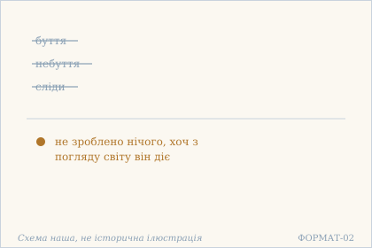 — Позбавлений буття й небуття — і все ж діє. Схема наша, не історична ілюстрація.

## 18.20

**Деванагарі.** प्रवृत्तौ वा निवृत्तौ वा नैव धीरस्य दुर्ग्रहः । यदा यत् कर्तुम् आयाति तत् कृत्वा तिष्ठतः सुखम् ॥

**Українська транслітерація.** правріттау ва нівріттау ва найва дгірася дурґрахах | яда ят картум аяті тат крітва тіштхатах сукхам ||

**Переклад.** Ні в діянні, ні у відступі немає в мудрого зацикленості: що б не випало зробити, зробивши те, він перебуває зручно.

**Науковий коментар.** pravṛtti / nivṛtti («виступання» / «відступ») — класична пара індійської думки: діяти в світі чи відійти від нього. Вірш каже, що для мудрого вона не має ваги, і причина названа точно: durgraha («вперте хапання») — не вибір, а зацикленість на виборі. Друга половина повторює 13.3 майже дослівно (yadā yat kartum āyāti), але замість «сиджу, як завгодно» тут «перебуває зручно» — та сама формула, інший відтінок.

**Українська паралель (наша інтерпретація, не твердження про вплив).** *Іван Франко*, «Мойсей» (1905). Наша паралель: у Франка відсутність зацикленості теж постає як ознака того, хто дійшов. Наше порівняння — типологічне.

**Ілюстрація.** 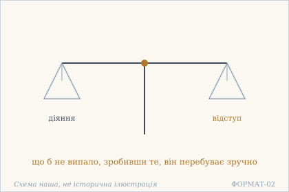 — Дві шальки: діяння й відступ. Схема наша, не історична ілюстрація.

## 18.21

**Деванагарі.** निर्वासनो निरालम्बः स्वच्छन्दो मुक्तबन्धनः । क्षिप्तः संस्कारवातेन चेष्टते शुष्कपर्णवत् ॥

**Українська транслітерація.** нірвасано ніраламбах сваччандо муктабандганах | кшіптах самскараватена чештате шушкапарнават ||

**Переклад.** Без слідів, без опори, за власною волею, з відпущеними путами — гнаний вітром самскар, він ворушиться, як сухий лист.

**Науковий коментар.** Образ сухого листа точний у двох відношеннях: він рухається, хоч сам не має сили руху, і він ні до чого не прикріплений. Тобто дія є, а діяча немає. saṃskāravāta («вітер самскар») — те саме, що cittavāta в главах 2 і 7, але тут вітер жене вже не човен і не хвилю, а лист: різниця мас. Чотири ознаки на початку (nirvāsana, nirālamba, svacchanda, muktabandhana) ідуть без дієслова — це не опис шляху, а перелік того, чого вже немає.

**Українська паралель (наша інтерпретація, не твердження про вплив).** *Василь Стус*, «Палімпсести» (збірка). Наша паралель: у Стуса людина, гнана вітром обставин, уподібнюється до сухого листя — образ, дуже близький до самскар, що несуть тіло без його волі. Це наша асоціація, а не твердження про вплив.

**Ілюстрація.** 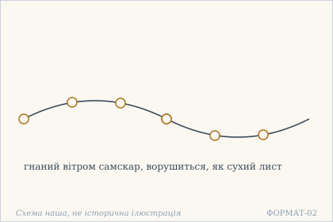 — Сухий лист на вітрі самскар. Схема наша, не історична ілюстрація.

## 18.22

**Деванагарі.** असंसारस्य तु क्वापि न हर्षो न विषादिता । स शीतलमना नित्यं विदेह इव राजते ॥

**Українська транслітерація.** асамсарася ту квапі на харшо на вішадіта | са шіталамана нітям відеха іва раджате ||

**Переклад.** У того, хто поза сансарою, ніде немає ні захвату, ні смутку: прохолодний розумом, він завжди сяє, наче розвтілеснений.

**Науковий коментар.** śītamana («прохолодний розумом») — не «байдужий»: прохолода тут властивість, а не відсутність тепла. І пара harṣa / viṣāda («захват» / «смуток») та сама, що в 4.2 і 3.9, але там ішлося про те, чого мудрий не відчуває, а тут — про те, що його стан видно ззовні. videha («без тіла») з iva («наче») — не твердження, що тіла немає, а опис того, як він виглядає: тіло є, а прив'язки до нього не видно.

**Українська паралель (наша інтерпретація, не твердження про вплив).** *Памфіл Юркевич*, «Серце і його значення в духовному житті людини» (праця). Наша паралель: Юркевич описує внутрішню зосередженість, у якій людина не захоплена зовнішнім, — стан, який у вірші названо прохолодним розумом і порівняно з розвтілесненим. Це наша інтерпретація, а не твердження про вплив.

**Ілюстрація.** 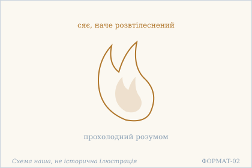 — Прохолодне полумʼя без тіла. Схема наша, не історична ілюстрація.

## 18.23

**Деванагарі.** कुत्रापि न जिहासास्ति नाशो वापि न कुत्रचित् । आत्मारामस्य धीरस्य शीतलाच्छतरात्मनः ॥

**Українська транслітерація.** кутрапі на джіхасасті нашо вапі на кутрачіт | атмарамася дгірася шіталаччатаратманах ||

**Переклад.** Ніде немає бажання відкинути, і ніде немає загибелі — у мудрого, чия втіха — Атман, чий Атман прохолодний і прозорий.

**Науковий коментар.** jihāsā («бажання відкинути») — дезидератив, тобто «хотіння покинути»; разом із nāśa («загибель») він закриває обидва способи втрати: відмовитися самому або бути знищеним. ātmārāma («той, чия втіха — Атман») — слово, відоме з «Бгаґавад-ґіти»; тут воно вжите без пояснень, як звичний зворот. Форма śītalācchatarātmanaḥ важка й, найімовірніше, зіпсована; я розібрав її як складене «прохолодний-прозорий-Атман», але це тлумачення, а не встановлене членування.

**Ілюстрація.** 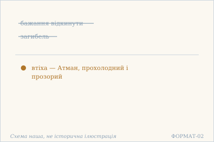 — Немає що відкидати й немає загибелі. Схема наша, не історична ілюстрація.

## 18.24

**Деванагарі.** प्रकृत्या शून्यचित्तस्य कुर्वतो ऽस्य यदृच्छया । प्राकृतस्येव धीरस्य न मानो नावमानता ॥

**Українська транслітерація.** пракрітя шунячіттася курвато ’ся ядріччая | пракрітасєва дгірася на мано наваманата ||

**Переклад.** У того, чий розум за природою порожній і хто діє, як випаде, — як у звичайної людини: немає ні гордості, ні приниженості.

**Науковий коментар.** prākṛtasya iva («як у звичайного») — найважливіше: мудрий не вирізняється, і саме тому в нього немає ні māna, ні avamānatā. Ці два слова — не просто «гордість» і «скромність», а стан у чиїхось очах: māna — коли тебе шанують, avamānatā — коли тебе принижують. Обидва потребують глядача, і вірш каже, що глядача немає. Порівняй 18.18 (lokaviparyasta): та сама думка, інший бік.

**Ілюстрація.** 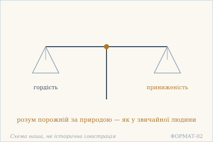 — Дві шальки: гордість і приниженість. Схема наша, не історична ілюстрація.

## 18.25

**Деванагарі.** कृतं देहेन कर्मेदं न मया शुद्धरूपिणा । इति चिन्तानुरोधी यः कुर्वन्न् अपि करोति न ॥

**Українська транслітерація.** крітам дехена кармедам на мая шуддгарупіна | іті чінтануродгі ях курванн апі кароті на ||

**Переклад.** «Це діяння зробило тіло, не я, чистої природи» — хто тримається цієї думки, той і роблячи не робить.

**Науковий коментар.** Формула «зробило тіло, не я» — класичне виправдання, і вірш ставиться до неї стримано: cintānurodhī («той, хто йде за думкою») означає, що сама думка ще не є свободою, а лише тим, за чим ідуть. Висновок kurvann api karoti na («хоч робить — не робить») стосується не того, хто проголошує формулу, а того, хто нею живе. Різниця між 18.19 (там «не зроблено нічого» сказано про мудрого) і тут — у тому, що тут ідеться про думку, а не про стан.

**Українська паралель (наша інтерпретація, не твердження про вплив).** *Григорій Сковорода*, «Наркіс. Розмова про те: Пізнай себе». Наша паралель: у Сковороди діяння теж приписується тілу, а не тому, хто в тілі бачить. Наше порівняння — типологічне.

**Ілюстрація.** 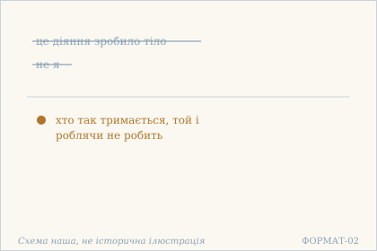 — Діяння тіла, а не мене. Схема наша, не історична ілюстрація.

## 18.26

**Деванагарі.** अतद्वादीव कुरुते न भवेद् अपि बालिशः । जीवन्मुक्तः सुखी श्रीमान् संसरन्न् अपि शोभते ॥

**Українська транслітерація.** атадвадіва куруте на бгавед апі балішах | джіванмуктах сукхі шріман самсаранн апі шобгате ||

**Переклад.** Навіть якщо він каже не те, він не стає від цього дурнем: звільнений за життя, щасливий, сяйний — він гарний навіть тоді, коли блукає сансарою.

**Науковий коментар.** Вірш захищає того, хто говорить неправильно: atadvādī («той, хто каже „не те“») не стає bāliśa («дурнем»), бо слова не міняють стану. Друга половина повертає jīvanmukta з 18.13 і додає saṃsaran api («навіть блукаючи»): свобода не скасовує блукання, а робить його гарним. śobhate («сяє, гарно виглядає») — слово про вигляд, не про суть, і це навмисно: йдеться про те, як це видно.

**Ілюстрація.** 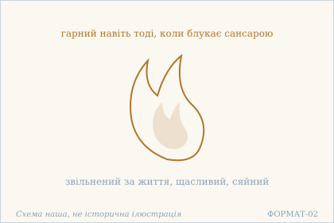 — Сяйво звільненого за життя. Схема наша, не історична ілюстрація.

## 18.27

**Деванагарі.** नानाविचारसुश्रान्तो धीरो विश्रान्तिम् आगतः । न कल्पते न जानाति न शृणोति न पश्यति ॥

**Українська транслітерація.** нанавічарасушранто дгіро вішрантім аґатах | на калпате на джанаті на шріноті на пашяті ||

**Переклад.** Мудрий, стомлений різноманітними роздумами, дійшов до спочинку: він не утворюється, не знає, не чує, не бачить.

**Науковий коментар.** Чотири заперечення наприкінці — це не опис нечутливості, а скасування чотирьох способів бути при справах: kalpate («вважається, утворюється»), jānāti, śṛṇoti, paśyati. Найцікавіше перше: na kalpate означає, що він більше не «складається» в якусь роль. Стомленість названа suśrānta («вельми втомлений») і стоїть як причина, а не як вада: спочинок приходить саме тому, що роздумів було надто багато.

**Українська паралель (наша інтерпретація, не твердження про вплив).** *Григорій Сковорода*, «Наркіс. Розмова про те: пізнай себе» (діалог). Наша паралель: Сковорода теж доводить самопізнання до межі, за якою зовнішнє вже не дає нічого, — і далі людина мовчить, а не описує. Це наша інтерпретація, а не твердження про вплив.

**Ілюстрація.** 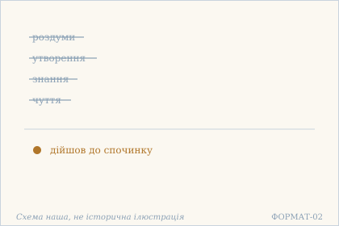 — Роздуми вичерпані: спочинок. Схема наша, не історична ілюстрація.

## 18.28

**Деванагарі.** असमाधेर् अविक्षेपान् न मुमुक्षुर् न चेतरः । निश्चित्य कल्पितं पश्यन् ब्रह्मैवास्ते महाशयः ॥

**Українська транслітерація.** асамадгер авікшепан на мумукшур на четарах | нішчітя калпітам пашян брахмайвасте махашаях ||

**Переклад.** Ні через відсутність самадгі, ні через відсутність розсіяння він не є ні тим, хто прагне визволення, ні кимось іншим: вирішивши так і бачачи все вигаданим, великодухий перебуває як саме Брахмо.

**Науковий коментар.** Подвійний ablativus (asamādheḥ, avikṣepāt) закриває обидва боки: він не mumukṣu ні тому, що не має зосередження, ні тому, що не має розсіяння. Тобто ознака прагнення не залежить від стану розуму взагалі. brahma eva āste («перебуває як саме Брахмо») — найсильніше твердження блоку: не «усвідомлює себе Брахмом», а перебуває ним.

**Ілюстрація.** 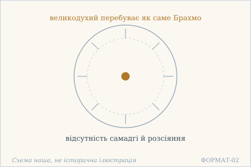 — Поза самадгі й розсіянням — як саме Брахмо. Схема наша, не історична ілюстрація.

## 18.29

**Деванагарі.** यस्यान्तः स्याद् अहङ्कारो न करोति करोति सः । निरहङ्कारधीरेण न किंचिद् अकृतं कृतम् ॥

**Українська транслітерація.** ясянтах сяд аханкаро на кароті кароті сах | ніраханкарадгірена на кімчід акрітам крітам ||

**Переклад.** У кого всередині є «я-роблення», той не робить, хоч і робить. А в мудрого без «я-роблення» не лишається нічого незробленого.

**Науковий коментар.** ahaṅkāra — не «его» в психологічному сенсі, а буквально «роблення „я“»: акт, яким дія зараховується собі. Тому перша половина й парадоксальна: хто робить цей акт, той насправді не діє. Друга половина — дзеркальна: без цього акту немає незробленого, бо нема кому вести рахунок. Це найточніше формулювання тієї самої думки, що в 13.3 і 18.19.

**Ілюстрація.** 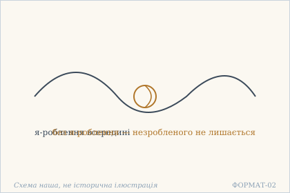 — Вузол я-роблення. Схема наша, не історична ілюстрація.

## 18.30

**Деванагарі.** नोद्विग्नं न च सन्तुष्टम् अकर्तृ स्पन्दवर्जितम् । निराशं गतसन्देहं चित्तं मुक्तस्य राजते ॥

**Українська транслітерація.** нодвіґнам на ча сантуштам акартри спандаварджітам | нірашам ґатасандехам чіттам муктася раджате ||

**Переклад.** Не схвильований і не вдоволений, без діяча, без пориву, без сподівань і без сумніву — розум вільного сяє.

**Науковий коментар.** Шість ознак, і всі — заперечні або позбавні, крім останнього дієслова rājate («сяє»). Це навмисна будова: описується не те, який розум є, а те, чого в ньому немає, і лише сяйво ствердне. akartṛ («без діяча») стоїть у середині переліку і є його віссю: прибравши діяча, решта ознак випливає сама. spanda («тремтіння») — те саме слово, що в назві школи кашмірського шіваїзму, але тут воно означає просто порив.

**Ілюстрація.** 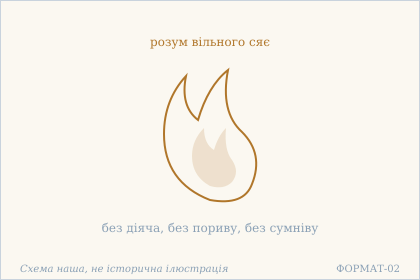 — Розум вільного сяє. Схема наша, не історична ілюстрація.

## 18.31

**Деванагарі.** निर्ध्यातुं चेष्टितुं वापि यच् चित्तं न प्रवर्तते । निर्निमित्तम् इदं किन्तु निर्ध्यायति विचेष्टते ॥

**Українська транслітерація.** нірдгятум чештітум вапі яч чіттам на правартате | нірніміттам ідам кінту нірдгяяті вічештате ||

**Переклад.** Ум, що не береться ні замислитися, ні діяти, — але ж він, без причини, замислюється й діє.

**Науковий коментар.** Вірш описує парадокс, а не заклик: ум не має наміру ні думати, ні діяти — і все ж думає й діє. `nirnimitta` («без причини, без приводу») — ключове слово: дія відбувається, але без того, хто її задумав. Це та сама структура, що в 15.16, де немає ні того, хто в сансарі, ні того, хто поза нею. `kintu` («але ж») тримає здивування, і його не можна викидати.

**Українська паралель (ПОТРЕБУЄ ПЕРЕВІРКИ).** *українська філософська лірика*, не визначено. ПОТРЕБУЄ ПЕРЕВІРКИ: ум, що замислюється без причини, — думка, близька до української філософської лірики, але конкретного твору ми не перевірили.

**Ілюстрація.** 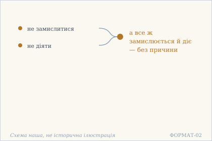 — Ум, що замислюється без причини. Схема наша, не історична ілюстрація.

## 18.32

**Деванагарі.** तत्त्वं यथार्थम् आकर्ण्य मन्दः प्राप्नोति मूढताम् । अथ वायाति सङ्कोचम् अमूढः को ऽपि मूढवत् ॥

**Українська транслітерація.** таттвам ятхартхам акарня мандах прапноті мудгатам | атха ваяті санкочам амудгах ко ’пі мудгават ||

**Переклад.** Почувши правильно істину, тупий стає ще затьмаренішим — або ж звужується; а буває й незатьмарений, що поводиться як затьмарений.

**Науковий коментар.** Вірш чесно називає, що буває з людиною від почутого: або гірше, або звуження. saṅkoca («стиснення») — те саме слово, що в 18.5, де воно було хибним способом досягнення; тут воно наслідок неправильно прийнятої істини. Остання половина додає третій випадок: amūḍha, який поводиться як mūḍha — і це вже не про розум, а про вигляд.

**Ілюстрація.** 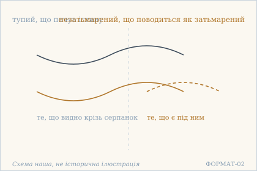 — Той, хто чув істину: тупий і незатьмарений. Схема наша, не історична ілюстрація.

## 18.33

**Деванагарі.** एकाग्रता निरोधो वा मूढैर् अभ्यस्यते भृशम् । धीराः कृत्यं न पश्यन्ति सुप्तवत् स्वपदे स्थिताः ॥

**Українська транслітерація.** екаґрата ніродго ва мудгайр абгясяте бгрішам | дгірах крітям на пашянті суптават свападе стхітах ||

**Переклад.** Зосередженість або припинення старанно вправляють дурні. Мудрі не бачать, що їм робити, — вони стоять на власному місці, як сплячі.

**Науковий коментар.** Дві вправи названі поіменно (ekāgratā, nirodha) і віддані дурням — це рідкісна в книзі пряма оцінка практики. suptavat («як сплячі») не принизливе: сплячий не робить нічого й не потребує робити. svapada («власне місце») — те саме слово, що в 18.5 (ātmanaḥ padam).

**Українська паралель (наша інтерпретація, не твердження про вплив).** *Ліна Костенко*, «Маруся Чурай» (роман у віршах). Наша паралель: у Костенко героїня тримається власного місця тоді, коли світ навколо вже зрадив, — і це схоже на стояння мудрого, який не бачить, що йому робити, бо робити нічого. Це наша асоціація, а не твердження про вплив.

**Ілюстрація.** 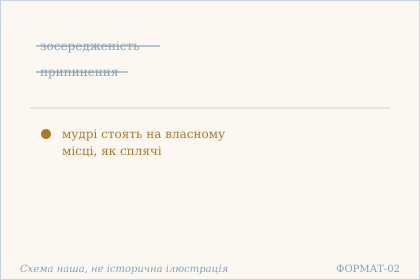 — Зосередженість і припинення відпадають. Схема наша, не історична ілюстрація.

## 18.34

**Деванагарі.** अप्रयत्नात् प्रयत्नाद् वा मूढो नाप्नोति निर्वृतिम् । तत्त्वनिश्चयमात्रेण प्राज्ञो भवति निर्वृतः ॥

**Українська транслітерація.** апраятнат праятнад ва мудго напноті нірврітім | таттванішчаяматрена праджньо бгаваті нірврітах ||

**Переклад.** Ні без зусилля, ні із зусиллям дурний не досягає заспокоєння: розумний заспокоюється самим лише рішенням про істину.

**Науковий коментар.** Подвійний ablativus (aprayatnāt, prayatnāt) закриває обидва боки так само, як у 18.28, — і тут це відповідь на 18.33, де дурні старанно вправляються. tattvaniścayamātra («саме лише рішення про істину») — не «знання», а niścaya, тобто остаточне встановлення, після якого питання знімається.

**Українська паралель (наша інтерпретація, не твердження про вплив).** *Василь Симоненко*, «Ти знаєш, що ти — людина» (вірш). Наша паралель: у Симоненка гідність тримається не на зусиллі, а на самому визнанні того, ким людина є, — подібно до заспокоєння через рішення про істину. Це наша інтерпретація, а не твердження про вплив.

**Ілюстрація.** 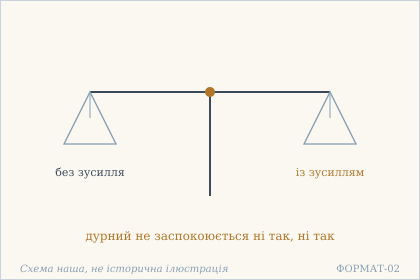 — Дві шальки: зусилля й відсутність зусилля. Схема наша, не історична ілюстрація.

## 18.35

**Деванагарі.** शुद्धं बुद्धं प्रियं पूर्णं निष्प्रपञ्चं निरामयम् । आत्मानं तं न जानन्ति तत्राभ्यासपरा जनाः ॥

**Українська транслітерація.** шуддгам буддгам пріям пурнам нішпрапаньчам нірамаям | атманам там на джананті татрабгясапара джанах ||

**Переклад.** Атман — чистий, пізнаний, любий, повний, без множинності, без недуги — такого не знають ті, для кого головне — вправа.

**Науковий коментар.** Шість ознак із шести — ствердні, і це єдиний такий перелік у главі: попередні будувалися на запереченнях. abhyāsaparāḥ («ті, чиє головне — вправа») — точна адреса докору: не «ліниві», а саме ті, хто зробив практику головним. priya («любий») у переліку ознак Атмана несподіване й навмисне: не «блаженний» як властивість, а той, кого люблять.

**Ілюстрація.** 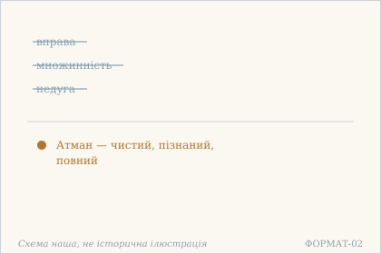 — Атман поза вправою й множинністю. Схема наша, не історична ілюстрація.

## 18.36

**Деванагарі.** नाप्नोति कर्मणा मोक्षं विमूढो ऽभ्यासरूपिणा । धन्यो विज्ञानमात्रेण मुक्तस् तिष्ठत्य् अविक्रियः ॥

**Українська транслітерація.** напноті кармана мокшам вімудго ’бгясарупіна | дганйо віджнянаматрена муктас тіштхатй авікріях ||

**Переклад.** Зовсім затьмарений не досягає визволення ні діянням, ні тим, що має вигляд вправи; а блаженний, вільний самим лише розпізнанням, перебуває незмінним.

**Науковий коментар.** abhyāsarūpa («те, що має вигляд вправи») — формула точна: йдеться не про вправу, а про її видимість. Протиставлення vijñānamātra («саме лише розпізнання») ставить розпізнання на місце дії, і avikriya («незмінний») — наслідок: те, що не змінюється, не потребує ані дії, ані вправи.

**Ілюстрація.** 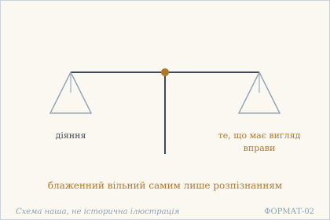 — Дві шальки: діяння й вправа. Схема наша, не історична ілюстрація.

## 18.37

**Деванагарі.** मूढो नाप्नोति तद् ब्रह्म यतो भवितुम् इच्छति । अनिच्छन्न् अपि धीरो हि परब्रह्मस्वरूपभाक् ॥

**Українська транслітерація.** мудго напноті тад брахма ято бгавітум іччаті | аніччанн апі дгіро хі парабрахмасварупабгак ||

**Переклад.** Дурний не досягає того Брахма, бо хоче ним стати. А мудрий, і не бажаючи, має власну природу вищого Брахма.

**Науковий коментар.** Причина названа точно: icchati («хоче стати») — саме бажання стати й не дає досягти, бо досягнення передбачає, що зараз не так. anicchan api («і не бажаючи») — не «без бажання» як заслуга, а просто відсутність цієї операції. bhāk («той, хто має частку») замість «той, хто є» — обережніше слово, ніж здається.

**Ілюстрація.** 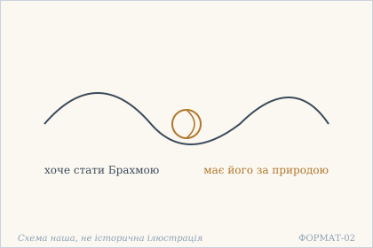 — Вузол бажання стати Брахмою. Схема наша, не історична ілюстрація.

## 18.38

**Деванагарі.** निराधारा ग्रहव्यग्रा मूढाः संसारपोषकाः । एतस्यानर्थमूलस्य मूलच्छेदः कृतो बुधैः ॥

**Українська транслітерація.** нірадгара ґрахав'яґра мудгах самсарапошаках | етасянартхамулася мулаччедах кріто будгайх ||

**Переклад.** Без опори, заклопотані хапанням, дурні годують сансару. А розумні зробили відтин кореня цього кореня лиха.

**Науковий коментар.** saṃsārapoṣaka («той, що годує сансару») — сильне слово: сансара не стан, у якому перебувають, а те, що хтось годує. mūlaccheda («відтин кореня») — не «видалення», а саме підтин під основу, після якого нічого не відростає. graha тут двозначне: і «хапання», і «планета» — тобто заклопотаність тим, що хапає.

**Ілюстрація.** 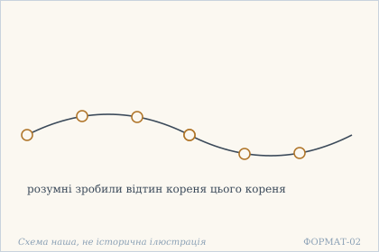 — Відтин кореня лиха. Схема наша, не історична ілюстрація.

## 18.39

**Деванагарі.** न शान्तिं लभते मूढो यतः शमितुम् इच्छति । धीरस् तत्त्वं विनिश्चित्य सर्वदा शान्तमानसः ॥

**Українська транслітерація.** на шантім лабгате мудго ятах шамітум іччаті | дгірас таттвам вінішчітя сарвада шантаманасах ||

**Переклад.** Дурний не отримує спокою, бо хоче заспокоїтися. А мудрий, остаточно встановивши істину, завжди має спокійний розум.

**Науковий коментар.** Той самий хід, що в 18.37: бажання стану не дає стану. Різниця в тому, що тут ідеться про śānti, і паралель точна — icchati («хоче») у першій половині проти viniścitya («встановивши») у другій: бажання й встановлення стоять на одному місці й не можуть бути разом.

**Ілюстрація.** 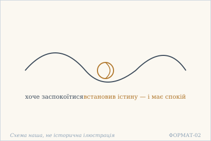 — Вузол бажання спокою. Схема наша, не історична ілюстрація.

## 18.40

**Деванагарі.** क्वात्मनो दर्शनं तस्य यद् दृष्टम् अवलम्बते । धीरास् तं तं न पश्यन्ति पश्यन्त्य् आत्मानम् अव्ययम् ॥

**Українська транслітерація.** кватмано даршанам тася яд дріштам аваламбате | дгірас там там на пашянті пашянтй атманам ав'яям ||

**Переклад.** Де в того бачення Атмана, хто тримається побаченого? Мудрі такого не бачать — вони бачать Атман, незнищенний.

**Науковий коментар.** Вірш грає двома смислами paśyati: «бачити [людину]» і «бачити [Атман]». dhīrāḥ tam na paśyanti — вони не бачать того, хто спирається на побачене, тобто не визнають його за того, ким він себе вважає; і в тому ж руслі paśyanti ātmānam. avyaya («незнищенний») — точніше «невитратний»: те, що не зменшується від використання.

**Ілюстрація.** 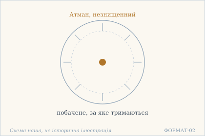 — Побачене й Атман, який бачать мудрі. Схема наша, не історична ілюстрація.

## 18.41

**Деванагарі.** क्व निरोधो विमूढस्य यो निर्बन्धं करोति वै । स्वारामस्यैव धीरस्य सर्वदासाव् अकृत्रिमः ॥

**Українська транслітерація.** ква ніродго вімудгася йо нірбандгам кароті вай | сварамасяйва дгірася сарвадасав акрітрімах ||

**Переклад.** Де припинення в того, хто зовсім затьмарився і наполягає? У мудрого, чия втіха — в собі, воно завжди невдаване.

**Науковий коментар.** Протиставлення точне: nirodha можна робити (karoti), а akṛtrima — «невдаване» — робити не можна за визначенням. Тому питання kva («де?») стосується не місця, а самої можливості. svārāma («чия втіха — в собі») — те саме слово, що в 18.23; тут воно протиставлене nirbandha («наполегливості»).

**Ілюстрація.** 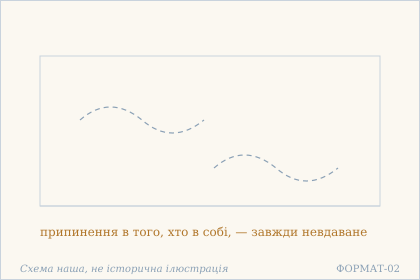 — Припинення, яке не треба вдавати. Схема наша, не історична ілюстрація.

## 18.42

**Деванагарі.** भावस्य भावकः कश्चिन् न किंचिद् भावको ऽपरः । उभयाभावकः कश्चिद् एवम् एव निराकुलः ॥

**Українська транслітерація.** бгавася бгаваках кашчін на кімчід бгавако ’парах | убгаябгаваках кашчід евам ева ніракулах ||

**Переклад.** Один наділяє буттям, інший не наділяє нічим, дехто не наділяє ні тим, ні тим. Саме так він безтурботний.

**Науковий коментар.** Рідкісний у книзі перелік із трьох типів, поданий без оцінки: перший уявляє буття, другий — ніщо (заперечення), третій не робить ні того, ні того. Безтурботність (nirākula) приписана саме третьому, і це важливо: не заперечення рятує, а вихід із пари «уявляти / не уявляти». Форма bhāvaka (каузативна від bhū) означає активне наділяння буттям, а не пасивне сприйняття.

**Ілюстрація.** 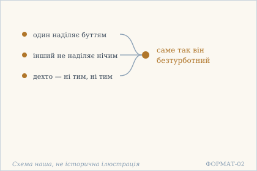 — Три способи наділяти буттям. Схема наша, не історична ілюстрація.

## 18.43

**Деванагарі.** शुद्धम् अद्वयम् आत्मानं भावयन्ति कुबुद्धयः । न तु जानन्ति संमोहाद् यावज्जीवम् अनिर्वृताः ॥

**Українська транслітерація.** шуддгам адваям атманам бгаваянті кубуддгаях | на ту джананті саммохад яваджджівам анірврітах ||

**Переклад.** Дурні уявляють Атман чистим і недвоїстим, але через затьмарення не знають його — і до кінця життя лишаються незаспокоєними.

**Науковий коментар.** Розведено bhāvayanti («уявляють, плекають у думці») і jānanti («знають»): перше доступне й дурням, друге — ні. Тобто правильна формула ще не є знанням. yāvajjīvam («до кінця життя») ставить ціну помилки: не тимчасове непорозуміння, а ціле життя.

**Ілюстрація.**  — Уявлений Атман і незнаний Атман. Схема наша, не історична ілюстрація.

## 18.44

**Деванагарі.** मुमुक्षोर् बुद्धिर् आलम्बम् अन्तरेण न विद्यते । निरालम्बैव निष्कामा बुद्धिर् मुक्तस्य सर्वदा ॥

**Українська транслітерація.** мумукшор буддгір аламбам антарена на відяте | ніраламбайва нішкама буддгір муктася сарвада ||

**Переклад.** У того, хто прагне визволення, розум не буває без опори. А у вільного розум без опори й без бажань — завжди.

**Науковий коментар.** Пара mumukṣu / mukta («той, хто прагне» / «вільний») і єдине слово ālamba («опора») розділяє їх: прагнення за визначенням потребує опори, бо мусить на щось спертися. Друга половина додає niṣkāmā («без бажань») — тобто відсутність опори й відсутність бажання тут не два факти, а один.

**Українська паралель (наша інтерпретація, не твердження про вплив).** *Іван Франко*, «Мойсей» (поема). Наша паралель: у Франка провідник веде народ, сам уже не маючи опори в тому, куди йде, — і саме ця безопорність робить його вільним. Це наша асоціація, а не твердження про вплив.

**Ілюстрація.** 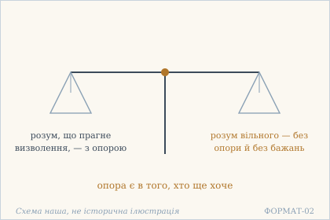 — Дві шальки: опора прагнення й порожнеча волі. Схема наша, не історична ілюстрація.

## 18.45

**Деванагарі.** विषयद्वीपिनो वीक्ष्य चकिताः शरणार्थिनः । विशन्ति झटिति क्रोडं निरोधैकाग्र्यसिद्धये ॥

**Українська транслітерація.** вішаядвіпіно вікшя чакітах шаранартхінах | вішанті джгатіті кродам ніродгайкаґр'ясіддгає ||

**Переклад.** Побачивши пантер предметів, налякані й шукаючи притулку, вони стрімко кидаються в лоно — задля успіху в припиненні й зосередженості.

**Науковий коментар.** Тут і далі (18.46) тваринна метафора, і вона несподівано точна: у практику йдуть не з рішучості, а з переляку. `dvīpin` — саме пантера, не слон; слони з'являться в наступному вірші. Слово `kroḍa` («лоно») вжите без пояснення, що це за лоно, — і це навмисно: читач має сам упізнати притулок.

**Ілюстрація.** 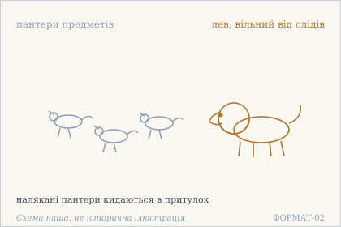 — Дрібні звірі тікають у притулок від лева, вільного від слідів. Схема наша, не історична ілюстрація.

## 18.46

**Деванагарі.** निर्वासनं हरिं दृष्ट्वा तूष्णीं विषयदन्तिनः । पलायन्ते न शक्तास् ते सेवन्ते कृतचाटवः ॥

**Українська транслітерація.** нірвасанам харім дріштва тушнім вішаядантінах | палаянте на шактас те севанте крітачатавах ||

**Переклад.** Побачивши лева, вільного від слідів, слони предметів мовчки тікають. Нездатні, вони більше не прислуговують, хоч раніше й підлещувалися.

**Науковий коментар.** Продовження 18.45, і метафора перевернута: там предмети — пантери, що лякають людину, тут вони слони, що тікають від лева. Те, що раніше гнало, тепер тікає. `kṛtacāṭava` («ті, що зробили підлабузництво») — незвичайно точне слово про предмети: вони не просто спокушали, а прислуговували з лестощами. `tūṣṇīm` («мовчки») підкреслює: втеча без опору.

**Ілюстрація.** 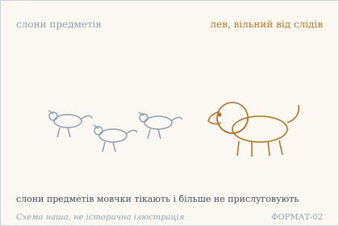 — Слони предметів тікають від лева й більше не прислуговують. Схема наша, не історична ілюстрація.

## 18.47

**Деванагарі.** न मुक्तिकारिकां धत्ते निःशङ्को युक्तमानसः । पश्यञ् छृण्वन् स्पृशञ् जिघ्रन्न् अश्नन्न् आस्ते यथासुखम् ॥

**Українська транслітерація.** на муктікарікам дгатте ніхшанко юктаманасах | пашянь ччрінван спрішань джіґгранн ашнанн асте ятхасукхам ||

**Переклад.** Він не носить на собі справи визволення — без сумніву, зі з'єднаним розумом. Дивиться, слухає, торкається, нюхає, їсть — і перебуває, як завгодно.

**Науковий коментар.** П'ять дієприкметників перелічують чуттєві дії поспіль, без оцінки — і саме це тут твердження: чуття працюють, а справи визволення немає. `muktikārikā` («справа визволення») подана як ноша: її не тримають на собі. Формула `yathāsukham` повторює рефрен глави 13 — та сама поза, інший контекст.

**Ілюстрація.** 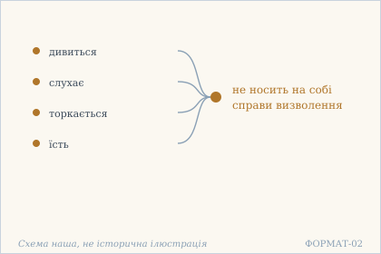 — Звичайні дії без ноші визволення. Схема наша, не історична ілюстрація.

## 18.48

**Деванагарі.** वस्तुश्रवणमात्रेण शुद्धबुद्धिर् निराकुलः । नैवाचारमनाचारम् औदास्यं वा प्रपश्यति ॥

**Українська транслітерація.** вастушраванаматрена шуддгабуддгір ніракулах | найвачараманачарам аудасям ва прапашяті ||

**Переклад.** Від самого лише слухання суті — чистий розумом, безтурботний — він не бачить ані різниці між належним і неналежним, ані байдужості.

**Науковий коментар.** Три речі названі й усі три знято: ācāra, anācāra і audāsya («байдужість»). Остання — найважливіша, бо це типова підміна: коли зникає різниця між належним і неналежним, на її місце стає байдужість, і вірш каже, що її теж немає. `vastuśravaṇamātra` («саме лише слухання суті») — єдина умова, названа тут.

**Ілюстрація.** 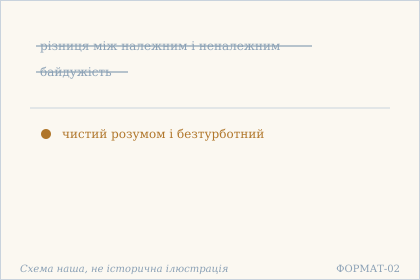 — Різниця й байдужість відпали. Схема наша, не історична ілюстрація.

## 18.49

**Деванагарі.** यदा यत् कर्तुम् आयाति तदा तत् कुरुते ऋजुः । शुभं वाप्य् अशुभं वापि तस्य चेष्टा हि बालवत् ॥

**Українська транслітерація.** яда ят картум аяті тада тат куруте ріджух | шубгам вапй ашубгам вапі тася чешта хі балават ||

**Переклад.** Коли що випадає зробити, тоді він те й робить — він прямий. Добре чи недобре — його діяння як у дитини.

**Науковий коментар.** Та сама формула, що в 13.3 і 18.20 (`yadā yat kartum āyāti`), і втретє в книзі — це вже сталий зворот. Нове тут — `bālavat` («як у дитини») і `śubha / aśubha`: дитина не розрізняє добра й недобра, і саме тому її діяння не зараховується. `ṛju` («прямий») пояснює, чому: він не вибирає, а робить те, що випало.

**Українська паралель (наша інтерпретація, не твердження про вплив).** *Василь Стефаник*, «Камінний хрест» (1900). Наша паралель: у Стефаника простота дії теж не є недбальством, а способом бути прямим. Наше порівняння — типологічне.

**Ілюстрація.** 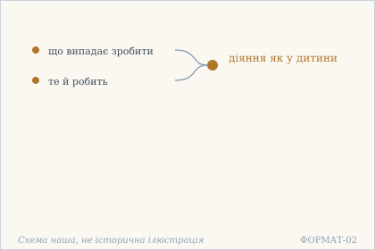 — Діяння як у дитини: що випало, те й робить. Схема наша, не історична ілюстрація.

## 18.50

**Деванагарі.** स्वातन्त्र्यात् सुखम् आप्नोति स्वातन्त्र्याल् लभते परम् । स्वातन्त्र्यान् निर्वृतिं गच्छेत् स्वातन्त्र्यात् परमं पदम् ॥

**Українська транслітерація.** сватантр'ят сукхам апноті сватантр'ял лабгате парам | сватантр'ян нірврітім ґаччет сватантр'ят парамам падам ||

**Переклад.** Від свободи отримує щастя, від свободи досягає вищого, від свободи приходить до заспокоєння, від свободи — до вищої стопи.

**Науковий коментар.** Чотириразова анафора `svātantryāt`, і це єдиний вірш книги, де одне слово відкриває всі чотири частини. `svātantrya` — не «свобода» взагалі, а буквально «правління собою»; тому воно й стоїть в ablativus: усе перелічене походить від нього, а не досягається заради нього. Порядок зростає: sukha → param → nirvṛti → paramaṃ pada, тобто від відчуття до останньої стопи.

**Ілюстрація.** 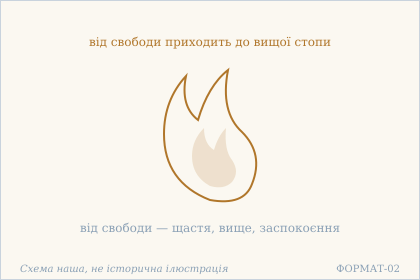 — Полумʼя свободи: щастя й вища стопа. Схема наша, не історична ілюстрація.

## 18.51

**Деванагарі.** अकर्तृत्वम् अभोक्तृत्वं स्वात्मनो मन्यते यदा । तदा क्षीणा भवन्त्य् एव समस्ताश् चित्तवृत्तयः ॥

**Українська транслітерація.** акартрітвам абгоктрітвам сватмано маняте яда | тада кшіна бгавантй ева самасташ чіттавріттаях ||

**Переклад.** Коли людина вважає свій Атман не-діячем і не-споживачем — тоді всі рухи розуму справді вичерпуються.

**Науковий коментар.** Дві ознаки названі разом і в правильному порядку: не-діяч (akartṛ) і не-споживач (abhoktṛ) — тобто знімається і дія, і той, хто привласнює її плід. `cittavṛtti` — технічний термін йоги (звідси «читта-врітті-ніродха»); тут сказано не «припиняються зусиллям», а `kṣīṇāḥ bhavanti` — «стають вичерпаними», самі.

**Ілюстрація.**  — Не діяч і не споживач: рухи розуму вичерпані. Схема наша, не історична ілюстрація.

## 18.52

**Деванагарі.** उच्छृङ्खलाप्य् अकृतिका स्थितिर् धीरस्य राजते । न तु सस्पृहचित्तस्य शान्तिर् मूढस्य कृत्रिमा ॥

**Українська транслітерація.** уччрінкхалапй акрітіка стхітір дгірася раджате | на ту саспріхачіттася шантір мудгася крітріма ||

**Переклад.** Навіть розкутий і безформний стан мудрого сяє. А спокій затьмареного з пожадливим розумом — удаваний.

**Науковий коментар.** Протиставлення `akṛtikā` / `kṛtrimā` — те саме слово в двох формах: стан мудрого без вигляду (не підробляється), а спокій дурного — зроблений. `ucchṛṅkhalā` («розкута») і `api` («навіть») разом означають: свобода видна навіть тоді, коли нічого не показує.

**Ілюстрація.**  — Удаваний спокій і справжній. Схема наша, не історична ілюстрація.

## 18.53

**Деванагарі.** विलसन्ति महाभोगैर् विशन्ति गिरिगह्वरान् । निरस्तकल्पना धीरा अबद्धा मुक्तबुद्धयः ॥

**Українська транслітерація.** віласанті махабгоґайр вішанті ґіріґахваран | нірастакалпана дгіра абаддга муктабуддгаях ||

**Переклад.** Вони граються великими розкошами й входять у гірські нетрі — мудрі, що відкинули побудови, незв'язані, з визволеним розумом.

**Науковий коментар.** Обидві крайнощі названі поспіль, і жодна не оцінена: розкоші й печери. Це відповідь на всю книгу уявлень про аскетизм — `abaddha` («незв'язаний») означає, що місце не має значення. `nirastakalpanā` («ті, що відкинули побудови») — причина, чому обидві крайнощі можливі.

**Українська паралель (наша інтерпретація, не твердження про вплив).** *Ігор Калинець*, «Вогонь Купала» (збірка). Наша паралель: у Калинця поєднання святкового й межового, розкоші й нетрів, читається як одне життя, а не два різні, — це близько до мудрого, що вільно входить і в одне, і в друге. Це наша інтерпретація, а не твердження про вплив.

**Ілюстрація.**  — Розкоші й нетрі — однаково для мудрих. Схема наша, не історична ілюстрація.

## 18.54

**Деванагарі.** श्रोत्रियं देवतां तीर्थम् अङ्गनां भूपतिं प्रियम् । दृष्ट्वा सम्पूज्य धीरस्य न कापि हृदि वासना ॥

**Українська транслітерація.** шротріям деватам тіртхам анґанам бгупатім пріям | дріштва сампуджя дгірася на капі хріді васана ||

**Переклад.** Побачивши знавця писань, божество, святе місце, жінку, царя, любу людину — і вшанувавши їх, — мудрий не має в серці жодного сліду.

**Науковий коментар.** Перелік навмисно строкатий: те, чому поклоняються, і те, до чого тягнуться. `sampūjya` («вшанувавши») важливе — він не уникає нічого з переліченого, але після вшанування `vāsanā` не лишається. Тобто дія виконана повністю, а сліду немає.

**Ілюстрація.**  — Шанування без сліду в серці. Схема наша, не історична ілюстрація.

## 18.55

**Деванагарі.** भृत्यैः पुत्रैः कलत्रैश् च दौहित्रैश् चापि गोत्रजैः । विहस्य धिक्कृतो योगी न याति विकृतिं मनाक् ॥

**Українська транслітерація.** бгрітяйх путрайх калатрайш ча даухітрайш чапі ґотраджайх | віхася дгіккріто йоґі на яті вікрітім манак ||

**Переклад.** Висміяний і зневажений слугами, синами, жінкою, онуками й родичами, йог не змінюється анітрохи.

**Науковий коментар.** Найближче коло назване повністю — і саме тому воно найважче: не вороги, а ті, з ким живеш. `manāk` («анітрохи») — слово, що закриває питання про міру: не «мало змінюється», а зовсім. `vikṛti` («видозміна») — те саме слово, що в 18.5 (nirvikāra).

**Українська паралель (наша інтерпретація, не твердження про вплив).** *Василь Стус*, «Веселий цвинтар» (1985). Наша паралель: у Стуса зневага близьких теж не змінює того, хто стоїть. Наше порівняння — за будовою думки.

**Ілюстрація.**  — Дві шальки: висміяний і зневажений. Схема наша, не історична ілюстрація.

## 18.56

**Деванагарі.** सन्तुष्टो ऽपि न सन्तुष्टः खिन्नो ऽपि न च खिद्यते । तस्याश्चर्यदशां तां तां तादृशा एव जानते ॥

**Українська транслітерація.** сантушто ’пі на сантуштах кхінно ’пі на ча кхідяте | тасяшчар'ядашам там там тадріша ева джанате ||

**Переклад.** І вдоволений — не вдоволений; і засмучений — не засмучується. Його дивовижні стани — такі-то й такі — знають лише такі ж, як він.

**Науковий коментар.** Закінчення дослівно повторює 14.4 (`tāṃ tāṃ tādṛśā eva jānate`) — тобто свідчення ззовні неможливе, і це вже вдруге в книзі. Перша половина — не парадокс, а точність: стан є, назви немає, бо `santuṣṭa` і `khinna` описують те, що всередині вже не відбувається.

**Ілюстрація.**  — Стан, що його знають лише такі ж. Схема наша, не історична ілюстрація.

## 18.57

**Деванагарі.** कर्तव्यतैव संसारो न तां पश्यन्ति सूरयः । शून्याकारा निराकारा निर्विकारा निरामयाः ॥

**Українська транслітерація.** картав'ятайва самсаро на там пашянті сураях | шунякара ніракара нірвікара нірамаях ||

**Переклад.** Сансара — це саме «треба зробити». Мудрі її не бачать: вони з порожнім виглядом, безформні, без видозмін, без недуги.

**Науковий коментар.** Найкоротше й найсильніше визначення сансари в книзі: не світ, не страждання, а `kartavyatā` — сам стан «треба». Тому й не бачать: сансара не річ, яку можна побачити, а спосіб, у якому речі постають. Чотири nir- означення наприкінці — та сама низка, що в 18.5.

**Ілюстрація.**  — Треба зробити — і сансари немає. Схема наша, не історична ілюстрація.

## 18.58

**Деванагарі.** अकुर्वन्न् अपि संक्षोभाद् व्यग्रः सर्वत्र मूढधीः । कुर्वन्न् अपि तु कृत्यानि कुशलो हि निराकुलः ॥

**Українська транслітерація.** акурванн апі самкшобгад в'яґрах сарватра мудгадгіх | курванн апі ту крітяні кушало хі ніракулах ||

**Переклад.** Навіть нічого не роблячи, дурний розумом скрізь збентежений через хвилювання. А вмілий, хоч і робить справи, — безтурботний.

**Науковий коментар.** Точне протиставлення за однією ознакою: справа не визначає стан. `saṃkṣobha` («збурення») назване причиною — не бездіяльність дає спокій, а відсутність збурення. `kuśala` («вмілий») тут не похвала майстерності, а ознака: той, хто вміє, не витрачається на саму дію.

**Ілюстрація.**  — Дві шальки: неробство й діяння. Схема наша, не історична ілюстрація.

## 18.59

**Деванагарі.** सुखम् आस्ते सुखं शेते सुखम् आयाति याति च । सुखं वक्ति सुखं भुङ्क्ते व्यवहारे ऽपि शान्तधीः ॥

**Українська транслітерація.** сукхам асте сукхам шете сукхам аяті яті ча | сукхам вакті сукхам бгункте в'явахаре ’пі шантадгіх ||

**Переклад.** Зручно сидить, зручно лежить, зручно приходить і йде, зручно говорить, зручно їсть — навіть у справах світу той, чий розум спокійний.

**Науковий коментар.** Шестиразова анафора `sukham`, і вона охоплює все тіло й усе спілкування: сидіти, лежати, приходити, йти, говорити, їсти. Це не «насолода», а `sukha` в значенні зручності, легкості. `vyavahāre 'pi` («навіть у справах») закриває сумнів: ідеться не про самотність, а про життя серед людей.

**Українська паралель (наша інтерпретація, не твердження про вплив).** *Олександр Довженко*, «Щоденник» (1941–1956). Наша паралель: у Довженка зручність у звичайних справах теж постає як ознака спокійного розуму, а не як байдужість. Наше порівняння — за образом.

**Ілюстрація.**  — Зручно сидить, зручно їсть: розум спокійний. Схема наша, не історична ілюстрація.

## 18.60

**Деванагарі.** स्वभावाद् यस्य नैवार्तिर् लोकवद् व्यवहारिणः । महाह्रद इवाक्षोभ्यो गतक्लेशः स शोभते ॥

**Українська транслітерація.** свабгавад яся найвартір локавад в'явахарінах | махахрада івакшобгйо ґатаклешах са шобгате ||

**Переклад.** У кого за природою немає страждання, хто поводиться, як усі в світі, — той сяє, як велике озеро: незбурюваний, з минулими стражданнями.

**Науковий коментар.** `lokavat` («як увесь світ») — те саме слово, що `prākṛta` у 18.24 і `lokaviparyasta` у 18.18: мудрого не відрізнити ззовні. `mahāhrada` («велике озеро») точніше за «океан»: озеро незбурюване, бо глибоке, а не безмежне. `kleśa` — технічний термін (занечищення в йозі), тому «страждання» тут у строгому сенсі, не побутовому.

**Українська паралель (наша інтерпретація, не твердження про вплив).** *Богдан-Ігор Антонич*, «Книга Лева» (збірка). Наша паралель: в Антонича спокій передано через воду й тишу, а не через зусилля — образ великого озера, незбурюваного зсередини, близький до цього вірша. Це наша асоціація, а не твердження про вплив.

**Ілюстрація.**  — Велике озеро без вітру. Схема наша, не історична ілюстрація.

## 18.61

**Деванагарі.** निवृत्तेर् अपि मूढस्य प्रवृत्तिर् उपजायते । प्रवृत्तिर् अपि धीरस्य निवृत्तिफलदायिनी ॥

**Українська транслітерація.** нівріттер апі мудгася правріттір упаджаяте | правріттір апі дгірася нівріттіпхаладаїні ||

**Переклад.** Навіть від припинення в затьмареного народжується діяльність. А діяльність мудрого дає плід припинення.

**Науковий коментар.** Найточніше формулювання того, що в книзі повторюється багато разів: справа не в дії й не в бездіяльності, а в тому, що з них виходить. У дурного навіть `nivṛtti` обертається `pravṛtti`; у мудрого `pravṛtti` дає плід `nivṛtti`. Обидві половини будуються на одній парі слів, переставленій місцями.

**Ілюстрація.**  — Діяльність, що дає плід припинення. Схема наша, не історична ілюстрація.

## 18.62

**Деванагарі.** परिग्रहेषु वैराग्यं प्रायो मूढस्य दृश्यते । देहे विगलिताशस्य क्व रागः क्व विरागता ॥

**Українська транслітерація.** паріґрахешу вайраґям прайо мудгася дрішяте | дехе віґаліташася ква раґах ква віраґата ||

**Переклад.** Відречення від набутків здебільшого видно в затьмареного. А в того, у кого в тілі вислизнула надія, — де пристрасть і де безпристрасність?

**Науковий коментар.** `vairāgya` тут не чеснота, а симптом: воно видно в дурного, бо дурний відрікається від того, чого не має. Друга половина закриває питання — `vigalitāśa` («той, у кого вислизнула надія») не має ні пристрасті, ні її протилежності, бо обидві потребують надії. Це те саме місце, яке місія просить перевіряти окремо (`vairāgya`).

**Ілюстрація.**  — Дві шальки: пристрасть і безпристрасність. Схема наша, не історична ілюстрація.

## 18.63

**Деванагарі.** भावनाभावनासक्ता दृष्टिर् मूढस्य सर्वदा । भाव्यभावनया सा तु स्वस्थस्यादृष्टिरूपिणी ॥

**Українська транслітерація.** бгаванабгаванасакта дріштір мудгася сарвада | бгав'ябгаваная са ту свастхасядріштірупіні ||

**Переклад.** Погляд затьмареного завжди прив'язаний до уявлення й неуявлення. А в того, хто в собі, він має вигляд не-бачення.

**Науковий коментар.** Та сама пара, що в 18.42 (`bhāvaka` / abhāvaka): дурний застрягає на обох боках. `adṛṣṭirūpiṇī` («та, що має ВИГЛЯД не-бачення») — обережна формула: не «не бачить», а має такий вигляд. `svastha` («той, хто в собі») — те саме слово, що `svāsthya` у 13.1.

**Ілюстрація.**  — Погляд уявлення й не-бачення. Схема наша, не історична ілюстрація.

## 18.64

**Деванагарі.** सर्वारम्भेषु निष्कामो यश् चरेद् बालवन् मुनिः । न लेपस् तस्य शुद्धस्य क्रियमाणे ऽपि कर्मणि ॥

**Українська транслітерація.** сарварамбгешу нішкамо яш чаред балаван муніх | на лепас тася шуддгася кріямане ’пі кармані ||

**Переклад.** Мудрець, що без бажань у всіх починаннях, поводиться як дитина. У чистого немає налипання, навіть коли діяння робиться.

**Науковий коментар.** `bālavat` («як дитина») — те саме слово, що в 18.7 і 18.49, і тут воно означає не наївність, а відсутність розрахунку. `lepa` («налипання») — технічне слово про те, як дія пристає до діяча; `kriyamāṇe 'pi karmaṇi` (locativus absolutus) ставить умову максимально невигідно: дія справді робиться, а налипання немає.

**Українська паралель (наша інтерпретація, не твердження про вплив).** *Леся Українка*, «Одержима» (драматична поема). Наша паралель: у Лесі Українки правота героїні не потребує доведення й захисту, вона поводиться так, як поводиться дитина, — без налипання на власну правоту. Це наша інтерпретація, а не твердження про вплив.

**Ілюстрація.**  — Мудрець поводиться як дитина. Схема наша, не історична ілюстрація.

## 18.65

**Деванагарі.** स एव धन्य आत्मज्ञः सर्वभावेषु यः समः । पश्यन् शृण्वन् स्पृशन् जिघ्रन्न् अश्नन् निस्तर्षमानसः ॥

**Українська транслітерація.** са ева дганя атмаджнях сарвабгавешу ях самах | пашян шрінван спрішан джіґгранн ашнан ністаршаманасах ||

**Переклад.** Саме він блаженний — той, хто знає Атман і рівний до всіх: дивиться, слухає, торкається, нюхає, їсть — а розум без спраги.

**Науковий коментар.** П'ять чуттєвих дієприкметників — той самий перелік, що в 18.47, і це вже вдруге: книга навмисно повторює його, щоб зняти підозру, ніби йдеться про відмову від чуттів. `nistarṣa` («без спраги») — точніше за «без бажань»: спрага (tarṣa) — те, що змушує пити знову.

**Ілюстрація.**  — П'ять чуттів і розум без спраги. Схема наша, не історична ілюстрація.

## 18.66

**Деванагарі.** क्व संसारः क्व चाभासः क्व साध्यं क्व च साधनम् । आकाशस्येव धीरस्य निर्विकल्पस्य सर्वदा ॥

**Українська транслітерація.** ква самсарах ква чабгасах ква садгям ква ча садганам | акашасєва дгірася нірвікалпася сарвада ||

**Переклад.** Де сансара, де навіть її видимість, де мета, де засіб — у мудрого, вільного від розрізнень, завжди, як у простору?

**Науковий коментар.** Чотири питання закривають усю схему практики: світ, його видимість, мета, засіб. `ābhāsa` («відблиск») доданий навмисно — після сансари питається й про її тінь, тобто навіть заперечення не має місця. Порівняння з простором (`ākāśa`) — те саме, що в 6.1, але тут воно в родовому: не «я — простір», а «в нього, як у простору».

**Ілюстрація.**  — Сансара й мета — як у простору. Схема наша, не історична ілюстрація.

## 18.67

**Деванагарі.** स जयत्य् अर्थसंन्यासी पूर्णस्वरसविग्रहः । अकृत्रिमो ऽनवच्छिन्ने समाधिर् यस्य वर्तते ॥

**Українська транслітерація.** са джаятй артхасамнясі пурнасварасавіґрахах | акрітрімо ’наваччінне самадгір яся вартате ||

**Переклад.** Перемагає той, хто зрікся користі, чиє тіло — повний власний смак: у нього самадгі невдаване й триває в необмеженому.

**Науковий коментар.** `pūrṇasvarasavigraha` — одне з найщільніших складених у книзі: тіло (vigraha) тут не вмістилище, а сам смак (rasa) і власний тон (svara). `anavacchinna` («невідтинене») — точніше за «безмежне»: самадгі не має краю, бо його ніщо не відтяло. `akṛtrima` повторює 18.41 і 18.52: невдаваність — сталий критерій у цій главі.

**Українська паралель (наша інтерпретація, не твердження про вплив).** *Григорій Сковорода*, «Байки харківські» (збірка). Наша паралель: у Сковороди сродна праця дає вдоволення сама собою, без винагороди ззовні, — і це схоже на тіло, що стало власним смаком, а не знаряддям користі. Це наша інтерпретація, а не твердження про вплив.

**Ілюстрація.**  — Невдаване самадгі. Схема наша, не історична ілюстрація.

## 18.68

**Деванагарі.** बहुनात्र किम् उक्तेन ज्ञाततत्त्वो महाशयः । भोगमोक्षनिराकाङ्क्षी सदा सर्वत्र नीरसः ॥

**Українська транслітерація.** бахунатра кім уктена джнятататтво махашаях | бгоґамокшаніраканкші сада сарватра нірасах ||

**Переклад.** До чого тут багато слів: великодухий, що пізнав істину, не прагне ні насолод, ні визволення — завжди й скрізь він без смаку до них.

**Науковий коментар.** `bhogamokṣanirākāṅkṣī` — найсильніше складове блоку: насолода й визволення поставлені в один ряд як рівноцінні об'єкти прагнення, і обидва зняті. `nīrasa` («без соку») — не «байдужий», а саме позбавлений смаку до них: метафора їжі, не емоції. `bahunātra kim uktena` — формула, що закриває розмову, і вона стоїть передостаннім віршем глави.

**Українська паралель (наша інтерпретація, не твердження про вплив).** *Леся Українка*, «Оргія» (1913). Наша паралель: у Лесі Українки відсутність смаку і до насолод, і до визволення теж є ознакою того, хто вже вільний. Наше порівняння — типологічне.

**Ілюстрація.**  — Ні насолод, ні визволення. Схема наша, не історична ілюстрація.

## 18.69

**Деванагарі.** महदादि जगद्द्वैतं नाममात्रविजृम्भितम् । विहाय शुद्धबोधस्य किं कृत्यम् अवशिष्यते ॥

**Українська транслітерація.** махададі джаґаддвайтам намаматравіджрімбгітам | віхая шуддгабодгася кім крітям авашішяте ||

**Переклад.** Двоїстість світу, починаючи з махат, розквітла лише з імені. Коли це відкинуто — яка справа лишається в чистого знання?

**Науковий коментар.** `nāmamātra` («лише ім'я») — найточніше формулювання: світ не ілюзія й не реальність, а розквітле ім'я. `mahadādi` відсилає до санкх'ї (mahat — перший принцип проявленого), тобто вірш прямо називає філософську схему й каже, що вона тримається на назвах. Питання `kim kṛtyam avaśiṣyate` («яка справа лишається») — останнє питання глави про дію.

**Ілюстрація.**  — Двоїстість, що розквітла з імені. Схема наша, не історична ілюстрація.

## 18.70

**Деванагарі.** भ्रमभूतम् इदं सर्वं किंचिन् नास्तीति निश्चयी । अलक्ष्यस्फुरणः शुद्धः स्वभावेनैव शाम्यति ॥

**Українська транслітерація.** бграмабгутам ідам сарвам кімчін настіті нішчаї | алакшяспхуранах шуддгах свабгавенайва шам'яті ||

**Переклад.** Хто впевнений, що все це має природу омани й ніщо не є, — той, із сяянням без ознак, чистий, заспокоюється самою природою.

**Науковий коментар.** `alakṣyasphuraṇa` («сяяння без ознак») — точна формула на межу мови: те, що сяє, але не має жодної ознаки, за якою його можна впізнати. `svabhāvena eva` («самою природою») закриває главу без зусилля: заспокоєння не досягається, а є властивістю. Порядок важливий — спершу niścaya (рішення), потім śāmyati (заспокоєння), і між ними нічого.

**Ілюстрація.**  — Усе має природу омани — і заспокоєння. Схема наша, не історична ілюстрація.

## 18.71

**Деванагарі.** शुद्धस्फुरणरूपस्य दृश्यभावम् अपश्यतः । क्व विधिः क्व च वैराग्यं क्व त्यागः क्व शमो ऽपि वा ॥

**Українська транслітерація.** шуддгаспхуранарупася дрішябгавам апашятах | ква відгіх ква ча вайраґям ква тяґах ква шамо ’пі ва ||

**Переклад.** У того, чия природа — чисте сяяння, хто не бачить, що видиме існує: де припис, де відречення, де покидання, де й заспокоєння?

**Науковий коментар.** Чотири `kva` закривають усю практику: vidhi (припис), vairāgya (відречення), tyāga (покидання), śama (заспокоєння). Зверни увагу: `vairāgya` стоїть у переліку того, що зникає, — тобто в цій главі воно не чеснота, а те, що відпадає разом з іншим. `śuddhasphuraṇa` — те саме сяяння, що `alakṣyasphuraṇa` у 18.70.

**Ілюстрація.**  — Припис і відречення відпали. Схема наша, не історична ілюстрація.

## 18.72

**Деванагарі.** स्फुरतो ऽनन्तरूपेण प्रकृतिं च न पश्यतः । क्व बन्धः क्व च वा मोक्षः क्व हर्षः क्व विषादिता ॥

**Українська транслітерація.** спхурато ’нантарупена пракрітім ча на пашятах | ква бандгах ква ча ва мокшах ква харшах ква вішадіта ||

**Переклад.** У того, хто сяє безконечною формою і не бачить природи: де пута, де визволення, де захват, де смуток?

**Науковий коментар.** Та сама будова, що в 18.71, але пари інші: пута й визволення стоять поруч як рівноцінно відсутні, і так само захват із смутком. `viṣāditā` — те саме слово, що в 18.22, і повтор тут не випадковий: глава збирає власні пари.

**Ілюстрація.**  — Пута й визволення відпали. Схема наша, не історична ілюстрація.

## 18.73

**Деванагарі.** बुद्धिपर्यन्तसंसारे मायामात्रं विवर्तते । निर्ममो निरहङ्कारो निष्कामः शोभते बुधः ॥

**Українська транслітерація.** буддгіпар'янтасамсаре маяматрам вівартате | нірмамо ніраханкаро нішкамах шобгате будгах ||

**Переклад.** У сансарі, що сягає межі розуму, обертається лише майя. Вільний від «моє», без «я-роблення», без бажань — сяє той, хто знає.

**Науковий коментар.** `buddhiparyanta` («що закінчується на розумі») — точне обмеження: сансара не безмежна, вона сягає рівно до розуму й далі не йде. Три ознаки в другій половині — та сама трійця, що в 18.29 (`ahaṅkāra`) і 15.x (`mama`), і тут вона подана як причина сяйва, а не як наслідок.

**Ілюстрація.**  — Сансара, у якій обертається лише майя. Схема наша, не історична ілюстрація.

## 18.74

**Деванагарі.** अक्षयं गतसन्तापम् आत्मानं पश्यतो मुनेः । क्व विद्या च क्व वा विश्वं क्व देहो ऽहं ममेति वा ॥

**Українська транслітерація.** акшаям ґатасантапам атманам пашято мунех | ква відя ча ква ва вішвам ква дехо ’хам маметі ва ||

**Переклад.** У мудреця, що бачить Атман — незнищенний, з минулим жаром: де знання, де всесвіт, де тіло, де «я» й «моє»?

**Науковий коментар.** У переліку стоїть і `vidyā` — знання, тобто те, чим цю книгу читають. Це найнезручніше місце блоку: знання зникає разом з тілом і світом. `akṣaya` («невитратний») — точніше за «вічний»: те, що не зменшується від ужитку.

**Ілюстрація.**  — Знання, всесвіт і тіло відпали. Схема наша, не історична ілюстрація.

## 18.75

**Деванагарі.** निरोधादीनि कर्माणि जहाति जडधीर् यदि । मनोरथान् प्रलापांश् च कर्तुम् आप्नोति तत्क्षणात् ॥

**Українська транслітерація.** ніродгадіні кармані джахаті джададгір яді | маноратхан пралапамш ча картум апноті таткшанат ||

**Переклад.** Якщо тупий розумом покидає діяння, починаючи з припинення, — він береться за забаганки й балачки, і саме з тієї ж миті.

**Науковий коментар.** Точний механізм підміни: покинувши практику, людина не заспокоюється, а починає `manoratha` (забаганки) і `pralāpa` (балачки). `manoratha` буквально «колісниця розуму» — те, що везе думку геть. `tatkṣaṇāt` («з тієї ж миті») робить це не поступовим, а негайним.

**Ілюстрація.**  — Вузол: покинув діяння — і взявся за балачки. Схема наша, не історична ілюстрація.

## 18.76

**Деванагарі.** मन्दः श्रुत्वापि तद्वस्तु न जहाति विमूढताम् । निर्विकल्पो बहिर्यत्नाद् अन्तर्विषयलालसः ॥

**Українська транслітерація.** мандах шрутвапі тадвасту на джахаті вімудгатам | нірвікалпо бахір'ятнад антарвішаялаласах ||

**Переклад.** Тупий, навіть почувши ту суть, не покидає цілковитої затьмареності: зовні він без розрізнень — із зовнішнього зусилля, — а всередині пожадливий до предметів.

**Науковий коментар.** `bahiryatnāt` / `antarviṣayalālasaḥ` — пара «зовні / усередині», і вона викриває механізм: `nirvikalpa` досягнуто зусиллям ззовні, тому всередині лишилося пожадання. Це пряме попередження проти наслідування: безрозрізнення можна зобразити, але не втримати. Слово `lālasa` («пожадливий») рідкісне й сильніше за звичайне kāma.

**Ілюстрація.**  — Зовні без розрізнень, усередині пожадливий. Схема наша, не історична ілюстрація.

## 18.77

**Деванагарі.** ज्ञानाद् गलितकर्मा यो लोकदृष्ट्यापि कर्मकृत् । नाप्नोत्य् अवसरं कर्तुं वक्तुम् एव न किंचन ॥

**Українська транслітерація.** джнянад ґалітакарма йо локадріштяпі кармакрит | напнотй авасарам картум вактум ева на кімчана ||

**Переклад.** Хто через знання має відпалі діяння — хоч і діє з огляду на світ — не знаходить нагоди зробити чи сказати хоч що-небудь.

**Науковий коментар.** `galitakarman` («той, у кого діяння відпали») — не «той, хто їх покинув»: відпадання без дії з його боку, і це принципово інша модель, ніж у 18.75, де покидання веде до балачок. `lokadṛṣṭyā api` («хоч і з огляду на світ») зберігає видимість дії: він діє, але нагоди не має.

**Ілюстрація.**  — Немає нагоди зробити чи сказати. Схема наша, не історична ілюстрація.

## 18.78

**Деванагарі.** क्व तमः क्व प्रकाशो वा हानं क्व च न किञ्चन । निर्विकारस्य धीरस्य निरातङ्कस्य सर्वदा ॥

**Українська транслітерація.** ква тамах ква пракашо ва ханам ква ча на кіньчана | нірвікарася дгірася ніратанкася сарвада ||

**Переклад.** Де темрява, де світло, де відкидання, де «ніщо» — у незмінного, мудрого, безтривожного, завжди?

**Науковий коментар.** Пара `tamas` / `prakāśa` (темрява / світло) — та сама, що в 18.9, але тут до неї додано `hāna` (відкидання) і `na kiñcana` («ніщо»). Тобто знято не лише протилежності, а й сам вихід із них: навіть «ніщо» не лишається як позиція.

**Ілюстрація.**  — Темрява й світло відпали. Схема наша, не історична ілюстрація.

## 18.79

**Деванагарі.** क्व धैर्यं क्व विवेकित्वं क्व निरातङ्कतापि वा । अनिर्वाच्यस्वभावस्य निःस्वभावस्य योगिनः ॥

**Українська транслітерація.** ква дгайр'ям ква вівекітвам ква ніратанкатапі ва | анірвачясвабгавася ніхсвабгавася йоґінах ||

**Переклад.** Де стійкість, де розрізнення, де й безтривожність — у йога, чия природа невимовна, хто без природи?

**Науковий коментар.** `anirvācyasvabhāva` і `niḥsvabhāva` стоять поруч, і це не тавтологія: перше каже, що природу не можна назвати, друге — що її немає. Разом вони закривають обидва виходи. `vivekitva` («розрізнюваність») у переліку того, що зникає, — найнезручніше для читача, бо це чеснота розпізнавання істинного від хибного.

**Ілюстрація.**  — Стійкість і розрізнення відпали. Схема наша, не історична ілюстрація.

## 18.80

**Деванагарі.** न स्वर्गो नैव नरको जीवन्मुक्तिर् न चैव हि । बहुनात्र किम् उक्तेन योगदृष्ट्या न किंचन ॥

**Українська транслітерація.** на сварґо найва нарако джіванмуктір на чайва хі | бахунатра кім уктена йоґадріштя на кімчана ||

**Переклад.** Немає неба, немає пекла, немає й визволення за життя. До чого багато слів: з погляду йоги — ніщо.

**Науковий коментар.** `jīvanmukti` знято разом із небом і пеклом — тобто технічний термін книги поставлено в один ряд із релігійними уявленнями. Це найрадикальніше місце глави, і воно стоїть перед останніми віршами. `bahunātra kim uktena` повторює 18.68: та сама формула закриття, і вдруге вона закриває вже не розмову, а весь перелік.

**Українська паралель (наша інтерпретація, не твердження про вплив).** *Григорій Сковорода*, «Алфавіт, чи Буквар миру» (діалог). Наша паралель: Сковорода зводить усі страхи до одного — до втрати того, що не належить людині, — і тоді ні небо, ні пекло не мають де стояти. Це наша інтерпретація, а не твердження про вплив.

**Ілюстрація.**  — Небо, пекло й визволення — ніщо. Схема наша, не історична ілюстрація.

## 18.81

**Деванагарі.** नैव प्रार्थयते लाभं नालाभेनानुशोचति । धीरस्य शीतलं चित्तम् अमृतेनैव पूरितम् ॥

**Українська транслітерація.** найва прартхаяте лабгам налабгенанушочаті | дгірася шіталам чіттам амрітенайва пурітам ||

**Переклад.** Він не прагне набутку й не сумує через ненабуток: розум мудрого прохолодний, сповнений амрітою.

**Науковий коментар.** Пара `lābha` / `alābha` (набуток / ненабуток) закриває обидва боки, як і в 18.28 і 18.34. `śītala` («прохолодний») повторює 18.22 і 18.30 — це стале слово глави для позначення стану, який не нагрівається ні втратою, ні придбанням. `amṛta` тут не метафора безсмертя, а те, чим розум сповнений замість очікування.

**Ілюстрація.**  — Дві шальки: набуток і ненабуток. Схема наша, не історична ілюстрація.

## 18.82

**Деванагарі.** न शान्तं स्तौति निष्कामो न दुष्टम् अपि निन्दति । समदुःखसुखस् तृप्तः किंचित् कृत्यं न पश्यति ॥

**Українська транслітерація.** на шантам стауті нішкамо на душтам апі ніндаті | самадухкхасукхас тріптах кімчіт крітям на пашяті ||

**Переклад.** Без бажань він не хвалить спокійного й не ганить лихого. Рівний у стражданні й щасті, насичений, він не бачить жодної справи.

**Науковий коментар.** Пара `śānta` / `duṣṭa` (спокійний / лихий) цікава тим, що обидві оцінки знято разом: похвала й осуд — один механізм. `tṛpta` («насичений») — не «задоволений», а саме той, хто вже наївся, тому `kṛtya` («справа») йому не видно. Це відповідь на 18.57, де сансара була `kartavyatā`.

**Ілюстрація.**  — Дві шальки: хвала й осуд. Схема наша, не історична ілюстрація.

## 18.83

**Деванагарі.** धीरो न द्वेष्टि संसारम् आत्मानं न दिदृक्षति । हर्षामर्षविनिर्मुक्तो न मृतो न च जीवति ॥

**Українська транслітерація.** дгіро на двешті самсарам атманам на дідрікшаті | харшамаршавінірмукто на мріто на ча джіваті ||

**Переклад.** Мудрий не ненавидить сансару й не прагне побачити Атман. Вільний від захвату й гніву, він ні мертвий, ні живий.

**Науковий коментар.** `didṛkṣati` (дезидератив «хоче побачити») — точне слово: знято не знання Атмана, а **бажання його побачити**, тобто саму позицію того, хто ще не бачив. `na mṛto na ca jīvati` — не парадокс заради ефекту: обидва слова описують стан того, хто має межі, а він їх не має.

**Ілюстрація.**  — Дві шальки: сансара й Атман. Схема наша, не історична ілюстрація.

## 18.84

**Деванагарі.** निःस्नेहः पुत्रदारादौ निष्कामो विषयेषु च । निश्चिन्तः स्वशरीरे ऽपि निराशः शोभते बुधः ॥

**Українська транслітерація.** ніхснехах путрадарадау нішкамо вішаєшу ча | нішчінтах свашаріре ’пі нірашах шобгате будгах ||

**Переклад.** Без прив'язаності до синів, жінки й інших, без бажань до предметів, без турботи навіть про власне тіло — без надій сяє той, хто знає.

**Науковий коментар.** `sneha` буквально «вологість» — те, чим речі прилипають; тому `niḥsneha` не «байдужий», а «незмочений». Перелік іде від найближчого до найдальшого й закінчується власним тілом — тобто остання прив'язка названа останньою. `nirāśa` («без надій») стоїть перед `śobhate`, і це єдина ствердна дія у вірші.

**Українська паралель (наша інтерпретація, не твердження про вплив).** *Василь Стус*, «Веселий цвинтар» (збірка). Наша паралель: у Стуса відмова від турботи про власне тіло не є зневагою до життя, вона є відмовою від надії на нього як на опору. Це наша асоціація, а не твердження про вплив.

**Ілюстрація.**  — Син, жінка, тіло — без надій. Схема наша, не історична ілюстрація.

## 18.85

**Деванагарі.** तुष्टिः सर्वत्र धीरस्य यथापतितवर्तिनः । स्वच्छन्दं चरतो देशान् यत्रास्तमितशायिनः ॥

**Українська транслітерація.** туштіх сарватра дгірася ятхапатітавартінах | сваччандам чарато дешан ятрастаміташаїнах ||

**Переклад.** Вдоволення скрізь у мудрого, що живе як випаде, вільно ходить землями й лягає там, де сонце зайшло.

**Науковий коментар.** `yathāpatita` («як випаде») — те саме слово, що `yadṛcchā` у 18.24 і 15.x. Остання частина конкретна й несподівано побутова: `astamitaśāyin` — лягає спати там, де його застав захід сонця. Це не метафора, а опис вільного мандрівника без розкладу.

**Українська паралель (наша інтерпретація, не твердження про вплив).** *Микола Зеров*, «Камена» (збірка). Наша паралель: у Зерова спокій постає як увага до того, що є, а не як утеча від нього, — і це близько до вдоволення скрізь, хто живе як випаде. Це наша інтерпретація, а не твердження про вплив.

**Ілюстрація.**  — Людина лягає там, де зайшло сонце: вдоволення без вибору місця. Схема наша, не історична ілюстрація.

## 18.86

**Деванагарі.** पततूदेतु वा देहो नास्य चिन्ता महात्मनः । स्वभावभूमिविश्रान्तिविस्मृताशेषसंसृतेः ॥

**Українська транслітерація.** пататудету ва дехо нася чінта махатманах | свабгавабгумівішрантівісмріташешасамсрітех ||

**Переклад.** Хай тіло падає або встає — у великого немає турботи: він спочив на ґрунті власної природи й забув усю сансару без останку.

**Науковий коментар.** `patatu ... udetu` — два імперативи, і вони стосуються тіла, не людини: тіло поставлене в граматичну позицію того, хто діє сам. `svabhāvabhūmi` («ґрунт власної природи») — точніше за «основа»: це те, на чому стоїть, а не те, чим є. `aśeṣa` («без останку») закриває: забуто не частину сансари, а всю.

**Українська паралель (наша інтерпретація, не твердження про вплив).** *Леся Українка*, «Contra spem spero» (вірш). Наша паралель: у Лесі Українки тіло може впасти, і це не змінює того, хто в ньому, — образ, дуже близький до слів про тіло, що падає або встає. Це наша асоціація, а не твердження про вплив.

**Ілюстрація.**  — Дві шальки: тіло падає чи встає. Схема наша, не історична ілюстрація.

## 18.87

**Деванагарі.** अकिंचनः कामचारो निर्द्वन्द्वश् छिन्नसंशयः । असक्तः सर्वभावेषु केवलो रमते बुधः ॥

**Українська транслітерація.** акімчанах камачаро нірдвандваш ччіннасамшаях | асактах сарвабгавешу кевало рамате будгах ||

**Переклад.** Без жодної речі, той, хто йде куди хоче, без двоїстості, з відтятим сумнівом, неприв'язаний до всіх станів — сам-один утішається той, хто знає.

**Науковий коментар.** `kevala` тут не «лише», а «сам-один, без домішку» — технічне слово, що пізніше стало назвою школи. `akiṃcana` («без хоч чогось») — найсильніша форма відсутності володіння в книзі. `ramate` («утішається») — єдине дієслово радості в цьому блоці, і воно стоїть останнім, після п'яти заперечень.

**Ілюстрація.**  — Без жодної речі — сам-один. Схема наша, не історична ілюстрація.

## 18.88

**Деванагарі.** निर्ममः शोभते धीरः समलोष्टाश्मकाञ्चनः । सुभिन्नहृदयग्रन्थिर् विनिर्धूतरजस्तमः ॥

**Українська транслітерація.** нірмамах шобгате дгірах самалошташмаканьчанах | субгіннахрідаяґрантхір вінірдгутараджастамах ||

**Переклад.** Без «моє» сяє мудрий, для кого грудка, камінь і золото те саме; у кого добре розв'язаний вузол серця, хто струсив геть пил і темряву.

**Науковий коментар.** `loṣṭa` («грудка землі») навмисно нижче за камінь і золото: перелік іде від найдешевшого до найдорожчого, і всі три зрівняні. `hṛdayagranthi` («вузол серця») — усталений образ, але `su-bhinna` («добре розбитий») додає різкості: вузол не розв'язують, а розбивають. `rajas` і `tamas` — дві з трьох ґун, названі прямо.

**Українська паралель (наша інтерпретація, не твердження про вплив).** *Тарас Шевченко*, «Кобзар» (збірка). Наша паралель: у Шевченка багатство й воля розведені так, що володіння не додає людині нічого, — це близько до рівності грудки, каменя й золота. Це наша інтерпретація, а не твердження про вплив.

**Ілюстрація.**  — Дві шальки: грудка й золото. Схема наша, не історична ілюстрація.

## 18.89

**Деванагарі.** सर्वत्रानवधानस्य न किञ्चिद् वासना हृदि । मुक्तात्मनो वितृप्तस्य तुलना केन जायते ॥

**Українська транслітерація.** сарватранавадганася на кіньчід васана хріді | муктатмано вітріптася тулана кена джаяте ||

**Переклад.** У того, хто ніде не має опори, немає жодного сліду в серці. З ким зрівняти визволеного Атмана, що наситився?

**Науковий коментар.** `anavadhāna` («без закріплення уваги») — не неуважність, а відсутність точки, за яку можна зачепитися; саме тому далі немає й `vāsanā`. Питання `tulanā kena jāyate` («з ким зрівняти») закриває останню можливість: порівняння потребує другого, а другого немає.

**Українська паралель (ПОТРЕБУЄ ПЕРЕВІРКИ).** *українська релігійна поезія*, не визначено. ПОТРЕБУЄ ПЕРЕВІРКИ: питання, з ким зрівняти визволеного, близьке до української релігійної поезії, але конкретного твору ми не звірили.

**Ілюстрація.**  — Без опори — і немає сліду в серці. Схема наша, не історична ілюстрація.

## 18.90

**Деванагарі.** जानन्न् अपि न जानाति पश्यन्न् अपि न पश्यति । ब्रुवन्न् अपि न च ब्रूते को ऽन्यो निर्वासनाद् ऋते ॥

**Українська транслітерація.** джананн апі на джанаті пашянн апі на пашяті | бруванн апі на ча бруте ко ’нйо нірвасанад ріте ||

**Переклад.** І знаючи — не знає, і бачачи — не бачить, і говорячи — не говорить. Хто інший, крім вільного від слідів?

**Науковий коментар.** Три дієприкметники з `api` («і... таки») — найчистіша форма цієї думки в книзі: дія відбувається, діяч відсутній. `nirvāsana` («без васан») повертає до 18.21, де він був першим словом блоку, — глава замикається на собі. Питання `kaḥ anyaḥ` замість твердження: відповіді не дано, бо й питання стосується того, кого нема з чим порівняти (пор. 18.89).

**Українська паралель (наша інтерпретація, не твердження про вплив).** *Євген Маланюк*, «Стилет і стилос» (збірка). Наша паралель: у Маланюка знання й незнання не розділені так, як звично думати, — обидва є способом тримати світ, і жоден не є остаточним. Це наша асоціація, а не твердження про вплив.

**Ілюстрація.**  — Знає — не знає; бачить — не бачить. Схема наша, не історична ілюстрація.

## 18.91

**Деванагарі.** भिक्षुर् वा भूपतिर् वापि यो निष्कामः स शोभते । भावेषु गलिता यस्य शोभनाशोभना मतिः ॥

**Українська транслітерація.** бгікшур ва бгупатір вапі йо нішкамах са шобгате | бгавешу ґаліта яся шобганашобгана матіх ||

**Переклад.** Жебрак чи володар — той, хто без бажань, сяє: у кого в усіх станах відпала думка про добре й недобре.

**Науковий коментар.** `bhikṣu` і `bhūpati` поставлені як рівноцінні, і це єдине місце в книзі, де соціальна крайність названа прямо. `galitā` («відпала, стікла») — те саме слово, що в 18.77; тут воно про `mati`, тобто про саму здатність оцінювати. `śobhana` / `aśobhana` — не «добре/погане» в етичному сенсі, а «гарне/негарне»: оцінка як смак.

**Українська паралель (наша інтерпретація, не твердження про вплив).** *Тарас Шевченко*, «Кавказ» (поема). Наша паралель: у Шевченка гідність не залежить від того, жебрак ти чи володар, — вона в тому, що людина не продає свого. Це наша інтерпретація, а не твердження про вплив.

**Ілюстрація.**  — Дві шальки: жебрак і володар. Схема наша, не історична ілюстрація.

## 18.92

**Деванагарі.** क्व स्वाच्छन्द्यं क्व सङ्कोचः क्व वा तत्त्वविनिश्चयः । निर्व्याजार्जवभूतस्य चरितार्थस्य योगिनः ॥

**Українська транслітерація.** ква сваччандям ква санкочах ква ва таттвавінішчаях | нірв'яджарджавабгутася чарітартхася йоґінах ||

**Переклад.** Де свобода, де стиснення, де рішення про істину — у йога, чия істота нелукаво-пряма, хто досяг мети?

**Науковий коментар.** `svācchandya` / `saṅkoca` — та сама пара, що в 18.32, але там `saṅkoca` був наслідком неправильно прийнятої істини, а тут знято обидві. `nirvyāja` («без обману») — рідкісне й точне слово: не «щирий» за наміром, а без підміни взагалі. `caritārtha` («чия справа зроблена») закриває тему дії, яку глава вела від 18.19.

**Ілюстрація.**  — Свобода й стиснення відпали. Схема наша, не історична ілюстрація.

## 18.93

**Деванагарі.** आत्मविश्रान्तितृप्तेन निराशेन गतार्तिना । अन्तर् यद् अनुभूयेत तत् कथं कस्य कथ्यते ॥

**Українська транслітерація.** атмавішрантітріптена нірашена ґатартіна | антар яд анубгуєта тат катхам кася катхяте ||

**Переклад.** Те, що переживається всередині в насиченого спочинком в Атмані, без надій, з минулим стражданням — як і кому це розповісти?

**Науковий коментар.** Подвійне питання `katham` / `kasya` («як?» і «кому?») закриває можливість передачі: не бракує слів, а немає ні способу, ні адресата. Форма `anubhūyeta` — оптатив пасиву, тобто «те, що могло б переживатися»: мова йде про можливість, а не про подію. Це пряме пояснення, чому глава весь час говорить запереченнями.

**Українська паралель (наша інтерпретація, не твердження про вплив).** *Ліна Костенко*, «Берестечко» (роман у віршах). Наша паралель: у Костенко є досвід, який неможливо передати тим, хто не був там, — і саме про це питає вірш: як і кому це розповісти. Це наша асоціація, а не твердження про вплив.

**Ілюстрація.**  — Те, що переживається всередині, — не розповідається. Схема наша, не історична ілюстрація.

## 18.94

**Деванагарі.** सुप्तो ऽपि न सुषुप्तौ च स्वप्ने ऽपि शयितो न च । जागरे ऽपि न जागर्ति धीरस् तृप्तः पदे पदे ॥

**Українська транслітерація.** супто ’пі на сушуптау ча свапне ’пі шаїто на ча | джаґаре ’пі на джаґарті дгірас тріптах паде паде ||

**Переклад.** І сплячи — не в глибокому сні; і в сні — не лежить; і в неспанні — не неспить. Мудрий, насичений на кожнім кроці.

**Науковий коментар.** Три стани свідомості (suṣupti, svapna, jāgara) названі поіменно й усі три знято — це відповідь усій традиції аналізу трьох станів. `pade pade` («на кожнім кроці») повертає до `svapada` з 18.33 і 18.5: те саме слово «крок/місце», і тут воно вжите як прислівник.

**Українська паралель (наша інтерпретація, не твердження про вплив).** *Іван Драч*, «Ніж у сонці» (збірка). Наша паралель: у Драча межові стани між сном і неспанням описані як справжній спосіб бути, а не як відхилення, — це близько до мудрого, що сплячи не в глибокому сні. Це наша інтерпретація, а не твердження про вплив.

**Ілюстрація.**  — Дві шальки: сон і неспання. Схема наша, не історична ілюстрація.

## 18.95

**Деванагарі.** ज्ञः सचिन्तो ऽपि निश्चिन्तः सेन्द्रियो ऽपि निरिन्द्रियः । सबुद्धिर् अपि निर्बुद्धिः साहङ्कारो ऽनहंकृतिः ॥

**Українська транслітерація.** джнях сачінто ’пі нішчінтах сендрійо ’пі ніріндріях | сабуддгір апі нірбуддгіх саханкаро ’нахамкрітіх ||

**Переклад.** Знаючий, хоч і з думкою — без думки; хоч і з чуттями — без чуттів; хоч і з розумом — без розуму; хоч і з «я-робленням» — без нього.

**Науковий коментар.** Чотири пари з `api` («хоч і... таки») — найчистіша форма цього ходу в книзі: кожна ознака є й водночас не діє. `ahaṃkṛti` тут замість звичного `ahaṃkāra` — і це не варіант: `kṛti` («роблення») наголошує саме на акті, а не на результаті. Порівняй 18.29, де той самий механізм описано розгорнуто.

**Ілюстрація.**  — З думкою — без думки; з розумом — без розуму. Схема наша, не історична ілюстрація.

## 18.96

**Деванагарі.** न सुखी न च वा दुःखी न विरक्तो न सङ्गवान् । न मुमुक्षुर् न वा मुक्तो न किंचिन् न च किंचन ॥

**Українська транслітерація.** на сукхі на ча ва духкхі на віракто на санґаван | на мумукшур на ва мукто на кімчін на ча кімчана ||

**Переклад.** Не щасливий і не нещасний, не відречений і не прив'язаний, не прагне визволення й не визволений. Він не «щось» і не «ніщо».

**Науковий коментар.** Шість заперечень, і серед них `mumukṣu` / `mukta` — тобто знято обидва кінці шляху, який книга описує. Остання пара `kiṃcit` / `kiṃcana` тонка: перше — «щось», друге — «хоч щось, абищо»; разом вони закривають і позицію, і її відсутність. Це найповніший перелік заперечень у книзі.

**Українська паралель (наша інтерпретація, не твердження про вплив).** *Ліна Костенко*, «Сад нетанучих скульптур» (1987). Наша паралель: у Костенко стан поза парою щось і ніщо теж постає як точність, а не як розмитість. Наше порівняння — за будовою думки.

**Ілюстрація.**  — Ні щасливий, ні нещасний; ні щось, ні ніщо. Схема наша, не історична ілюстрація.

## 18.97

**Деванагарі.** विक्षेपे ऽपि न विक्षिप्तः समाधौ न समाधिमान् । जाड्ये ऽपि न जडो धन्यः पाण्डित्ये ऽपि न पण्डितः ॥

**Українська транслітерація.** вікшепе ’пі на вікшіптах самадгау на самадгіман | джадє ’пі на джадо дганях пандітє ’пі на пандітах ||

**Переклад.** І в розсіянні — не розсіяний; і в самадгі — не той, хто має самадгі; і в тупості — не тупий. Блаженний, і у вченості — не вчений.

**Науковий коментар.** Пари навмисно принизливі: `jāḍya` («тупість») і `pāṇḍitya` («вченість») стоять поруч як рівноцінні — тобто вченість не краща за тупість, бо обидві є станом. `samādhimān` («той, хто має самадгі») — найтонше заперечення: не «не в самадгі», а не володіє ним. Порівняй 18.33, де зосередженість віддана дурням.

**Українська паралель (наша інтерпретація, не твердження про вплив).** *Іван Франко*, «Зів'яле листя» (збірка). Наша паралель: у Франка людина може бути в розпачі й не бути розпачливою — стан і той, хто в ньому, розведені. Це близько до слів, що й у розсіянні він не розсіяний. Це наша асоціація, а не твердження про вплив.

**Ілюстрація.**  — Розсіяння й самадгі — не його. Схема наша, не історична ілюстрація.

## 18.98

**Деванагарі.** मुक्तो यथास्थितिस्वस्थः कृतकर्तव्यनिर्वृतः । समः सर्वत्र वैतृष्ण्यान् न स्मरत्य् अकृतं कृतम् ॥

**Українська транслітерація.** мукто ятхастхітісвастхах крітакартав'янірврітах | самах сарватра вайтрішнян на смаратй акрітам крітам ||

**Переклад.** Вільний, у собі в тому, як є; заспокоєний у зробленому-що-треба; рівний скрізь. Через безспраглість він не пам'ятає ні зробленого, ні незробленого.

**Науковий коментар.** `kṛtakartavya` («зроблене-що-треба») — формула, відома з інших текстів, тут у складі: він заспокоєний саме в тому, що справу закрито. `vaitṛṣṇya` («безспраглість») названа причиною забуття, і це точніше, ніж «не пам'ятає»: пам'ять тримається спраги, без неї триматися нема за що.

**Ілюстрація.**  — Безспраглість: не памʼятає зробленого. Схема наша, не історична ілюстрація.

## 18.99

**Деванагарі.** न प्रीयते वन्द्यमानो निन्द्यमानो न कुप्यति । नैवोद्विजति मरणे जीवने नाभिनन्दति ॥

**Українська транслітерація.** на пріяте вандямано ніндямано на куп'яті | найводвіджаті маране джіване набгінандаті ||

**Переклад.** Його не тішить, коли хвалять, і не гнівить, коли ганять. Він не лякається смерті й не радіє життю.

**Науковий коментар.** Останній вірш книги будується на двох парах, і обидві — про те, що приходить ззовні: похвала й осуд, смерть і життя. Дві форми пасиву (`vandyamāna`, `nindyamāna`) ставлять його в позицію того, з ким це роблять, — і саме тому він не відповідає. `udvijati` («здригається») — тілесне слово: не «боїться думки про смерть», а не здригається перед нею.

**Українська паралель (наша інтерпретація, не твердження про вплив).** *Тарас Шевченко*, «Неофіти» (1857). Наша паралель: у Шевченка хвала й ганьба теж не міняють того, хто стоїть. Наше порівняння — типологічне, не про джерело.

**Ілюстрація.**  — Дві шальки: хвала й ганьба. Схема наша, не історична ілюстрація.

## 18.100

**Деванагарі.** न धावति जनाकीर्णं नारण्यम् उपशान्तधीः । यथातथा यत्रतत्र सम एवावतिष्ठते ॥

**Українська транслітерація.** на дгаваті джанакірнам нараням упашантадгіх | ятхататха ятрататра сама еваватіштхате ||

**Переклад.** Той, чия думка втихла, не біжить ні до переповненого людьми, ні до лісу; так чи інакше, там чи там він перебуває рівним.

**Науковий коментар.** Останній вірш книги. Дві відмови — не тікати до людей і не тікати до лісу — повторюють пару з 18.11, але тут вона про **рух**, а не про умови. `yathātathā yatratatra` — подвійна байдужість до способу й до місця; ця формула вже була в 9.4 і 15.18, і переклад мусить бути той самий. `sama eva avatiṣṭhate` — не «лишається спокійним», а «стоїть рівним»: `sama` — рівність, а не тиша.

**Українська паралель (наша інтерпретація, не твердження про вплив).** *Леся Українка*, «Лісова пісня» (драма-феєрія). Наша паралель: у Лесі Українки Мавка не вибирає між лісом і людьми остаточно й не біжить ні до одного, ні до другого, — це близько до останнього вірша книги. Це наша інтерпретація, а не твердження про вплив.

**Ілюстрація.**  — Ні до людей, ні до лісу — рівний скрізь. Схема наша, не історична ілюстрація.

## Поетичний переклад

Окремо, у [`poetychnyi/rozdil-18.md`](poetychnyi/rozdil-18.md). Це **наш поетичний переклад**, не канонічний і не науковий; у PDF він іде окремою частиною.
