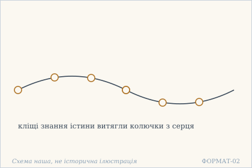
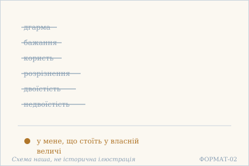
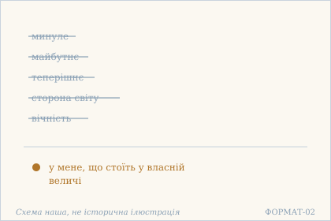
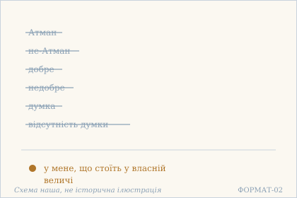
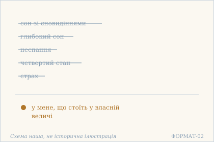
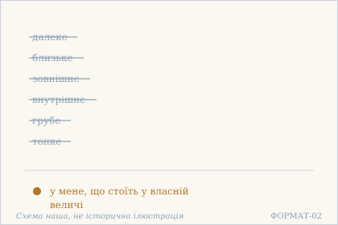
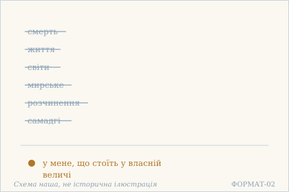
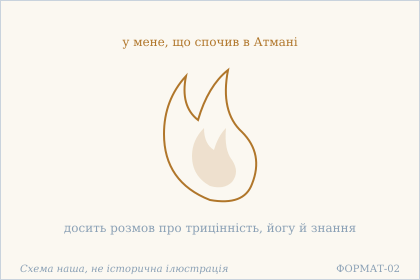

# Аштавакра-ґіта. Глава 19. Наукове представлення

> ФОРМАТ-02: кожен вірш подано пʼятьма шарами — деванагарі, українська
> транслітерація, переклад, науковий коментар з українськими паралелями,
> ілюстрація. Плюс окремо — поетичний переклад (`poetychnyi/rozdil-19.md`).
>
> **Деванагарі тут — механічна** транслітерація поля `iast` з картки
> (`scripts/iast_to_devanagari.py`), а не окреме читання за рукописом.
> **Українська транслітерація** — теж механічна (`scripts/iast_to_ukrainian.py`,
> таблиця в `docs/TRANSLITERATSIIA.md`).
> **Українські паралелі** — наша інтерпретація, а не твердження про вплив;
> реєстр і правила — `paraleli.json` і `scripts/check_ukrainian_parallels.py`.
> **Схеми** — наші власні; жодна не є історичною ілюстрацією.
>
> Цей файл згенеровано; правити треба картки й `format-v2/rozdil-19.json`,
> а не його.

## Глава 19. Де це все?

Девʼятнадцята глава складається з восьми віршів, і сім із них мають одну форму: питання де те й де те — і відповідь у мене, що стоїть у власній величі. Це не заперечення перелічених речей: текст питає, де вони, у того, хто вже стоїть. Восьмий вірш обриває навіть цю форму: досить розмов.

## 19.1

**Деванагарі.** तत्त्वविज्ञानसन्दंशम् आदाय हृदयोदरात् । नानाविधपरामर्शशल्योद्धारः कृतो मया ॥

**Українська транслітерація.** таттвавіджнянасандамшам адая хрідайодарат | нанавідгапарамаршашалйоддгарах кріто мая ||

**Переклад.** Взявши кліщі знання істини, я витяг із нутра серця колючки різноманітних хибних уявлень.

**Построкове зіставлення (редакторська чернетка, не рецензовано).**

### Рядок а

**Деванагарі (механічно з IAST).** तत्त्वविज्ञानसन्दंशम् आदाय हृदयोदरात्

**IAST (з редакторської картки).** tattvavijñānasandaṃśam ādāya hṛdayodarāt

**Українська транслітерація (механічна).** таттвавіджнянасандамшам адая хрідайодарат

**Український відповідник рядка.** Взявши кліщі знання істини,

**Коментар рядка (не рецензовано).** tattvavijñāna («знання істини») входить до складного слова із sandaṃśa («щипці, кліщі»); ādāya — дієприслівникове «взявши». hṛdayodarāt означає «з нутра серця», але в українському цілому реченні цей зворот стоїть у другій частині: поділ перекладу є смисловим, не послівним.

### Рядок б

**Деванагарі (механічно з IAST).** नानाविधपरामर्शशल्योद्धारः कृतो मया

**IAST (з редакторської картки).** nānāvidhaparāmarśaśalyoddhāraḥ kṛto mayā

**Українська транслітерація (механічна).** нанавідгапарамаршашалйоддгарах кріто мая

**Український відповідник рядка.** я витяг із нутра серця колючки різноманітних хибних уявлень.

**Коментар рядка (не рецензовано).** nānāvidha — «різноманітний», parāmarśa тут стосується схоплювання або уявлень, śalya — «колючка». uddhāraḥ kṛto mayā передає виконане «мною» вилучення; український активний вираз «я витяг» зберігає чинну редакцію, але не відтворює буквально пасивну побудову санскриту.

**Науковий коментар.** Вірш — не декларація, а опис процедури, і метафора тут хірургічна: sandaṃśa — кліщі, якими виймають стороннє тіло з рани. Три слова працюють разом: śalya («колючка») — те, що застрягло; uddhāra («витягання») — дія; hṛdayodara («нутро серця») — місце, і воно назване нутром, а не поверхнею. parāmarśa тут не «думка», а хибне схоплювання — розумове прийняття чогось за інше. Тобто йдеться не про прибирання думок, а про виймання того, що застрягло й болить. РЕФРЕН ГЛАВИ. 19.2–19.7 закінчуються однаково: svamahimni sthitasya me («у мене, що стоїть у власній величі»). Кожен із цих шести віршів — низка питань kva («де»), і жодне не дістає відповіді. 19.1 і 19.8 стоять поза серією: перший описує, ЯК це сталося, останній — ЩО з цього випливає для мови.

**Українська паралель (наша інтерпретація, не твердження про вплив).** *Григорій Сковорода*, «Асхань. Симфонія, наречена книга Асхань, про пізнання самого себе». Наша паралель: у Сковороди пізнання себе теж постає як виймання зайвого, а не як набирання нового. Наше порівняння — типологічне, не твердження про джерело.

**Ілюстрація.**  — Кліщі знання витягають колючки з серця. Схема наша, не історична ілюстрація.

## 19.2

**Деванагарі.** क्व धर्मः क्व च वा कामः क्व चार्थः क्व विवेकता । क्व द्वैतं क्व च वाद्वैतं स्वमहिम्नि स्थितस्य मे ॥

**Українська транслітерація.** ква дгармах ква ча ва камах ква чартхах ква вівеката | ква двайтам ква ча вадвайтам свамахімні стхітася ме ||

**Переклад.** Де дгарма, де бажання, де користь, де вміння розрізняти? Де двоїстість, де недвоїстість — у мене, що стоїть у власній величі?

**Построкове зіставлення (редакторська чернетка, не рецензовано).**

### Рядок а

**Деванагарі (механічно з IAST).** क्व धर्मः क्व च वा कामः क्व चार्थः क्व विवेकता

**IAST (з редакторської картки).** kva dharmaḥ kva ca vā kāmaḥ kva cārthaḥ kva vivekatā

**Українська транслітерація (механічна).** ква дгармах ква ча ва камах ква чартхах ква вівеката

**Український відповідник рядка.** Де дгарма, де бажання, де користь, де вміння розрізняти?

**Коментар рядка (не рецензовано).** Повтор kva («де?») об'єднує dharmaḥ, kāmaḥ, arthaḥ і термін розрізнення. Чинна картка має vivekatā, тоді як електронний GRETIL читає vivekitā: цю лексичну відмінність потрібно окремо перевірити; механічно виправляти авторський український переклад не можна.

### Рядок б

**Деванагарі (механічно з IAST).** क्व द्वैतं क्व च वाद्वैतं स्वमहिम्नि स्थितस्य मे

**IAST (з редакторської картки).** kva dvaitaṃ kva ca vādvaitaṃ svamahimni sthitasya me

**Українська транслітерація (механічна).** ква двайтам ква ча вадвайтам свамахімні стхітася ме

**Український відповідник рядка.** Де двоїстість, де недвоїстість — у мене, що стоїть у власній величі?

**Коментар рядка (не рецензовано).** Два питання kva dvaitaṃ і kva ... advaitaṃ охоплюють і двоїстість, і недвоїстість. svamahimni — місцевий відмінок «у власній величі», sthitasya me — родове «мене, що стоїть»; формула повторюється у віршах 19.2–19.7, і її український відповідник збережено.

**Науковий коментар.** Перший із шести віршів-переліків. Три з перших чотирьох понять — це три з чотирьох пурушартг (дгарма, користь, бажання); четверте, визволення, не назване, бо його місце займає сама позиція того, хто питає. Найважливіше — остання пара: питається не лише «де двоїстість», а й «де недвоїстість». Тобто заперечується не світ на користь єдності, а сама вісь, на якій обидва поняття мають сенс. svamahimni («у власній величі») — не гордість, а міра: те, що не має ні межі, ні місця. РЕФРЕН ГЛАВИ. 19.2–19.7 закінчуються однаково: svamahimni sthitasya me («у мене, що стоїть у власній величі»). Кожен із цих шести віршів — низка питань kva («де»), і жодне не дістає відповіді. 19.1 і 19.8 стоять поза серією: перший описує, ЯК це сталося, останній — ЩО з цього випливає для мови.

**Українська паралель (наша інтерпретація, не твердження про вплив).** *Митрополит Іларіон Київський*, «Слово про закон і благодать» (XI ст.). Наша паралель: у київському Слові перелік того, що вже не важить, теж будується як питання, а не як твердження. Наше порівняння — типологічне; датування цієї книги науково не встановлене.

**Ілюстрація.**  — Дгарма, бажання й двоїстість відпали. Схема наша, не історична ілюстрація.

## 19.3

**Деванагарі.** क्व भूतं क्व भविष्यद् वा वर्तमानम् अपि क्व वा । क्व देशः क्व च वा नित्यं स्वमहिम्नि स्थितस्य मे ॥

**Українська транслітерація.** ква бгутам ква бгавішяд ва вартаманам апі ква ва | ква дешах ква ча ва нітям свамахімні стхітася ме ||

**Переклад.** Де минуле, де майбутнє, де навіть теперішнє? Де сторона світу, де вічність — у мене, що стоїть у власній величі?

**Построкове зіставлення (редакторська чернетка, не рецензовано).**

### Рядок а

**Деванагарі (механічно з IAST).** क्व भूतं क्व भविष्यद् वा वर्तमानम् अपि क्व वा

**IAST (з редакторської картки).** kva bhūtaṃ kva bhaviṣyad vā vartamānam api kva vā

**Українська транслітерація (механічна).** ква бгутам ква бгавішяд ва вартаманам апі ква ва

**Український відповідник рядка.** Де минуле, де майбутнє, де навіть теперішнє?

**Коментар рядка (не рецензовано).** bhūtaṃ, bhaviṣyad і vartamānam позначають минуле, майбутнє та теперішнє; api посилює згадку про теперішнє («навіть»). Питальне kva повторюється, а не називає фактичної відсутності календарного часу в житті читача.

### Рядок б

**Деванагарі (механічно з IAST).** क्व देशः क्व च वा नित्यं स्वमहिम्नि स्थितस्य मे

**IAST (з редакторської картки).** kva deśaḥ kva ca vā nityaṃ svamahimni sthitasya me

**Українська транслітерація (механічна).** ква дешах ква ча ва нітям свамахімні стхітася ме

**Український відповідник рядка.** Де сторона світу, де вічність — у мене, що стоїть у власній величі?

**Коментар рядка (не рецензовано).** deśaḥ — місце або сторона, nityaṃ — постійне чи вічне. Рефрен svamahimni sthitasya me співвідносить простір і тривалість зі станом мовця; це філософське питання, не фізичне заперечення простору.

**Науковий коментар.** Три часи названі поспіль, і слово api («навіть») стоїть саме при теперішньому: минуле й майбутнє відсутні легко, а теперішнє — те, що здається найбільш незаперечним. Друга пара — deśa («місце») і nitya («вічне») — зіставляє простір із часом; разом обидві пари охоплюють усе, у чому можна було б розміститися. Вірш показує, що «стояти у власній величі» означає не займати іншого місця, а не мати місця взагалі. РЕФРЕН ГЛАВИ. 19.2–19.7 закінчуються однаково: svamahimni sthitasya me («у мене, що стоїть у власній величі»). Кожен із цих шести віршів — низка питань kva («де»), і жодне не дістає відповіді. 19.1 і 19.8 стоять поза серією: перший описує, ЯК це сталося, останній — ЩО з цього випливає для мови.

**Українська паралель (ПОТРЕБУЄ ПЕРЕВІРКИ).** *українська філософська лірика*, не визначено. ПОТРЕБУЄ ПЕРЕВІРКИ: питання, де минуле й майбутнє, близьке до української філософської лірики, але конкретного твору ми не звірили.

**Ілюстрація.**  — Минуле, майбутнє й вічність відпали. Схема наша, не історична ілюстрація.

## 19.4

**Деванагарі.** क्व चात्मा क्व च वानात्मा क्व शुभं क्वाशुभं तथा । क्व चिन्ता क्व च वाचिन्ता स्वमहिम्नि स्थितस्य मे ॥

**Українська транслітерація.** ква чатма ква ча ванатма ква шубгам квашубгам татха | ква чінта ква ча вачінта свамахімні стхітася ме ||

**Переклад.** Де Атман, де не-Атман, де добре, де недобре? Де думка, де відсутність думки — у мене, що стоїть у власній величі?

**Построкове зіставлення (редакторська чернетка, не рецензовано).**

### Рядок а

**Деванагарі (механічно з IAST).** क्व चात्मा क्व च वानात्मा क्व शुभं क्वाशुभं तथा

**IAST (з редакторської картки).** kva cātmā kva ca vānātmā kva śubhaṃ kvāśubhaṃ tathā

**Українська транслітерація (механічна).** ква чатма ква ча ванатма ква шубгам квашубгам татха

**Український відповідник рядка.** Де Атман, де не-Атман, де добре, де недобре?

**Коментар рядка (не рецензовано).** Пари ātmā / anātmā та śubhaṃ / aśubhaṃ запитально зіставлені через kva. Чинна картка бере SARIT kvāśubhaṃ tathā; GRETIL має kvāsubhaṃ yathā — відмінність торкається і слова, і зв'язки. Жодного з цих електронних читань не оголошено незалежно підтвердженим рукописним оригіналом.

### Рядок б

**Деванагарі (механічно з IAST).** क्व चिन्ता क्व च वाचिन्ता स्वमहिम्नि स्थितस्य मे

**IAST (з редакторської картки).** kva cintā kva ca vācintā svamahimni sthitasya me

**Українська транслітерація (механічна).** ква чінта ква ча вачінта свамахімні стхітася ме

**Український відповідник рядка.** Де думка, де відсутність думки — у мене, що стоїть у власній величі?

**Коментар рядка (не рецензовано).** cintā означає думку або турботу, acintā — її відсутність; запитання поширюється на обидва боки пари. Рефрен svamahimni sthitasya me збережено однаково з сусідніми віршами. Цей рядок не дає підстав наказувати українському читачеві відмовитися від мислення.

**Науковий коментар.** Три пари, і в кожній заперечується не один бік, а обидва. Найгостріша — перша: питати «де Атман» і «де не-Атман» однаково означає не знайти місця ні для того, ні для того, тобто сама пара втрачає ґрунт. Друга пара (śubha / aśubha) — та сама, що в 13.7, де вона відкидалася цілою. Третя (cintā / acintā) важлива тим, що сюди потрапляє й «відсутність думки»: навіть спокій розуму не стає позицією, з якої можна стояти. РЕФРЕН ГЛАВИ. 19.2–19.7 закінчуються однаково: svamahimni sthitasya me («у мене, що стоїть у власній величі»). Кожен із цих шести віршів — низка питань kva («де»), і жодне не дістає відповіді. 19.1 і 19.8 стоять поза серією: перший описує, ЯК це сталося, останній — ЩО з цього випливає для мови.

**Українська паралель (наша інтерпретація, не твердження про вплив).** *Олександр Потебня*, «Думка й мова» (1862). Наша паралель: Потебня теж показує, що пара думка й відсутність думки є справою самого мірила, а не речей. Наше порівняння — типологічне.

**Ілюстрація.**  — Атман і не-Атман, думка й не-думка відпали. Схема наша, не історична ілюстрація.

## 19.5

**Деванагарі.** क्व स्वप्नः क्व सुषुप्तिर् वा क्व च जागरणं तथा । क्व तुरीयं भयं वापि स्वमहिम्नि स्थितस्य मे ॥

**Українська транслітерація.** ква свапнах ква сушуптір ва ква ча джаґаранам татха | ква туріям бгаям вапі свамахімні стхітася ме ||

**Переклад.** Де сон зі сновидіннями, де глибокий сон, де неспання? Де четвертий стан, де навіть страх — у мене, що стоїть у власній величі?

**Построкове зіставлення (редакторська чернетка, не рецензовано).**

### Рядок а

**Деванагарі (механічно з IAST).** क्व स्वप्नः क्व सुषुप्तिर् वा क्व च जागरणं तथा

**IAST (з редакторської картки).** kva svapnaḥ kva suṣuptir vā kva ca jāgaraṇaṃ tathā

**Українська транслітерація (механічна).** ква свапнах ква сушуптір ва ква ча джаґаранам татха

**Український відповідник рядка.** Де сон зі сновидіннями, де глибокий сон, де неспання?

**Коментар рядка (не рецензовано).** svapnaḥ — сон зі сновидіннями, suṣuptiḥ — глибокий сон, jāgaraṇaṃ — неспання. kva ставить під питання всі три стани; така трійця має філософський контекст, але тут не є описом медичного або психологічного дослідження сну.

### Рядок б

**Деванагарі (механічно з IAST).** क्व तुरीयं भयं वापि स्वमहिम्नि स्थितस्य मे

**IAST (з редакторської картки).** kva turīyaṃ bhayaṃ vāpi svamahimni sthitasya me

**Українська транслітерація (механічна).** ква туріям бгаям вапі свамахімні стхітася ме

**Український відповідник рядка.** Де четвертий стан, де навіть страх — у мене, що стоїть у власній величі?

**Коментар рядка (не рецензовано).** turīyaṃ — «четвертий» стан, bhayaṃ — «страх», api посилює друге питання. Відмінність turīyaṃ / turiyaṃ між електронними текстами потребує орфографічного обліку; висновок про рукописне різночитання з неї не випливає.

**Науковий коментар.** Три стани — неспання, сон зі сновидіннями, глибокий сон — це стандартна схема упанішад, і четвертий (turīya) стоїть поза нею. Тут відкидається й він: навіть те, що мало б бути виходом, не має місця. Страх (bhaya) доданий останнім, і це не випадково: страх — те, що тримає в межах трьох станів, і якщо його немає, то й виходити нікуди. РЕФРЕН ГЛАВИ. 19.2–19.7 закінчуються однаково: svamahimni sthitasya me («у мене, що стоїть у власній величі»). Кожен із цих шести віршів — низка питань kva («де»), і жодне не дістає відповіді. 19.1 і 19.8 стоять поза серією: перший описує, ЯК це сталося, останній — ЩО з цього випливає для мови.

**Українська паралель (ПОТРЕБУЄ ПЕРЕВІРКИ).** *українська релігійна проза*, не визначено. ПОТРЕБУЄ ПЕРЕВІРКИ: перелік станів від сну до четвертого стану найближчий до української релігійної прози, але назвати твір без звірки ми не можемо.

**Ілюстрація.**  — Сон, неспання й четвертий стан відпали. Схема наша, не історична ілюстрація.

## 19.6

**Деванагарі.** क्व दूरं क्व समीपं वा बाह्यं क्वाभ्यन्तरं क्व वा । क्व स्थूलं क्व च वा सूक्ष्मं स्वमहिम्नि स्थितस्य मे ॥

**Українська транслітерація.** ква дурам ква саміпам ва бахям квабгянтарам ква ва | ква стхулам ква ча ва сукшмам свамахімні стхітася ме ||

**Переклад.** Де далеке, де близьке, де зовнішнє, де внутрішнє? Де грубе, де тонке — у мене, що стоїть у власній величі?

**Построкове зіставлення (редакторська чернетка, не рецензовано).**

### Рядок а

**Деванагарі (механічно з IAST).** क्व दूरं क्व समीपं वा बाह्यं क्वाभ्यन्तरं क्व वा

**IAST (з редакторської картки).** kva dūraṃ kva samīpaṃ vā bāhyaṃ kvābhyantaraṃ kva vā

**Українська транслітерація (механічна).** ква дурам ква саміпам ва бахям квабгянтарам ква ва

**Український відповідник рядка.** Де далеке, де близьке, де зовнішнє, де внутрішнє?

**Коментар рядка (не рецензовано).** dūraṃ / samīpaṃ позначають далеке й близьке; bāhyaṃ / abhyantaraṃ — зовнішнє й внутрішнє. Це триває низка питань kva, а не твердження про зникнення фізичних відстаней. У GRETIL можливе написання bahyaṃ, у SARIT bāhyaṃ: перевірити довготу голосної при фаховій колації.

### Рядок б

**Деванагарі (механічно з IAST).** क्व स्थूलं क्व च वा सूक्ष्मं स्वमहिम्नि स्थितस्य मे

**IAST (з редакторської картки).** kva sthūlaṃ kva ca vā sūkṣmaṃ svamahimni sthitasya me

**Українська транслітерація (механічна).** ква стхулам ква ча ва сукшмам свамахімні стхітася ме

**Український відповідник рядка.** Де грубе, де тонке — у мене, що стоїть у власній величі?

**Коментар рядка (не рецензовано).** sthūlaṃ та sūkṣmaṃ зіставляють грубе або відчутне з тонким; обидва стоять у питальній конструкції. svamahimni sthitasya me — той самий рефрен, що в 19.2–19.5; переклад «у власній величі» не змінено.

**Науковий коментар.** Три пари, і кожна описує простір по-своєму: відстань (далеке / близьке), напрямок (зовнішнє / внутрішнє), щільність (грубе / тонке). Разом вони мали б вичерпати всі способи бути десь — і саме тому всі три відкидаються разом. Пара sthūla / sūkṣma особлива: це не лише «велике й мале», а й «тілесне й тонке», тобто остання межа між видимим і невидимим. РЕФРЕН ГЛАВИ. 19.2–19.7 закінчуються однаково: svamahimni sthitasya me («у мене, що стоїть у власній величі»). Кожен із цих шести віршів — низка питань kva («де»), і жодне не дістає відповіді. 19.1 і 19.8 стоять поза серією: перший описує, ЯК це сталося, останній — ЩО з цього випливає для мови.

**Українська паралель (наша інтерпретація, не твердження про вплив).** *Володимир Свідзінський*, «Медобір» (1975, посмертно). Наша паралель: у Свідзінського далеке й близьке теж втрачають міру, коли зникає той, хто міряє. Наше порівняння — за образом.

**Ілюстрація.**  — Далеке й близьке, грубе й тонке відпали. Схема наша, не історична ілюстрація.

## 19.7

**Деванагарі.** क्व मृत्युर् जीवितं वा क्व लोकाः क्वास्य क्व लौकिकम् । क्व लयः क्व समाधिर् वा स्वमहिम्नि स्थितस्य मे ॥

**Українська транслітерація.** ква мрітюр джівітам ва ква локах квася ква лаукікам | ква лаях ква самадгір ва свамахімні стхітася ме ||

**Переклад.** Де смерть, де життя, де світи, де мирське? Де розчинення, де самадгі — у мене, що стоїть у власній величі?

**Построкове зіставлення (редакторська чернетка, не рецензовано).**

### Рядок а

**Деванагарі (механічно з IAST).** क्व मृत्युर् जीवितं वा क्व लोकाः क्वास्य क्व लौकिकम्

**IAST (з редакторської картки).** kva mṛtyur jīvitaṃ vā kva lokāḥ kvāsya kva laukikam

**Українська транслітерація (механічна).** ква мрітюр джівітам ва ква локах квася ква лаукікам

**Український відповідник рядка.** Де смерть, де життя, де світи, де мирське?

**Коментар рядка (не рецензовано).** mṛtyuḥ — «смерть», jīvitaṃ — «життя», lokāḥ — «світи», laukikam — «мирське». Форма kvāsya у чинному санскритському рядку граматично неясна й не має однозначного українського відповідника в чинній картці; її **не** можна непомітно тлумачити як встановлене читання.

### Рядок б

**Деванагарі (механічно з IAST).** क्व लयः क्व समाधिर् वा स्वमहिम्नि स्थितस्य मे

**IAST (з редакторської картки).** kva layaḥ kva samādhir vā svamahimni sthitasya me

**Українська транслітерація (механічна).** ква лаях ква самадгір ва свамахімні стхітася ме

**Український відповідник рядка.** Де розчинення, де самадгі — у мене, що стоїть у власній величі?

**Коментар рядка (не рецензовано).** layaḥ означає розчинення, samādhiḥ — зосередження або самадгі; kva ставить обидві практичні цілі під питання. Рефрен svamahimni sthitasya me зберігається; вірш не є доказом безкорисності будь-якої медитації поза власним філософським контекстом.

**Науковий коментар.** Останній із шести переліків, і він забирає найвище: laya і samādhi — те, до чого глави 5 і 13 кликали, тут теж не мають місця. Це замикає книгу на собі: навіть мета попередніх глав не стає притулком. Форма kvāsya (kva + asya, «де цього») темна: asya — родового від займенника, але без опори в реченні; можливо, це зіпсоване читання. У перекладі цей член пропущено, і це позначено, а не замасковано. РЕФРЕН ГЛАВИ. 19.2–19.7 закінчуються однаково: svamahimni sthitasya me («у мене, що стоїть у власній величі»). Кожен із цих шести віршів — низка питань kva («де»), і жодне не дістає відповіді. 19.1 і 19.8 стоять поза серією: перший описує, ЯК це сталося, останній — ЩО з цього випливає для мови.

**Українська паралель (наша інтерпретація, не твердження про вплив).** *Леся Українка*, «Кассандра» (1907). Наша паралель: у Лесі Українки життя й смерть теж не утворюють пари, вартої вибору, для того, хто вже стоїть поза нею. Наше порівняння — типологічне.

**Ілюстрація.**  — Смерть, життя й самадгі відпали. Схема наша, не історична ілюстрація.

## 19.8

**Деванагарі.** अलं त्रिवर्गकथया योगस्य कथयाप्य् अलम् । अलं विज्ञानकथया विश्रान्तस्य ममात्मनि ॥

**Українська транслітерація.** алам тріварґакатхая йоґася катхаяпй алам | алам віджнянакатхая вішрантася маматмані ||

**Переклад.** Досить розмов про трицінність, досить і розмов про йогу, досить розмов про знання — у мене, що спочив в Атмані.

**Построкове зіставлення (редакторська чернетка, не рецензовано).**

### Рядок а

**Деванагарі (механічно з IAST).** अलं त्रिवर्गकथया योगस्य कथयाप्य् अलम्

**IAST (з редакторської картки).** alaṃ trivargakathayā yogasya kathayāpy alam

**Українська транслітерація (механічна).** алам тріварґакатхая йоґася катхаяпй алам

**Український відповідник рядка.** Досить розмов про трицінність, досить і розмов про йогу,

**Коментар рядка (не рецензовано).** Повтор alam («досить») охоплює trivarga («три групи цілей» — дгарма, користь, бажання) і розмову про йогу; kathayā стоїть в орудному відмінку. Це підсумкова риторична формула, а не наказ заборонити українській спільноті обговорення знань.

### Рядок б

**Деванагарі (механічно з IAST).** अलं विज्ञानकथया विश्रान्तस्य ममात्मनि

**IAST (з редакторської картки).** alaṃ vijñānakathayā viśrāntasya mamātmani

**Українська транслітерація (механічна).** алам віджнянакатхая вішрантася маматмані

**Український відповідник рядка.** досить розмов про знання — у мене, що спочив в Атмані.

**Коментар рядка (не рецензовано).** vijñānakathayā — «розмовою про знання». viśrāntasya mamātmani означає стан мовця, що спочив в Атмані; завершення відрізняється від рефрену svamahimni sthitasya me у віршах 19.2–19.7. Третє alam підкреслює завершальний характер вислову.

**Науковий коментар.** Вірш не має рефрену попередніх шести й замінює його іншим: не svamahimni sthitasya («що стоїть у власній величі»), а viśrāntasya mamātmani («що спочив в Атмані»). Різниця точна: стояння — це позиція, спочинок — її відсутність потреби. Тричі повторене alam («досить») знищує три теми поспіль: етику (трицінність), практику (йога) і теорію (знання). Це останній вірш книги перед главой 20, і він закриває розмову — буквально: kathā означає «розмова», і саме розмову тут оголошено зайвою.

**Українська паралель (наша інтерпретація, не твердження про вплив).** *Григорій Сковорода*, «Розмова пʼяти подорожніх про істинне щастя в житті». Наша паралель: у Сковороди розмови про знання теж урешті виявляються зайвими перед тим, що вже є. Наше порівняння — типологічне.

**Ілюстрація.**  — Полумʼя, що втихло: досить розмов. Схема наша, не історична ілюстрація.

## Поетичний переклад

Окремо, у [`poetychnyi/rozdil-19.md`](poetychnyi/rozdil-19.md). Це **наш поетичний переклад**, не канонічний і не науковий; у PDF він іде окремою частиною.
