# Аштавакра-ґіта. Глава 2. Наукове представлення

> ФОРМАТ-02: кожен вірш подано пʼятьма шарами — деванагарі, українська
> транслітерація, переклад, науковий коментар з українськими паралелями,
> ілюстрація. Плюс окремо — поетичний переклад (`poetychnyi/rozdil-2.md`).
>
> **Деванагарі тут — механічна** транслітерація поля `iast` з картки
> (`scripts/iast_to_devanagari.py`), а не окреме читання за рукописом.
> **Українська транслітерація** — теж механічна (`scripts/iast_to_ukrainian.py`,
> таблиця в `docs/TRANSLITERATSIIA.md`).
> **Українські паралелі** — наша інтерпретація, а не твердження про вплив;
> реєстр і правила — `paraleli.json` і `scripts/check_ukrainian_parallels.py`.
> **Схеми** — наші власні; жодна не є історичною ілюстрацією.
> **Сцени** (`ilustratsii-naratyvni/`) — теж наші власні малюнки й теж не
> історичні: це ситуація вірша, а не поняття, і фігури там — силуети без
> облич.
>
> Цей файл згенеровано; правити треба картки й `format-v2/rozdil-2.json`,
> а не його.

## Глава 2. Радість усвідомлення

Друга глава переходить від заперечення до вигуку. Десять разів у ній звучить aho — «о диво», і саме цей вигук тримає главу разом: він щоразу стоїть там, де учень упізнає в собі те, що раніше приписував іншому. Друга половина глави (2.23–2.25) міняє образ: замість дзеркал і мотузок зʼявляється океан, у якому хвилі світів піднімаються й опадають самі собою. Це не доказ, а спосіб побачити, що рух не належить тому, хто його бачить.

## 2.1

**Деванагарі.** अहो निरञ्जनः शान्तो बोधोऽहं प्रकृतेः परः । एतावन्तम् अहं कालं मोहेनैव विडम्बितः ॥

**Українська транслітерація.** ахо ніраньджанах шанто бодго’хам пракрітех парах | етавантам ахам калам мохенайва відамбітах ||

**Переклад.** О диво: я — незаплямлене, спокійне усвідомлення, вище за природу. Увесь цей час мене дурила сама лише омана.

**Науковий коментар.** Розділ 2 відкривається вигуком подиву (aho) — це не аргумент, а зміна погляду. Три означення (nirañjana, śānta, bodha) ідуть як одне ціле: Я не «має» спокій, а є усвідомленням, яке не плямується. Viḍambitaḥ — не «я помилявся», а «мене дурили»: омана діяла, а не Я. Для українського перекладу важливо не зробити з цього самодокір: текст не звинувачує, а констатує.

**Українська паралель (наша інтерпретація, не твердження про вплив).** *Григорій Сковорода*, «Кільце. Дружня розмова про душевний мир». Наша паралель: у Сковороди справжній мир теж не здобувають ззовні — його впізнають як те, що вже було під нашаруванням думок. Це наша інтерпретація, а не твердження про вплив.

**Ілюстрація.** 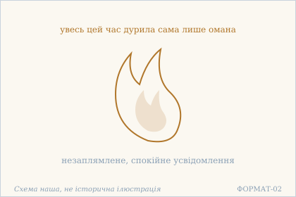 — Полумʼя без диму: усвідомлення, яке не забруднила омана. Схема наша, не історична ілюстрація.

**Сцена.** 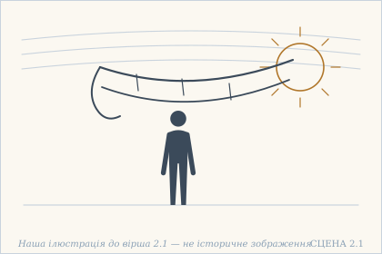 — З людини сповзає серпанок, і за ним видно чисте світло. Наша ілюстрація до вірша 2.1 — не історичне зображення.

## 2.2

**Деванагарі.** यथा प्रकाशयाम्य् एको देहम् एनं तथा जगत् । अतो मम जगत् सर्वं अथवा न च किञ्चन ॥

**Українська транслітерація.** ятха пракашаямй еко дехам енам татха джаґат | ато мама джаґат сарвам атхава на ча кіньчана ||

**Переклад.** Як я один освітлюю це тіло, так освітлюю і світ. Тому весь світ — мій; або ж — аніщо.

**Науковий коментар.** Вірш тримає дві відповіді одночасно: «світ мій» і «світ — аніщо». Це не суперечність, а два боки одного: світ не існує окремо від того, хто його освітлює, і саме тому не є чимось набутим. athavā («або ж») — сигнал, що текст свідомо лишає обидві формули, а не обирає одну. Перекладати його як «тобто» було б спрощенням.

**Українська паралель (наша інтерпретація, не твердження про вплив).** *Памфіл Юркевич*, «Серце і його значення в духовному житті людини» (1860). Наша паралель: коли вірш каже, що одне світло освітлює і тіло, і світ, він ставить світло в джерело, а не в речі. Юркевич шукає таке джерело в серці, а не в розумі, — це наша асоціація за будовою думки.

**Ілюстрація.** 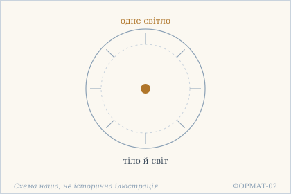 — Одне світло в центрі: воно освітлює і тіло, і світ. Схема наша, не історична ілюстрація.

## 2.3

**Деванагарі.** सशरीरम् अहो विश्वं परित्यज्य मयाधुना । कुतश्चित् कौशलाद् एव परमात्मा विलोक्यते ॥

**Українська транслітерація.** сашарірам ахо вішвам парітяджя маядгуна | куташчіт каушалад ева параматма вілокяте ||

**Переклад.** О диво: тепер, відкинувши світ разом із тілом, я — самим лише вмінням, невідомо звідки — бачу вище Я.

**Науковий коментар.** Ключове тут — пасив vilokyate: бачення не є зусиллям того, хто бачить. kutaścit («невідомо звідки») підкреслює, що вміння не вироблене вправою. Для української редакції це найтонше місце: активне «я бачу» зраджує сенс, тому в перекладі додано «невідомо звідки» як відповідник kutaścit. saśarīram означає «не залишаючи тіла» — не фізичне відкидання, а відмова від ототожнення.

**Українська паралель (ПОТРЕБУЄ ПЕРЕВІРКИ).** *українська містична традиція*, не визначено. ПОТРЕБУЄ ПЕРЕВІРКИ: мотив уміння, що приходить невідомо звідки, найближчий до українського барокового письма про внутрішню людину, але конкретного твору ми за джерелом не перевірили.

**Ілюстрація.** 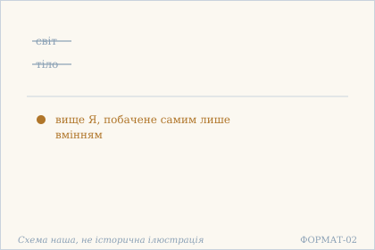 — Світ і тіло відкинуто — лишається вище Я. Схема наша, не історична ілюстрація.

## 2.4

**Деванагарі.** यथा न तोयतो भिन्नास् तरङ्गाः फेनबुद्बुदाः । आत्मनो न तथा भिन्नं विश्वम् आत्मविनिर्गतम् ॥

**Українська транслітерація.** ятха на тоято бгіннас таранґах пхенабудбудах | атмано на татха бгіннам вішвам атмавінірґатам ||

**Переклад.** Як хвилі, піна й бульбашки не відмінні від води, так і світ, що вийшов із Я, не відмінний від Я.

**Науковий коментар.** Образ води й хвиль працює на одному слові — bhinnam («відмінний»): хвиля не є водою в сенсі «іншою речовиною», але й не тотожна їй як окремий предмет. Це не тотожність і не різниця, а відмова від самої пари. ātmavinirgatam («той, що вийшов із Я») — не «створений», тому в перекладі немає слова «створений».

**Українська паралель (наша інтерпретація, не твердження про вплив).** *Григорій Сковорода*, «Наркіс. Розмова про те: Пізнай себе». Наша паралель: хвиля, що не віддільна від води, — образ, близький до сковородинського розрізнення видимого й того, що в ньому видно. Це наша інтерпретація, не вказівка на джерело вірша.

**Ілюстрація.** 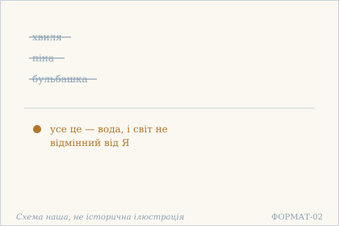 — Хвиля, піна й бульбашка виявляються водою. Схема наша, не історична ілюстрація.

## 2.5

**Деванагарі.** तन्तु-मात्रो भवेद् एव पटो यद्वद् विचारतः । आत्म-तन्मात्रम् एवेदं तद्वद् विश्वं विचारितम् ॥

**Українська транслітерація.** танту-матро бгавед ева пато ядвад вічаратах | атма-танматрам еведам тадвад вішвам вічарітам ||

**Переклад.** Як тканина при дослідженні виявляється лише ниткою, так і цей світ, коли його дослідити, є лише Я.

**Науковий коментар.** Це перший вірш книги, де прямо названо метод — vicāra, «дослідження». Тканина не зникає, коли ми бачимо нитку; зникає лише уявлення, що тканина — щось понад нитку. tanmātra («саме те, тільки те») — технічний термін, який у санкх'ї означає тонкі елементи; тут він ужитий у звичайному обмежувальному сенсі, і плутати ці два вживання не слід. Це спостереження про слововживання, а не встановлений факт.

**Українська паралель (наша інтерпретація, не твердження про вплив).** *Олександр Довженко*, «Зачарована Десна» (1956). Наша паралель: у Довженка річ теж розкривається, коли її розібрати до основи, — і основа виявляється простішою й живішою за річ. Наше порівняння стосується способу бачити, а не вчення.

**Ілюстрація.** 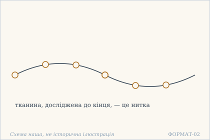 — Тканина розібрана на нитку: так і світ — на Я. Схема наша, не історична ілюстрація.

## 2.6

**Деванагарі.** यथैवेक्षुरसे कॢप्ता तेन व्याप्तैव शर्करा । तथा विश्वं मयि कॢप्तं मया व्याप्तं निरन्तरम् ॥

**Українська транслітерація.** ятхайвекшурасе кліпта тена в'яптайва шаркара | татха вішвам маї кліптам мая в'яптам нірантарам ||

**Переклад.** Як цукор уже вкладений у сік цукрової тростини й просякнутий ним, так і світ вкладений у мене й просякнутий мною безперервно.

**Построкове зіставлення (редакторська чернетка, не рецензовано).**

### Рядок а

**Деванагарі (механічно з IAST).** यथैवेक्षुरसे कॢप्ता तेन व्याप्तैव शर्करा

**IAST (з редакторської картки).** yathaivekṣurase kḷptā tena vyāptaiva śarkarā

**Українська транслітерація (механічна).** ятхайвекшурасе кліпта тена в'яптайва шаркара

**Український відповідник рядка.** Як цукор уже вкладений у сік цукрової тростини й просякнутий ним,

**Коментар рядка (не рецензовано).** yathaiva — підсилена порівняльна вказівка «як»; ikṣurase — «у соці цукрової тростини» (місцевий відмінок). śarkarā — «цукор», жіночий рід; kḷptā та vyāptā (у формі vyāptaiva) описують його як «вкладений» та «просякнутий» соком; tena — «ним». Це порівняння не стверджує, що цукор окремо додали в сік; конкретне членування сандгі слід перевірити за друкованими джерелами.

### Рядок б

**Деванагарі (механічно з IAST).** तथा विश्वं मयि कॢप्तं मया व्याप्तं निरन्तरम्

**IAST (з редакторської картки).** tathā viśvaṃ mayi kḷptaṃ mayā vyāptaṃ nirantaram

**Українська транслітерація (механічна).** татха вішвам маї кліптам мая в'яптам нірантарам

**Український відповідник рядка.** так і світ вкладений у мене й просякнутий мною безперервно.

**Коментар рядка (не рецензовано).** tathā — «так само», друга половина порівняння з yathaiva; viśvaṃ — «світ». mayi — «в мені» (місцевий), mayā — «мною» (орудний), отже санскрит розрізняє місце і спосіб охоплення. kḷptaṃ та vyāptaṃ відповідають формам першого піврядка, але узгоджені з середнім родом viśvaṃ; nirantaram — «безперервно». Цукор і тростинний сік — образ невідокремленості в цьому вірші, а не доказ фізичного творення світу; українські літературні аналогії для 2.6 у чинній книзі ще потребують перевірки.

**Науковий коментар.** Образ працює не на «створенні», а на присутності: цукор не доданий до соку — він у ньому вже є, і окремо його не видно. Ключове слово — kḷpta («вкладений, влаштований»), а не sṛṣṭa («створений»); підміна змінила б думку з «світ у мені влаштований» на «світ мною зроблений». Тому в перекладі немає слова «створений».

**Українська паралель (ПОТРЕБУЄ ПЕРЕВІРКИ).** *українська етнографічна проза*, не визначено. ПОТРЕБУЄ ПЕРЕВІРКИ: образ речовини, що вже просякнута своїм смаком, в українській прозі трапляється часто, але назвати твір, де він несе саме цю думку, ми не можемо без звірки.

**Ілюстрація.** 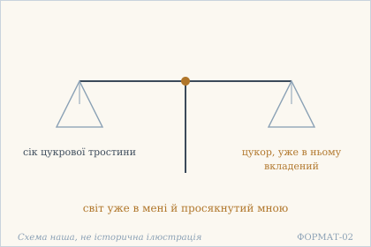 — Дві шальки: сік тростини й цукор, що вже в ньому. Схема наша, не історична ілюстрація.

## 2.7

**Деванагарі.** आत्माज्ञानाज् जगद् भाति हात्मज्ञानान् न भासते । रज्ज्वज्ञानाद् अहिर् भाति तज्ज्ञानाद् भासते न हि ॥

**Українська транслітерація.** атмаджнянадж джаґад бгаті хатмаджнянан на бгасате | раджджваджнянад ахір бгаті таджджнянад бгасате на хі ||

**Переклад.** Від незнання Я світ сяє; від знання Я він не сяє. Від незнання мотузки сяє змія; від знання її вона не сяє.

**Построкове зіставлення (редакторська чернетка, не рецензовано).**

### Рядок а

**Деванагарі (механічно з IAST).** आत्माज्ञानाज् जगद् भाति हात्मज्ञानान् न भासते

**IAST (з редакторської картки).** ātmājñānāj jagad bhāti hātmajñānān na bhāsate

**Українська транслітерація (механічна).** атмаджнянадж джаґад бгаті хатмаджнянан на бгасате

**Український відповідник рядка.** Від незнання Я світ сяє; від знання Я він не сяє.

**Коментар рядка (не рецензовано).** ātma-ajñānāt («від незнання Я») і ātma-jñānāt («від знання Я») вказують на протиставлення причинних відношень через відкладний відмінок; на стиках слів у чинній IAST стоїть сандгі. jagat — «світ», bhāti — «сяє, являється», na bhāsate — «не сяє». Частку ha, сховану у сполученні hātmajñānān, не можна без текстологічної перевірки перетворювати на окрему богословську тезу. Українське «не сяє» збережено дослівно: вірш не вимагає перекладу «світ фізично зникає».

### Рядок б

**Деванагарі (механічно з IAST).** रज्ज्वज्ञानाद् अहिर् भाति तज्ज्ञानाद् भासते न हि

**IAST (з редакторської картки).** rajjvajñānād ahir bhāti tajjñānād bhāsate na hi

**Українська транслітерація (механічна).** раджджваджнянад ахір бгаті таджджнянад бгасате на хі

**Український відповідник рядка.** Від незнання мотузки сяє змія; від знання її вона не сяє.

**Коментар рядка (не рецензовано).** rajju-ajñānāt — «від незнання мотузки», ahiḥ (перед наступним словом у сандгі ahir) — «змія». bhāti повторює дієслово першого рядка, а taj-jñānāt пов'язує друге заперечення зі знанням тієї ж мотузки; bhāsate na hi — «не сяє», з кінцевою часткою hi. Мотузка не перестає існувати: змінюється помилкове впізнавання змії. Це авторський граматично-філософський коментар до образу, не незалежно рецензоване свідчення про всі варіанти санскритського тексту.

**Науковий коментар.** Класичний приклад мотузки й змії, але з точністю, яку легко зіпсувати: текст каже na bhāsate — «не сяє», а не «зникає». Зникає не мотузка, а змія; світ не анульовується, а перестає сяяти як щось окреме. Українське «зникає» тут було б зручнішим і хибним.

**Українська паралель (наша інтерпретація, не твердження про вплив).** *Григорій Сковорода*, «Ікона Алківіадська». Наша паралель: Сковорода теж показує, що тінь зникає не тому, що її прибрали, а тому, що побачили річ. Це наша асоціація, а не твердження про спільне джерело.

**Ілюстрація.** 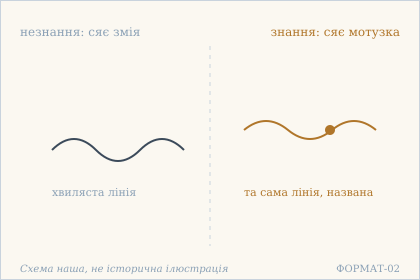 — Змія й мотузка: від незнання й від знання. Схема наша, не історична ілюстрація.

## 2.8

**Деванагарі.** प्रकाशो मे निजं रूपं नातिरिक्तोऽस्म्य् अहं ततः । यदा प्रकाशते विश्वं तदाऽहंभास एव हि ॥

**Українська транслітерація.** пракашо ме ніджам рупам натірікто’смй ахам татах | яда пракашате вішвам тада’хамбгаса ева хі ||

**Переклад.** Світло — моя власна природа; я не більший за нього. Коли сяє світ, сяє лише сяйво Я.

**Построкове зіставлення (редакторська чернетка, не рецензовано).**

### Рядок а

**Деванагарі (механічно з IAST).** प्रकाशो मे निजं रूपं नातिरिक्तोऽस्म्य् अहं ततः

**IAST (з редакторської картки).** prakāśo me nijaṃ rūpaṃ nātirikto'smy ahaṃ tataḥ

**Українська транслітерація (механічна).** пракашо ме ніджам рупам натірікто’смй ахам татах

**Український відповідник рядка.** Світло — моя власна природа; я не більший за нього.

**Коментар рядка (не рецензовано).** prakāśaḥ («світло, сяйво») у сполуці prakāśo є називним відмінком; me («моє»), nijaṃ rūpaṃ («власна природа») окреслюють самовизначення мовця. nātirikto'smy містить заперечення na та atiriktaḥ asmi — «я не окремий / не надлишковий»; чинний український переклад передає це як «не більший». ahaṃ tataḥ підтримує особову вказівку. Не ототожнюємо дослівність цього перекладу з остаточною санскритологічною інтерпретацією без незалежної звірки сандгі.

### Рядок б

**Деванагарі (механічно з IAST).** यदा प्रकाशते विश्वं तदाऽहंभास एव हि

**IAST (з редакторської картки).** yadā prakāśate viśvaṃ tadā'haṃbhāsa eva hi

**Українська транслітерація (механічна).** яда пракашате вішвам тада’хамбгаса ева хі

**Український відповідник рядка.** Коли сяє світ, сяє лише сяйво Я.

**Коментар рядка (не рецензовано).** yadā … tadā («коли … тоді») поєднує сяйво світу й Я; prakāśate — «сяє, виявляється»; viśvaṃ — «світ». У tadā'haṃbhāsa (із сандгі) складник ahaṃbhāsa описує «сяйво Я» в чинній редакції, однак його точне членування й синтаксичну функцію ще потрібно філологічно перевірити. eva hi — підсилювальне «саме, адже». Не змішувати ahaṃbhāsa із терміном ahaṃkāra («его-творення»). Українська паралель із Павлом Тичиною лишається редакторською асоціацією, не твердженням про вплив.

**Науковий коментар.** Тонкість у nātiriktaḥ — «не більший, не надлишковий»: світло не є чимось поза своїм проявом, і того, хто сяє, не можна відділити від сяйва. Складник ahaṃbhāsa рідкісний; перекладено «сяйво Я», а не «его» — его було б ahaṃkāra, інше слово.

**Українська паралель (наша інтерпретація, не твердження про вплив).** *Павло Тичина*, «Сонячні кларнети» (1918). Наша паралель: у Тичини світло теж не позичене ззовні, а є способом, яким світ себе показує. Наше порівняння — типологічне.

**Ілюстрація.** 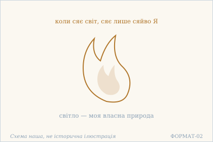 — Полумʼя, що не позичає світла: світло і є Я. Схема наша, не історична ілюстрація.

## 2.9

**Деванагарі.** अहो विकल्पितं विश्वम् अज्ञानान् मयि भासते । रूप्यं शुक्तौ फणी रज्जौ वारि सूर्यकरे यथा ॥

**Українська транслітерація.** ахо вікалпітам вішвам аджнянан маї бгасате | руп'ям шуктау пхані раджджау варі сур'якаре ятха ||

**Переклад.** О диво: вигаданий світ через незнання сяє в мені — як срібло в перламутрі, як змій у мотузці, як вода в мареві сонячного променя.

**Науковий коментар.** Три приклади підібрані за одним принципом: у кожному є річ, що є, і річ, якої немає, але яка видима. Перламутр є, срібла немає; мотузка є, змія немає; промінь є, води немає. Спільне в них не «світ ілюзорний», а точніше: **помилка має місце в тому, що є, і не додає нічого нового до буття**. Слово vikalpitam («сконструйоване») вказує на роботу розуму, а не на онтологічний статус світу. Порівняй 2.10, де той самий світ описаний уже як такий, що вийшов із мене й повернеться: там акцент на походженні, тут — на способі явлення.

**Українська паралель (ПОТРЕБУЄ ПЕРЕВІРКИ).** *українська поезія XX ст.*, не визначено. ПОТРЕБУЄ ПЕРЕВІРКИ: перламутр, у якому сяє срібло, — образ, близький до української лірики про оманливе бачення, але конкретного рядка ми не перевіряли й тому не називаємо.

**Ілюстрація.** 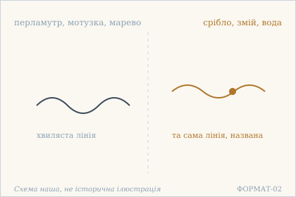 — Три омани в одному ряді: срібло, змій, вода. Схема наша, не історична ілюстрація.

**Сцена.** 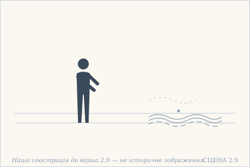 — Спрагла людина простягає руку до води, якої насправді немає. Наша ілюстрація до вірша 2.9 — не історичне зображення.

## 2.10

**Деванагарі.** मत्तो विनिर्गतं विश्वं मय्य् एव लयम् एष्यति । मृदि कुम्भो जले वीचिः कनके कटकं यथा ॥

**Українська транслітерація.** матто вінірґатам вішвам майй ева лаям ешяті | мріді кумбго джале вічіх канаке катакам ятха ||

**Переклад.** Світ, що вийшов із мене, у мені ж і розчиниться — як горщик у глині, як хвиля у воді, як браслет у золоті.

**Науковий коментар.** Порівняння тут іншого типу, ніж у 2.9. Там ішлося про помилку сприйняття, тут — про **відношення причини й наслідку**. Горщик не є чимось додатковим до глині, браслет — до золота: змінилася форма, не речовина. Це класична для індійської думки модель, де наслідок уже міститься в причині. Слово laya («розчинення») не означає знищення: воно означає повернення до того, з чого виникло. Разом 2.9 і 2.10 дають два різні пояснення одного й того самого: світ і помилковий у способі явлення (2.9), і не відокремлений від джерела (2.10).

**Українська паралель (наша інтерпретація, не твердження про вплив).** *Григорій Сковорода*, «Діалог, або Розмова про давній світ». Наша паралель: думка, що річ розчиняється у своєму началі, у Сковороди теж тримає всю розмову про давній і новий світ. Наша інтерпретація за будовою думки, не за джерелом.

**Ілюстрація.** 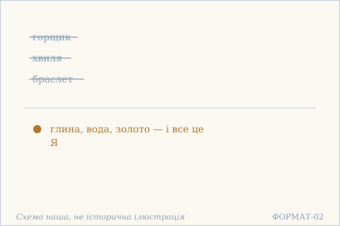 — Горщик, хвиля й браслет розчиняються в своєму началі. Схема наша, не історична ілюстрація.

## 2.11

**Деванагарі.** अहो अहं नमो मह्यं विनाशो यस्य नास्ति मे । ब्रह्मादिस्तम्बपर्यन्तं जगन्नाशे ऽपि तिष्ठतः ॥

**Українська транслітерація.** ахо ахам намо махям вінашо яся насті ме | брахмадістамбапар'янтам джаґаннаше ’пі тіштхатах ||

**Переклад.** О диво! Поклін мені самому — тому, в кого немає загибелі, хто стоїть, навіть коли гине світ від Брахми аж до стебла трави.

**Науковий коментар.** Зачин «aho ahaṃ namo mahyaṃ» — самопрославлення, і це навмисний парадокс у тексті, що весь будується на запереченні «я». Тут «я» не его, а те, що лишається, коли его знято: тому й поклін спрямований не собі як особі, а тому, що в собі не гине. Діапазон «brahmādistambaparyantam» («від Брахми до стебла трави») — це не поетичне перебільшення, а повний обсяг живих істот у традиційній картині: найвищий бог і найменша рослина. Твердження сильне саме тому, що охоплює обидва краї. Те саме «namo mahyaṃ» повторюється в 2.12 — це рефрен, а не випадковий збіг.

**Українська паралель (наша інтерпретація, не твердження про вплив).** *Тарас Шевченко*, «Подражаніє Екклезіястові». Наша паралель: у Шевченка все, що має кінець, теж минає, і саме на цьому тлі постає те, що стоїть. Наше порівняння — за настроєм, а не твердження про спільну думку.

**Ілюстрація.** 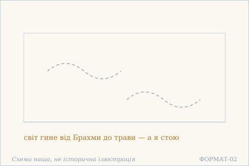 — Небо без хмар: світ минає, а те, що дивиться, стоїть. Схема наша, не історична ілюстрація.

## 2.12

**Деванагарі.** अहो अहं नमो मह्यं एको ऽहं देहवान् अपि । क्वचिन् न गन्ता नागन्ता व्याप्य विश्वम् अवस्थितः ॥

**Українська транслітерація.** ахо ахам намо махям еко ’хам дехаван апі | квачін на ґанта наґанта в'яп'я вішвам авастхітах ||

**Переклад.** О диво! Поклін мені самому! Я один — і хоч маю тіло, нікуди не йду й не приходжу: охопивши все, перебуваю.

**Науковий коментар.** Парадокс у «dehavān api» («навіть маючи тіло»): тіло є, а руху немає, бо немає куди йти — усе вже охоплене. «na gantā nāgantā» («не той, хто йде, і не той, хто приходить») знімає не дію, а подорож як таку: обидва дієприкметники майбутнього часу, тобто йдеться не про те, що вже сталося, а про те, що не станеться. Разом із 2.11 це пара: там «не гину, коли гине світ» (час), тут «не йду, коли все охоплене» (простір). Два виміри, один висновок.

**Українська паралель (наша інтерпретація, не твердження про вплив).** *Василь Стус*, «Палімпсести». Наша паралель: у Стуса теж є стан, у якому людина не приходить і не йде, а перебуває всупереч усьому, що з нею роблять. Наша асоціація, не вказівка на вплив.

**Ілюстрація.** 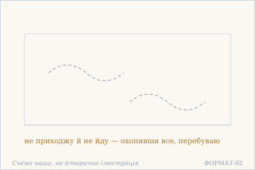 — Простір, що нікуди не йде, бо вже охопив усе. Схема наша, не історична ілюстрація.

## 2.13

**Деванагарі.** अहो अहं नमो मह्यं दक्षो नास्तीह मत्समः । असंस्पृश्य शरीरेण येन विश्वं चिरं धृतम् ॥

**Українська транслітерація.** ахо ахам намо махям дакшо настіха матсамах | асамспрішя шарірена єна вішвам чірам дгрітам ||

**Переклад.** О диво! Поклін мені самому — тому, хто, не торкаючись тілом, довго втримує все; немає тут нікого, хто дорівнював би мені в цьому.

**Науковий коментар.** Парадокс в asaṃspṛśya («не торкнувшись»): світ утримується, і водночас немає дотику. Тіло назване тут не як перешкода, а як те, чим дотик не відбувається — це не заперечення тіла, а заперечення його як інструменту. Слово dakṣa («спритний») ужите з іронією: спритність зазвичай означає вправність у дії, а тут вона полягає в тому, щоб діяти без дотику. Третій рефренний зачин поспіль (2.11, 2.12, 2.13) показує, що це не окремі вигуки, а серія: кожен наступний вірш додає новий вимір до того самого «поклону собі».

**Українська паралель (ПОТРЕБУЄ ПЕРЕВІРКИ).** *українська філософська проза*, не визначено. ПОТРЕБУЄ ПЕРЕВІРКИ: думка про те, що ціле втримується без дотику, в українському матеріалі найчастіше приходить через Сковороду, але конкретного місця ми не звірили.

**Ілюстрація.** 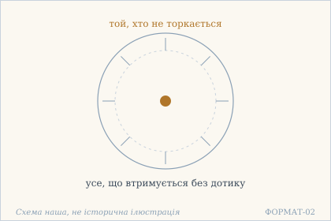 — Центр без дотику: усе втримується, а він не торкається. Схема наша, не історична ілюстрація.

## 2.14

**Деванагарі.** अहो अहं नमो मह्यं यस्य मे नास्ति किञ्चन । अथवा यस्य मे सर्वं यद् वाङ्मनसगोचरम् ॥

**Українська транслітерація.** ахо ахам намо махям яся ме насті кіньчана | атхава яся ме сарвам яд ванманасаґочарам ||

**Переклад.** О диво! Поклін мені самому! У мене немає нічого — або ж у мене є все, що взагалі досяжне слову й розуму.

**Науковий коментар.** Вірш ставить дві взаємовиключні відповіді й не обирає між ними: athavā («або ж») залишає обидві. Це не нерішучість, а точний хід: якщо «нічого» і «все» однаково хибні описи, то обидва виражають те саме — те, що не піддається опису ні як володіння, ні як відсутність. Та сама формула athavā na ca kiñcana є і в 2.2, тож це не одноразовий зворот, а повторюваний прийом тексту. Друга половина обмежує коло: sarvaṃ — це не «все взагалі», а лише те, що потрапляє в поле слова й розуму (vāṅmanasagocara). Те, що поза цим полем, не називається ні «всім», ні «нічим».

**Українська паралель (наша інтерпретація, не твердження про вплив).** *Григорій Сковорода*, «Убогий Жайворонок». Наша паралель: у Сковороди вбогість і багатство теж міряються не майном, а тим, чи вміщується в людину те, чого вона хоче. Наше порівняння — типологічне.

**Ілюстрація.** 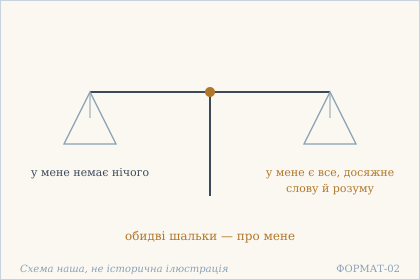 — Дві шальки: нічого і все — обидві про мене. Схема наша, не історична ілюстрація.

## 2.15

**Деванагарі.** ज्ञानं ज्ञेयं तथा ज्ञाता त्रितयं नास्ति वास्तवम् । अज्ञानाद् भाति यत्रेदं सो ऽहम् अस्मि निरञ्जनः ॥

**Українська транслітерація.** джнянам джнєям татха джнята трітаям насті ваставам | аджнянад бгаті ятредам со ’хам асмі ніраньджанах ||

**Переклад.** Знання, пізнаване й пізнавач — ця трійця не є справжньою. Те, у чому вона сяє через незнання, — це я, незаплямований.

**Науковий коментар.** Заперечується не знання як таке, а **трійця** — поділ на того, хто знає, те, що знають, і саме знання. Це найточніше місце глави: доки є трійця, є й поділ, а поділ і є те, що тут названо незнанням. Зверни увагу на порядок: спершу сказано, що трійця не дійсна, і лише потім — що вона сяє. Тобто вона не зникає: вона продовжує являтися, але вже не як справжня. saḥ aham asmi («я є те») — пряма формула ототожнення, і вона стосується не трійці, а того, у чому трійця являється. nirañjana («незаплямований») стоїть останнім словом навмисно: те, у чому сяє незнання, саме ним не забруднюється.

**Українська паралель (наша інтерпретація, не твердження про вплив).** *Памфіл Юркевич*, «Серце і його значення в духовному житті людини» (1860). Наша паралель: коли вірш називає трійцю пізнавача, пізнаваного й знання несправжньою, він питає про те саме, про що Юркевич питає інакше: де в людині те, що не є ані річчю, ані думкою про річ.

**Ілюстрація.** 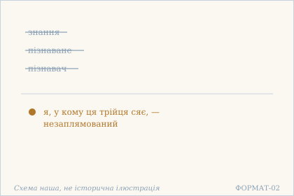 — Трійця пізнання відкинута: лишається незаплямований. Схема наша, не історична ілюстрація.

## 2.16

**Деванагарі.** द्वैतमूलम् अहो दुःखं नान्यत् तस्यास्ति भेषजम् । दृश्यम् एतन् मृषा सर्वं एको ऽहं चिद्रसो ऽमलः ॥

**Українська транслітерація.** двайтамулам ахо духкхам нанят тасясті бгешаджам | дрішям етан мріша сарвам еко ’хам чідрасо ’малах ||

**Переклад.** О диво! Корінь страждання — двоїстість, і немає від нього інших ліків. Усе це видиме — хибне. Я один: смак свідомості, незаплямований.

**Науковий коментар.** Вірш має три частини й будується як діагноз, рецепт і твердження. Діагноз: duḥkha має корінь у двоїстості, а не в обставинах. Рецепт: nānyat tasya asti bheṣajam — «немає інших ліків», тобто лікування не в усуненні окремих страждань, а в усуненні поділу. Твердження: dṛśyam etan mṛṣā — видиме хибне. Останнє найризикованіше, і його не слід читати як «світу немає»: mṛṣā означає «марне, несправжнє» в сенсі несамостійного буття, а не відсутності. cidrasaḥ («чий смак — cit») — рідкісний і точний складник: не «я є свідомість», а «я маю смак свідомості», тобто свідомість не річ, якою я володію, а те, чим я відчувається.

**Українська паралель (наша інтерпретація, не твердження про вплив).** *Ліна Костенко*, «Сад нетанучих скульптур» (1987). Наша паралель: у Костенко двоїстість теж постає джерелом болю, а не умовою мислення. Наше порівняння — за способом ставити питання.

**Ілюстрація.** 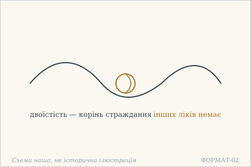 — Вузол двоїстості: корінь болю і єдине, що треба розвʼязати. Схема наша, не історична ілюстрація.

## 2.17

**Деванагарі.** बोधमात्रोऽहम् अज्ञानाद् उपाधिः कल्पितो मया । एवं विमृशतो नित्यं निर्विकल्पे स्थितिर् मम ॥

**Українська транслітерація.** бодгаматро’хам аджнянад упадгіх калпіто мая | евам вімрішато нітям нірвікалпе стхітір мама ||

**Переклад.** Я — лише усвідомлення; через незнання я домисив собі обмеження. Хто так постійно розмірковує, той стоїть у не-розрізненні — і це моє стояння.

**Науковий коментар.** Тут названо механізм: upādhi («накладка, обмеження») не є чимось зовнішнім — він kalpita, «домислений», і домисил його саме той, хто тепер його знімає (mayā). Це не докір собі: у тексті немає оцінки, лише констатація авторства помилки. nirvikalpa — «без розрізнення», стан, у якому vikalpa (конструювання) не діє; це той самий корінь, що в 2.9 vikalpita.

**Українська паралель (ПОТРЕБУЄ ПЕРЕВІРКИ).** *українська релігійна філософія*, не визначено. ПОТРЕБУЄ ПЕРЕВІРКИ: мотив межі, яку людина домалювала собі сама, близький до української традиції самоспостереження, але назвати твір без звірки ми не можемо.

**Ілюстрація.** 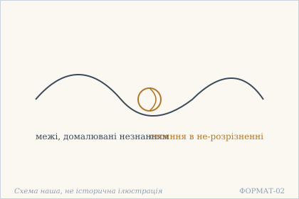 — Вузол, завʼязаний власною думкою, і стояння поза ним. Схема наша, не історична ілюстрація.

## 2.18

**Деванагарі.** अहो मयि स्थितं विश्वं वस्तुतो न मयि स्थितम् । न मे बन्धोऽस्ति मोक्षो वा भ्रान्तिः शान्ता निराश्रया ॥

**Українська транслітерація.** ахо маї стхітам вішвам вастуто на маї стхітам | на ме бандго’сті мокшо ва бгрантіх шанта нірашрая ||

**Переклад.** О диво: світ ніби в мені — а насправді він у мені не вміщується. Немає в мене ні пут, ні визволення; омана вщухла, втративши опору.

**Науковий коментар.** Парадокс навмисний: перший піввірш дає звичну формулу, другий її знімає через vastutaḥ («насправді»). Далі — те саме заперечення, що в 15.18: немає ні пут, ні визволення. nirāśrayā («без опори») вказує, чому омана вщухла: у неї не лишилося основи, а не тому, що її перемогли.

**Українська паралель (наша інтерпретація, не твердження про вплив).** *Григорій Сковорода*, «Алфавіт, чи Буквар миру» (діалог). Наша паралель: у Сковороди дух теж описаний як те, що не має краю, у якому його можна було б замкнути. Наша інтерпретація, не твердження про вплив.

**Ілюстрація.** 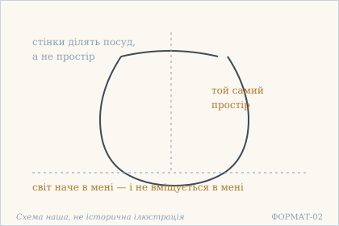 — Простір, у який не вміщується те, що в ньому ніби є. Схема наша, не історична ілюстрація.

## 2.19

**Деванагарі.** सशरीरम् इदं विश्वं न किञ्चिद् इति निश्चितम् । शुद्धचिन्मात्र आत्मा च तत् कस्मिन् कल्पनाधुना ॥

**Українська транслітерація.** сашарірам ідам вішвам на кіньчід іті нішчітам | шуддгачінматра атма ча тат касмін калпанадгуна ||

**Переклад.** Цей світ разом із тілом — ніщо, так установлено; а Я — лише чиста свідомість. У чому ж тоді ще домислювати?

**Науковий коментар.** Друга половина — риторичне питання, і воно важливіше за першу: після того як названо «ніщо» і «чиста свідомість», для домислювання не лишається місця (kasmin — «у чому?»). śuddha-cin-mātra зберігає потрійну будову: чисте — свідомість — лише; кожен складник несе вагу.

**Українська паралель (наша інтерпретація, не твердження про вплив).** *Іван Вишенський*, «Книжка» (кінець XVI ст.). Наша паралель: у Вишенського відмова від світу теж робить питання про набутки зайвим. Наше порівняння — типологічне, не про джерело.

**Ілюстрація.** 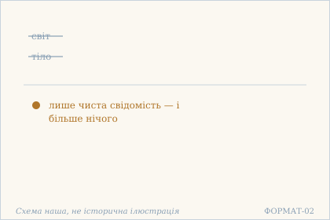 — Світ і тіло названі нічим: лишається чиста свідомість. Схема наша, не історична ілюстрація.

## 2.20

**Деванагарі.** शरीरं स्वर्गनरकौ बन्धमोक्षौ भयं तथा । कल्पनामात्रम् एवैतत् किं मे कार्यं चिदात्मनः ॥

**Українська транслітерація.** шарірам сварґанаракау бандгамокшау бгаям татха | калпанаматрам евайтат кім ме кар'ям чідатманах ||

**Переклад.** Тіло, небо й пекло, пута й визволення, страх — усе це лише домислювання. Що мені робити, коли моя природа — свідомість?

**Науковий коментар.** Два двоїни (dual) у переліку — svarga-narakau і bandha-mokṣau — тримають пари разом: текст не відкидає пекло й не обирає небо, він ставить обидва в один ряд із домислюванням. Питання kiṃ me kāryam не риторичне в сенсі «нічого»: воно справді питає, що лишається робити, і відповіді в цьому вірші немає.

**Українська паралель (ПОТРЕБУЄ ПЕРЕВІРКИ).** *українське бароко*, не визначено. ПОТРЕБУЄ ПЕРЕВІРКИ: перелік того, що є лише домислом, близький до барокової проповіді про марність уявлень, але конкретного тексту ми не перевіряли.

**Ілюстрація.** 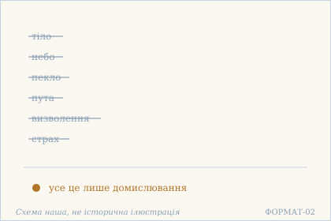 — Шість домислів закреслено: тіло, небо, пекло, пута, воля, страх. Схема наша, не історична ілюстрація.

## 2.21

**Деванагарі.** अहो जनसमूहे ऽपि न द्वैतं पश्यतो मम । अरण्यम् इव संवृत्तं क्व रतिं करवाण्य् अहम् ॥

**Українська транслітерація.** ахо джанасамухе ’пі на двайтам пашято мама | араням іва самвріттам ква ратім караванй ахам ||

**Переклад.** О диво! Навіть у натовпі, коли я не бачу двоїстості, все стає як ліс. Де ж мені шукати втіхи?

**Науковий коментар.** Парадокс подвійний. Перший: натовп для того, хто не бачить двоїстості, — те саме, що ліс, тобто самотність не залежить від людей навколо. Другий, і він тонший: питання kva ratiṃ karavāṇi («де мені знайти втіху») поставлене там, де втіху вже ніде шукати, бо поділу немає. Це не скарга, а риторичне питання, що закриває можливість відповіді. Форма optativus karavāṇi («мені б робити») додає відтінку роздуму, а не бажання. Зверни увагу: слово rati («втіха») — те саме, що в 15.2 у складі vaiṣayiko rasaḥ («смак до чуттєвого»); тут воно вжите без засудження, але й без місця, куди його покласти.

**Українська паралель (наша інтерпретація, не твердження про вплив).** *Михайло Коцюбинський*, «Intermezzo» (1908). Наша паралель: у Коцюбинського самотність серед людей теж обертається на простір, у якому все стає живим. Наше порівняння — за образом, а не за вченням.

**Ілюстрація.** 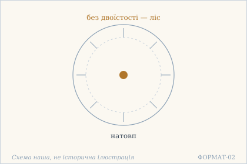 — Натовп без двоїстості стає лісом. Схема наша, не історична ілюстрація.

## 2.22

**Деванагарі.** नाहम् देहो न मे देहो जीवो नाहम् अहं हि चित् । अयम् एव हि मे बन्ध आसीत् या जीविते स्पृहा ॥

**Українська транслітерація.** нахам дехо на ме дехо джіво нахам ахам хі чіт | аям ева хі ме бандга асіт я джівіте спріха ||

**Переклад.** Я не тіло, і тіло не моє. Я не живчик — я свідомість. Ось у чому була моя уза: спрага до життя.

**Науковий коментар.** Найважливіше тут — **час дієслова**. āsīt — це минулий незавершений час, тобто «була», а не «є». Уза не описується як наявна: вона названа в минулому, бо вже побачена як те, чим вона була. Це не проголошення свободи, а звіт про те, що побачене. Другий точний момент: заперечуються три ототожнення поспіль (тіло, володіння тілом, jīva), і лише четверте — ствердне (aham cit). jīva тут не синонім ātman: це саме «живчик», індивідуальна істота, і її заперечення стоїть окремо від заперечення тіла. Причина узи названа одна — spṛhā, спрага до життя, а не до насолод. Це вужче й точніше, ніж звичне «бажання».

**Українська паралель (наша інтерпретація, не твердження про вплив).** *Леся Українка*, «Одержима» (1901). Наша паралель: у Лесі Українки те, що тримає людину в житті, теж названо прямо і без утіхи. Наша асоціація, не твердження про вплив.

**Ілюстрація.** 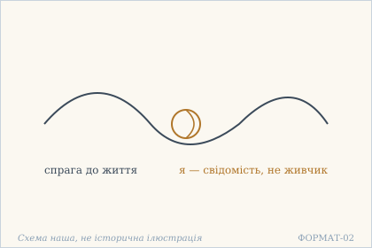 — Вузол спраги жити: ось у чому була уза. Схема наша, не історична ілюстрація.

## 2.23

**Деванагарі.** अहो भुवनकल्लोलैर् विचित्रैर् द्राक् समुत्थितम् । मय्य् अनन्तमहाम्भोधौ चित्तवाते समुद्यते ॥

**Українська транслітерація.** ахо бгуванакаллолайр вічітрайр драк самуттхітам | майй анантамахамбгодгау чіттавате самудяте ||

**Переклад.** О диво! Різнобарвні хвилі світів раптом піднялися — бо в мені, безмежному великому океані, здіймається вітер розуму.

**Науковий коментар.** Початок триптиха (2.23–2.25), де той самий образ розгортається в три кроки: вітер здіймається, вітер вщухає, хвилі граються самі. Тут важлива **причинність**: хвилі не є океаном і не породжені ним безпосередньо — їх піднімає вітер, тобто citta. Океан лишається океаном і без хвиль. Слово ambhodhi буквально означає «той, що містить води» — це поетичне іменування океану, і воно тримає образ: води багато, хвиля — її форма, а не додаток. Порівняй 2.10, де були горщик у глині й хвиля у воді: там ішлося про невідокремленість наслідку, тут — про те, що рух має причину, і причина не в океані.

**Українська паралель (наша інтерпретація, не твердження про вплив).** *Григорій Сковорода*, «Сад божественних пісень». Наша паралель: у Сковороди буря пристрастей теж постає як рух, що піднімається зсередини, а не приходить ззовні. Наше порівняння — за образом, не за джерелом.

**Ілюстрація.** 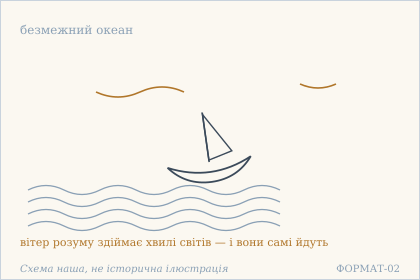 — Бурхливий океан і човен: хвилі світів піднімає вітер розуму. Схема наша, не історична ілюстрація.

## 2.24

**Деванагарі.** मय्य् अनन्तमहाम्भोधौ चित्तवाते प्रशाम्यति । अभाग्याज् जीववणिजो जगत्पोतो विनश्वरः ॥

**Українська транслітерація.** майй анантамахамбгодгау чіттавате прашам'яті | абгаґядж джіваваніджо джаґатпото вінашварах ||

**Переклад.** Коли в мені, безмежному океані, вітер розуму вщухає, — на лихо торговцеві-живчику — човен світу гине.

**Науковий коментар.** Іронія тут точна й гірка. abhāgyāt («на лихо») сказано з погляду **торговця**: для jīva, який плавав на цьому човні й мав із нього зиск, затишшя — катастрофа. Для океану — спокій. Одне й те саме явище описане двічі, і оцінки протилежні. Метафора подвійна: човен пливе **на** океані, тобто світ не є океаном, а лише тим, що по ньому рухається; і човен гине не від бурі, а від її відсутності. Це відповідає 15.18 («нема ні пут, ні визволення»): те, що зникає, не було справжнім, а лише плавало.

**Українська паралель (ПОТРЕБУЄ ПЕРЕВІРКИ).** *українська філософська лірика*, не визначено. ПОТРЕБУЄ ПЕРЕВІРКИ: образ човна, що тоне разом із торговцем, в українському матеріалі найближчий до філософської лірики, але конкретного твору ми не звірили.

**Ілюстрація.** 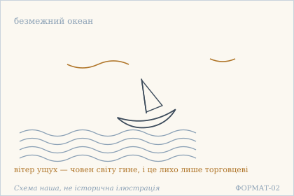 — Човен тоне в ущухлому океані: втрата тільки для торговця. Схема наша, не історична ілюстрація.

## 2.25

**Деванагарі.** मय्य् अनन्तमहाम्भोधाव् आश्चर्यं जीववीचयः । उद्यन्ति घ्नन्ति खेलन्ति प्रविशन्ति स्वभावतः ॥

**Українська транслітерація.** майй анантамахамбгодгав ашчар'ям джівавічаях | удянті ґгнанті кхеланті правішанті свабгаватах ||

**Переклад.** У мені, безмежному океані, диво: хвилі живих істот здіймаються, б'ються, граються й входять — самі собою, за власною природою.

**Науковий коментар.** Завершення триптиха, і воно знімає те, що було в 2.23–2.24. Там хвилі піднімав вітер, і човен гинув — тобто була причина й був той, кому зле. Тут **причини немає**: svabhāvataḥ («за власною природою») стоїть останнім словом і скасовує питання «хто це робить». Чотири дієслова йдуть без сполучників, підряд — це не опис послідовності, а перелік того, що відбувається водночас. ghnanti («б'ються») — єдине слово з відтінком болю, і воно стоїть у тому ж ряду, що khelanti («граються»), без переходу й без пояснення. Це і є āścaryam («диво»): не те, що все добре, а те, що все це відбувається саме, без господаря.

**Українська паралель (наша інтерпретація, не твердження про вплив).** *Богдан-Ігор Антонич*, «Зелена Євангелія» (1938). Наша паралель: в Антонича світ теж рухається сам собою, за власною природою, і людина лише бачить цей рух. Наше порівняння — типологічне.

**Ілюстрація.** 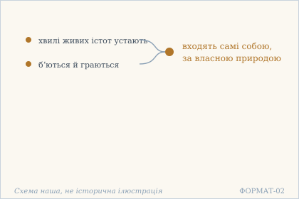 — Хвилі живих істот граються й входять самі собою. Схема наша, не історична ілюстрація.

## Поетичний переклад

Окремо, у [`poetychnyi/rozdil-2.md`](poetychnyi/rozdil-2.md). Це **наш поетичний переклад**, не канонічний і не науковий; у PDF він іде окремою частиною.
