# Аштавакра-ґіта. Глава 20. Наукове представлення

> ФОРМАТ-02: кожен вірш подано шістьма шарами — деванагарі, IAST, українська
> транслітерація, переклад, науковий коментар з українськими паралелями,
> ілюстрація. Плюс окремо — поетичний переклад (`poetychnyi/rozdil-20.md`).
>
> **IAST** — те, що записано в картці (поле `iast`), без редакторських
> поправок: це єдиний шар, який не перераховується скриптом.
> **Деванагарі тут — механічна** транслітерація поля `iast` з картки
> (`scripts/iast_to_devanagari.py`), а не окреме читання за рукописом.
> **Українська транслітерація** — теж механічна (`scripts/iast_to_ukrainian.py`,
> таблиця в `docs/TRANSLITERATSIIA.md`).
> **Українські паралелі** — наша інтерпретація, а не твердження про вплив;
> реєстр і правила — `paraleli.json` і `scripts/check_ukrainian_parallels.py`.
> **Схеми** — наші власні; жодна не є історичною ілюстрацією.
> **Сцени** (`ilustratsii-naratyvni/`) — теж наші власні малюнки й теж не
> історичні: це ситуація вірша, а не поняття, і фігури там — силуети без
> облич.
>
> Цей файл згенеровано; правити треба картки й `format-v2/rozdil-20.json`,
> а не його.

## Глава 20. Ніщо не постає

Остання глава повторює форму девʼятнадцятої й доводить її до кінця: чотирнадцять разів питає де те й де те, і щоразу відповідає не переліком, а собою. Останній вірш книги обриває й самий перелік: та й навіщо багато слів — у мене не постає ніщо. Книга, що почалася питанням учня, закінчується тим, що питати більше нічого.

## 20.1

**Деванагарі.** क्व भूतानि क्व देहो वा । क्वेन्द्रियाणि क्व वा मनः । क्व शून्यं क्व च नैराश्यं । मत्स्वरूपे निरञ्जने ॥

**IAST.** kva bhūtāni kva deho vā | kvendriyāṇi kva vā manaḥ | kva śūnyaṃ kva ca nairāśyaṃ | matsvarūpe nirañjane ||

**Українська транслітерація.** ква бгутані ква дехо ва | квендріяні ква ва манах | ква шуням ква ча найрашям | матсварупе ніраньджане ||

**Переклад.** Де першоелементи, де тіло, де чуття, де розум? Де порожнеча, де без-надійність — у моїй власній формі, що не знає плями?

**Коментар.** Глава 20 складається майже цілком із питань kva, і це не пошук, а спосіб сказати, що переліченого немає де шукати. Перший вірш задає рамку: усі пари й категорії поставлено до однієї locative-форми — matsvarūpe, «у моїй власній формі». Зверніть увагу, що поряд із тілом і чуттями стоїть nairāśya, без-надійність: це не чеснота, а один із станів, який теж зникає. Слово ātman тут не вжите — є svarūpa, «власна форма»; ототожнювати їх можна лише як тлумачення.

**Українська паралель (наша інтерпретація, не твердження про вплив).** *Григорій Сковорода*, «Наркіс. Розмова про те: Пізнай себе». Наша паралель: у Сковороди питання де тіло й де чуття теж обертається на питання про того, хто питає. Наше порівняння — типологічне.

**Ілюстрація.** 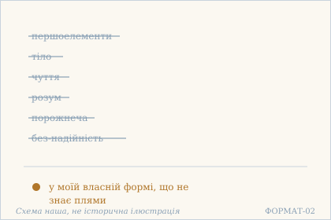 — Першоелементи й розум відпали: лишається власна форма. Схема наша, не історична ілюстрація.

## 20.2

**Деванагарі.** क्व शास्त्रं क्वात्मविज्ञानं । क्व वा निर्विषयं मनः । क्व तृप्तिः क्व वितृष्णत्वं । गतद्वन्द्वस्य मे सदा ॥

**IAST.** kva śāstraṃ kvātmavijñānaṃ | kva vā nirviṣayaṃ manaḥ | kva tṛptiḥ kva vitṛṣṇatvaṃ | gatadvandvasya me sadā ||

**Українська транслітерація.** ква шастрам кватмавіджнянам | ква ва нірвішаям манах | ква тріптіх ква вітрішнатвам | ґатадвандвася ме сада ||

**Переклад.** Де писання, де пізнання Я, де розум без об'єктів? Де вдоволеність, де свобода від спраги — у мене, в кого пари вже відпали назавжди?

**Коментар.** Другий вірш ставить під питання й засоби пізнання: писання, пізнання Я, безоб'єктний розум. Це важливо для розуміння всієї глави — заперечення не обминає духовних досягнень, воно починає саме з них. tṛpti і vitṛṣṇatva названо поруч і досить несподівано: вдоволеність теж виявляється тим, чого немає де шукати. Термін toṣa, з яким tṛpti часто ототожнюють, тут не вжитий; це різні слова, і переклад їх не змішує.

**Українська паралель (наша інтерпретація, не твердження про вплив).** *Іван Вишенський*, «Книжка» (кінець XVI ст.). Наша паралель: у Вишенського писання й пізнання теж втрачають вагу перед тим, у кого пари вже відпали. Наше порівняння — типологічне.

**Ілюстрація.** 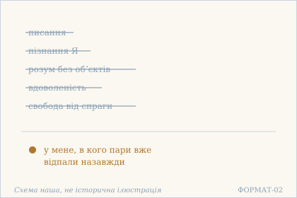 — Писання й пізнання Я відпали. Схема наша, не історична ілюстрація.

## 20.3

**Деванагарі.** क्व विद्या क्व च वाविद्या । क्वाहं क्वेदं मम क्व वा । क्व बन्धः क्व च वा मोक्षः । स्वरूपस्य क्व रूपिता ॥

**IAST.** kva vidyā kva ca vāvidyā | kvāhaṃ kvedaṃ mama kva vā | kva bandhaḥ kva ca vā mokṣaḥ | svarūpasya kva rūpitā ||

**Українська транслітерація.** ква відя ква ча вавідя | квахам кведам мама ква ва | ква бандгах ква ча ва мокшах | сварупася ква рупіта ||

**Переклад.** Де знання й де незнання, де «я», де «це», де «моє»? Де пута, де визволення — і де взагалі якась оформленість у того, хто сам є своєю формою?

**Коментар.** Вірш перебирає основні опозиції будь-якого вчення — знання й незнання, я й це, моє, пута й визволення — і всі ставить під те саме питання. Порядок показовий: mokṣa з'являється не як відповідь, а як останній член пари з bandha. Остання пада замикає коло: якщо він є власна форма (svarūpa), то приписувати йому ще й оформленість (rūpitā) немає де. Саме тут свідки розходяться в одному слові — rūpitā / rūpatā, — і вибір між ними змінює відтінок, але не напрям думки.

**Українська паралель (наша інтерпретація, не твердження про вплив).** *Памфіл Юркевич*, «Серце і його значення в духовному житті людини» (1860). Наша паралель: коли вірш питає, де я й де моє, він розводить того, хто говорить, і те, що він собі приписує. Юркевич розводить їх так само рішуче. Наше порівняння — за способом розрізняти.

**Ілюстрація.** 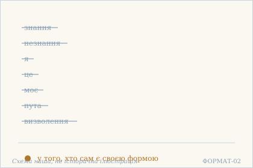 — Я, моє, пута й визволення відпали. Схема наша, не історична ілюстрація.

## 20.4

**Деванагарі.** क्व प्रारब्धानि कर्माणि । जीवन्मुक्तिर् अपि क्व वा । क्व तद् विदेहकैवल्यं । निर्विशेषस्य सर्वदा ॥

**IAST.** kva prārabdhāni karmāṇi | jīvanmuktir api kva vā | kva tad videhakaivalyaṃ | nirviśeṣasya sarvadā ||

**Українська транслітерація.** ква прарабдгані кармані | джіванмуктір апі ква ва | ква тад відехакайвалям | нірвішешася сарвада ||

**Переклад.** Де вже запущені в дію діяння, де звільнення ще за життя? Де те безтілесне кайвальям — у того, хто завжди без ознак?

**Коментар.** Тут заперечено не лише пута, а й обидві форми звільнення, відомі традиції: прижиттєве (jīvanmukti) і посмертне (videhakaivalya). Разом із ними зникає й prārabdha-karman — залишкова карма, якою зазвичай пояснюють, чому звільнений ще живе в тілі. Логіка вірша: усе це ознаки, а того, хто без ознак (nirviśeṣa), означити нічим. Зауважмо, що слово mukti в главах 16, 17 і 20 ужите лише двічі — тут і в 20.12, — і обидва рази в переліку того, чого немає.

**Українська паралель (ПОТРЕБУЄ ПЕРЕВІРКИ).** *українська філософська проза*, не визначено. ПОТРЕБУЄ ПЕРЕВІРКИ: питання про безтілесне звільнення найближче до української філософської прози, але конкретного твору ми не перевірили.

**Ілюстрація.** 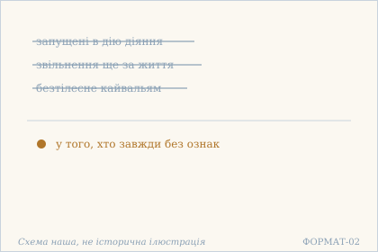 — Діяння й безтілесне звільнення відпали. Схема наша, не історична ілюстрація.

## 20.5

**Деванагарі.** क्व कर्ता क्व च वा भोक्ता । निष्क्रियं स्फुरणं क्व वा । क्वापरोक्षं फलं वा क्व । निःस्वभावस्य मे सदा ॥

**IAST.** kva kartā kva ca vā bhoktā | niṣkriyaṃ sphuraṇaṃ kva vā | kvāparokṣaṃ phalaṃ vā kva | niḥsvabhāvasya me sadā ||

**Українська транслітерація.** ква карта ква ча ва бгокта | нішкріям спхуранам ква ва | квапарокшам пхалам ва ква | ніхсвабгавася ме сада ||

**Переклад.** Де діяч, де той, хто зазнає? Де бездіяльне сяйво? Де безпосереднє знання, де його плід — у мене, в кого немає власної природи?

**Коментар.** Вірш забирає найстійкішу пару будь-якої системи — діяча й споживача — і додає до неї niṣkriya sphuraṇa, бездіяльне сяйво: те, що виявляється, не діючи. Це єдина в главі спроба назвати щось позитивне, і вона одразу поставлена під питання kva. Останнє слово — niḥsvabhāva, «без власної природи»; воно не означає порожнечі, а вказує, що жодна природа не може бути йому приписана. Термінів cit чи sākṣin тут немає, хоч sphuraṇa за змістом найближче до них.

**Українська паралель (наша інтерпретація, не твердження про вплив).** *Микола Зеров*, «Камена» (1924). Наша паралель: у Зерова бездіяльне сяйво теж постає як повнота, а не як відсутність. Наше порівняння — типологічне.

**Ілюстрація.** 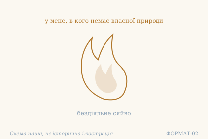 — Бездіяльне сяйво без власної природи. Схема наша, не історична ілюстрація.

## 20.6

**Деванагарі.** क्व लोकः क्व मुमुक्षुर् वा । क्व योगी ज्ञानवान् क्व वा । क्व बद्धः क्व च वा मुक्तः । स्वस्वरूपे ऽहम् अद्वये ॥

**IAST.** kva lokaḥ kva mumukṣur vā | kva yogī jñānavān kva vā | kva baddhaḥ kva ca vā muktaḥ | svasvarūpe 'ham advaye ||

**Українська транслітерація.** ква локах ква мумукшур ва | ква йоґі джнянаван ква ва | ква баддгах ква ча ва муктах | свасварупе ’хам адває ||

**Переклад.** Де світ, де той, хто прагне звільнення, де йог чи знавець? Де зв'язаний, де звільнений — я у своїй власній формі, яка не знає двоїстості.

**Коментар.** Уперше в главі з'являється ствердне речення: aham ... svasvarūpe advaye, «я — у своїй недвоїстій формі». Усе інше лишається питанням. Показово, що серед зниклих постатей є й muktaḥ, звільнений: у недвоїстості немає ні того, хто зв'язаний, ні того, хто звільнений. Слово advaya, «недвоїстий», — єдиний явний адвайтичний термін у цих трьох главах; усе решта сказано описово. Це місце варто читати уважно: «я» тут не протиставлене світові, воно вказане як те, у чому світу не знаходиться місця.

**Українська паралель (наша інтерпретація, не твердження про вплив).** *Тарас Шевченко*, «Кобзар» (1840). Наша паралель: у Шевченка питання де звʼязаний, де звільнений теж звучить як докір мірі, а не як опис двох людей. Наше порівняння — типологічне, не про джерело.

**Ілюстрація.** 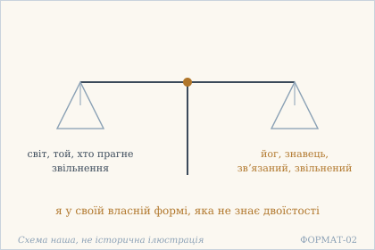 — Дві шальки: світ і визволення — обидві порожні. Схема наша, не історична ілюстрація.

## 20.7

**Деванагарі.** क्व सृष्टिः क्व च संहारः । क्व साध्यं क्व च साधनम् । क्व साधकः क्व सिद्धिर् वा । स्वस्वरूपे ऽहम् अद्वये ॥

**IAST.** kva sṛṣṭiḥ kva ca saṃhāraḥ | kva sādhyaṃ kva ca sādhanam | kva sādhakaḥ kva siddhir vā | svasvarūpe 'ham advaye ||

**Українська транслітерація.** ква сріштіх ква ча самхарах | ква садгям ква ча садганам | ква садгаках ква сіддгір ва | свасварупе ’хам адває ||

**Переклад.** Де творення, де згортання, де мета, де засіб? Де той, хто практикує, де здобуття — я у своїй власній формі, яка не знає двоїстості.

**Коментар.** Вірш знімає всю структуру практики: мету, засіб, виконавця й результат. Це найпряміше місце глави, де сказано, що шлях як такий не має опори. Друга пада повторює 20.6 дослівно — прийом навмисний: після кожного переліку читача повертають до того самого місця. Слово siddhi тут ужите в звичайному значенні «здобуття», а не як назва надприродних сил у йозі.

**Українська паралель (наша інтерпретація, не твердження про вплив).** *Богдан-Ігор Антонич*, «Ротації» (1938). Наша паралель: в Антонича творення й згортання теж описані як рух самої природи, а не чиясь справа. Наше порівняння — за образом.

**Ілюстрація.** 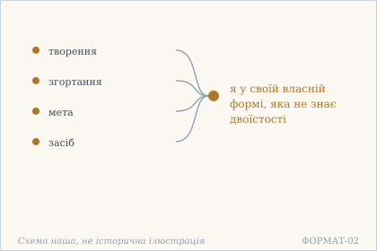 — Творення й згортання відпали. Схема наша, не історична ілюстрація.

## 20.8

**Деванагарі.** क्व प्रमाता प्रमाणं वा । क्व प्रमेयं क्व च प्रमा । क्व किंचित् क्व न किंचिद् वा । सर्वदा विमलस्य मे ॥

**IAST.** kva pramātā pramāṇaṃ vā | kva prameyaṃ kva ca pramā | kva kiṃcit kva na kiṃcid vā | sarvadā vimalasya me ||

**Українська транслітерація.** ква прамата праманам ва | ква прамеям ква ча прама | ква кімчіт ква на кімчід ва | сарвада вімалася ме ||

**Переклад.** Де той, хто пізнає, де засіб пізнання, де предмет, де саме пізнання? Де «щось», де «ніщо» — у мене, хто завжди без плями?

**Коментар.** Тут розібрано повний апарат пізнання — чотири члени, які індійські школи сперечалися уточнювати. Текст не заперечує жодного з них окремо: він питає, де вони, коли немає місця, у якому вони могли б стояти. Пада kva kiṃcit kva na kiṃcid vā забирає й останню опору — саму пару «є / немає». Це важливо для розуміння всієї глави: заперечення не є твердженням порожнечі, воно знімає обидві можливості.

**Українська паралель (ПОТРЕБУЄ ПЕРЕВІРКИ).** *українська релігійна філософія*, не визначено. ПОТРЕБУЄ ПЕРЕВІРКИ: перелік пізнавача, засобу й предмета, після якого питати нічого, близький до української релігійної філософії, але конкретного місця ми не звірили.

**Ілюстрація.** 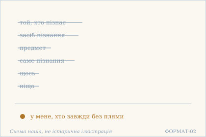 — Пізнавач, предмет і пізнання відпали. Схема наша, не історична ілюстрація.

## 20.9

**Деванагарі.** क्व विक्षेपः क्व चैकाग्र्यं । क्व निर्बोधः क्व मूढता । क्व हर्षः क्व विषादो वा । सर्वदा निष्क्रियस्य मे ॥

**IAST.** kva vikṣepaḥ kva caikāgryaṃ | kva nirbodhaḥ kva mūḍhatā | kva harṣaḥ kva viṣādo vā | sarvadā niṣkriyasya me ||

**Українська транслітерація.** ква вікшепах ква чайкаґр'ям | ква нірбодгах ква мудгата | ква харшах ква вішадо ва | сарвада нішкріяся ме ||

**Переклад.** Де розсіяність, де зосередженість, де несвідомість, де затьмареність? Де радість, де відчай — у мене, хто завжди бездіяльний?

**Коментар.** Вірш повторює схему 18.10 — три пари, кожна заперечує обидва боки, — але з іншим закінченням: замість «у вгамованого йога» тут «у мене, хто завжди бездіяльний» (niṣkriya). niṣkriya не означає «лінивий»: це відсутність діяння як діяча, а не відсутність руху. Пари підібрані так, щоб охопити і стан уваги (розсіяність / зосередженість), і стан розуму (несвідомість / затьмареність), і стан почуття (радість / відчай). Те, що лишається поза цими парами, у вірші не названо.

**Українська паралель (наша інтерпретація, не твердження про вплив).** *Василь Стус*, «Палімпсести». Наша паралель: у Стуса розсіяність і зосередженість теж не творять пари для того, хто вже стоїть. Наше порівняння — типологічне.

**Ілюстрація.** 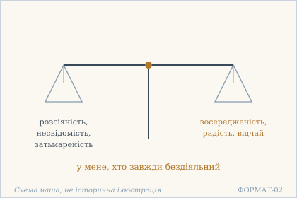 — Дві шальки: розсіяність і зосередженість. Схема наша, не історична ілюстрація.

## 20.10

**Деванагарі.** क्व चैष व्यवहारो वा । क्व च सा परमार्थता । क्व सुखं क्व च वा दुःखं । निर्विमर्शस्य मे सदा ॥

**IAST.** kva caiṣa vyavahāro vā | kva ca sā paramārthatā | kva sukhaṃ kva ca vā duḥkhaṃ | nirvimarśasya me sadā ||

**Українська транслітерація.** ква чайша в'явахаро ва | ква ча са парамартхата | ква сукхам ква ча ва духкхам | нірвімаршася ме сада ||

**Переклад.** Де ця буденна практика, де та вища істина? Де щастя, де страждання — у мене, хто вже завжди нічого не розглядає?

**Коментар.** Найнебезпечніше місце для читача: тут знято пару vyavahāra / paramārtha, тобто буденний і вищий рівні істини. Зазвичай цю пару використовують, щоб пояснити, чому світ хибний, а Брахмо істинне; вірш не робить і цього кроку — обидва рівні однаково не мають де стояти. nirvimarśa, «без розгляду», — не заклик до нерозуміння, а опис: розглядати нічого, бо немає двох речей, які можна було б зіставити.

**Українська паралель (наша інтерпретація, не твердження про вплив).** *Ліна Костенко*, «Берестечко» (1999). Наша паралель: у Костенко буденна практика й вища істина теж втрачають різницю перед обличчям того, що вже є. Наше порівняння — за будовою думки.

**Ілюстрація.** 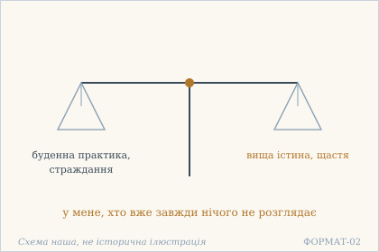 — Дві шальки: практика й вища істина. Схема наша, не історична ілюстрація.

## 20.11

**Деванагарі.** क्व माया क्व च संसारः । क्व प्रीतिर् विरतिः क्व वा । क्व जीवः क्व च तद्ब्रह्म । सर्वदा विमलस्य मे ॥

**IAST.** kva māyā kva ca saṃsāraḥ | kva prītir viratiḥ kva vā | kva jīvaḥ kva ca tadbrahma | sarvadā vimalasya me ||

**Українська транслітерація.** ква мая ква ча самсарах | ква прітір віратіх ква ва | ква джівах ква ча тадбрахма | сарвада вімалася ме ||

**Переклад.** Де майя, де сансара, де прихильність і де відвернення? Де жива істота, де те Брахмо — у мене, хто завжди без плями?

**Коментар.** Вірш називає основні поняття будь-якого вчення про визволення — майю, сансару, прихильність і відвернення, живу істоту й Брахмо — і ставить їх в один ряд із питанням kva. Найрадикальніше тут те, що Брахмо стоїть у тому самому ряду, що й сансара: текст не протиставляє їх як хибне й істинне. Це місце легко прочитати як спростування адвайти; точніше сказати, що вірш відмовляється від її словника, не пропонуючи іншого.

**Українська паралель (наша інтерпретація, не твердження про вплив).** *Михайло Коцюбинський*, «Тіні забутих предків» (1911). Наша паралель: у Коцюбинського мая й сансара теж постають як те, що показується й зникає, не питаючи людину. Наше порівняння — за образом.

**Ілюстрація.** 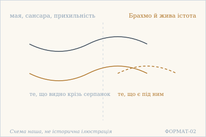 — Мая й сансара під серпанком. Схема наша, не історична ілюстрація.

## 20.12

**Деванагарі.** क्व प्रवृत्तिर् निवृत्तिर् वा । क्व मुक्तिः क्व च बन्धनम् । कूटस्थनिर्विभागस्य । स्वस्थस्य मम सर्वदा ॥

**IAST.** kva pravṛttir nivṛttir vā | kva muktiḥ kva ca bandhanam | kūṭasthanirvibhāgasya | svasthasya mama sarvadā ||

**Українська транслітерація.** ква правріттір нівріттір ва | ква муктіх ква ча бандганам | кутастханірвібгаґася | свастхася мама сарвада ||

**Переклад.** Де діяння і де припинення, де звільнення, де пута — у мене, незмінного й неділимого, що завжди в собі?

**Коментар.** Пару pravṛtti / nivṛtti вже було знято в 16.8, і тут вона повертається разом із парою mukti / bandhana. Друга половина вірша — єдина в главі, де подано ствердні означення: kūṭastha, nirvibhāga, svastha. Усі три описують не властивість, а відсутність поділу: незмінний, неділимий, у собі. Саме тому питання kva не має відповіді-місця — ділити нема на що.

**Українська паралель (наша інтерпретація, не твердження про вплив).** *Іван Франко*, «Мойсей» (1905). Наша паралель: у Франка діяння й припинення теж не утворюють вибору для того, хто незмінний. Наше порівняння — типологічне.

**Ілюстрація.** 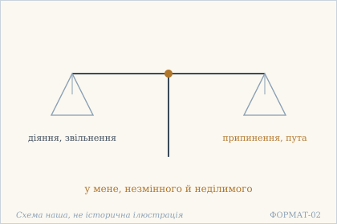 — Дві шальки: діяння й припинення. Схема наша, не історична ілюстрація.

## 20.13

**Деванагарі.** क्वोपदेशः क्व वा शास्त्रं । क्व शिष्यः क्व च वा गुरुः । क्व चास्ति पुरुषार्थो वा । निरुपाधेः शिवस्य मे ॥

**IAST.** kvopadeśaḥ kva vā śāstraṃ | kva śiṣyaḥ kva ca vā guruḥ | kva cāsti puruṣārtho vā | nirupādheḥ śivasya me ||

**Українська транслітерація.** квопадешах ква ва шастрам | ква шішях ква ча ва ґурух | ква часті пурушартхо ва | нірупадгех шівася ме ||

**Переклад.** Де настановлення, де писання, де учень, де вчитель? Де й мета людського життя — у мене, хто без жодної опори, у мене, блаженного?

**Коментар.** Після того як у 20.2 знято писання, тут знято всю установу передачі знання: настановлення, текст, учня, вчителя. Це послідовно: якщо немає ні знання, ні незнання, то немає й того, кому й від кого його передавати. puruṣārtha зникає останнім — разом із самою ідеєю мети. śiva тут майже напевно прикметник «блаженний, ласкавий», а не ім'я бога; вірш не дає приводу читати його як теологічне твердження, і переклад цього не робить.

**Українська паралель (наша інтерпретація, не твердження про вплив).** *Григорій Сковорода*, «Алфавіт, чи Буквар миру» (діалог). Наша паралель: у Сковороди настановлення й писання теж відступають перед тим, хто вже не має опори. Наше порівняння — типологічне.

**Ілюстрація.** 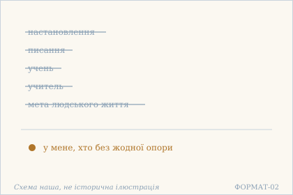 — Настановлення, учень і вчитель відпали. Схема наша, не історична ілюстрація.

**Сцена.** 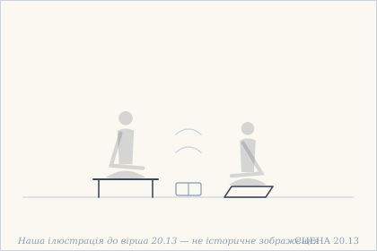 — Порожні сидіння вчителя й учня, а між ними закрита книжка на землі. Наша ілюстрація до вірша 20.13 — не історичне зображення.

## 20.14

**Деванагарі.** क्व चास्ति क्व च वा नास्ति । क्वास्ति चैकं क्व च द्वयम् । बहुनात्र किम् उक्तेन । किंचिन् नोत्तिष्ठते मम ॥

**IAST.** kva cāsti kva ca vā nāsti | kvāsti caikaṃ kva ca dvayam | bahunātra kim uktena | kiṃcin nottiṣṭhate mama ||

**Українська транслітерація.** ква часті ква ча ва насті | квасті чайкам ква ча дваям | бахунатра кім уктена | кімчін ноттіштхате мама ||

**Переклад.** Де «є» і де «немає», де «одне» і де «двоє»? Та й навіщо багато слів: у мене не постає ніщо.

**Коментар.** Останній вірш закриває главу відмовою від подальшої мови: після того як знято пару «є / немає» і пару «одне / двоє», говорити більше нема про що. Формула bahunātra kim uktena — усталений спосіб обірвати перелік, і вона тут доречна подвійно: як риторика і як зміст. Слово kiṃcit у заперечному реченні означає «ніщо»; це не твердження порожнечі, а констатація, що ніщо не підводиться як предмет. Цим і завершується глава: не відповіддю, а припиненням питання.

**Українська паралель (наша інтерпретація, не твердження про вплив).** *Олександр Довженко*, «Зачарована Десна» (1956). Наша паралель: у Довженка останнє слово теж не додає нічого до сказаного, а лише закриває розмову. Наше порівняння — за будовою думки.

**Ілюстрація.** 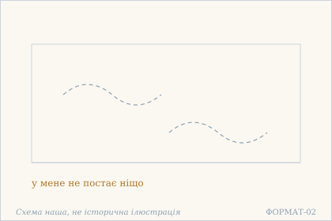 — Ніщо не постає: останнє слово. Схема наша, не історична ілюстрація.

## Поетичний переклад

Окремо, у [`poetychnyi/rozdil-20.md`](poetychnyi/rozdil-20.md). Це **наш поетичний переклад**, не канонічний і не науковий; у PDF він іде окремою частиною.
