# Аштавакра-ґіта. Глава 3. Наукове представлення

> ФОРМАТ-02: кожен вірш подано пʼятьма шарами — деванагарі, українська
> транслітерація, переклад, науковий коментар з українськими паралелями,
> ілюстрація. Плюс окремо — поетичний переклад (`poetychnyi/rozdil-3.md`).
>
> **Деванагарі тут — механічна** транслітерація поля `iast` з картки
> (`scripts/iast_to_devanagari.py`), а не окреме читання за рукописом.
> **Українська транслітерація** — теж механічна (`scripts/iast_to_ukrainian.py`,
> таблиця в `docs/TRANSLITERATSIIA.md`).
> **Українські паралелі** — наша інтерпретація, а не твердження про вплив;
> реєстр і правила — `paraleli.json` і `scripts/check_ukrainian_parallels.py`.
> **Схеми** — наші власні; жодна не є історичною ілюстрацією.
>
> Цей файл згенеровано; правити треба картки й `format-v2/rozdil-3.json`,
> а не його.

## Глава 3. Іспит пізнання

Третя глава — найнеспокійніша з перших трьох. Вона не описує, як здобути знання, а показує, що знання саме по собі не вирішує нічого: у ній пʼять разів звучить aho там, де мудрець ловить себе на тому, що лишилося. Звідси — три останні вірші, де спокій описано не як здобуток, а як те, після чого питання про здобуток відпадає.

## 3.1

**Деванагарі.** अविनाशिनम् आत्मानम् एकं विज्ञाय तत्त्वतः । तवात्मज्ञस्य धीरस्य कथम् अर्थार्जने रतिः ॥

**Українська транслітерація.** авінашінам атманам екам віджняя таттватах | таватмаджняся дгірася катхам артхарджане ратіх ||

**Переклад.** Пізнавши істинно Атман — незнищенний і єдиний — як у тебе, атмазнавця й мудрого, може бути втіха в набутті користі?

**Науковий коментар.** Питання katham («як?») риторичне й будується на несумісності двох занять: пізнання єдиного й накопичення множинного. Слово artha тут не «сенс», а саме «користь, вигода» — це той самий термін, що в 10.1 серед того, що відкидають. Зверни увагу на порядок означень: спершу те, що пізнано (незнищенне, єдине), потім той, хто пізнав (атмазнавець, мудрий). Втіха в набутті не заборонена — поставлено питання, чи вона взагалі можлива за такого пізнання.

**Українська паралель (наша інтерпретація, не твердження про вплив).** *Григорій Сковорода*, «Розмова пʼяти подорожніх про істинне щастя в житті». Наша паралель: у Сковороди щастя теж не лежить у набутку, і саме тому його не можна ні відняти, ні докупити. Наше порівняння — типологічне.

**Ілюстрація.** 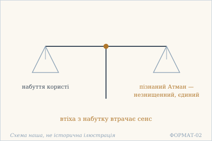 — Дві шальки: набуток і пізнаний Атман. Схема наша, не історична ілюстрація.

## 3.2

**Деванагарі.** आत्माज्ञानाद् अहो प्रीतिर् विषयभ्रमगोचरे । शुक्तेर् अज्ञानतो लोभो यथा रजतविभ्रमे ॥

**Українська транслітерація.** атмаджнянад ахо прітір вішаябграмаґочаре | шуктер аджнянато лобго ятха раджатавібграме ||

**Переклад.** О диво! Через незнання Атмана з'являється прихильність у полі омани чуттєвих предметів — як через незнання перламутру з'являється жадоба в омані срібла.

**Науковий коментар.** Вірш будується на точній паралелі з двох частин, і паралель тут не прикраса, а аргумент: prīti (прихильність) співвіднесена з lobha (жадобою), viṣayabhrama (омана чуттєвого) — з rajatavibhrama (омана срібла), ātmājñāna (незнання Атмана) — з śuktyajñāna (незнання перламутру). Причина в обох випадках одна — незнання, а не вада предмета: перламутр не винен, що його беруть за срібло. Це та сама паралель, що в 2.9, але там був перелік трьох прикладів, а тут — один, розгорнутий до кінця. Слово prīti м'якше за spṛhā (2.22) і за lobha: це радше «прихильність», ніж «спрага».

**Українська паралель (ПОТРЕБУЄ ПЕРЕВІРКИ).** *українська барокова проповідь*, не визначено. ПОТРЕБУЄ ПЕРЕВІРКИ: перламутр і срібло як пара омани близькі до барокової емблематики, але конкретного твору ми не звірили й тому не називаємо.

**Ілюстрація.** 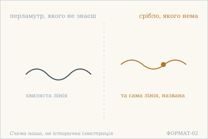 — Перламутр і срібло: жадоба з незнання. Схема наша, не історична ілюстрація.

## 3.3

**Деванагарі.** विश्वं स्फुरति यत्रेदं तरङ्गा इव सागरे । सो ऽहम् अस्मीति विज्ञाय किं दीन इव धावसि ॥

**Українська транслітерація.** вішвам спхураті ятредам таранґа іва саґаре | со ’хам асміті віджняя кім діна іва дгавасі ||

**Переклад.** Пізнавши: «я — те, у чому сяє весь цей світ, як хвилі в морі», — чого ти біжиш, наче вбогий?

**Науковий коментар.** Питання kim ... dhāvasi («чого біжиш») спрямоване не до дії взагалі, а до бігу як способу життя: дієслово dhāv означає саме фізичний біг, метушню. Порівняння з dīna («убогий») вказує на мотив, а не на стан: біжать ті, кому бракує. Формула so 'ham asmi («я є те») — та сама, що в 2.15, але там вона завершувала заперечення трійці, а тут відкриває питання. Образ хвиль у морі повторює 2.10 і 2.23–2.25: це наскрізний образ тексту, а не місцева метафора.

**Українська паралель (ПОТРЕБУЄ ПЕРЕВІРКИ).** *українська філософська лірика*, не визначено. ПОТРЕБУЄ ПЕРЕВІРКИ: докір тому, хто шукає те, що вже має, в українській ліриці трапляється, але назвати твір без звірки ми не можемо.

**Ілюстрація.** 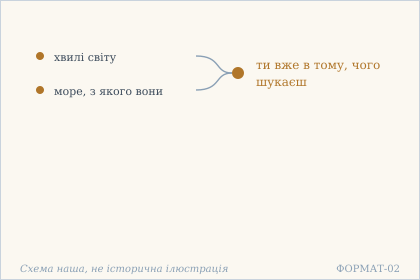 — Хвиля, що шукає моря, у якому вже стоїть. Схема наша, не історична ілюстрація.

## 3.4

**Деванагарі.** श्रुत्वापि शुद्धचैतन्यम् आत्मानम् अतिसुन्दरम् । उपस्थे ऽत्यन्तसंसक्तो मालिन्यम् अधिगच्छति ॥

**Українська транслітерація.** шрутвапі шуддгачайтаням атманам атісундарам | упастхе ’тянтасамсакто маліням адгіґаччаті ||

**Переклад.** Навіть почувши про Атман — чисту свідомість, надзвичайно прекрасну, — той, хто надмірно прив'язаний до того, що під рукою, набуває бруду.

**Науковий коментар.** Слово upasthe навмисно не уточнене: воно означає і «на лоні», і «поблизу, під рукою», і традиційно вживається з плотським відтінком. Точний зміст залежить від контексту, якого вірш не дає, — і саме тому переклад зберігає двозначність, а не обирає одне значення. Структура вірша — контраст між почутим і робленим: śrutvā api («навіть почувши») підкреслює, що знання про Атман саме собою нічого не змінює. mālinya («бруд») — не моральна оцінка, а стан забрудненості; те саме слово вживане про одяг і про посуд. Тобто йдеться не про гріх, а про те, що річ втрачає чистоту від дотику.

**Українська паралель (наша інтерпретація, не твердження про вплив).** *Іван Франко*, «Зівʼяле листя» (1896). Наша паралель: у Франка знання теж не рятує від привʼязаності — воно лише робить її виднішою. Наше порівняння — за способом бачити людину, а не за вченням.

**Ілюстрація.** 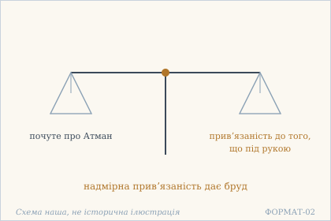 — Дві шальки: почуте про Атман і те, що під рукою. Схема наша, не історична ілюстрація.

## 3.5

**Деванагарі.** सर्वभूतेषु चात्मानं सर्वभूतानि चात्मनि । मुनेर् जानत आश्चर्यं ममत्वम् अनुवर्तते ॥

**Українська транслітерація.** сарвабгутешу чатманам сарвабгутані чатмані | мунер джаната ашчар'ям маматвам анувартате ||

**Переклад.** О диво: у мудреця, який знає Атман у всіх істотах і всі істоти — в Атмані, досі тримається «моє».

**Науковий коментар.** Двозмінна конструкція (Атман у всіх, усі в Атмані) — не повтор, а два напрямки одного знання: назовні й усередину. Диво в тому, що навіть за такого знання лишається mamatvam — не «моє» як майно, а мійність як звичка. Дієслово anuvartate («іде слідом») важливе: воно не каже, що мійність панує, а що вона тягнеться позаду. Це найточніше місце глави про межі знання: знання не вичищає звичку автоматично. Порівняй 3.4, де йшлося про того, хто лише почув: там бруд набувають, тут мійність лишається — різні ступені, і текст не згладжує різниці.

**Українська паралель (ПОТРЕБУЄ ПЕРЕВІРКИ).** *українська релігійна думка*, не визначено. ПОТРЕБУЄ ПЕРЕВІРКИ: докір мудрецеві, в якого лишилося своє, близький до української аскетичної літератури, але конкретного місця ми не перевірили.

**Ілюстрація.** 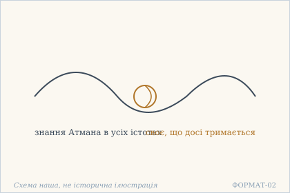 — Вузол, що лишається навіть у знанні. Схема наша, не історична ілюстрація.

## 3.6

**Деванагарі.** आस्थितः परमाद्वैतं मोक्षार्थे ऽपि व्यवस्थितः । आश्चर्यं कामवशगो विकलः केलिशिक्षया ॥

**Українська транслітерація.** астхітах парамадвайтам мокшартхе ’пі в'явастхітах | ашчар'ям камавашаґо вікалах келішікшая ||

**Переклад.** Той, хто утвердився у вищій недвоїстості й стоїть навіть у справі звільнення, — о диво! — під владою бажання: безпорадний, мов у грі-вправлянні.

**Науковий коментар.** Вірш починає серію із чотирьох «див» (3.6–3.8, далі 3.10), і кожне будується за однією схемою: високий стан — і те, що в ньому несподівано лишається. Тут протиставлені два утвердження (āsthitaḥ, vyavasthitaḥ — майже синоніми, поставлені поруч навмисно) і один стан, що їх перекреслює. Слово vikala («безпорадний») сильніше за просте «слабкий»: воно означає позбавленість частини, скаліченість. keliśikṣayā («грою-вправлянням») знижує регістр: те, що мало бути шляхом, виявилося забавкою.

**Українська паралель (наша інтерпретація, не твердження про вплив).** *Василь Стус*, «Веселий цвинтар» (1985). Наша паралель: у Стуса людина теж стоїть на своєму — і все одно бажання веде її далі, ніж вона хотіла. Наша асоціація, не твердження про вплив.

**Ілюстрація.** 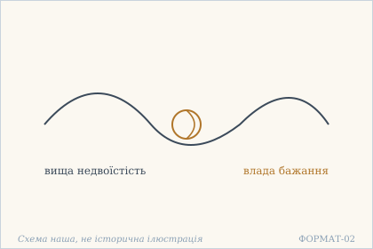 — Вузол бажання, затягнутий поверх недвоїстості. Схема наша, не історична ілюстрація.

## 3.7

**Деванагарі.** उद्भूतं ज्ञानदुर्मित्रम् अवधार्यातिदुर्बलः । आश्चर्यं कामम् आकाङ्क्षेत् कालम् अन्तम् अनुश्रितः ॥

**Українська транслітерація.** удбгутам джнянадурмітрам авадгар'ятідурбалах | ашчар'ям камам аканкшет калам антам анушрітах ||

**Переклад.** О диво! Зрозумівши, що знання виявилося поганим другом, — надзвичайно слабкий — він усе одно прагнув би бажання, дійшовши до кінця часу.

**Науковий коментар.** Складене jñānadurmitram можна прочитати двома способами: «знання, що є поганим другом» і «поганий друг, [який полягає] у знанні». Обидва дають той самий сенс: знання, на яке покладалися, не врятувало. Найсильніше тут — час дієслова й обставина: ākāṅkṣet стоїть в optativus («прагнув би»), а kālam antam anuśritaḥ («дійшовши до кінця часу») означає останню межу, коли вже нічого не змінити. Тобто бажання не просто лишається — воно лишається там, де його вже неможливо задовольнити. Це не докір, а констатація абсурду, і слово āścaryam («диво») вжите саме в цьому сенсі.

**Українська паралель (ПОТРЕБУЄ ПЕРЕВІРКИ).** *українська поезія XX ст.*, не визначено. ПОТРЕБУЄ ПЕРЕВІРКИ: мотив знання, що виявилося поганим другом, близький до української лірики про зраду власних переконань, але конкретного твору ми не називаємо без звірки.

**Ілюстрація.** 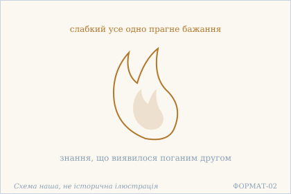 — Полумʼя, що не зігріває: знання як поганий друг. Схема наша, не історична ілюстрація.

## 3.8

**Деванагарі.** इहामुत्र विरक्तस्य नित्यानित्यविवेकिनः । आश्चर्यं मोक्षकामस्य मोक्षाद् एव विभीषिका ॥

**Українська транслітерація.** іхамутра вірактася нітянітявівекінах | ашчар'ям мокшакамася мокшад ева вібгішіка ||

**Переклад.** О диво: у того, хто відвернувся від цього й того світу, хто розрізняє вічне й невічне, хто бажає звільнення, — страх саме від звільнення.

**Науковий коментар.** Найгостріший вірш серії. Три ознаки поставлені поспіль і всі три «правильні»: відречення, розрізнення, бажання звільнення. І саме з третьої виростає страх, бо звільнення означає втрату того, хто звільняється. ablativus mokṣāt («від звільнення») з eva («саме») робить джерелом страху не світ і не смерть, а мету. vibhīṣikā — не «боязкість», а те, що лякає; слово вживане і про опудало. Тобто звільнення постає як те, чим лякають.

**Українська паралель (наша інтерпретація, не твердження про вплив).** *Леся Українка*, «Кассандра» (1907). Наша паралель: у Лесі Українки знання теж не дає спокою, а забирає його, — і страх приходить саме від того, що має визволити. Наше порівняння — типологічне.

**Ілюстрація.** 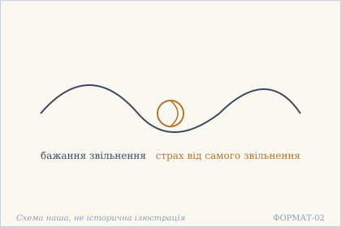 — Вузол, завʼязаний на самому звільненні. Схема наша, не історична ілюстрація.

## 3.9

**Деванагарі.** धीरस् तु भोज्यमानो ऽपि पीड्यमानो ऽपि सर्वदा । आत्मानं केवलं पश्यन् न तुष्यति न कुप्यति ॥

**Українська транслітерація.** дгірас ту бгоджямано ’пі підямано ’пі сарвада | атманам кевалам пашян на тушяті на куп'яті ||

**Переклад.** Мудрий же — чи його голублять, чи його мучать — завжди, бачачи лише Атман, і не радіє, і не гнівається.

**Науковий коментар.** Два дієприкметники пасиву (bhojyamāna, pīḍyamāna) поставлені як рівноцінні умови: похвала й мука описані однією граматичною формою, тобто для мудрого вони вже не різні події. Це не байдужість: na tuṣyati na kupyati — два окремі заперечення, а не одне «не хвилюється». Слово kevalam («лише») робить ключову роботу: бачить не «Атман крізь усе», а лише Атман, і саме тому немає кому радіти. Форма дієприкметника paśyan (теперішній час) вказує на тривалість, а не на одноразове прозріння.

**Українська паралель (наша інтерпретація, не твердження про вплив).** *Тарас Шевченко*, «Неофіти» (1857). Наша паралель: у Шевченка гідність теж не залежить від того, хвалять людину чи мучать. Наше порівняння — за будовою думки, не про джерело.

**Ілюстрація.** 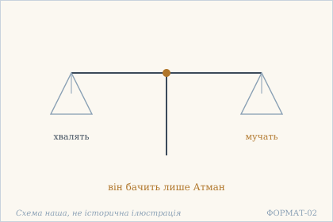 — Дві шальки: хвала й мука — важать однаково. Схема наша, не історична ілюстрація.

## 3.10

**Деванагарі.** चेष्टमानं शरीरं स्वं पश्यत्य् अन्यशरीरवत् । संस्तवे चापि निन्दायां कथं क्षुभ्येत् महाशयः ॥

**Українська транслітерація.** чештаманам шарірам свам пашятй аняшарірават | самставе чапі ніндаям катхам кшубгєт махашаях ||

**Переклад.** Своє тіло, що рухається, він бачить як тіло чуже. То як у хвалі чи в ганьбі збентежився б великодухий?

**Науковий коментар.** Вірш закриває серію «див» і робить це тихо, без āścaryam: тут немає вигуку, є питання katham («як?»), на яке відповідь очевидна. ceṣṭamānam («те, що ворушиться») вибране навмисно: тіло описане не як річ, а як процес, і саме тому його легко побачити збоку. Пара saṃstava / nindā («хвала» / «ганьба») — та сама пара, що bhojyamāna / pīḍyamāna у 3.9, але там ішлося про дію на тіло, тут — про слово. mahāśayaḥ («великодухий») буквально означає «той, у кого велике ложе», і це не метафора розуму, а образ простору, у якому вміщається і хвала, і ганьба.

**Українська паралель (наша інтерпретація, не твердження про вплив).** *Олександр Довженко*, «Щоденник» (1941–1956). Наша паралель: у Довженка тіло теж постає як щось, що людині належить менше, ніж їй здається. Наше порівняння — за способом бачити себе.

**Ілюстрація.** 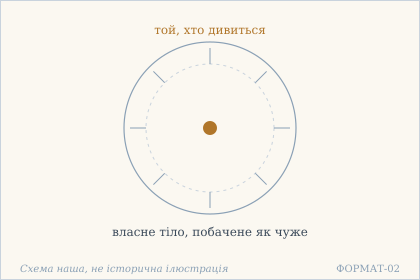 — Тіло як чуже в колі побаченого, бачитель у центрі. Схема наша, не історична ілюстрація.

## 3.11

**Деванагарі.** मायामात्रम् इदं विश्वं पश्यन् विगतकौतुकः । अपि सन्निहिते मृत्यौ कथं त्रस्यति धीरधीः ॥

**Українська транслітерація.** маяматрам ідам вішвам пашян віґатакаутуках | апі санніхіте мрітяу катхам трасяті дгірадгіх ||

**Переклад.** Бачачи, що весь цей світ — тільки мая, і втративши до нього охоту, — навіть коли смерть уже поруч, як злякався б той, чий розум стійкий?

**Науковий коментар.** Слово kautuka тут важить більше, ніж здається: це не просто «цікавість», а охота до святкового, потяг до видовища. Тобто йдеться не про втрату знань, а про втрату інтересу до гри. locativus absolutus sannihite mṛtyau («коли смерть присутня») ставить умову максимально жорстко: не «якось колись», а тут і тепер. dhīradhīḥ («чий розум стійкий») — не «хоробрий»: стійкість розуму, а не безстрашність характеру. Питання katham знову риторичне, як у 3.3 і 3.10 — глава послідовно закриває питання питаннями.

**Українська паралель (наша інтерпретація, не твердження про вплив).** *Михайло Коцюбинський*, «Тіні забутих предків» (1911). Наша паралель: у Коцюбинського світ теж постає як те, що показується й зникає, не питаючи людину. Наше порівняння — за образом, а не за вченням.

**Ілюстрація.** 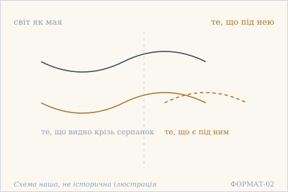 — Серпанок маї: світ, що зникає під поглядом. Схема наша, не історична ілюстрація.

## 3.12

**Деванагарі.** निःस्पृहं मानसं यस्य नैराश्ये ऽपि महात्मनः । तस्यात्मज्ञानतृप्तस्य तुलना केन जायते ॥

**Українська транслітерація.** ніхспріхам манасам яся найрашє ’пі махатманах | тасятмаджнянатріптася тулана кена джаяте ||

**Переклад.** У кого розум без прагнень, хто навіть у безнадії лишається великим духом, хто вдоволений знанням Атмана, — з ким його й порівнювати?

**Науковий коментар.** nairāśye 'pi («навіть у безнадії») — найтонше місце. Безнадія тут не недолік, а умова: відсутність сподівань і є тим, що робить розум вільним від прагнень. Тому й сказано api («навіть») — ніби всупереч очікуванню, що без надії людина меншає. tulanā («порівняння, міра») вжите як річ, що не виникає: не «він не має рівних», а «порівняння не народжується», тобто зникає сама операція зіставлення. Форма jāyate (теперішній, «народжується») показує це як постійний стан, а не як разовий висновок.

**Українська паралель (ПОТРЕБУЄ ПЕРЕВІРКИ).** *українська аскетична проза*, не визначено. ПОТРЕБУЄ ПЕРЕВІРКИ: опис розуму без прагнень, з яким немає з чим порівняти, близький до української аскетичної прози, але конкретного твору ми не перевірили.

**Ілюстрація.** 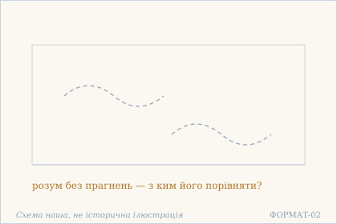 — Небо без хмар: розум без прагнень. Схема наша, не історична ілюстрація.

## 3.13

**Деванагарі.** स्वभावाद् एव जानानो दृश्यम् एतन् न किञ्चन । इदं ग्राह्यम् इदं त्याज्यं स किं पश्यति धीरधीः ॥

**Українська транслітерація.** свабгавад ева джанано дрішям етан на кіньчана | ідам ґрахям ідам тяджям са кім пашяті дгірадгіх ||

**Переклад.** Знаючи самою природою, що все видиме — аніщо, — «це треба взяти, це треба відкинути» — то що ж бачить той, чий розум стійкий?

**Науковий коментар.** Дві пари герундивів (grāhyam / tyājyam) подані в лапках як чужа мова: це не позиція мудрого, а те, що він чує навколо або в собі. Заперечується не вибір між «взяти» й «відкинути», а сама наявність пари. svabhāvād eva («самою природою») знімає потребу в доказі: це не висновок, а спосіб бачення. Питання kim paśyati («що бачить») точніше за «чи бачить»: воно питає про предмет, а не про факт, бо коли видиме — аніщо, предмета не лишається.

**Українська паралель (наша інтерпретація, не твердження про вплив).** *Григорій Сковорода*, «Байки харківські» (1774). Наша паралель: у Сковороди вибір між речами теж виявляється зайвим для того, хто вже бачить, що речі не важать. Наше порівняння — типологічне.

**Ілюстрація.** 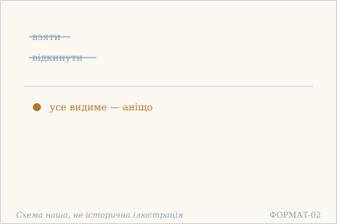 — Взяти й відкинути відпадають: усе видиме — аніщо. Схема наша, не історична ілюстрація.

## 3.14

**Деванагарі.** अन्तस्त्यक्तकषायस्य निर्द्वन्द्वस्य निराशिषः । यदृच्छयागतो भोगो न दुःखाय न तुष्टये ॥

**Українська транслітерація.** антастяктакашаяся нірдвандвася нірашішах | ядріччаяґато бгоґо на духкхая на туштає ||

**Переклад.** У того, в кого всередині відкинуто каламуть, хто без двоїстості й без сподівань, усе, що випадає само собою, не стає ні стражданням, ні задоволенням.

**Науковий коментар.** Давальні duḥkhāya і tuṣṭaye — не «не приносить», а «не йде на»: досвід не зараховується ні туди, ні туди. Це тонше за байдужість: байдужість усе ще ставить оцінку «ніяк», а тут досвід просто не конвертується в жодну з двох категорій. kaṣāya («каламуть, осад») — слово з мови фарб і напоїв: це не гріх і не пристрасть у моральному сенсі, а те, що каламутить прозорість. antaḥ («усередині») стоїть першим членом навмисно: відкинуто не зовнішнє, а осад усередині. yadṛcchayāgataḥ («прийшов сам собою») — те саме yadṛcchā, що в 4.4 і далі; тут воно означає не випадковість, а відсутність замовлення.

**Українська паралель (наша інтерпретація, не твердження про вплив).** *Микола Зеров*, «Камена» (1924). Наша паралель: у Зерова ясність теж приходить після того, як каламуть відстоялася, і тоді все, що випадає, приймають рівно. Наше порівняння — за образом, не за джерелом.

**Ілюстрація.** 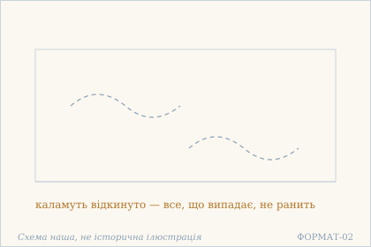 — Прозоре небо: каламуть відстоялася. Схема наша, не історична ілюстрація.

## Поетичний переклад

Окремо, у [`poetychnyi/rozdil-3.md`](poetychnyi/rozdil-3.md). Це **наш поетичний переклад**, не канонічний і не науковий; у PDF він іде окремою частиною.
