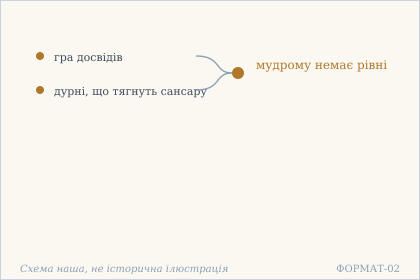
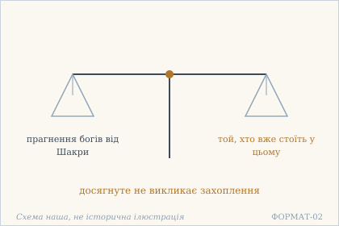
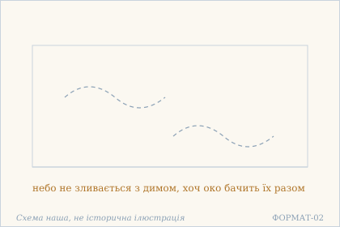
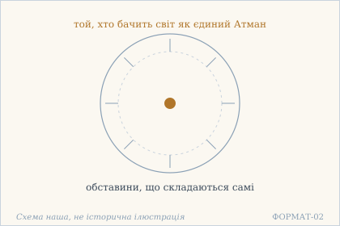
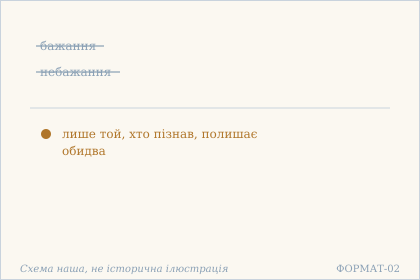
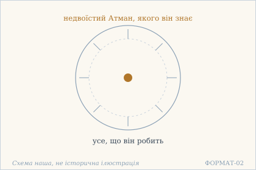

# Аштавакра-ґіта. Глава 4. Наукове представлення

> ФОРМАТ-02: кожен вірш подано пʼятьма шарами — деванагарі, українська
> транслітерація, переклад, науковий коментар з українськими паралелями,
> ілюстрація. Плюс окремо — поетичний переклад (`poetychnyi/rozdil-4.md`).
>
> **Деванагарі тут — механічна** транслітерація поля `iast` з картки
> (`scripts/iast_to_devanagari.py`), а не окреме читання за рукописом.
> **Українська транслітерація** — теж механічна (`scripts/iast_to_ukrainian.py`,
> таблиця в `docs/TRANSLITERATSIIA.md`).
> **Українські паралелі** — наша інтерпретація, а не твердження про вплив;
> реєстр і правила — `paraleli.json` і `scripts/check_ukrainian_parallels.py`.
> **Схеми** — наші власні; жодна не є історичною ілюстрацією.
>
> Цей файл згенеровано; правити треба картки й `format-v2/rozdil-4.json`,
> а не його.

## Глава 4. Хто пізнав — не боїться

Четверта глава найкоротша в першій половині книги: шість віршів. Вона не додає нового вчення, а перевіряє попереднє питанням про міру: чим відрізняється той, хто пізнав? Відповідь будується на порівняннях — небо й дим, чотири роди істот, — і жодного разу не на обіцянці нагороди. Останній вірш замикає главу тим, що знімає страх: не як наслідок мужності, а як наслідок знання.

## 4.1

**Деванагарі.** हन्तात्मज्ञस्य धीरस्य खेलतो भोगलीलया । न हि संसारवाहीकैर् मूढैः सह समानता ॥

**Українська транслітерація.** хантатмаджняся дгірася кхелато бгоґалілая | на хі самсаравахікайр мудгайх саха саманата ||

**Переклад.** О! Атмазнавцеві, мудрому, що грається грою досвідів, немає рівні з дурнями, які тягнуть сансару.

**Науковий коментар.** Слово vāhīka («погонич, той, хто везе») вибране точно: сансара тут не стан, у якому перебувають, а вантаж, який тягнуть. Дурість полягає не в незнанні, а в тому, що людина впряглася. Протиставлення будується на двох способах дії: khelataḥ («того, хто грається») і vāhīkaiḥ («тих, хто тягне»). Те саме діяння, різна якість. līlā («гра») — слово з релігійної мови, де гра не протистоїть серйозності, а означає дію без потреби. Вигук hanta на початку задає тон подиву, а не докору.

**Українська паралель (наша інтерпретація, не твердження про вплив).** *Леся Українка*, «Лісова пісня» (1911). Наша паралель: у Лесі Українки гра теж не протистоїть досвіду, а є способом жити серед нього, не застигаючи. Наше порівняння — типологічне, не твердження про джерело.

**Ілюстрація.**  — Дві дороги: гра досвідів і тягар сансари. Схема наша, не історична ілюстрація.

## 4.2

**Деванагарі.** यत् पदं प्रेप्सवो दीनाः शक्राद्याः सर्वदेवताः । अहो तत्र स्थितो योगी न हर्षम् उपगच्छति ॥

**Українська транслітерація.** ят падам препсаво дінах шакрадях сарвадеватах | ахо татра стхіто йоґі на харшам упаґаччаті ||

**Переклад.** О диво: те, до чого прагнуть убогі всі боги, починаючи з Шакри, — йог, що вже стоїть у цьому, не відчуває захоплення.

**Науковий коментар.** Слово dīnāḥ («убогі») вжите про богів навмисно: убогість тут не в майні, а в прагненні — хто прагне, той має брак. Дезидератив prepsavaḥ («ті, що хочуть досягти») підкреслює саме бажання досягти, а не досягнення. Йог описаний дієприкметником sthitaḥ («той, хто стоїть») — це стан, а не подія; і саме тому harṣa («захоплення») не виникає: захоплення потребує новизни, а тут нічого нового не сталося. Вигук aho той самий, що в серії «див» глави 3, і тут він позначає межу між прагненням і перебуванням.

**Українська паралель (наша інтерпретація, не твердження про вплив).** *Григорій Сковорода*, «Вдячний Еродій» (трактат). Наша паралель: у Сковороди прагнення саме по собі теж викриває брак, і тому досягнуте не викликає захоплення. Наша інтерпретація за будовою думки, а не вказівка на вплив.

**Ілюстрація.**  — Дві шальки: прагнення богів і спокій того, хто вже стоїть. Схема наша, не історична ілюстрація.

## 4.3

**Деванагарі.** तज्ज्ञस्य पुण्यपापाभ्यां स्पर्शो ह्य् अन्तर् न जायते । न ह्य् आकाशस्य धूमेन दृश्यमाना ऽपि संगतिः ॥

**Українська транслітерація.** таджджняся пуняпапабгям спаршо хй антар на джаяте | на хй акашася дгумена дрішямана ’пі самґатіх ||

**Переклад.** Того, хто осягнув Істину, не зачіпають ані заслуги, ані провини. Так само й небо не зливається з димом, хоча на око вони ніби поєднані.

**Науковий коментар.** У вірші 4.3 використано порівняння неба і диму, щоби розрізнити видимий зв'язок та сутнісне ототожнення. Зовнішнє спостереження диму на тлі неба ще не означає, що небо набуває властивостей диму. Аналогічно фігура «того, хто знає Те» в недвоїстому вченні не визначається заслугами чи провинами як власною сутністю. З цього не випливає юридичний або етичний дозвіл чинити шкоду: вірш формулює філософську тезу про природу свідка, а не правила поведінки. У робочому перекладі «осягнув Істину» — тлумачна експлікація займенника tat, можлива буквальніша редакція — «той, хто знає Те»; на рецензії слід обрати один варіант. Потрібно окремо звірити різницю «з'єднання» / «дотик» і мовну форму фінального іменника saṅgati / saṃgatiḥ. **Атрибуція мовця не усталена за звіреними електронними свідками:** GRETIL/TextGrid перед 4.1 подає «aṣṭāvakra uvāca», а SARIT в заголовку глави 4 — «janaka uvāca». Поки не залучено незалежне друковане видання чи рукописні свідчення, не слід беззастережно приписувати твердження Аштавакрі або Джанаці. Два електронні свідки не є критичним виданням; коментарі сучасних авторів тут не передруковано.

**Українська паралель (наша інтерпретація, не твердження про вплив).** *Памфіл Юркевич*, «Серце і його значення в духовному житті людини» (1860). Наша паралель: коли вірш каже, що небо не зливається з димом, він відділяє те, що проходить, від того, на чому воно проходить. Юркевич розводить серце й привхідне в людині так само рішуче. Наше порівняння — за способом розрізняти.

**Ілюстрація.**  — Небо й дим: видно разом, а не зливаються. Схема наша, не історична ілюстрація.

## 4.4

**Деванагарі.** आत्मैवेदं जगत् सर्वं ज्ञातं येन महात्मना । यदृच्छया वर्तमानं तं निषेद्धुं क्षमेत कः ॥

**Українська транслітерація.** атмайведам джаґат сарвам джнятам єна махатмана | ядріччая вартаманам там нішеддгум кшамета ках ||

**Переклад.** Хто здатен стримати того, хто пізнав увесь світ як єдиний Атман і живе так, як складаються обставини?

**Науковий коментар.** Вірш поєднує дві теми: пізнання недвоїстої природи світу та свободу від нав'язаної поведінкової схеми. Питання «хто здатен стримати?» є риторичним і характеризує свободу того, хто усвідомив світ як Атман. Слово yadṛcchayā не слід автоматично прирівнювати до примхливого бажання або безвідповідальності: у цьому контексті воно допускає читання «за збігом обставин, природним чином». Українське «єдиний Атман» — смислове відтворення підсилювального eva, а не окремий прикметник оригіналу; перед остаточним виданням перевірити, чи краще писати «сам Атман». Важливо, що vartamānaṃ taṃ граматично підтримує тлумачення про людину, яка живе спонтанно, а не тезу, ніби «світ робить усе, що йому хочеться». Цей коментар — редакторська інтерпретація, не незалежна наукова рецензія. Додатковий текстологічний блокер: GRETIL і SARIT не збігаються в атрибуції мовця всієї четвертої глави, тому цей вірш не приписано беззастережно жодному співрозмовникові.

**Українська паралель (наша інтерпретація, не твердження про вплив).** *Михайло Коцюбинський*, «Intermezzo» (1908). Наша паралель: у Коцюбинського той, хто бачить ціле, теж не піддається керуванню ззовні. Наше порівняння — типологічне.

**Ілюстрація.**  — Центр, якого не втримати: він бачить усе як єдине. Схема наша, не історична ілюстрація.

## 4.5

**Деванагарі.** आब्रह्मस्तम्बपर्यन्ते भूतग्रामे चतुर्विधे । विज्ञस्यैव हि सामर्थ्यं इच्छा ऽनिच्छाविवर्जने ॥

**Українська транслітерація.** абрахмастамбапар'янте бгутаґраме чатурвідге | віджнясяйва хі самартхям ічча ’ніччавіварджане ||

**Переклад.** Серед чотирьох родів істот — від Брахми до стеблини трави — лише той, хто пізнав, спроможний полишити і бажання, і небажання.

**Науковий коментар.** Вірш протиставляє всеосяжний образ світу істот — від найвищого міфологічного персонажа до найскромнішої рослини — стану знання. Ключовий вислів vijñasyaiva hi sāmarthyam указує не на соціальний ранг, а на спроможність «того, хто знає». Пара icchā / anicchā охоплює внутрішні схильності до прийняття й відкидання; переклад «бажання й небажання» ближчий до буквального заперечного словотвору, тоді як «бажання й відраза» є сильнішою філософською інтерпретацією, яку варто перевірити в незалежному коментарі. «Чотири роди» не слід подавати як сучасну біологічну систематику: вірш використовує традиційну космологічну категоризацію, але не перелічує її членів. У GRETIL/TextGrid перед 4.1 позначено «aṣṭāvakra uvāca», тоді як у SARIT заголовок четвертої глави має «janaka uvāca». Через невирішену суперечність заголовків коментар не приписує ці слова певному мовцеві. Це власне робоче пояснення за двома електронними транскрипціями, не критичне видання й не незалежна фахова рецензія.

**Українська паралель (наша інтерпретація, не твердження про вплив).** *Іван Франко*, «Мойсей» (1905). Наша паралель: у Франка вибір, що не зводиться до бажання й небажання, теж постає як те, на що здатний не кожен. Наше порівняння — за будовою думки, не про вплив.

**Ілюстрація.**  — Бажання й небажання відкинуто разом. Схема наша, не історична ілюстрація.

## 4.6

**Деванагарі.** आत्मानम् अद्वयं कश्चिज् जानाति जगद् ईश्वरं । यद् वेत्ति तत् स कुरुते न भयं तस्य कुत्रचित् ॥

**Українська транслітерація.** атманам адваям кашчідж джанаті джаґад ішварам | яд ветті тат са куруте на бгаям тася кутрачіт ||

**Переклад.** Хтось знає Атман — недвоїстий, володаря світу. Що він знає, те й робить, — і страху в нього немає ніде.

**Науковий коментар.** kaścit («хтось») на початку — не випадкове слово: вірш не обіцяє, що це стосується кожного, і не називає його. Друга половина дає формулу yad vetti tat kurute («що знає, те й робить»), і вона сильніша за звичне «чини за знанням»: тут знання й дія не узгоджуються, а ототожнюються. kutracit з na («ніде») закриває простір повністю — страх не має місця, а не просто відсутній тут. Це останній вірш глави, і він повертає до її початку: 4.1 протиставляв того, хто грається, тому, хто тягне; тут сказано, чому — бо немає страху, а отже немає й потреби тягнути.

**Українська паралель (наша інтерпретація, не твердження про вплив).** *Василь Стус*, «Час творчості». Наша паралель: у Стуса теж є стан, у якому людина робить те, що знає, і не має страху ніде. Наша асоціація, а не твердження про джерело.

**Ілюстрація.**  — Той, хто знає недвоїсте, робить те, що знає. Схема наша, не історична ілюстрація.

## Поетичний переклад

Окремо, у [`poetychnyi/rozdil-4.md`](poetychnyi/rozdil-4.md). Це **наш поетичний переклад**, не канонічний і не науковий; у PDF він іде окремою частиною.
