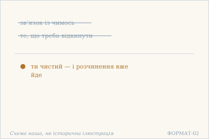
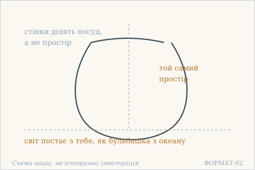
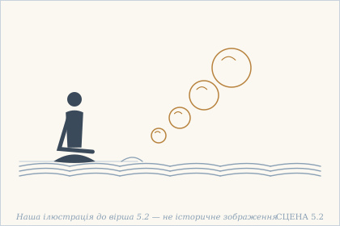
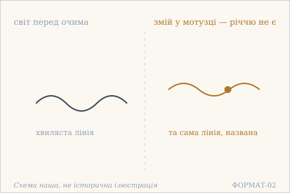
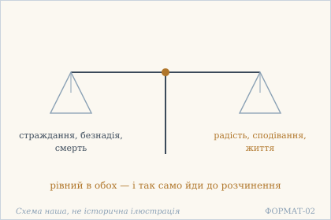

# Аштавакра-ґіта. Глава 5. Наукове представлення

> ФОРМАТ-02: кожен вірш подано пʼятьма шарами — деванагарі, українська
> транслітерація, переклад, науковий коментар з українськими паралелями,
> ілюстрація. Плюс окремо — поетичний переклад (`poetychnyi/rozdil-5.md`).
>
> **Деванагарі тут — механічна** транслітерація поля `iast` з картки
> (`scripts/iast_to_devanagari.py`), а не окреме читання за рукописом.
> **Українська транслітерація** — теж механічна (`scripts/iast_to_ukrainian.py`,
> таблиця в `docs/TRANSLITERATSIIA.md`).
> **Українські паралелі** — наша інтерпретація, а не твердження про вплив;
> реєстр і правила — `paraleli.json` і `scripts/check_ukrainian_parallels.py`.
> **Схеми** — наші власні; жодна не є історичною ілюстрацією.
> **Сцени** (`ilustratsii-naratyvni/`) — теж наші власні малюнки й теж не
> історичні: це ситуація вірша, а не поняття, і фігури там — силуети без
> облич.
>
> Цей файл згенеровано; правити треба картки й `format-v2/rozdil-5.json`,
> а не його.

## Глава 5. Розчинення

Пʼята глава — чотири вірші й один рефрен. Рефрен тут не прикраса: він стоїть у кінці кожної строфи тими самими словами, і саме повтор і є думкою. Глава не описує розчинення, а показує, що робити з ним, коли відкидати вже нічого: у першому вірші це сказано прямо — у чистого немає звʼязку ні з чим, тож і відкидати йому нічого.

## 5.1

**Деванагарі.** न ते सङ्गो ऽस्ति केनापि किं शुद्धस् त्यक्तुम् इच्छसि । सङ्घातविलयं कुर्वन्न् एवम् एव लयं व्रज ॥

**Українська транслітерація.** на те санґо ’сті кенапі кім шуддгас тяктум іччасі | санґгатавілаям курванн евам ева лаям враджа ||

**Переклад.** У тебе немає зв'язку ні з чим — то чого ж ти, чистий, хочеш відкинути? Здійснюючи розчинення скупчення, так само йди до розчинення.

**Построкове зіставлення (редакторська чернетка, не рецензовано).**

### Рядок а

**Деванагарі (механічно з IAST).** न ते सङ्गो ऽस्ति केनापि किं शुद्धस् त्यक्तुम् इच्छसि

**IAST (з редакторської картки).** na te saṅgo 'sti kenāpi kiṃ śuddhas tyaktum icchasi

**Українська транслітерація (механічна).** на те санґо ’сті кенапі кім шуддгас тяктум іччасі

**Український відповідник рядка.** У тебе немає зв'язку ні з чим — то чого ж ти, чистий, хочеш відкинути?

**Коментар рядка (не рецензовано).** na ... saṅgo 'sti заперечує прив'язаність; kenāpi вказує на відсутність зв'язку з будь-чим, kiṃ ... icchasi формує питання, tyaktum — інфінітив «відкинути». Тлумачення стосується внутрішньої свободи, а не наказу полишити родину чи працю.

### Рядок б

**Деванагарі (механічно з IAST).** सङ्घातविलयं कुर्वन्न् एवम् एव लयं व्रज

**IAST (з редакторської картки).** saṅghātavilayaṃ kurvann evam eva layaṃ vraja

**Українська транслітерація (механічна).** санґгатавілаям курванн евам ева лаям враджа

**Український відповідник рядка.** Здійснюючи розчинення скупчення, так само йди до розчинення.

**Коментар рядка (не рецензовано).** saṅghātavilayaṃ — розчинення сукупності, kurvann — дієприкметник «здійснюючи», vraja — наказова форма «йди». evam eva layaṃ vraja — рефрен усіх чотирьох віршів глави 5; розрізнення vilaya / laya як філософських термінів потребує незалежної фахової звірки.

**Науковий коментар.** Питання kim ... icchasi («чого хочеш») викриває безглуздість самого наміру відректися: відкидають те, до чого прив'язані, а зв'язку немає (na te saṅgaḥ asti kenāpi). Слово saṅghāta («скупчення») — технічне: тіло описане не як річ, а як агрегат, суму. Тому vilaya («розчинення») і laya («розчинення») стоять в одному вірші двічі: перше — те, що відбувається з тілом само собою, друге — те, до чого слід іти. Різниця в тому, що перше трапляється, а друге обирають. РЕФРЕН ГЛАВИ. Усі чотири вірші глави 5 закінчуються однаково: evam eva layaṃ vraja («так само йди до розчинення»). Це не чотири окремі повчання, а одна літанія з незмінним приспівом: змінюється тільки перша половина — обґрунтування, а висновок лишається той самий. Тому главу слід читати як одне ціле.

**Українська паралель (наша інтерпретація, не твердження про вплив).** *Григорій Сковорода*, «Асхань. Симфонія, наречена книга Асхань, про пізнання самого себе». Наша паралель: у Сковороди пізнання себе теж нічого не додає й нічого не відкидає — воно знімає перешкоду, і тільки. Наша інтерпретація, не твердження про вплив.

**Ілюстрація.**  — Відкидати нічого: у чистого немає звʼязку. Схема наша, не історична ілюстрація.

## 5.2

**Деванагарі.** उदेति भवतो विश्वं वारिधेर् इव बुद्बुदः । इति ज्ञात्वा एकम् आत्मानम् एवम् एव लयं व्रज ॥

**Українська транслітерація.** удеті бгавато вішвам варідгер іва будбудах | іті джнятва екам атманам евам ева лаям враджа ||

**Переклад.** Світ постає з тебе, як бульбашка з океану. Знаючи, що Атман єдиний, — так само йди до розчинення.

**Построкове зіставлення (редакторська чернетка, не рецензовано).**

### Рядок а

**Деванагарі (механічно з IAST).** उदेति भवतो विश्वं वारिधेर् इव बुद्बुदः

**IAST (з редакторської картки).** udeti bhavato viśvaṃ vāridher iva budbudaḥ

**Українська транслітерація (механічна).** удеті бгавато вішвам варідгер іва будбудах

**Український відповідник рядка.** Світ постає з тебе, як бульбашка з океану.

**Коментар рядка (не рецензовано).** udeti означає «постає»; bhavataḥ допускає значення «з тебе» або «твого», vāridher iva budbudaḥ порівнює світ із бульбашкою в океані. Це образ залежного виникнення, а не самостійний доказ неіснування світу.

### Рядок б

**Деванагарі (механічно з IAST).** इति ज्ञात्वा एकम् आत्मानम् एवम् एव लयं व्रज

**IAST (з редакторської картки).** iti jñātvā ekam ātmānam evam eva layaṃ vraja

**Українська транслітерація (механічна).** іті джнятва екам атманам евам ева лаям враджа

**Український відповідник рядка.** Знаючи, що Атман єдиний, — так само йди до розчинення.

**Коментар рядка (не рецензовано).** iti jñātvā — «так знаючи», ekam ātmānam стосується єдності Атмана. evam eva layaṃ vraja — наказовий рефрен усіх чотирьох віршів цієї глави; український відповідник збережено без змін.

**Науковий коментар.** Порівняння з бульбашкою точніше за звичне «хвиля в морі» (2.10, 2.23–2.25): хвиля є форма тієї ж води, а бульбашка — порожнеча, обтягнута плівкою з тієї ж води. Вона не має власного вмісту. bhavataḥ стоїть в ablativus/genitivus, і обидва прочитання працюють: «з тебе» (джерело) і «твого» (належність). Висновок вірша не «світ нереальний», а «Атман єдиний» — і саме з єдності випливає розчинення, а не навпаки. РЕФРЕН ГЛАВИ. Усі чотири вірші глави 5 закінчуються однаково: evam eva layaṃ vraja («так само йди до розчинення»). Це не чотири окремі повчання, а одна літанія з незмінним приспівом: змінюється тільки перша половина — обґрунтування, а висновок лишається той самий. Тому главу слід читати як одне ціле.

**Українська паралель (наша інтерпретація, не твердження про вплив).** *Богдан-Ігор Антонич*, «Ротації» (1938). Наша паралель: в Антонича світ теж постає з того, хто на нього дивиться, як бульбашка з океану. Наше порівняння — за образом.

**Ілюстрація.**  — Бульбашка й океан: світ постає з тебе. Схема наша, не історична ілюстрація.

**Сцена.**  — Людина сидить на березі, а з океану одна за одною піднімаються бульбашки. Наша ілюстрація до вірша 5.2 — не історичне зображення.

## 5.3

**Деванагарі.** प्रत्यक्षम् अप्य् अवस्तुत्वाद् विश्वं नास्त्य् अमले त्वयि । रज्जुसर्प इव व्यक्तम् एवम् एव लयं व्रज ॥

**Українська транслітерація.** пратякшам апй авастутвад вішвам настй амале тваї | раджджусарпа іва в'яктам евам ева лаям враджа ||

**Переклад.** Хоч світ і перед очима, він не існує в тобі, незаплямованому, — бо він не річ, як змій у мотузці, явно. Так само йди до розчинення.

**Построкове зіставлення (редакторська чернетка, не рецензовано).**

### Рядок а

**Деванагарі (механічно з IAST).** प्रत्यक्षम् अप्य् अवस्तुत्वाद् विश्वं नास्त्य् अमले त्वयि

**IAST (з редакторської картки).** pratyakṣam apy avastutvād viśvaṃ nāsty amale tvayi

**Українська транслітерація (механічна).** пратякшам апй авастутвад вішвам настй амале тваї

**Український відповідник рядка.** Хоч світ і перед очима, він не існує в тобі, незаплямованому, — бо він не річ,

**Коментар рядка (не рецензовано).** pratyakṣam api означає «хоч і видимий перед очима»; avastutvād — «через відсутність самостійної речовості/сутності», viśvaṃ nāsti — «світ не існує»; amale tvayi звертається до незаплямованого адресата. Це відтворення редакторської картки, а не нове критичне читання.

### Рядок б

**Деванагарі (механічно з IAST).** रज्जुसर्प इव व्यक्तम् एवम् एव लयं व्रज

**IAST (з редакторської картки).** rajjusarpa iva vyaktam evam eva layaṃ vraja

**Українська транслітерація (механічна).** раджджусарпа іва в'яктам евам ева лаям враджа

**Український відповідник рядка.** як змій у мотузці, явно. Так само йди до розчинення.

**Коментар рядка (не рецензовано).** rajjusarpa iva — порівняння з уявним змієм у мотузці, vyaktam — «виразно, явно». evam eva layaṃ vraja зберігає незмінний рефрен глави; філософське пояснення образу слід відрізняти від лексичного значення санскриту.

**Науковий коментар.** Найсильніше тут — avastutvāt («через несуттєвість»). Це не «світ оманливий», а точніше: світ не є vastu, річчю, самостійною сутністю. pratyakṣam api («хоч і перед очима») визнає видимість повністю — вірш не заперечує, що ми бачимо. Заперечується лише те, що видиме має власне буття. Змій у мотузці (той самий приклад, що в 2.9) поданий тут з vyaktam («явно»): помилка не тьмяна, вона гранично чітка — і саме тому переконлива. РЕФРЕН ГЛАВИ. Усі чотири вірші глави 5 закінчуються однаково: evam eva layaṃ vraja («так само йди до розчинення»). Це не чотири окремі повчання, а одна літанія з незмінним приспівом: змінюється тільки перша половина — обґрунтування, а висновок лишається той самий. Тому главу слід читати як одне ціле.

**Українська паралель (наша інтерпретація, не твердження про вплив).** *Іван Франко*, «Сойчине крило» (1905). Наша паралель: у Франка видиме й справжнє теж не збігаються, і саме на цьому розходженні тримається оповідь. Наше порівняння — типологічне, не про джерело.

**Ілюстрація.**  — Світ перед очима й змій у мотузці. Схема наша, не історична ілюстрація.

## 5.4

**Деванагарі.** समदुःखसुखः पूर्ण आशानैराश्ययोः समः । समजीवितमृत्युः सन्न् एवम् एव लयं व्रज ॥

**Українська транслітерація.** самадухкхасукхах пурна ашанайрашяйох самах | самаджівітамрітюх санн евам ева лаям враджа ||

**Переклад.** Рівний у стражданні й радості, повний, рівний у сподіванні й безнадії, рівний у житті й смерті, — так само йди до розчинення.

**Построкове зіставлення (редакторська чернетка, не рецензовано).**

### Рядок а

**Деванагарі (механічно з IAST).** समदुःखसुखः पूर्ण आशानैराश्ययोः समः

**IAST (з редакторської картки).** samaduḥkhasukhaḥ pūrṇa āśānairāśyayoḥ samaḥ

**Українська транслітерація (механічна).** самадухкхасукхах пурна ашанайрашяйох самах

**Український відповідник рядка.** Рівний у стражданні й радості, повний, рівний у сподіванні й безнадії,

**Коментар рядка (не рецензовано).** samaduḥkhasukhaḥ — рівність до страждання й радості; pūrṇaḥ — «повний»; āśānairāśyayoḥ samaḥ — рівний у парі сподівання/безнадія. Два протиставлення містяться в одному друкованому піврядку; це не два самостійні переклади.

### Рядок б

**Деванагарі (механічно з IAST).** समजीवितमृत्युः सन्न् एवम् एव लयं व्रज

**IAST (з редакторської картки).** samajīvitamṛtyuḥ sann evam eva layaṃ vraja

**Українська транслітерація (механічна).** самаджівітамрітюх санн евам ева лаям враджа

**Український відповідник рядка.** рівний у житті й смерті, — так само йди до розчинення.

**Коментар рядка (не рецензовано).** samajīvitamṛtyuḥ — рівність у житті й смерті, san — дієприкметник «бувши». evam eva layaṃ vraja — той самий наказовий рефрен, що в 5.1–5.3; український порядок слів залишено без змін.

**Науковий коментар.** Вірш складається з трьох пар, і всі три побудовані на sama («рівний»): страждання/радість, сподівання/безнадія, життя/смерть. Пари охоплюють три виміри — відчуття, очікування, буття. Слово pūrṇaḥ («повний») стоїть між першою і другою парою не випадково: рівність не порожнеча, а повнота, якій не бракує нічого з обох боків. Це єдиний вірш глави, де немає ні прикладу, ні заперечення — лише перелік ознак. Тим самим літанія закінчується не аргументом, а описом того, хто йде. РЕФРЕН ГЛАВИ. Усі чотири вірші глави 5 закінчуються однаково: evam eva layaṃ vraja («так само йди до розчинення»). Це не чотири окремі повчання, а одна літанія з незмінним приспівом: змінюється тільки перша половина — обґрунтування, а висновок лишається той самий. Тому главу слід читати як одне ціле.

**Українська паралель (наша інтерпретація, не твердження про вплив).** *Леся Українка*, «Камінний господар» (1912). Наша паралель: у Лесі Українки рівність перед останнім теж не залежить від надії чи її відсутності. Наше порівняння — за будовою думки.

**Ілюстрація.**  — Дві шальки, що стоять рівно: життя й смерть. Схема наша, не історична ілюстрація.

## Поетичний переклад

Окремо, у [`poetychnyi/rozdil-5.md`](poetychnyi/rozdil-5.md). Це **наш поетичний переклад**, не канонічний і не науковий; у PDF він іде окремою частиною.
