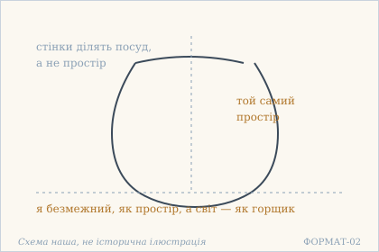
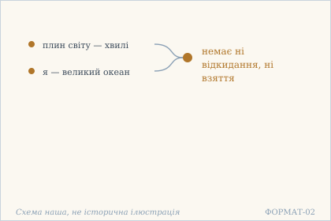
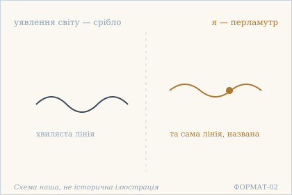
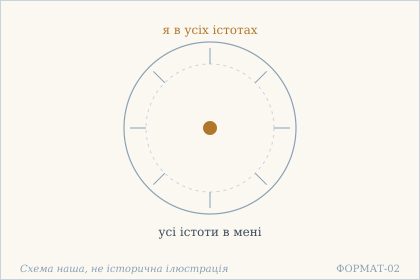

# Аштавакра-ґіта. Глава 6. Наукове представлення

> ФОРМАТ-02: кожен вірш подано пʼятьма шарами — деванагарі, українська
> транслітерація, переклад, науковий коментар з українськими паралелями,
> ілюстрація. Плюс окремо — поетичний переклад (`poetychnyi/rozdil-6.md`).
>
> **Деванагарі тут — механічна** транслітерація поля `iast` з картки
> (`scripts/iast_to_devanagari.py`), а не окреме читання за рукописом.
> **Українська транслітерація** — теж механічна (`scripts/iast_to_ukrainian.py`,
> таблиця в `docs/TRANSLITERATSIIA.md`).
> **Українські паралелі** — наша інтерпретація, а не твердження про вплив;
> реєстр і правила — `paraleli.json` і `scripts/check_ukrainian_parallels.py`.
> **Схеми** — наші власні; жодна не є історичною ілюстрацією.
>
> Цей файл згенеровано; правити треба картки й `format-v2/rozdil-6.json`,
> а не його.

## Глава 6. Горщик і простір

Шоста глава тримається на рефрені, довшому за рефрен пʼятої: чотири вірші закінчуються тими самими словами про відкидання, взяття й розчинення. Кожна строфа дає новий образ — простір і горщик, океан і хвиля, перламутр і срібло, — і після кожного повторює, що з цим знанням нічого не треба робити. Це глава про те, що знання не є дією.

## 6.1

**Деванагарі.** आकाशवद् अनन्तो ऽहं घटवत् प्रकृतं जगत् । इति ज्ञानं तथैतस्य न त्यागो न ग्रहो लयः ॥

**Українська транслітерація.** акашавад ананто ’хам ґгатават пракрітам джаґат | іті джнянам татхайтася на тяґо на ґрахо лаях ||

**Переклад.** Я безмежний, як простір, а світ — як горщик. Таке знання — і в нього немає ні відкидання, ні взяття, ні розчинення.

**Науковий коментар.** Образ простору й горщика працює точніше, ніж здається: простір не вміщується в горщик і не обмежується його стінками — горщик лише окреслює частину простору, не додаючи й не забираючи нічого. Тому рефрен і каже: немає ні tyāga (відкидання), ні graha (взяття), ні навіть laya (розчинення) — усі три дії припускають, що щось справді додалося або зникло. Слово prakṛtam («зроблене») підкреслює: горщик — виріб, а простір — ні. РЕФРЕН ГЛАВИ. Усі чотири вірші глави 6 закінчуються однаково: iti jñānaṃ tathaitasya na tyāgo na graho layaḥ («таке знання — і в нього немає ні відкидання, ні взяття, ні розчинення»). Зверни увагу: рефрен глави 5 вимагав laya («йди до розчинення»), а рефрен глави 6 заперечує навіть laya. Це не суперечність, а наступний крок: спершу розчинення як те, до чого йдуть, потім — знання, у якому немає кому йти й нічого розчиняти. Главу слід читати як одне ціле.

**Українська паралель (ПОТРЕБУЄ ПЕРЕВІРКИ).** *українська філософська традиція*, не визначено. ПОТРЕБУЄ ПЕРЕВІРКИ: образ простору, що не ділиться стінками посуду, найчастіше приходить до українського читача через Сковороду; саме місце, де він говорить про посуд і простір, ми за джерелом не звірили й тому не називаємо.

**Ілюстрація.**  — Простір і горщик: стінки ділять посуд, а не простір. Схема наша, не історична ілюстрація.

## 6.2

**Деванагарі.** महोदधिर् इवाहं स प्रपञ्चो वीचिसंनिभः । इति ज्ञानं तथैतस्य न त्यागो न ग्रहो लयः ॥

**Українська транслітерація.** маходадгір івахам са прапаньчо вічісамнібгах | іті джнянам татхайтася на тяґо на ґрахо лаях ||

**Переклад.** Я — як великий океан, а цей плин світу — як хвилі. Таке знання — і в нього немає ні відкидання, ні взяття, ні розчинення.

**Науковий коментар.** prapañca — важке слово: буквально «розгортання, розпросторення», а в ужитку «різноманіття світу» з відтінком заплутаності. Тут воно вжите без засудження: хвилі не є вадою океану. Порівняй 2.23–2.25, де той самий образ розгорнутий у три кроки; тут він стиснутий до одного порівняння, бо мета інша — не показати, як хвилі виникають, а показати, що з ними не треба нічого робити. РЕФРЕН ГЛАВИ. Усі чотири вірші глави 6 закінчуються однаково: iti jñānaṃ tathaitasya na tyāgo na graho layaḥ («таке знання — і в нього немає ні відкидання, ні взяття, ні розчинення»). Зверни увагу: рефрен глави 5 вимагав laya («йди до розчинення»), а рефрен глави 6 заперечує навіть laya. Це не суперечність, а наступний крок: спершу розчинення як те, до чого йдуть, потім — знання, у якому немає кому йти й нічого розчиняти. Главу слід читати як одне ціле.

**Українська паралель (наша інтерпретація, не твердження про вплив).** *Григорій Сковорода*, «Вдячний Еродій» (трактат). Наша паралель: у Сковороді море як образ цілого, у якому частка не має власного окремого життя, близьке до цього вірша. Наше порівняння — типологічне, не твердження про джерело.

**Ілюстрація.**  — Хвилі й океан: у знанні немає ні взяття, ні відкидання. Схема наша, не історична ілюстрація.

## 6.3

**Деванагарі.** अहं स शुक्तिसङ्काशो रूप्यवद् विश्वकल्पना । इति ज्ञानं तथैतस्य न त्यागो न ग्रहो लयः ॥

**Українська транслітерація.** ахам са шуктісанкашо руп'явад вішвакалпана | іті джнянам татхайтася на тяґо на ґрахо лаях ||

**Переклад.** Я — як перламутр, а уявлення світу — як срібло в ньому. Таке знання — і в нього немає ні відкидання, ні взяття, ні розчинення.

**Науковий коментар.** Третє й останнє з трьох порівнянь глави (простір/горщик, океан/хвилі, перламутр/срібло), і воно єдине, де друга річ не існує зовсім: горщик і хвиля є, срібла немає. Тому тут і стоїть kalpanā («уявлення, конструкція») — не «світ», а саме уявлення світу. Зверни увагу: перламутр не заперечується і не змінюється — зникає тільки срібло, а разом із ним і питання, що з ним робити. Це і є сенс рефрену. РЕФРЕН ГЛАВИ. Усі чотири вірші глави 6 закінчуються однаково: iti jñānaṃ tathaitasya na tyāgo na graho layaḥ («таке знання — і в нього немає ні відкидання, ні взяття, ні розчинення»). Зверни увагу: рефрен глави 5 вимагав laya («йди до розчинення»), а рефрен глави 6 заперечує навіть laya. Це не суперечність, а наступний крок: спершу розчинення як те, до чого йдуть, потім — знання, у якому немає кому йти й нічого розчиняти. Главу слід читати як одне ціле.

**Українська паралель (ПОТРЕБУЄ ПЕРЕВІРКИ).** *українська барокова емблематика*, не визначено. ПОТРЕБУЄ ПЕРЕВІРКИ: пара перламутр / срібло як образ оманливого уявлення знайома бароковій емблематиці, але конкретного твору ми не перевірили.

**Ілюстрація.**  — Перламутр і срібло: уявлення світу. Схема наша, не історична ілюстрація.

## 6.4

**Деванагарі.** अहं वा सर्वभूतेषु सर्वभूतान्य् अथो मयि । इति ज्ञानं तथैतस्य न त्यागो न ग्रहो लयः ॥

**Українська транслітерація.** ахам ва сарвабгутешу сарвабгутанй атхо маї | іті джнянам татхайтася на тяґо на ґрахо лаях ||

**Переклад.** Я — у всіх істотах, а всі істоти — у мені. Таке знання — і в нього немає ні відкидання, ні взяття, ні розчинення.

**Науковий коментар.** Двозмінна формула та сама, що в 3.5, і тут вона завершує главу. Після трьох порівнянь (простір, океан, перламутр) висновок поданий без образу взагалі — лише відношення. atho («а також») з'єднує два напрямки так, що вони не зливаються в один: я в істотах і істоти в мені — не те саме твердження, прочитане двічі, а два боки одного відношення. Саме тому рефрен знову заперечує tyāga і graha: у такому відношенні немає нічого, що можна було б узяти або відкинути. РЕФРЕН ГЛАВИ. Усі чотири вірші глави 6 закінчуються однаково: iti jñānaṃ tathaitasya na tyāgo na graho layaḥ («таке знання — і в нього немає ні відкидання, ні взяття, ні розчинення»). Зверни увагу: рефрен глави 5 вимагав laya («йди до розчинення»), а рефрен глави 6 заперечує навіть laya. Це не суперечність, а наступний крок: спершу розчинення як те, до чого йдуть, потім — знання, у якому немає кому йти й нічого розчиняти. Главу слід читати як одне ціле.

**Українська паралель (наша інтерпретація, не твердження про вплив).** *Павло Тичина*, «Плуг» (1920). Наша паралель: у Тичини взаємне перебування всього в усьому теж стає способом бачити світ, а не твердженням про будову речей. Наше порівняння — за образом.

**Ілюстрація.**  — Взаємне перебування: я в усіх істотах, усі істоти в мені. Схема наша, не історична ілюстрація.

## Поетичний переклад

Окремо, у [`poetychnyi/rozdil-6.md`](poetychnyi/rozdil-6.md). Це **наш поетичний переклад**, не канонічний і не науковий; у PDF він іде окремою частиною.
