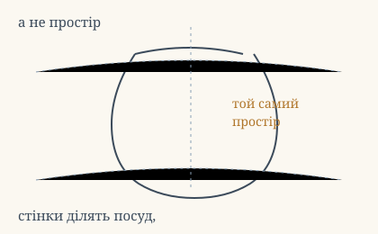

# Аштавакра-ґіта. Розділ 6. Наукове представлення

> Пілот нового формату: кожен вірш подано шістьма шарами — деванагарі,
> латинська транслітерація IAST, українська практична транслітерація,
> український переклад, науковий коментар із українськими паралелями, ілюстрація.
> Деванагарі тут — **механічна** транслітерація поля `iast` з картки
> (`scripts/iast_to_devanagari.py`), а не окреме читання за рукописом.
> Правила формату: `docs/FORMAT_V2.md`.

## 6.1

**Деванагарі.** आकाशवद् अनन्तो ऽहं घटवत् प्रकृतं जगत् । इति ज्ञानं तथैतस्य न त्यागो न ग्रहो लयः ॥

**IAST.** ākāśavad ananto 'haṃ ghaṭavat prakṛtaṃ jagat | iti jñānaṃ tathaitasya na tyāgo na graho layaḥ ||

**Українська транслітерація.** акашавад ананто ’хам ґгатават пракрітам джаґат | іті джнянам татхайтасья на тьяґо на ґрахо лаях ||

**Переклад.** Я безмежний, як простір, а світ — як горщик. Таке знання — і в нього немає ні відкидання, ні взяття, ні розчинення.

**Коментар.** Порівняння `ākāśa` (простір) і `ghaṭa` (глечик) — одне з найстаріших в адвайті: стінки посуду окреслюють посуд, але не розрізають простір навпіл. Слово `prakṛta` тут означає не «природа» у сенсі санкх'ї, а «виготовлене, зроблене» — світ як виріб, а не як субстанція. Тому й `na tyāgaḥ` — відкидати нічого, бо відкидають те, що мали.

*Українська паралель (наша асоціація, не науковий консенсус).* Григорій Сковорода у діалозі «Наркіс. Розмова про те: пізнай себе» розрізняє зовнішню й внутрішню людину так само, як цей вірш розрізняє посуд і простір: межа є, але вона не там, де здається. Сковорода не знав санскриту; збіг тут — типологічний, а не запозичення, і саме тому він вартий уваги читача.

**Ілюстрація.**  — пунктир показує, що простір усередині й зовні той самий.

## 6.2

**Деванагарі.** महोदधिर् इवाहं स प्रपञ्चो वीचिसंनिभः । इति ज्ञानं तथैतस्य न त्यागो न ग्रहो लयः ॥

**IAST.** mahodadhir ivāhaṃ sa prapañco vīcisaṃnibhaḥ | iti jñānaṃ tathaitasya na tyāgo na graho layaḥ ||

**Українська транслітерація.** маходадгір івахам са прапанчо вічісамнібгах | іті джнянам татхайтасья на тьяґо на ґрахо лаях ||

**Переклад.** Я — як великий океан, а цей плин світу — як хвилі. Таке знання — і в нього немає ні відкидання, ні взяття, ні розчинення.

**Коментар.** `prapañca` — буквально «розгортання, розпростертість»; у філософській мові це «світ явищ», а не «обман», і переклад «мара» тут був би неточним. `vīci` — хвиля; хвиля має початок і кінець, океан — ні, і саме ця різниця в тривалості, а не в речовині, становить думку вірша.

*Українська паралель (наша асоціація).* Образ моря як тотожності частини й цілого — наскрізний у нашій поезії: від Сковородиного «світ ловив мене, та не спіймав» до Лесі Українки, де море стає мірою свободи. Наводимо як асоціацію, не як джерело.

## 6.3

**Деванагарі.** अहं स शुक्तिसङ्काशो रूप्यवद् विश्वकल्पना । इति ज्ञानं तथैतस्य न त्यागो न ग्रहो लयः ॥

**IAST.** ahaṃ sa śuktisaṅkāśo rūpyavad viśvakalpanā | iti jñānaṃ tathaitasya na tyāgo na graho layaḥ ||

**Українська транслітерація.** ахам са шуктісанкашо рупьявад вішвакалпана | іті джнянам татхайтасья на тьяґо на ґрахо лаях ||

**Переклад.** Я — як перламутр, а уявлення світу — як срібло в ньому. Таке знання — і в нього немає ні відкидання, ні взяття, ні розчинення.

**Коментар.** `śukti` — перламутрова черепашка; `rūpya` — срібло. Класичний приклад хибного ототожнення: срібло не існує окремо від черепашки, але й не зникає при уважному погляді — воно просто перестає бути сріблом. Це третій із чотирьох образів глави, і єдиний, де йдеться про **помилку сприйняття**, а не про масштаб.

## 6.4

**Деванагарі.** अहं वा सर्वभूतेषु सर्वभूतान्य् अथो मयि । इति ज्ञानं तथैतस्य न त्यागो न ग्रहो लयः ॥

**IAST.** ahaṃ vā sarvabhūteṣu sarvabhūtāny atho mayi | iti jñānaṃ tathaitasya na tyāgo na graho layaḥ ||

**Українська транслітерація.** ахам ва сарвабгутешу сарвабгутаньятхо майі | іті джнянам татхайтасья на тьяґо на ґрахо лаях ||

**Переклад.** Я — у всіх істотах, а всі істоти — у мені. Таке знання — і в нього немає ні відкидання, ні взяття, ні розчинення.

**Коментар.** Останній вірш глави відкидає напрямок: не «істоти в мені» і не «я в істотах», а обидва разом (`vā` тут зʼєднувальне, не розділове). Це та сама симетрія, що в 15.6 і 18.11, і переклад мусить її зберегти, а не вибрати один бік.

## Рефрен глави

Усі чотири вірші закінчуються дослівно однаково: `iti jñānaṃ tathaitasya na tyāgo na graho layaḥ`. Це не чотири різні твердження, а одне, сказане чотирма образами. Тому в перекладі рефрен повторений слово в слово — інакше читач не побачить, що глава тримається на повторі.
