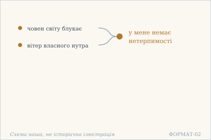
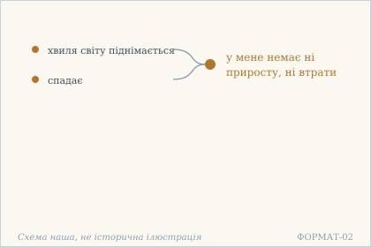
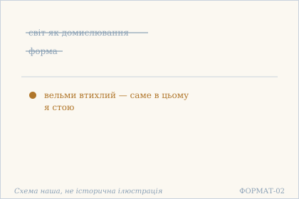
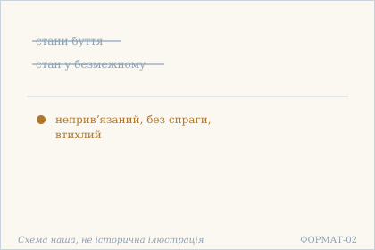
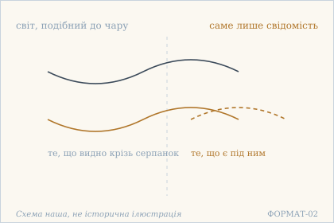

# Аштавакра-ґіта. Глава 7. Наукове представлення

> ФОРМАТ-02: кожен вірш подано пʼятьма шарами — деванагарі, українська
> транслітерація, переклад, науковий коментар з українськими паралелями,
> ілюстрація. Плюс окремо — поетичний переклад (`poetychnyi/rozdil-7.md`).
>
> **Деванагарі тут — механічна** транслітерація поля `iast` з картки
> (`scripts/iast_to_devanagari.py`), а не окреме читання за рукописом.
> **Українська транслітерація** — теж механічна (`scripts/iast_to_ukrainian.py`,
> таблиця в `docs/TRANSLITERATSIIA.md`).
> **Українські паралелі** — наша інтерпретація, а не твердження про вплив;
> реєстр і правила — `paraleli.json` і `scripts/check_ukrainian_parallels.py`.
> **Схеми** — наші власні; жодна не є історичною ілюстрацією.
>
> Цей файл згенеровано; правити треба картки й `format-v2/rozdil-7.json`,
> а не його.

## Глава 7. Океан, у якому пливе світ

Сьома глава коротка й тримається на двох повторах. Перші три вірші починаються тими самими словами — у мені, безмежному океані, — і щоразу додають новий рух: човен, хвилю, домислювання. Останні два закінчуються словами саме в цьому я стою. Отже, глава не про те, що світ ілюзорний, а про те, де саме стоїть той, хто це бачить.

## 7.1

**Деванагарі.** मय्य् अनन्तमहाम्भोधौ विश्वपोत इतस्ततः । भ्रमति स्वान्तवातेन न ममास्त्य् असहिष्णुता ॥

**Українська транслітерація.** майй анантамахамбгодгау вішвапота ітастатах | бграматі свантаватена на мамастй асахішнута ||

**Переклад.** У мені, безмежному океані, човен світу блукає туди-сюди вітром власного нутра — і в мене немає нетерпимості.

**Построкове зіставлення (редакторська чернетка, не рецензовано).**

### Рядок а

**Деванагарі (механічно з IAST).** मय्य् अनन्तमहाम्भोधौ विश्वपोत इतस्ततः

**IAST (з редакторської картки).** mayy anantamahāmbhodhau viśvapota itastataḥ

**Українська транслітерація (механічна).** майй анантамахамбгодгау вішвапота ітастатах

**Український відповідник рядка.** У мені, безмежному океані, човен світу

**Коментар рядка (не рецензовано).** mayy anantamahāmbhodhau — місцевий відмінок «у мені, безмежному океані»; viśvapota — «човен світу», itastataḥ — «туди-сюди». Український присудок «блукає» перенесено до другого відповідника для збереження цілісного чинного перекладу; відповідність між мовами тут не слово-в-слово.

### Рядок б

**Деванагарі (механічно з IAST).** भ्रमति स्वान्तवातेन न ममास्त्य् असहिष्णुता

**IAST (з редакторської картки).** bhramati svāntavātena na mamāsty asahiṣṇutā

**Українська транслітерація (механічна).** бграматі свантаватена на мамастй асахішнута

**Український відповідник рядка.** блукає туди-сюди вітром власного нутра — і в мене немає нетерпимості.

**Коментар рядка (не рецензовано).** bhramati — «блукає», svāntavātena — орудний відмінок «вітром власного нутра», na mamāsty asahiṣṇutā — «у мене немає нетерпимості». Зміст не дорівнює забороні зовнішнього руху світу: мовець заперечує власну нетерпимість.

**Науковий коментар.** `pota` — «човен, судно», а не «хвиля»: світ тут не хвилювання океану, а рухома річ **на** ньому. Це відрізняє 7.1 від 7.2, де світ уже `vīci` (хвиля). `svānta-vāta` («вітер власного нутра») — рушій усередині, не зовні. `asahiṣṇutā` — «нетерпимість, нездатність терпіти»: океан не страждає від човна, і саме це сказано, а не «спокій».

**Українська паралель (наша інтерпретація, не твердження про вплив).** *Олександр Довженко*, «Поема про море» (1956). Наша паралель: у Довженка море теж стає мірою того, що з людиною діється, а сама людина лишається тим, у чому цей рух відбувається. Наше порівняння — за образом, не про джерело.

**Ілюстрація.**  — Човен світу в безмежному океані, гнаний вітром нутра. Схема наша, не історична ілюстрація.

## 7.2

**Деванагарі.** मय्य् अनन्तमहाम्भोधौ जगद्वीचिः स्वभावतः । उदेतु वास्तम् आयातु न मे वृद्धिर् न च क्षतिः ॥

**Українська транслітерація.** майй анантамахамбгодгау джаґадвічіх свабгаватах | удету вастам аяту на ме вріддгір на ча кшатіх ||

**Переклад.** У мені, безмежному океані, хвиля світу — за власною природою. Нехай піднімається або спадає: у мене немає ні приросту, ні втрати.

**Построкове зіставлення (редакторська чернетка, не рецензовано).**

### Рядок а

**Деванагарі (механічно з IAST).** मय्य् अनन्तमहाम्भोधौ जगद्वीचिः स्वभावतः

**IAST (з редакторської картки).** mayy anantamahāmbhodhau jagadvīciḥ svabhāvataḥ

**Українська транслітерація (механічна).** майй анантамахамбгодгау джаґадвічіх свабгаватах

**Український відповідник рядка.** У мені, безмежному океані, хвиля світу — за власною природою.

**Коментар рядка (не рецензовано).** mayy anantamahāmbhodhau повторює місцевий відмінок 7.1; jagadvīciḥ — «хвиля світу» на відміну від човна в 7.1; svabhāvataḥ — «за власною природою». Це образ, а не природничонаукове пояснення океану.

### Рядок б

**Деванагарі (механічно з IAST).** उदेतु वास्तम् आयातु न मे वृद्धिर् न च क्षतिः

**IAST (з редакторської картки).** udetu vāstam āyātu na me vṛddhir na ca kṣatiḥ

**Українська транслітерація (механічна).** удету вастам аяту на ме вріддгір на ча кшатіх

**Український відповідник рядка.** Нехай піднімається або спадає: у мене немає ні приросту, ні втрати.

**Коментар рядка (не рецензовано).** udetu ... astam āyātu — два наказові побажальні вислови про піднесення й спадання; na me vṛddhir na ca kṣatiḥ — заперечення приросту та втрати. Українська інтонація «нехай» не додає нового джерела до санскриту.

**Науковий коментар.** Два імперативи (`udetu`, `āyātu`) — це не побажання, а **дозвіл**: текст не просить хвилю поводитися інакше. `svabhāvataḥ` («за власною природою») знімає питання причини. Пара `vṛddhi` / `kṣati` — приріст і втрата: океан не стає більшим від хвилі й не меншим без неї. Разом із 7.1 це друга метафора того самого, і різниця між човном і хвилею не випадкова.

**Українська паралель (наша інтерпретація, не твердження про вплив).** *Богдан-Ігор Антонич*, «Книга Лева» (1936). Наша паралель: в Антонича хвиля теж піднімається й спадає за власною природою, не питаючи, чи це комусь на приріст. Наше порівняння — типологічне.

**Ілюстрація.**  — Хвиля світу: піднімається й спадає без приросту й втрати. Схема наша, не історична ілюстрація.

## 7.3

**Деванагарі.** मय्य् अनन्तमहाम्भोधौ विश्वं नाम विकल्पना । अतिशान्तो निराकार एतद् एवाहम् आस्थितः ॥

**Українська транслітерація.** майй анантамахамбгодгау вішвам нама вікалпана | атішанто ніракара етад евахам астхітах ||

**Переклад.** У мені, безмежному океані те, що зветься світом, є домислюванням. Вельми втихлий, без форми — саме в цьому я стою.

**Построкове зіставлення (редакторська чернетка, не рецензовано).**

### Рядок а

**Деванагарі (механічно з IAST).** मय्य् अनन्तमहाम्भोधौ विश्वं नाम विकल्पना

**IAST (з редакторської картки).** mayy anantamahāmbhodhau viśvaṃ nāma vikalpanā

**Українська транслітерація (механічна).** майй анантамахамбгодгау вішвам нама вікалпана

**Український відповідник рядка.** У мені, безмежному океані те, що зветься світом, є домислюванням.

**Коментар рядка (не рецензовано).** mayy anantamahāmbhodhau знову позначає «в мені, безмежному океані»; viśvaṃ nāma — «те, що зветься світом», vikalpanā — мисленна конструкція або домислювання. Так передано чинну картку, не нібито рукописну реконструкцію.

### Рядок б

**Деванагарі (механічно з IAST).** अतिशान्तो निराकार एतद् एवाहम् आस्थितः

**IAST (з редакторської картки).** atiśānto nirākāra etad evāham āsthitaḥ

**Українська транслітерація (механічна).** атішанто ніракара етад евахам астхітах

**Український відповідник рядка.** Вельми втихлий, без форми — саме в цьому я стою.

**Коментар рядка (не рецензовано).** atiśāntaḥ — «вельми втихлий», nirākāraḥ — «без форми», etad evāham āsthitaḥ — «саме в цьому я стою». Остання формула повторюється у 7.4; її український відповідник має лишатися узгодженим.

**Науковий коментар.** `nāma` тут не «ім'я», а знецінювальна частка: «те, що **зветься** світом». `vikalpanā` — та сама «конструкція розуму», що в 2.9 і 2.17; словник карток має лишатися узгодженим. Формула `etad evāham āsthitaḥ` («саме в цьому я стою») повторюється в 7.3 і 7.4 — це не прикраса, а спосіб зчепити два вірші в одне твердження.

**Українська паралель (ПОТРЕБУЄ ПЕРЕВІРКИ).** *українська містична проза*, не визначено. ПОТРЕБУЄ ПЕРЕВІРКИ: думка, що світ є домислом, у українському матеріалі найближча до містичної прози, але назвати твір без звірки ми не можемо.

**Ілюстрація.**  — Світ і форма відкинуті: лишається стояння в тиші. Схема наша, не історична ілюстрація.

## 7.4

**Деванагарі.** नात्मा भावेषु नो भावस् तत्रानन्ते निरञ्जने । इत्य् असक्तो ऽस्पृहः शान्त एतद् एवाहम् आस्थितः ॥

**Українська транслітерація.** натма бгавешу но бгавас татрананте ніраньджане | ітй асакто ’спріхах шанта етад евахам астхітах ||

**Переклад.** Я не в станах буття, і стан — не там, у безмежному, незаплямленому. Так — неприв'язаний, без спраги, втихлий — саме в цьому я стою.

**Построкове зіставлення (редакторська чернетка, не рецензовано).**

### Рядок а

**Деванагарі (механічно з IAST).** नात्मा भावेषु नो भावस् तत्रानन्ते निरञ्जने

**IAST (з редакторської картки).** nātmā bhāveṣu no bhāvas tatrānante nirañjane

**Українська транслітерація (механічна).** натма бгавешу но бгавас татрананте ніраньджане

**Український відповідник рядка.** Я не в станах буття, і стан — не там, у безмежному, незаплямленому.

**Коментар рядка (не рецензовано).** nātmā bhāveṣu / no bhāvas — парне заперечення взаємного розташування «Я» і стану; tatrānante nirañjane — «там, у безмежному, незаплямленому». Українська конструкція важка й навмисно лишена буквальною; потрібне окреме фахове підтвердження тлумачення.

### Рядок б

**Деванагарі (механічно з IAST).** इत्य् असक्तो ऽस्पृहः शान्त एतद् एवाहम् आस्थितः

**IAST (з редакторської картки).** ity asakto 'spṛhaḥ śānta etad evāham āsthitaḥ

**Українська транслітерація (механічна).** ітй асакто ’спріхах шанта етад евахам астхітах

**Український відповідник рядка.** Так — неприв'язаний, без спраги, втихлий — саме в цьому я стою.

**Коментар рядка (не рецензовано).** ity asakto 'spṛhaḥ śānta — «так, неприв'язаний, без спраги, втихлий»; etad evāham āsthitaḥ повторює кінцівку 7.3. Це перелік означень мовця і формула стояння, не інструкція щодо зовнішньої бездіяльності.

**Науковий коментар.** Вірш навмисно важкий: заперечуються обидві сторони — і `ātman` як один зі `bhāva`, і `bhāva` як те, що перебуває в безмежному. Це не заклик, а **усунення альтернативи**, і спрощувати його в перекладі не можна. `nirañjana` — той самий епітет, що в 1.15 і 2.15: незаплямленість тут не метафора чистоти, а вказівка на відсутність того, до чого можна приліпитися.

**Українська паралель (наша інтерпретація, не твердження про вплив).** *Іван Вишенський*, «Писання» (кінець XVI — початок XVII ст.). Наша паралель: у Вишенського стан непривʼязаності й відсутності спраги теж описано як стояння, а не як дію. Наше порівняння — типологічне, не твердження про вплив.

**Ілюстрація.**  — Стани буття не мої: непривʼязаний, без спраги, втихлий. Схема наша, не історична ілюстрація.

## 7.5

**Деванагарі.** अहो चिन्मात्रम् एवाहम् इन्द्रजालोपमं जगत् । अतो मम कथं कुत्र हेयोपादेयकल्पना ॥

**Українська транслітерація.** ахо чінматрам евахам індраджалопамам джаґат | ато мама катхам кутра хейопадеякалпана ||

**Переклад.** О диво: я — саме лише свідомість, а світ подібний до чару. Тож звідки й де в мені домислювання про те, що відкинути і що прийняти?

**Построкове зіставлення (редакторська чернетка, не рецензовано).**

### Рядок а

**Деванагарі (механічно з IAST).** अहो चिन्मात्रम् एवाहम् इन्द्रजालोपमं जगत्

**IAST (з редакторської картки).** aho cinmātram evāham indrajālopamaṃ jagat

**Українська транслітерація (механічна).** ахо чінматрам евахам індраджалопамам джаґат

**Український відповідник рядка.** О диво: я — саме лише свідомість, а світ подібний до чару.

**Коментар рядка (не рецензовано).** aho — вигук «о диво»; cinmātram evāham — «я — саме лише свідомість», indrajālopamaṃ jagat — «світ подібний до чару». У перекладі не додаємо «чиста», бо mātra обмежує значення до «лише».

### Рядок б

**Деванагарі (механічно з IAST).** अतो मम कथं कुत्र हेयोपादेयकल्पना

**IAST (з редакторської картки).** ato mama kathaṃ kutra heyopādeyakalpanā

**Українська транслітерація (механічна).** ато мама катхам кутра хейопадеякалпана

**Український відповідник рядка.** Тож звідки й де в мені домислювання про те, що відкинути і що прийняти?

**Коментар рядка (не рецензовано).** ato mama kathaṃ kutra — риторичні «тоді як/звідки і де в мене»; heyopādeyakalpanā — мисленне розрізнення того, що відкинути, і того, що прийняти. Рядок завершує главу запитанням, а не додатковим наказом.

**Науковий коментар.** `cinmātra` («саме лише свідомість») — ключове слово розділу; переклад не повинен додавати «чиста», бо `mātra` означає «не більше ніж». `indrajāla` — той самий образ чару, що в 10.2, і словник має бути спільним. Питання `kathaṃ kutra` подвійне — «як» і «де» — і саме подвійність робить його риторичним: для вибору не лишається ні способу, ні місця. Глава 7 на цьому закінчується.

**Українська паралель (ПОТРЕБУЄ ПЕРЕВІРКИ).** *українське бароко*, не визначено. ПОТРЕБУЄ ПЕРЕВІРКИ: питання, звідки береться вибір між прийняти й відкинути, близьке до барокової проповіді про марність вибору, але конкретного тексту ми не перевірили.

**Ілюстрація.**  — Світ як чар і свідомість, що його бачить. Схема наша, не історична ілюстрація.

## Поетичний переклад

Окремо, у [`poetychnyi/rozdil-7.md`](poetychnyi/rozdil-7.md). Це **наш поетичний переклад**, не канонічний і не науковий; у PDF він іде окремою частиною.
