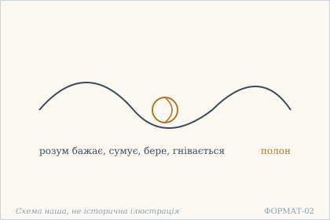
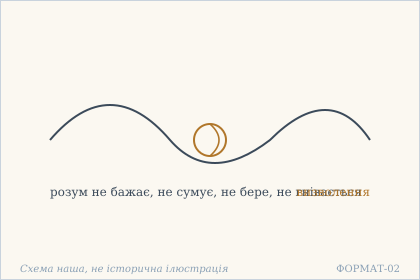
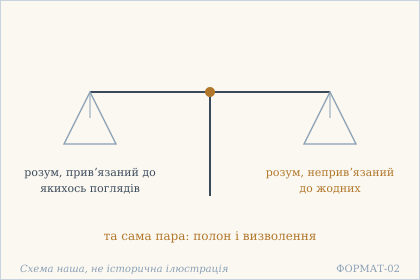
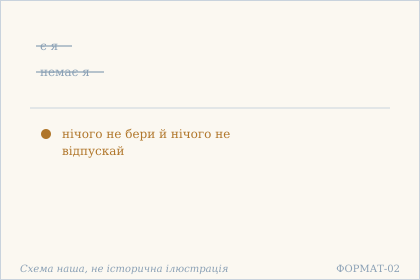

# Аштавакра-ґіта. Глава 8. Наукове представлення

> ФОРМАТ-02: кожен вірш подано пʼятьма шарами — деванагарі, українська
> транслітерація, переклад, науковий коментар з українськими паралелями,
> ілюстрація. Плюс окремо — поетичний переклад (`poetychnyi/rozdil-8.md`).
>
> **Деванагарі тут — механічна** транслітерація поля `iast` з картки
> (`scripts/iast_to_devanagari.py`), а не окреме читання за рукописом.
> **Українська транслітерація** — теж механічна (`scripts/iast_to_ukrainian.py`,
> таблиця в `docs/TRANSLITERATSIIA.md`).
> **Українські паралелі** — наша інтерпретація, а не твердження про вплив;
> реєстр і правила — `paraleli.json` і `scripts/check_ukrainian_parallels.py`.
> **Схеми** — наші власні; жодна не є історичною ілюстрацією.
>
> Цей файл згенеровано; правити треба картки й `format-v2/rozdil-8.json`,
> а не його.

## Глава 8. Полон і визволення — в розумі

Восьма глава — чотири вірші, дві пари. Перша пара (8.1 і 8.2) побудована як дослівне заперечення: ті самі шість дієслів, у другому вірші кожне з часткою na. Друга пара міняє мірило: спершу привʼязаність до поглядів (8.3), далі саме слово я (8.4). Визволення тут не додає нічого — воно знімає рівно те, що було названо полоном.

## 8.1

**Деванагарі.** तदा बन्धो यदा चित्तं किञ्चिद् वाञ्छति शोचति । किञ्चिन् मुञ्चति गृह्णाति किञ्चिद् धृष्यति कुप्यति ॥

**Українська транслітерація.** тада бандго яда чіттам кіньчід ваньччаті шочаті | кіньчін муньчаті ґріхнаті кіньчід дгрішяті куп'яті ||

**Переклад.** Полон — тоді, коли розум чогось бажає, сумує, щось відпускає або бере, чомусь радіє чи гнівається.

**Построкове зіставлення (редакторська чернетка, не рецензовано).**

### Рядок а

**Деванагарі (механічно з IAST).** तदा बन्धो यदा चित्तं किञ्चिद् वाञ्छति शोचति

**IAST (з редакторської картки).** tadā bandho yadā cittaṃ kiñcid vāñchati śocati

**Українська транслітерація (механічна).** тада бандго яда чіттам кіньчід ваньччаті шочаті

**Український відповідник рядка.** Полон — тоді, коли розум чогось бажає, сумує,

**Коментар рядка (не рецензовано).** Кореляція tadā ... yadā пояснює, коли постає полон. У першому піврядку розум бажає й сумує; це два з шести дієслів переліку. Переклад залишає речення відкритим до наступного рядка.

### Рядок б

**Деванагарі (механічно з IAST).** किञ्चिन् मुञ्चति गृह्णाति किञ्चिद् धृष्यति कुप्यति

**IAST (з редакторської картки).** kiñcin muñcati gṛhṇāti kiñcid dhṛṣyati kupyati

**Українська транслітерація (механічна).** кіньчін муньчаті ґріхнаті кіньчід дгрішяті куп'яті

**Український відповідник рядка.** щось відпускає або бере, чомусь радіє чи гнівається.

**Коментар рядка (не рецензовано).** Другий піврядок завершує перелік: розум відпускає, бере, радіє та гнівається. Форма dhṛṣyati в джерельній картці не має остаточного лексикографічного розв'язання; відповідник «радіє» залишено без самовільного виправлення санскриту.

**Науковий коментар.** Визначення полону тут не метафізичне, а **описове**: шість дієслів, і кожне — звичайний рух розуму. Зверніть увагу, що «бере» і «відпускає» стоять в одному ряду з гнівом: вибір сам по собі є ознакою полону. Перелік не оцінює, а перелічує — і саме тому діє.

**Українська паралель (наша інтерпретація, не твердження про вплив).** *Григорій Сковорода*, «Сад божественних пісень». Наша паралель: у Сковороди буря пристрастей теж описана як рух усередині людини, а не як те, що приходить ззовні. Наше порівняння — за образом, не за джерелом.

**Ілюстрація.**  — Вузол полону: шість рухів розуму. Схема наша, не історична ілюстрація.

## 8.2

**Деванагарі.** तदा मुक्तिर् यदा चित्तं न वाञ्छति न शोचति । न मुञ्चति न गृह्णाति न हृष्यति न कुप्यति ॥

**Українська транслітерація.** тада муктір яда чіттам на ваньччаті на шочаті | на муньчаті на ґріхнаті на хрішяті на куп'яті ||

**Переклад.** Визволення — тоді, коли розум не бажає, не сумує, не відпускає й не бере, не радіє й не гнівається.

**Построкове зіставлення (редакторська чернетка, не рецензовано).**

### Рядок а

**Деванагарі (механічно з IAST).** तदा मुक्तिर् यदा चित्तं न वाञ्छति न शोचति

**IAST (з редакторської картки).** tadā muktir yadā cittaṃ na vāñchati na śocati

**Українська транслітерація (механічна).** тада муктір яда чіттам на ваньччаті на шочаті

**Український відповідник рядка.** Визволення — тоді, коли розум не бажає, не сумує,

**Коментар рядка (не рецензовано).** Кореляція tadā ... yadā пов'язує визволення зі станом розуму. Форми na vāñchati й na śocati називають перші два заперечені рухи — «не бажає» і «не сумує». Це початок одного речення, яке продовжується в другому піврядку.

### Рядок б

**Деванагарі (механічно з IAST).** न मुञ्चति न गृह्णाति न हृष्यति न कुप्यति

**IAST (з редакторської картки).** na muñcati na gṛhṇāti na hṛṣyati na kupyati

**Українська транслітерація (механічна).** на муньчаті на ґріхнаті на хрішяті на куп'яті

**Український відповідник рядка.** не відпускає й не бере, не радіє й не гнівається.

**Коментар рядка (не рецензовано).** Чотири повтори na завершують симетричний перелік: не відпускає, не бере, не радіє, не гнівається. Порівняння з 8.1 є редакторським зіставленням двох чинних карток; 8.2 має hṛṣyati, що не дає підстав автоматично замінювати dhṛṣyati у 8.1.

**Науковий коментар.** Вірш є **дослівним запереченням** попереднього: ті самі шість дієслів, кожне з часткою na. Це важливо для перекладу: будь-яка стилістична варіація тут зруйнує паралелізм, який і є аргументом. Визволення не додає нічого — воно знімає рівно те, що було названо полоном.

**Українська паралель (наша інтерпретація, не твердження про вплив).** *Леся Українка*, «Contra spem spero!» (1890). Наша паралель: у Лесі Українки рівновага теж не залежить від того, чи є надія. Наше порівняння — типологічне: обидва тексти описують стан, а не здобуток.

**Ілюстрація.**  — Той самий вузол, але кожен рух заперечено. Схема наша, не історична ілюстрація.

## 8.3

**Деванагарі.** तदा बन्धो यदा चित्तं सक्तं कास्वपि दृष्टिषु । तदा मोक्षो यदा चित्तम् असक्तं सर्वदृष्टिषु ॥

**Українська транслітерація.** тада бандго яда чіттам сактам касвапі дріштішу | тада мокшо яда чіттам асактам сарвадріштішу ||

**Переклад.** Полон — тоді, коли розум прив'язаний до якихось поглядів; визволення — коли розум неприв'язаний до всіх поглядів.

**Науковий коментар.** `dṛṣṭi` — «погляд» у подвійному сенсі: і зір, і переконання. Асиметрія навмисна: `kāsvapi` («до якихось») проти `sarva` («до всіх»). Тобто достатньо **однієї** прив'язаності, щоб бути в полоні, але потрібна неприв'язаність до **всіх** — і це не той самий обсяг вимог, що звучить суворіше, ніж здається з першого читання.

**Українська паралель (наша інтерпретація, не твердження про вплив).** *Микола Хвильовий*, «Я (Романтика)» (1924). Наша паралель: у Хвильового привʼязаність до власного погляду теж постає як те, що тримає міцніше за будь-яку зовнішню силу. Наше порівняння — за будовою думки.

**Ілюстрація.**  — Дві шальки: привʼязаність до поглядів і свобода від них. Схема наша, не історична ілюстрація.

## 8.4

**Деванагарі.** यदा नाहं तदा मोक्षो यदाहं बन्धनं तदा । मत्वेति हेलया किञ्चिन् मा गृहाण विमुञ्च मा ॥

**Українська транслітерація.** яда нахам тада мокшо ядахам бандганам тада | матветі хелая кіньчін ма ґріхана вімуньча ма ||

**Переклад.** Коли немає «я» — визволення; коли є «я» — полон. Так розуміючи, легко нічого не бери й нічого не відпускай.

**Науковий коментар.** Тут уперше названо причину, а не симптом: попередні три вірші описували рухи розуму, цей називає їхнє джерело — `aham`. `helayā` («легко, жартома») різко змінює тон: те, що виглядало як велика вимога, подане як щось майже незначне. І `mā … mā` — подвійна заборона: не бери й не відпускай, тобто не роби й самого жесту вибору.

**Українська паралель (наша інтерпретація, не твердження про вплив).** *Іван Багряний*, «Сад Гетсиманський» (1950). Наша паралель: у Багряного теж є думка, що остання вʼязниця людини — вона сама. Наше порівняння — типологічне, не твердження про вплив.

**Ілюстрація.**  — Я і його відсутність: легко не брати й не відпускати. Схема наша, не історична ілюстрація.

## Поетичний переклад

Окремо, у [`poetychnyi/rozdil-8.md`](poetychnyi/rozdil-8.md). Це **наш поетичний переклад**, не канонічний і не науковий; у PDF він іде окремою частиною.
