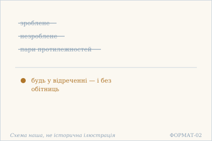
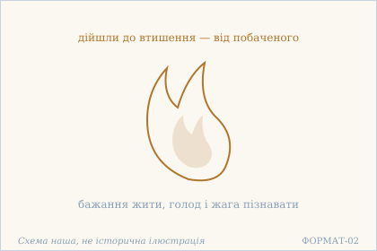
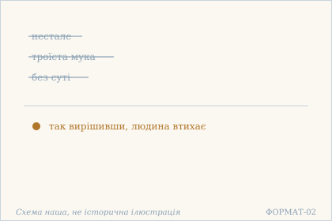
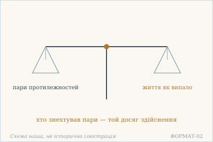
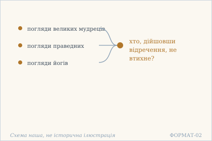
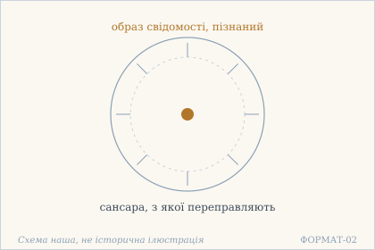
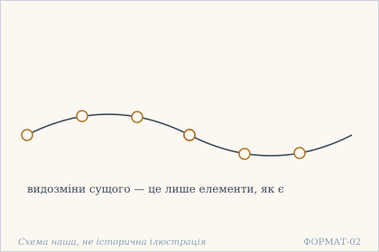
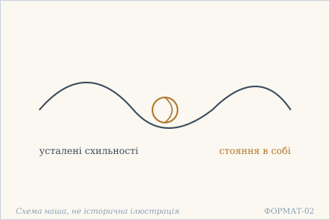

# Аштавакра-ґіта. Глава 9. Наукове представлення

> ФОРМАТ-02: кожен вірш подано пʼятьма шарами — деванагарі, українська
> транслітерація, переклад, науковий коментар з українськими паралелями,
> ілюстрація. Плюс окремо — поетичний переклад (`poetychnyi/rozdil-9.md`).
>
> **Деванагарі тут — механічна** транслітерація поля `iast` з картки
> (`scripts/iast_to_devanagari.py`), а не окреме читання за рукописом.
> **Українська транслітерація** — теж механічна (`scripts/iast_to_ukrainian.py`,
> таблиця в `docs/TRANSLITERATSIIA.md`).
> **Українські паралелі** — наша інтерпретація, а не твердження про вплив;
> реєстр і правила — `paraleli.json` і `scripts/check_ukrainian_parallels.py`.
> **Схеми** — наші власні; жодна не є історичною ілюстрацією.
> **Сцени** (`ilustratsii-naratyvni/`) — теж наші власні малюнки й теж не
> історичні: це ситуація вірша, а не поняття, і фігури там — силуети без
> облич.
>
> Цей файл згенеровано; правити треба картки й `format-v2/rozdil-9.json`,
> а не його.

## Глава 9. Відречення

Девʼята глава — вісім віршів про відречення, і жодного разу воно не постає як зусилля. Спершу пари протилежностей утихають самі (9.1), далі втихає бажання жити (9.2), далі річ виявляється без суті (9.3). Найгостріший вірш — 9.8: сансара названа просто усталеними схильностями, і тоді відречення зводиться до одного — відпустити їх.

## 9.1

**Деванагарі.** कृताकृते च द्वन्द्वानि कदा शान्तानि कस्य वा । एवं ज्ञात्वेह निर्वेदाद् भव त्यागपरो ऽव्रती ॥

**Українська транслітерація.** крітакріте ча двандвані када шантані кася ва | евам джнятвеха нірведад бгава тяґапаро ’враті ||

**Переклад.** Зроблене й незроблене, пари протилежностей — коли вони втихли і чиї вони? Так знаючи, будь тут, у відреченні, схильним до відкидання — і без обітниць.

**Построкове зіставлення (редакторська чернетка, не рецензовано).**

### Рядок а

**Деванагарі (механічно з IAST).** कृताकृते च द्वन्द्वानि कदा शान्तानि कस्य वा

**IAST (з редакторської картки).** kṛtākṛte ca dvandvāni kadā śāntāni kasya vā

**Українська транслітерація (механічна).** крітакріте ча двандвані када шантані кася ва

**Український відповідник рядка.** Зроблене й незроблене, пари протилежностей — коли вони втихли і чиї вони?

**Коментар рядка (не рецензовано).** Питальні слова kadā («коли?») і kasya vā («чиї?») завершують перший друкований піврядок. dvandvāni — «пари протилежностей»; kṛtākṛte потребує окремої морфологічної звірки, тому українське «зроблене й незроблене» лишається чинним робочим відповідником, а не остаточно встановленим граматичним рішенням.

### Рядок б

**Деванагарі (механічно з IAST).** एवं ज्ञात्वेह निर्वेदाद् भव त्यागपरो ऽव्रती

**IAST (з редакторської картки).** evaṃ jñātveha nirvedād bhava tyāgaparo 'vratī

**Українська транслітерація (механічна).** евам джнятвеха нірведад бгава тяґапаро ’враті

**Український відповідник рядка.** Так знаючи, будь тут, у відреченні, схильним до відкидання — і без обітниць.

**Коментар рядка (не рецензовано).** evaṃ jñātvā («так пізнавши») передує наказовому bhava («будь»); nirvedād вказує на підставу відречення. tyāgaparaḥ («схильний до відкидання») поєднано з avratī («без обітниць»): внутрішнє відречення не перетворюється на припис нової обітниці. GRETIL і SARIT по-різному позначають сегментацію nirvedād bhava / nirvedādbhava та 'vratī / +avratī; це не доказ незалежного рукописного різночитання.

**Науковий коментар.** `avratī` («без обітниць») — не дрібниця: текст водночас радить `tyāga` (відкидання) і знімає `vrata` (обітницю). Тобто відкидання не повинно стати новою дисципліною — інакше воно перетвориться на те, від чого відкидають. Питання `kasya vā` («і чиї ж вони?») залишене без відповіді навмисно.

**Українська паралель (наша інтерпретація, не твердження про вплив).** *Олександр Потебня*, «Думка й мова» (1862). Наша паралель: Потебня теж питає, чиї насправді ті пари, якими ми міряємо світ, — і відповідь у нього не в речах, а в тому, хто міряє. Наше порівняння — типологічне.

**Ілюстрація.**  — Пари протилежностей втихли: лишається відречення без обітниць. Схема наша, не історична ілюстрація.

## 9.2

**Деванагарі.** कस्यापि तात धन्यस्य लोकचेष्टावलोकनात् । जीवितेच्छा बुभुक्षा च बुभुत्सोपशमं गताः ॥

**Українська транслітерація.** касяпі тата дганяся локачештавалоканат | джівітечча бубгукша ча бубгутсопашамам ґатах ||

**Переклад.** У якогось щасливого, любий, від споглядання того, як поводиться світ, бажання жити, голод і жага пізнавати дійшли до втишення.

**Построкове зіставлення (редакторська чернетка, не рецензовано).**

### Рядок а

**Деванагарі (механічно з IAST).** कस्यापि तात धन्यस्य लोकचेष्टावलोकनात्

**IAST (з редакторської картки).** kasyāpi tāta dhanyasya lokaceṣṭāvalokanāt

**Українська транслітерація (механічна).** касяпі тата дганяся локачештавалоканат

**Український відповідник рядка.** У якогось щасливого, любий, від споглядання того, як поводиться світ,

**Коментар рядка (не рецензовано).** Родовий зворот kasyāpi ... dhanyasya («якогось щасливого») окреслює особу, а tāta — звертання до співрозмовника («любий»). Аблатив lokaceṣṭāvalokanāt пояснює підставу: від споглядання руху й учинків світу. Це повідомлення про досвід, а не наказ споглядати за певним правилом.

### Рядок б

**Деванагарі (механічно з IAST).** जीवितेच्छा बुभुक्षा च बुभुत्सोपशमं गताः

**IAST (з редакторської картки).** jīvitecchā bubhukṣā ca bubhutsopaśamaṃ gatāḥ

**Українська транслітерація (механічна).** джівітечча бубгукша ча бубгутсопашамам ґатах

**Український відповідник рядка.** бажання жити, голод і жага пізнавати дійшли до втишення.

**Коментар рядка (не рецензовано).** jīvitecchā («бажання жити») та bubhukṣā («голод») названі разом; у третьому понятті йдеться про жагу пізнавати. SARIT має bubhutsopaśamaṃ gatāḥ, а GRETIL/TextGrid, за задокументованою звіркою Issue #227, — bubhutsopaśamaḥ gatāḥ: різниця -ṃ / -ḥ відкрита й змінює можливий синтаксичний розбір. Не вважати електронні читання рукописною колацією. Втишення бажань у цьому контексті не дорівнює заклику до бездіяльності.

**Науковий коментар.** Три подібні іменники стоять поруч: `jīvitecchā` (бажання жити), `bubhukṣā` (голод) і `bubhutsā` (жага пізнавати) — останнє те саме слово, що в 10.5, і словник має бути спільним. Причина названа одна й зовнішня: **споглядання** того, як поводиться світ, а не зусилля над собою. `tāta` — ласкаве звертання, не «батько».

**Українська паралель (наша інтерпретація, не твердження про вплив).** *Леся Українка*, «Оргія» (1913). Наша паралель: у Лесі Українки бажання жити теж утихає не від зусилля, а від побаченого. Наше порівняння — за способом бачити.

**Ілюстрація.**  — Полумʼя, що втихло: бажання жити й жага пізнавати. Схема наша, не історична ілюстрація.

## 9.3

**Деванагарі.** अनित्यं सर्वम् एवेदं तापत्रितयदूषितम् । असारं निन्दितं हेयम् इति निश्चित्य शाम्यति ॥

**Українська транслітерація.** анітям сарвам еведам тапатрітаядушітам | асарам ніндітам хеям іті нішчітя шам'яті ||

**Переклад.** Усе це нестале, зіпсоване троїстою мукою, без суті, осуджене, гідне відкинення — так вирішивши, людина втихає.

**Построкове зіставлення (редакторська чернетка, не рецензовано).**

### Рядок а

**Деванагарі (механічно з IAST).** अनित्यं सर्वम् एवेदं तापत्रितयदूषितम्

**IAST (з редакторської картки).** anityaṃ sarvam evedaṃ tāpatritayadūṣitam

**Українська транслітерація (механічна).** анітям сарвам еведам тапатрітаядушітам

**Український відповідник рядка.** Усе це нестале, зіпсоване троїстою мукою,

**Коментар рядка (не рецензовано).** anityaṃ («нестале») характеризує sarvam eva idam («усе це»); tāpa-tritaya-dūṣitam — «уражене троїстою мукою». Сам цей піврядок не називає окремо трьох її різновидів: конкретний перелік належить до пояснення традиції, а не до буквального санскритського рядка. Українське «усе це» зберігає вказівний наголос idam.

### Рядок б

**Деванагарі (механічно з IAST).** असारं निन्दितं हेयम् इति निश्चित्य शाम्यति

**IAST (з редакторської картки).** asāraṃ ninditaṃ heyam iti niścitya śāmyati

**Українська транслітерація (механічна).** асарам ніндітам хеям іті нішчітя шам'яті

**Український відповідник рядка.** без суті, осуджене, гідне відкинення — так вирішивши, людина втихає.

**Коментар рядка (не рецензовано).** asāraṃ («без суті»), ninditaṃ («осуджене»), heyam («те, що належить відкинути») продовжують низку оцінок мінливого. iti niścitya — «так визначивши / дійшовши висновку», після чого śāmyati означає «втихає». Ця синтаксична послідовність описує втишення після розпізнання, а не наказ нехтувати щоденними обов'язками чи здоров'ям.

**Науковий коментар.** `tāpa-tritaya` («троїста мука») — усталена формула: мука від себе, від інших і від природи; переклад має лишити її як формулу, а не розтлумачувати в тексті вірша. П'ять означень ідуть підряд, і кожне сильніше за попереднє: від `anitya` (нестале) до `heya` (гідне відкинення). Втишення тут — **наслідок рішення**, а не почуття.

**Українська паралель (наша інтерпретація, не твердження про вплив).** *Ольга Кобилянська*, «Земля» (1902). Наша паралель: у Кобилянської речі, за які тримаються, теж виявляються несталими й без суті. Наше порівняння — типологічне, не твердження про джерело.

**Ілюстрація.**  — Нестале й троїста мука відкинуті — людина втихає. Схема наша, не історична ілюстрація.

## 9.4

**Деванагарі.** को ऽसौ कालो वयः किं वा यत्र द्वन्द्वानि नो नृणाम् । तान्य् उपेक्ष्य यथाप्राप्तवर्ती सिद्धिम् अवाप्नुयात् ॥

**Українська транслітерація.** ко ’сау кало ваях кім ва ятра двандвані но нрінам | танй упекшя ятхапраптаварті сіддгім авапнуят ||

**Переклад.** Який же той час, вік або що — коли в людей немає пар протилежностей? Знехтувавши їх, хто живе як випало, той досяг би здійснення.

**Построкове зіставлення (редакторська чернетка, не рецензовано).**

### Рядок а

**Деванагарі (механічно з IAST).** को ऽसौ कालो वयः किं वा यत्र द्वन्द्वानि नो नृणाम्

**IAST (з редакторської картки).** ko 'sau kālo vayaḥ kiṃ vā yatra dvandvāni no nṛṇām

**Українська транслітерація (механічна).** ко ’сау кало ваях кім ва ятра двандвані но нрінам

**Український відповідник рядка.** Який же той час, вік або що — коли в людей немає пар протилежностей?

**Коментар рядка (не рецензовано).** Початкове ko 'sau kālo («який же той час») та vayaḥ kiṃ vā («вік або що») утворюють риторичне питання. У сполученні yatra dvandvāni no nṛṇām слово no передає заперечення наявності «пар протилежностей» (dvandvāni) серед людей (nṛṇām), а не присвійне «наших». Питання не обіцяє, що певний вік звільнить людину від протилежностей.

### Рядок б

**Деванагарі (механічно з IAST).** तान्य् उपेक्ष्य यथाप्राप्तवर्ती सिद्धिम् अवाप्नुयात्

**IAST (з редакторської картки).** tāny upekṣya yathāprāptavartī siddhim avāpnuyāt

**Українська транслітерація (механічна).** танй упекшя ятхапраптаварті сіддгім авапнуят

**Український відповідник рядка.** Знехтувавши їх, хто живе як випало, той досяг би здійснення.

**Коментар рядка (не рецензовано).** tāny upekṣya («не зважаючи на них / відкинувши їх») відсилає до попередніх dvandvāni. yathāprāptavartī буквально окреслює людину, яка живе відповідно до того, що трапляється; це не твердження, ніби обов'язки зникають. siddhim avāpnuyāt містить потенційно-умовну форму avāpnuyāt («досяг би»): переклад не повинен перетворювати її на безумовну обіцянку.

**Науковий коментар.** Питання риторичне й знецінювальне: не існує такого віку, коли пар немає, — отже, чекати на них марно. `yathāprāpta-vartī` («той, хто живе як випало») — той самий принцип, що `yadṛcchā` у 3.14 і 4.4, і в перекладі він має звучати так само. `avāpnuyāt` — умовний спосіб: «досяг би», а не «досягне»; це не обіцянка.

**Українська паралель (ПОТРЕБУЄ ПЕРЕВІРКИ).** *українська філософська лірика*, не визначено. ПОТРЕБУЄ ПЕРЕВІРКИ: думка, що жити як випало — це і є здійснення, близька до української філософської лірики, але конкретного твору ми не звірили.

**Ілюстрація.**  — Дві шальки: пари протилежностей і життя як випало. Схема наша, не історична ілюстрація.

## 9.5

**Деванагарі.** नाना मतं महर्षीणां साधूनां योगिनां तथा । दृष्ट्वा निर्वेदम् आपन्नः को न शाम्यति मानवः ॥

**Українська транслітерація.** нана матам махаршінам садгунам йоґінам татха | дріштва нірведам апаннах ко на шам'яті манавах ||

**Переклад.** Побачивши, скільки різних поглядів мають великі мудреці, праведні й йоги, — хто, дійшовши відречення, не втихне?

**Построкове зіставлення (редакторська чернетка, не рецензовано).**

### Рядок а

**Деванагарі (механічно з IAST).** नाना मतं महर्षीणां साधूनां योगिनां तथा

**IAST (з редакторської картки).** nānā mataṃ maharṣīṇāṃ sādhūnāṃ yogināṃ tathā

**Українська транслітерація (механічна).** нана матам махаршінам садгунам йоґінам татха

**Український відповідник рядка.** Побачивши, скільки різних поглядів мають великі мудреці, праведні й йоги, —

**Коментар рядка (не рецензовано).** nānā mataṃ («різноманітні погляди») стосується maharṣi, sādhu та yogin — трьох позначень духовних авторитетів, наведених у родовому множини. Текстологічна примітка: SARIT 9.5 передає maharṣīṇāṃ, тоді як GRETIL Avg_9.5 має maharṣīṣāṃ; це відмінність цифрових читань, а не доведене різночитання рукописів. Тут відтворено IAST чинної редакторської картки.

### Рядок б

**Деванагарі (механічно з IAST).** दृष्ट्वा निर्वेदम् आपन्नः को न शाम्यति मानवः

**IAST (з редакторської картки).** dṛṣṭvā nirvedam āpannaḥ ko na śāmyati mānavaḥ

**Українська транслітерація (механічна).** дріштва нірведам апаннах ко на шам'яті манавах

**Український відповідник рядка.** хто, дійшовши відречення, не втихне?

**Коментар рядка (не рецензовано).** dṛṣṭvā («побачивши») позначає попередню дію, nirvedam āpannaḥ — людину, яка дійшла стану розчарування чи неприв'язаності, а ko na śāmyati mānavaḥ формує риторичне питання. Вірш не є доказом непридатності кожного вчителя; це інтерпретація зіткнення різних поглядів, а не наказ відмовитися від знання.

**Науковий коментар.** Риторичне питання з відповіддю «ніхто». Важливий перелік: `maharṣi`, `sādhu`, `yogin` — три різні авторитети, і текст показує, що **вони не згодні між собою**. Відречення тут походить не від безладдя світу, а від розбіжності авторитетів — це сильніше й конкретніше.

**Українська паралель (наша інтерпретація, не твердження про вплив).** *Євген Плужник*, «Рання осінь» (1927). Наша паралель: у Плужника розгубленість перед безліччю людських поглядів теж приводить до тиші, а не до нового погляду. Наше порівняння — за будовою думки.

**Ілюстрація.**  — Багато поглядів сходяться до тиші. Схема наша, не історична ілюстрація.

## 9.6

**Деванагарі.** कृत्वा मूर्तिपरिज्ञानं चैतन्यस्य न किं गुरुः । निर्वेदसमतायुक्त्या यस् तारयति संसृतेः ॥

**Українська транслітерація.** крітва муртіпаріджнянам чайтаняся на кім ґурух | нірведасаматаюктя яс тараяті самсрітех ||

**Переклад.** Хто, пізнавши образ свідомості, — чи не вчитель? — той через відречення, рівність і з'єднаність переправляє з сансари.

**Построкове зіставлення (редакторська чернетка, не рецензовано).**

### Рядок а

**Деванагарі (механічно з IAST).** कृत्वा मूर्तिपरिज्ञानं चैतन्यस्य न किं गुरुः

**IAST (з редакторської картки).** kṛtvā mūrtiparijñānaṃ caitanyasya na kiṃ guruḥ

**Українська транслітерація (механічна).** крітва муртіпаріджнянам чайтаняся на кім ґурух

**Український відповідник рядка.** Хто, пізнавши образ свідомості, — чи не вчитель? —

**Коментар рядка (не рецензовано).** kṛtvā mūrtiparijñānaṃ та caitanyasya пов'язують пізнання з образом або виявом свідомості; na kiṃ guruḥ має питальну силу «чи не вчитель?». Синтаксис нетривіальний: перша частина не містить наказу безумовно підкорятися наставникові.

### Рядок б

**Деванагарі (механічно з IAST).** निर्वेदसमतायुक्त्या यस् तारयति संसृतेः

**IAST (з редакторської картки).** nirvedasamatāyuktyā yas tārayati saṃsṛteḥ

**Українська транслітерація (механічна).** нірведасаматаюктя яс тараяті самсрітех

**Український відповідник рядка.** той через відречення, рівність і з'єднаність переправляє з сансари.

**Коментар рядка (не рецензовано).** nirveda-samatā-yuktyā — форма орудного відмінка: засіб, пов'язаний із неприв'язаністю, рівновагою та способом їх поєднання; yas tārayati saṃsṛteḥ — «хто переправляє із сансари». Образ переправи не вказує конкретної фізичної річки чи історичної події; додавати їх до наукового перекладу не слід.

**Науковий коментар.** Єдине місце в книзі, де `guru` названо **позитивно** і з означенням: учитель — той, хто пізнав `caitanya`. Але й тут текст не вимагає послуху: `tārayati` — «переправляє», дієслово руху, а не влади. Три складники (`nirveda`, `samatā`, `yukti`) подані як спосіб дії, а не як чесноти вчителя.

**Українська паралель (наша інтерпретація, не твердження про вплив).** *Григорій Сковорода*, «Кільце. Дружня розмова про душевний мир». Наша паралель: у Сковороди рівність теж є тим, через що людина виходить із кола, у якому її тримали. Наше порівняння — типологічне.

**Ілюстрація.**  — Переправа з сансари: центр — пізнаний образ свідомості. Схема наша, не історична ілюстрація.

## 9.7

**Деванагарі.** पश्य भूतविकारांस् त्वं भूतमात्रान् यथार्थतः । तत्क्षणाद् बन्धनिर्मुक्तः स्वरूपस्थो भविष्यसि ॥

**Українська транслітерація.** пашя бгутавікарамс твам бгутаматран ятхартхатах | таткшанад бандганірмуктах сварупастхо бгавішясі ||

**Переклад.** Дивись на видозміни сущого як на самі лише елементи, як є насправді — і тієї ж миті, вільний від пут, станеш тим, хто стоїть у власній формі.

**Построкове зіставлення (редакторська чернетка, не рецензовано).**

### Рядок а

**Деванагарі (механічно з IAST).** पश्य भूतविकारांस् त्वं भूतमात्रान् यथार्थतः

**IAST (з редакторської картки).** paśya bhūtavikārāṃs tvaṃ bhūtamātrān yathārthataḥ

**Українська транслітерація (механічна).** пашя бгутавікарамс твам бгутаматран ятхартхатах

**Український відповідник рядка.** Дивись на видозміни сущого як на самі лише елементи, як є насправді —

**Коментар рядка (не рецензовано).** paśya — наказовий спосіб «дивись»; bhūta-vikārān і bhūta-mātrān співвідносять видозміни й елементи. yathārthataḥ уточнює спосіб сприйняття — «як є насправді». Це заклик до розрізнення в межах філософського тексту, не твердження про сучасну фізику чи медицину.

### Рядок б

**Деванагарі (механічно з IAST).** तत्क्षणाद् बन्धनिर्मुक्तः स्वरूपस्थो भविष्यसि

**IAST (з редакторської картки).** tatkṣaṇād bandhanirmuktaḥ svarūpastho bhaviṣyasi

**Українська транслітерація (механічна).** таткшанад бандганірмуктах сварупастхо бгавішясі

**Український відповідник рядка.** і тієї ж миті, вільний від пут, станеш тим, хто стоїть у власній формі.

**Коментар рядка (не рецензовано).** tatkṣaṇāt («тієї ж миті») визначає часовий перехід; bandha-nirmuktaḥ («звільнений від пут») і svarūpa-sthaḥ («той, хто перебуває у власній формі») описують очікуваний стан. bhaviṣyasi є майбутнім часом «станеш», а не минулим описом уже досягнутого.

**Науковий коментар.** `tatkṣaṇāt` («тієї ж миті») — найсильніше слово вірша: не поступово, не через практику, а негайно. `bhūtamātra` («самі лише елементи») знімає оцінку з речей: вони не погані й не добрі, вони — складники. `svarūpastha` («той, хто стоїть у власній формі») — стан, а не дія; і `bhaviṣyasi` — майбутній час, тому це не опис того, що вже є, а вказівка на те, що станеться.

**Українська паралель (наша інтерпретація, не твердження про вплив).** *Володимир Свідзінський*, «Медобір» (1975, посмертно). Наша паралель: у Свідзінського річ теж розкладається на те, з чого вона є, і саме так стає видимою. Наше порівняння — за образом.

**Ілюстрація.**  — Видозміни розібрані на елементи, як намистини на нитці. Схема наша, не історична ілюстрація.

## 9.8

**Деванагарі.** वासना एव संसार इति सर्वा विमुञ्च ताः । तत्त्यागो वासनात्यागात् स्थितिरद्य यथा तथा ॥

**Українська транслітерація.** васана ева самсара іті сарва вімуньча тах | таттяґо васанатяґат стхітірадя ятха татха ||

**Переклад.** Сансара — це саме усталені схильності, так; відпусти їх усі. Їх відкидання — через відкидання схильностей; стояння в собі — нині, так чи інакше.

**Построкове зіставлення (редакторська чернетка, не рецензовано).**

### Рядок а

**Деванагарі (механічно з IAST).** वासना एव संसार इति सर्वा विमुञ्च ताः

**IAST (з редакторської картки).** vāsanā eva saṃsāra iti sarvā vimuñca tāḥ

**Українська транслітерація (механічна).** васана ева самсара іті сарва вімуньча тах

**Український відповідник рядка.** Сансара — це саме усталені схильності, так; відпусти їх усі.

**Коментар рядка (не рецензовано).** vāsanā пов'язано із saṃsāra, а sarvā ... tāḥ указує на множину схильностей, які закликають відпустити; vimuñca — наказова форма. Це філософський контекст звички й прив'язаності, не порада відмовлятися від медичної допомоги, соціальних зв'язків чи відповідальності.

### Рядок б

**Деванагарі (механічно з IAST).** तत्त्यागो वासनात्यागात् स्थितिरद्य यथा तथा

**IAST (з редакторської картки).** tattyāgo vāsanātyāgāt sthitiradya yathā tathā

**Українська транслітерація (механічна).** таттяґо васанатяґат стхітірадя ятха татха

**Український відповідник рядка.** Їх відкидання — через відкидання схильностей; стояння в собі — нині, так чи інакше.

**Коментар рядка (не рецензовано).** tat-tyāgaḥ та vāsanā-tyāgāt повторюють корінь tyāga («відкидання») у різних граматичних відношеннях; sthitir adya «перебування нині», yathā tathā «так чи інакше». Переклад не повинен вигадувати конкретного ритуалу або гарантувати миттєвий зовнішній результат.

**Науковий коментар.** Вірш закінчує главу визначенням, а не обіцянкою: сансара — не світ, а `vāsanā`, усталені схильності. `yathā tathā` («так чи інакше») знімає вимогу до способу: результат не залежить від того, як саме це станеться. Друга половина повторює те саме слово двічі (`tyāga`), і повтор тут не недогляд — він показує, що відкидання схильностей і є відкиданням, а не засобом до нього.

**Українська паралель (наша інтерпретація, не твердження про вплив).** *Леся Українка*, «Бояриня» (1910). Наша паралель: у Лесі Українки схильності, засвоєні звичкою, теж тримають людину міцніше за будь-який наказ. Наше порівняння — типологічне.

**Ілюстрація.**  — Вузол схильностей і стояння в собі. Схема наша, не історична ілюстрація.

## Поетичний переклад

Окремо, у [`poetychnyi/rozdil-9.md`](poetychnyi/rozdil-9.md). Це **наш поетичний переклад**, не канонічний і не науковий; у PDF він іде окремою частиною.
