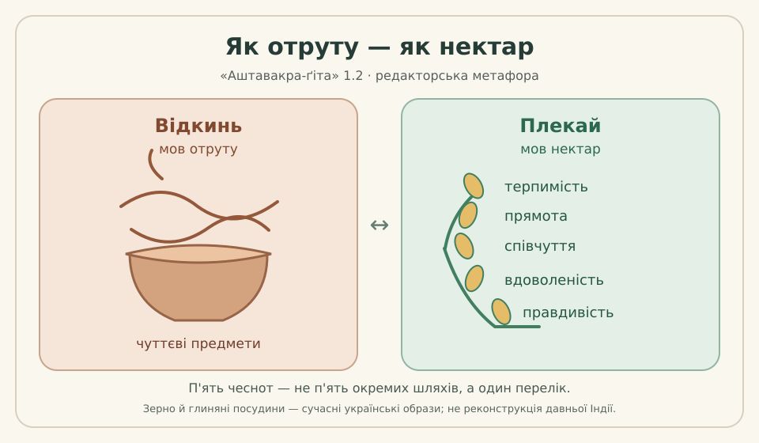

# ІЛЮСТРАЦІЯ-01: вірш 1.2 — «отрута / нектар»

**Редакторська проба, не затверджене книжкове оформлення і не дозвіл на публікацію.** [Issue #598](https://github.com/juv4uk/ukrainian-books/issues/598).

## Санскритська підстава

За [редакторською карткою 1.2](../cards/1.2.json) та [науковою робочою главою 1](../../books/ashtavakra-gita/rozdil-1-naukove.md) **viṣavat** означає «як отруту», **pīyūṣavat** — «як нектар». Вірш радить відкинути предмети чуттів (**viṣayān**) і плекати п'ять чеснот: **kṣamā** — терпимість; **ārjava** — прямота; **dayā** — співчуття; **toṣa** — вдоволеність; **satya** — правдивість. Порівняння не слід читати як твердження про буквальну отруту чи медичну дію нектару.

Джерельні локатори: [GRETIL, Avg_1.2](https://www.gretil.uni-goettingen.de/gretil/corpustei/transformations/html/sa_aSTAvakragItA.htm); [SARIT, verse_1.2](https://github.com/sarit/SARIT-corpus/blob/master/astavakragita.xml). Це цифрові свідки з окремими умовами прав, не доведені критичні видання. Ілюстрація не копіює жодного давнього чи сучасного малюнка.

## Що є сучасною українською асоціацією

**Глиняні посудини й зернини відсутні в санскритському вірші.** Їх використано як авторські сучасні українські засоби пояснення протиставлення. Ліві умовні вихори символізують чуттєві принади, а праві **п'ять** зернин поіменно відображають перелік чеснот. Це не реконструкція історичної індійської іконографії й не доказ філософського тлумачення.

Українських поетів чи мислителів у малюнку навмисно не цитовано: це вимагало б конкретних бібліографічних доказів і визначення меж аналогії. Додавати такі паралелі дозволено лише в окремому рецензованому коментарі.

## Доступність, авторство, статус

- Оригінальний [векторний SVG](1-2-otruta-nektar.svg) має полотно 960 × 560, контрастні українські підписи та внутрішні елементи SVG title і desc; немає JavaScript, мережевих зображень чи сторонніх шрифтів.
- Альтернативний опис: «Дві посудини. Ліворуч — вихори чуттєвих принад із закликом відкинути їх, мов отруту. Праворуч — п'ять зернин із назвами терпимості, прямоти, співчуття, вдоволеності й правдивості, які слід плекати, мов нектар».
- Авторство: самостійно намальований редакторський векторний ескіз цього внеску. Чинна ліцензія власних матеріалів **«ВОЛЬНІСТЬ»** не змінена. Вона не поширюється автоматично на цифрові транскрипції SARIT/GRETIL.
- **Статус: чернетка.** Незалежного санскритологічного, художнього й правового схвалення всієї книги немає. Не переносити автоматично до books/ і не називати готовим виданням.

**Приймання перед майбутньою публікацією:** звірка метафори з санскритом, редакторська оцінка читабельності, доступності, авторства й прав, незалежний Review та новий PR для включення до схваленого наукового тому.
