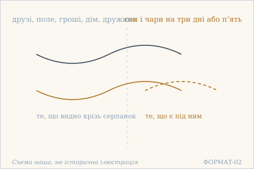

# «Аштавакра-ґіта» 10.2 — построкове науково-редакторське вирівнювання

> **Дослідницька чернетка, не готова до видання.** Джерело для цього зразка —
> наявна [редакторська картка 10.2](../cards/10.2.json), а не нове
> безпосереднє звіряння рукопису. Деванагарі механічно отримано з IAST;
> українська передача звука є практичною редакторською проєкцією.
> **Права на відтворення електронних санскритських читань не підтверджені,
> незалежної санскритологічної та літературної рецензії немає.**

## Походження та межі

- **GRETIL:** [Avg_10.2](https://www.gretil.uni-goettingen.de/gretil/corpustei/transformations/html/sa_aSTAvakragItA.htm) — локатор, `checked_on: null` у чинній картці. Без доказів повторного живого звіряння.
- **SARIT:** [verse_10.2](https://github.com/sarit/SARIT-corpus/blob/master/astavakragita.xml) — картка фіксує `checked_on: 2026-10-31`; це електронний свідок, **не критичне видання**.
- **Картка:** `status: чернетка`, `author: null`, `variants_checked: false`, `rights.verified: false`; поля `reviewer`, `reviewed_on` і `review_url` не заповнені.
- **Принцип поділу:** «Рядок а» і «Рядок б» відповідають двом частинам IAST, відділеним `|`. Це редакторський поділ **друкованих піврядків**, не самостійний висновок про межі чотирьох метричних *pāda*. Переклад вирівнюється **за змістом**, бо граматичний додаток стоїть у наступному рядку.
- **Обмеження:** подані нижче два українські сегменти — нова редакторська пропозиція для построкового макета; незмінний суцільний переклад картки наведено окремо для перевірки.

## 10.2

### Рядок а

**Деванагарі.** स्वप्नेन्द्रजालवत् पश्य दिनानि त्रीणि पञ्च वा ।

**IAST.** svapnendrajālavat paśya dināni trīṇi pañca vā |

**Українська транслітерація.** свапнендраджалават пашья дінані тріні панча ва |

**Український відповідник (редакторська проба).** Дивись на [перелічені далі надбання] як на сон і чари — на три дні або п’ять.

**Граматичний коментар.** `paśya` — наказовий спосіб другої особи однини («дивись»); словосполука `svapnendrajālavat` установлює спосіб сприйняття: «немов сон і чарівна вистава». `dināni trīṇi pañca vā` буквально містить «три дні або п'ять» — образ короткочасності, **не датування** подій. Додаток до `paśya` стоїть лише в рядку б, тому пояснювальні квадратні дужки введено свідомо й вони **не є словами санскритського оригіналу**.

### Рядок б

**Деванагарі.** मित्रक्षेत्रधनागारदारदायादिसंपदः ॥

**IAST.** mitrakṣetradhanāgāradāradāyādisaṃpadaḥ ||

**Українська транслітерація.** мітракшетрадганаґарадарадаядісампадах ||

**Український відповідник (редакторська проба).** Друзів, поле, гроші, дім, дружину, спадок та інші багатства.

**Граматичний коментар.** Довгий складений іменник подає низку конкретних зв'язків і надбань, а не абстрактне «все»: `mitra` (друзі), `kṣetra` (поле), `dhana` (гроші / майно), `āgāra` (дім), `dāra` (дружина), `dāya` (спадок), `ādi` (тощо), `saṃpadaḥ` (надбання). Граматичну роль складника й варіанти цифрової графіки ще належить перевірити фахово; список становить змістовий додаток до **«дивись» із рядка а**. Розірваний на дві українські фрази, цей синтаксичний зв'язок не можна загубити.

## Контроль незмінності чинного українського перекладу

> Дивись на друзів, поле, гроші, дім, дружину, спадок і решту багатств як на сон і чари — на три дні або п'ять.

Це **дослівно** поле `ukrainian_translation` із [картки 10.2](../cards/10.2.json). Нові відповідники для рядків а/б **не замінюють** ні це поле, ні [наукову главу 10](../../books/ashtavakra-gita/rozdil-10-naukove.md); це матеріал для майбутньої філологічної редактури та контрольованої генерації.

## Науково-культурний коментар для українського читача

Вірш ставить поруч дуже впізнавані речі: друзів, землю, житло, родину, спадщину. Протиставлення **побутової конкретності** й образу **сну / чарівної вистави** нагадує про минущість володіння. Тут не доведено, що давній текст засуджує родинні зв'язки або працю; для такого твердження потрібен ширший контекст і текстологічне дослідження.

Можливе українське зіставлення — філософські роздуми Григорія Сковороди про зовнішнє надбання й внутрішню міру в «Алфавіті, чи Букварі миру». **Це наша попередня типологічна асоціація**, а не доведений історичний вплив і не цитата зі Сковороди. Для включення до академічного коментаря ще потрібне точне місце у перевіреному виданні українського автора.

## Ілюстрація та пояснення

*Повторно використана наявна власна SVG-схема книги «Побутові речі під серпанком: сон і чари»; не історична ілюстрація, не доказ джерельного читання. У цьому PR зображення не створено й не змінено.*

## Необхідні наступні перевірки

- Незалежно звірити санскритський рядок із джерелами й межі складного слова; `variants_checked` досі `false`.
- Затвердити українську практичну транслітерацію та точність двох окремих перекладних сегментів.
- Перевірити конкретне місце у творі Сковороди або вилучити порівняння.
- Отримати належне редакторське рецензування і визначити правовий режим відтворення цифрового санскритського читання перед включенням до видання.

**Ця чернетка не змінює академічний або поетичний том, правовий статус чи підсумкове покриття 298 віршів.**
