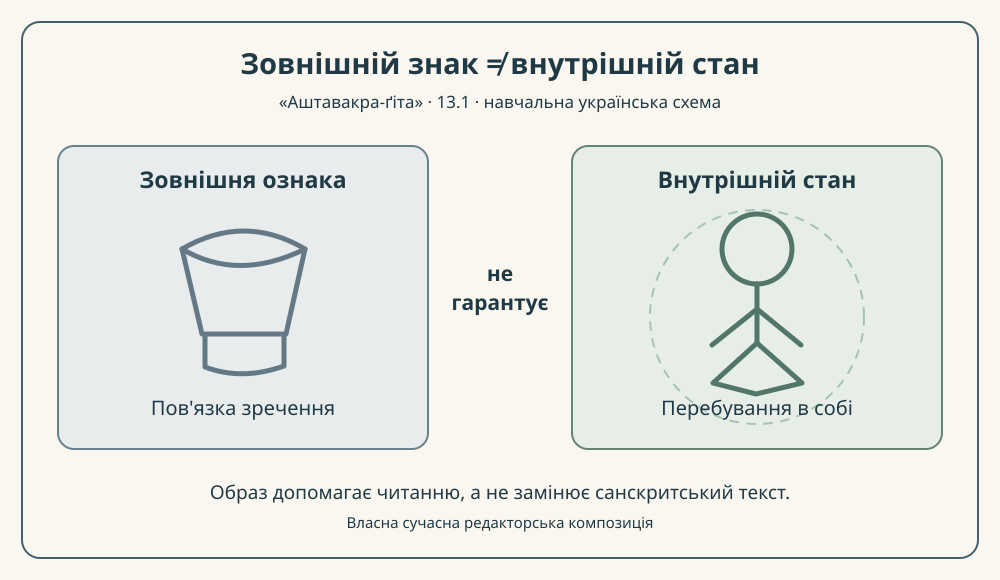

# «Аштавакра-ґіта» 13.1 — построковий науково-редакторський зразок

> **Робоча дослідницька чернетка, не готова до публікації.** Деванагарі механічно отримано з чинного поля IAST; це **не** незалежний рукописний свідок. Українська передача звука — незатверджена практична проєкція. Права на републікацію конкретних цифрових транскрипцій та незалежна санскритологічна й літературна рецензія **не підтверджені**.

## Джерело та метод

- [Редакторська картка 13.1](../cards/13.1.json), `status: чернетка`, `rights.verified: false`. Обидва українські речення нижче перенесені **дослівно** з її `ukrainian_translation`, без дописаних висновків.
- [GRETIL, Avg_13.1](https://gretil.sub.uni-goettingen.de/gretil/corpustei/transformations/html/sa_aSTAvakragItA.htm) та [SARIT TEI, verse_13.1](https://github.com/sarit/SARIT-corpus/blob/master/astavakragita.xml) — **два електронні записи** для перевірки читань, не два критичні видання й не дозволи на публікацію.
- У GRETIL початок передано `akiṃcanabhavaṃ`, у SARIT — `akiñcanabhavaṃ`. Цю різницю написання носового звука зафіксовано для рецензента; вона сама собою **не доводить** окремої рукописної традиції.
- «Рядок а» і «Рядок б» тут означають **два друковані санскритські піврядки** зі знаками `|` та `||`; точну метричну межу *pāda* окремо не встановлюємо.

## 13.1

### Рядок а

**Деванагарі.** अकिंचनभवं स्वास्थ्यं कौपीनत्वे ऽपि दुर्लभम् ।

**IAST.** akiṃcanabhavaṃ svāsthyaṃ kaupīnatve 'pi durlabham |

**Українська транслітерація.** акімчанабгавам свастхям каупінатве ’пі дурлабгам |

**Переклад.** Стан неволодіння — це бути в собі; навіть у жебрацькому поясі він рідкісний.

**Коментар.** У цій редакторській інтерпретації `akiṃcanabhavaṃ` описує стан неволодіння, `svāsthyaṃ` — перебування у власному стані, а `kaupīnatve 'pi durlabham` додає заперечення автоматичного наслідку зовнішньої аскези: навіть пов'язка зреченця сама собою не гарантує внутрішньої рівноваги. Точні граматичні зв'язки цих форм слід перевірити незалежно; тут **не приписано** давньому автору сучасних українських понять.

### Рядок б

**Деванагарі.** त्यागादाने विहायास्माद् अहम् आसे यथासुखम् ॥

**IAST.** tyāgādāne vihāyāsmād aham āse yathāsukham ||

**Українська транслітерація.** тяґадане віхаясмад ахам асе ятхасукхам ||

**Переклад.** Відкинувши віддавання й приймання, я сиджу, як мені завгодно.

**Коментар.** `tyāgādāne` — пара «віддавання — приймання»; `vihāya` передає дію «відкинувши», `aham āse` — «я сиджу / перебуваю», а `yathāsukham` — «як зручно, як мені завгодно». Це не тотожне твердженню про фізичну бездіяльність. Саме друга половина вводить мотив незалежності від **обох** протилежних способів ставлення до речей.

## Український читацький місток

Для українського читача контраст можна сформулювати без привласнення іншої традиції: **скромний одяг або бідність не є доказом духовної свободи; зовнішнє не тотожне внутрішньому**. Для майбутнього наукового коментаря можна окремо дослідити тему самопізнання в трактаті Григорія Сковороди [«Наркісс. Разглагол о том: узнай себе»](https://litopys.org.ua/skovoroda/skov109.htm). Це **пропозиція типологічного зіставлення**, не доказ історичного контакту чи тотожності адвайти і філософії Сковороди; точне текстове місце та межі паралелі ще потребують фахової звірки.

## Авторська пояснювальна ілюстрація

*Власна українська навчальна SVG-схема, не стародавня ілюстрація та не джерелознавчий доказ. Редакційна концепція «зовнішній знак ≠ внутрішній стан» пояснює саме перший рядок.*

## Межі й наступна перевірка

**Цілісність первісного перекладу (без зміни):** Стан неволодіння — це бути в собі; навіть у жебрацькому поясі він рідкісний. Відкинувши віддавання й приймання, я сиджу, як мені завгодно.

Надалі потрібно перевірити конкретні санскритські лексеми за незалежним фаховим оглядом, затвердити українську вимову, довести законність відтворення деванагарі, уточнити культурну паралель і отримати окремі редакторські висновки. **Повнота двох рядків цього вірша не засвідчує готовності решти 297 віршів або поетичного тому.**
