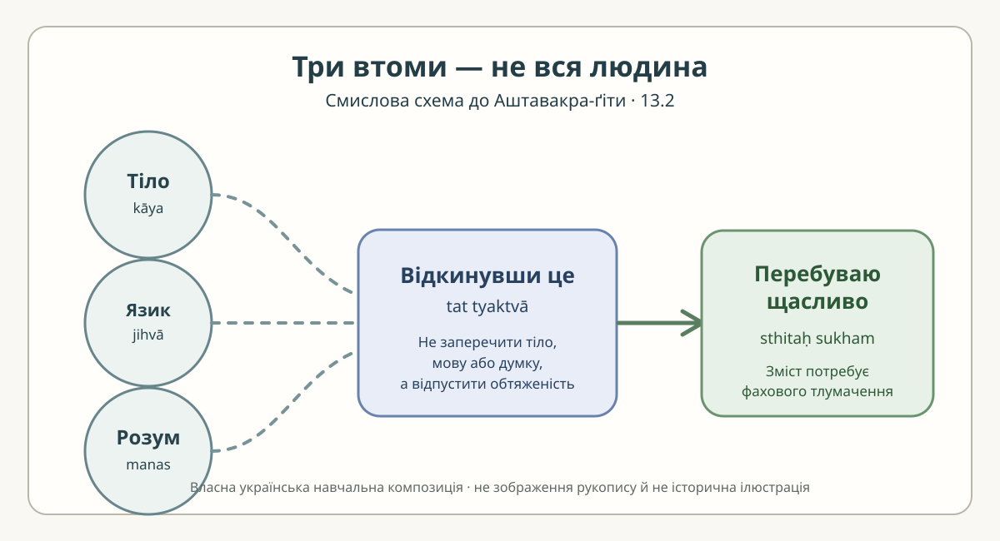

# Аштавакра-ґіта 13.2 — чотири пади, одна думка

> **Робоча построкова наукова чернетка; не затверджений переклад і не сторінка готового видання.**
> Деванагарі тут відтворює механічну редакторську проєкцію IAST чинної
> [картки 13.2](../cards/13.2.json), а не окремо перевірений рукопис.
> Українське звучання також є навчальною, не затвердженою фахівцем передачею.
> Чинні картку й книжкову главу не змінено.

## Чотири вирівняні рядки

### Рядок 1 — пада а

**Деванагарі.** कुत्रापि खेदः कायस्य ।

**IAST.** kutrāpi khedaḥ kāyasya |

**Українська транслітерація.** кутрапі кхедах каяся |

**Український відповідник.** Десь втомлюється тіло,

**Граматика.** `kāyasya` — родовий від «тіло»; `khedaḥ` — «втома, виснаження, докука». Український дієслівний відповідник передає стан, а не додає до санскритського першого рядка дієслово як окрему засвідчену лексему.

### Рядок 2 — пада б

**Деванагарі.** जिह्वा कुत्रापि खिद्यते ।

**IAST.** jihvā kutrāpi khidyate |

**Українська транслітерація.** джіхва кутрапі кхідяте |

**Український відповідник.** десь втомлюється язик,

**Граматика.** `jihvā` — «язик», що може метонімічно стосуватися мовлення; `khidyate` — «втомлюється». Не підмінюємо граматичний суб'єкт «язик» словом «мова» без позначення інтерпретації.

### Рядок 3 — пада в

**Деванагарі.** मनः कुत्रापि तत् त्यक्त्वा ।

**IAST.** manaḥ kutrāpi tat tyaktvā |

**Українська транслітерація.** манах кутрапі тат тяктва |

**Український відповідник.** десь розум — відкинувши це,

**Граматика.** `manaḥ` — «розум»; `tat` — «те / це»; `tyaktvā` — дієприслівникова форма «відкинувши». Межа між рядками не тотожна межі українського речення: розгортання `kutrāpi` тричі є ознакою структури оригіналу, а не трьома незалежними наказами.

### Рядок 4 — пада г

**Деванагарі.** पुरुषार्थे स्थितः सुखम् ॥

**IAST.** puruṣārthe sthitaḥ sukham ||

**Українська транслітерація.** пурушартхе стхітах сукхам ||

**Український відповідник.** я стою в меті людини, щасливо.

**Граматика.** `puruṣārthe` — місцевий однини від `puruṣārtha` («людська мета / ціль»); `sthitaḥ` — «той, хто стоїть, перебуває»; `sukham` — «щасливо, зручно». **Це не буквальна констатація, що «всі чотири цілі вже не потрібні»**: така думка є можливою сучасною філософською інтерпретацією, а не прямо висловленим граматичним твердженням.

## Повний наявний переклад без змін

> Десь втомлюється тіло, десь втомлюється язик, десь розум — відкинувши це, я стою в меті людини, щасливо.

Цей абзац **дослівно зберігає** поле `ukrainian_translation`
джерельної картки. Під час поділу на чотири пади перестановки
і пунктуація служать лише читанню; це **не** окремий новий
фінальний переклад.

## Науковий коментар — що сказано, а що лише тлумачиться

Тіло, язик і розум названі різними можливими носіями втоми. Тричі
повторене `kutrāpi` («десь / у чомусь») не перетворює вислів на
заперечення людської діяльності загалом. Перехід від `tat tyaktvā`
до `puruṣārthe sthitaḥ sukham` пов'язує відкидання названої
обтяженості з перебуванням у щасті або зручності.

Особливість 13.2 — **відсутність** повторюваного в сусідніх віршах
`aham āse yathāsukham`. Тому механічно переносити «я сиджу»
з 13.1 чи 13.3 сюди не можна: в цьому вірші написано
`sthitaḥ sukham`. Як саме `puruṣārtha` співвідноситься
з традиційними чотирма людськими цілями, потребує
окремого історико-філологічного огляду, а не декларативного висновку.

**Український читацький контекст.** Розрізнення втоми тіла,
втоми мовлення й втоми думки зрозуміле українському читачеві
без приписування аналогічної тріади конкретному поету чи філософу.
Пошук порівняння в «Щоденнику» Олександра Довженка
(згаданого у згенерованій науковій главі)
можливий лише після встановлення **точного датованого запису
й перевірки його тексту**. Поки таких доказів тут немає,
ми **не проголошуємо цей паралелізм доведеним**.

## Оригінальна пояснювальна схема

*Нова сучасна українська схема для розуміння будови вірша; не історична ілюстрація, не картинка рукопису та не доказ доктринального змісту.*

## Походження, права й рецензування

- **Редакторська основа:** [картка 13.2](../cards/13.2.json) і [наукова робоча глава 13](../../books/ashtavakra-gita/rozdil-13-naukove.md). Сама картка має `rights.verified=false`, тому статус публікаційної готовності **не встановлено**.
- **Два електронні свідки для фахової колації:** [GRETIL, локатор `Avg_13.2`](https://gretil.sub.uni-goettingen.de/gretil/corpustei/transformations/html/sa_aSTAvakragItA.htm) та [SARIT TEI, локатор `verse_13.2`](https://github.com/sarit/SARIT-corpus/blob/master/astavakragita.xml). Два цифрові тексти **не є автоматично незалежними критичними виданнями**; перевірку конкретних читань і рукописної історії цим внеском **не завершено**.
- **Ліцензія:** текст «ВОЛЬНІСТЬ» не змінювали. Нові власні українські коментарі й схема відокремлені від чужих транскрипцій; їхню остаточну правову сумісність має перевірити відповідальний редактор.
- **Рівень готовності:** наукова й художня **чернетка**. Незалежного санскритологічного, текстологічного або правового **APPROVED немає**. До академічного PDF/EPUB не вносити без колації, узгодження практичної транслітерації, фахового перегляду й дозволу на відповідний санскритський шар.
