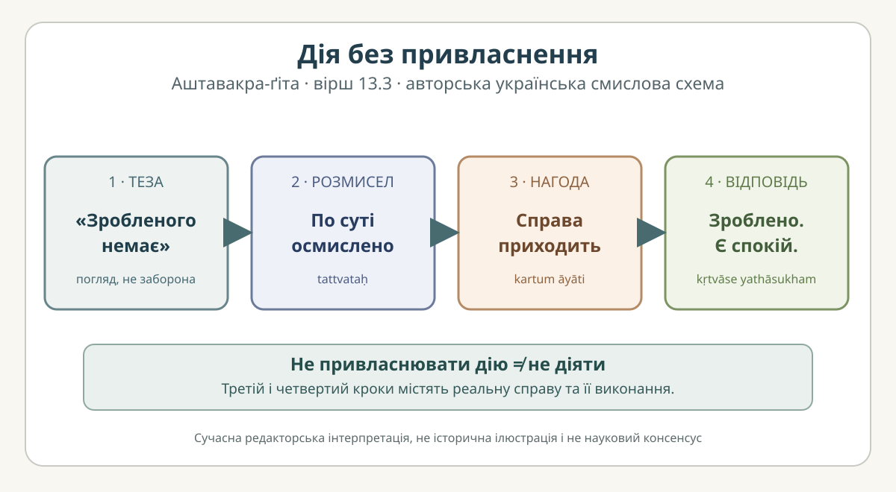

# «Аштавакра-ґіта» 13.3 — дія без привласнення: построкова редакторська проба

> **Статус: науково-редакторська чернетка. Не затверджений переклад і не сторінка готового видання.** Це навчальне вирівнювання чотирьох змістово-метричних сегментів, а не самостійна рукописна колація. Чинну [картку 13.3](../cards/13.3.json) і [книжкову главу 13](../../books/ashtavakra-gita/rozdil-13-naukove.md) **не змінено**.

## Джерела, права та метод

- **GRETIL:** локатор `Avg_13.3` в [Aṣṭāvakragītā](https://www.gretil.uni-goettingen.de/gretil/corpustei/transformations/html/sa_aSTAvakragItA.htm). У поточній картці дата звірки — 31.10.2026; відкритий [архівований дзеркальний HTML](https://tylergneill.github.io/gretil-mirror/gretil/corpustei/transformations/html/sa_aSTAvakragItA.htm) показує написання `sañcintya`, а картка — `saṃcintya`. Це **питання графічної передачі носового**, не підстава без додаткової колації оголошувати змістове різночитання.
- **SARIT:** локатор `verse_13.3` у [TEI-корпусі](https://github.com/sarit/SARIT-corpus/blob/master/astavakragita.xml); картка датує перевірку 31.10.2026. Свіжу незалежну ручну звірку живого XML у цій пробі **не виконано**.
- **Основа вирівнювання:** незмінені `sanskrit`, `iast`, `grammar`, `literal_meaning`, `ukrainian_translation` з [редакторської картки](../cards/13.3.json); деванагарі та український читальний шар — із наявної [глави 13](../../books/ashtavakra-gita/rozdil-13-naukove.md), механічні проєкції IAST, а не незалежні свідки.
- **Права:** це наша редакторська структуризація й оригінальна схема; права на чужі електронні транскрипції та їхні редакторські шари не проголошено встановленими. `rights.verified=false` та `review.reviewer=null` у вихідній картці. Дозволу на фінальне видавниче відтворення це дослідження не надає.

## Чотири вирівняні сегменти

### 1. Початкова теза — «зробленого нічого»

**Деванагарі.** कृतं किम् अपि नैव स्याद्

**IAST.** `kṛtaṃ kim api naiva syād`

**Українська транслітерація (робоча).** крітам кім апі найва сяд

**Український відповідник.** «Зробленого не було б анічого…»

**Граматика.** `kṛtam` — дієприкметник середнього роду («зроблене»); `kim api` — «що-небудь»; `na eva` підсилює заперечення; `syāt` — оптатив третьої особи від «бути». Теза **не** формулює фактичного припинення усіх тілесних дій: друга половина вірша прямо описує дію.

### 2. Спосіб розуміння — «помисливши про суть»

**Деванагарі.** इति संचिन्त्य तत्त्वतः

**IAST.** `iti saṃcintya tattvataḥ`

**Українська транслітерація (робоча).** іті самчінтя таттватах

**Український відповідник.** «…так розмисливши по суті…»

**Граматика.** `iti` відмежовує зміст думки; `saṃcintya` — дієприслівникова форма «розмисливши», `tattvataḥ` — «істинно, по суті». Це формулювання **погляду**, а не доказу того, що події зовнішнього світу зникли.

### 3. Ситуація — «коли приходить справа»

**Деванагарі.** यदा यत् कर्तुम् आयाति

**IAST.** `yadā yat kartum āyāti`

**Українська транслітерація (робоча).** яда ят картум аяті

**Український відповідник.** «Коли що випадає зробити…»

**Граматика.** `yadā` — «коли»; `yat` — «що»; `kartum` — інфінітив «зробити»; `āyāti` — «приходить, постає». Наявність `kartum` виключає грубе тлумачення вірша як наказу **нічого не робити**.

### 4. Відповідь — «зробивши, перебуваю»

**Деванагарі.** तत् कृत्वासे यथासुखम्

**IAST.** `tat kṛtvāse yathāsukham`

**Українська транслітерація (робоча).** тат крітвасе ятхасукхам

**Український відповідник.** «…те зробивши, я сиджу, як мені зручно».

**Граматика.** `tat` співвідноситься з `yat`; `kṛtvāse` передає поєднання `kṛtvā` («зробивши») + `āse` («я сиджу / перебуваю»), `yathāsukham` — «як зручно, у спокої». **Дія відбувається**, але наступний стан не описано як перемогу над світом.

## Як ці чотири частини пов'язані

Теза першого сегмента створює парадокс. У другому вона названа результатом розмислу; у третьому постає конкретна справа; у четвертому справу **виконано**. Тому інтерпретація «бездіяльність» не витримує читання всього вірша. Обережніше говорити про **відмову привласнювати дію як остаточну характеристику себе**; це вже наш філософський коментар, а не окреме санскритське слово у вірші.

**Український культурний місток — відкрите редакторське питання.** Для порівняльного читання можна дослідити Григорія Сковороду, *«Алфавіт, або Буквар миру»* і тему сродної праці. Але Сковородина етика праці **не тотожна** недвоїстому міркуванню 13.3; точне місце паралелі поки не звірене. **ПОТРЕБУЄ ПЕРЕВІРКИ.** Це не цитата, не твердження про історичний вплив і не доведений академічний консенсус.

## Українська схема

*Авторська смислова схема. «Нічого не зроблено» тут — теза способу бачення, а не відсутність конкретної виконаної роботи. Зображення не є історичною ілюстрацією або доказом усталеного тлумачення.*

## Межі редакторської перевірки

- Построковий відповідник **не замінює** переклад у картці.
- Читання `saṃcintya` / `sañcintya` потребує окремого свідкового обліку до будь-якої зміни першоджерела.
- Картка позначає різночитання як перевірені, але цю чернетку незалежний санскритолог **не рецензував**; нової ручної колації не було.
- Публікаційний PDF/EPUB не створювався, ліцензійні файли не змінювалися.
