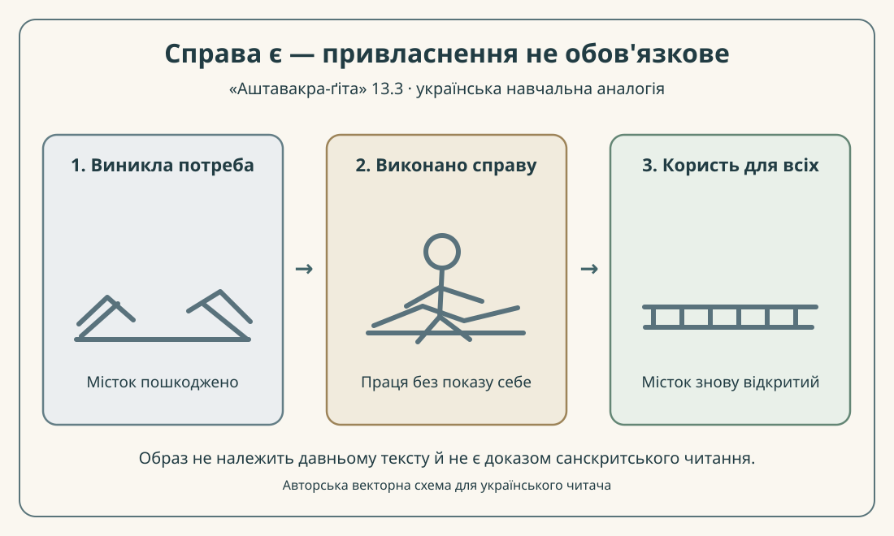

# «Аштавакра-ґіта» 13.3 — дві наукові строки українською

> **Редакторський построковий зразок, не рецензоване видання.** Деванагарі у цьому файлі — механічна проєкція чинного IAST, а не самостійно засвідчений рукопис. Українська передача звучання — робоча; її остаточні правила та права на використання конкретних електронних текстів не підтверджено.

## Джерела й правило зіставлення

Чинна [українська редакторська картка 13.3](../cards/13.3.json) задає IAST, власний переклад і граматичний коментар. Її локатори: [GRETIL — `Avg_13.3`](https://gretil.sub.uni-goettingen.de/gretil/corpustei/transformations/html/sa_aSTAvakragItA.htm) і [SARIT TEI — `verse_13.3`](https://github.com/sarit/SARIT-corpus/blob/master/astavakragita.xml). Це цифрові текстові записи, **не** два незалежні критичні видання. У картці зазначено `variants_checked: true`, але `rights.verified: false` та `review.reviewer: null`.

Два блоки нижче відповідають **друкованим піврядкам**, розділеним `|` і `||`; не можна автоматично прирівнювати їх до чотирьох метричних *pāda*. Українське речення взято **дослівно** з картки та розбито на межі тире. При відновленні одного речення між українськими сегментами повертається « — ».

## 13.3

### Рядок а

**Деванагарі.** कृतं किम् अपि नैव स्याद् इति संचिन्त्य तत्त्वतः ।

**IAST.** kṛtaṃ kim api naiva syād iti saṃcintya tattvataḥ |

**Українська транслітерація.** крітам кім апі найва сяд іті самчінтя таттватах |

**Переклад.** Подумавши по-справжньому: «зробленого не буде нічого»

**Коментар.** `kṛtaṃ kim api` стосується будь-якого зробленого; `naiva syāt` містить заперечення `na eva` й оптатив `syāt`, а не твердження, що діяння фізично не відбувається. `saṃcintya` — дієприслівникова форма від «обміркувати», `tattvataḥ` — «по суті, насправді». Це редакторський граматичний розбір, який потребує незалежної перевірки.

### Рядок б

**Деванагарі.** यदा यत् कर्तुम् आयाति तत् कृत्वासे यथासुखम् ॥

**IAST.** yadā yat kartum āyāti tat kṛtvāse yathāsukham ||

**Українська транслітерація.** яда ят картум аяті тат крітвасе ятхасукхам ||

**Переклад.** що б не випало зробити, зробивши те, я сиджу, як мені завгодно.

**Коментар.** `yadā yat ... āyāti` вводить те, що випадає зробити; `kartum` — інфінітив, `kṛtvā` — «зробивши», `āse` — форма першої особи «я сиджу / перебуваю». У друкованому рядку стоїть `kṛtvāse` (`kṛtvā + āse`), **не** окреме `aham āse`. Спільний для багатьох місць глави мотив `yathāsukham` не доводить дослівної тотожності всього рефрену в кожному вірші. Парадокс вірша — дія здійснюється без вимоги приписувати її власному «я».

## Український читацький приклад, а не твердження про джерело

Уявімо, що в селі після негоди потрібно полагодити місток: людина виконує справу, але не вимагає дошки з власним ім'ям. **Це сучасний український дидактичний образ**, а не буквальний санскритський образ, не слова Сковороди чи іншого автора і не доказ історичного впливу. Порівняння лише допомагає розрізнити дію та привласнення результату. Для академічної культурної паралелі потрібен окремо перевірений український текст і точний локатор.

## Авторська доступна схема

*Векторна схема — оригінальна сучасна редакторська робота, не історична індійська ілюстрація й не підтвердження граматики.*

## Перевірка цілісності та межі

**Дослівний суцільний переклад із картки (не змінено):** Подумавши по-справжньому: «зробленого не буде нічого» — що б не випало зробити, зробивши те, я сиджу, як мені завгодно.

**Невирішене:** перевірка конкретних санскритських лексем фахівцем; незалежна літературна рецензія; підтвердження наукової та української практичної транслітерації; законність публікації цифрового відтворення санскриту. Цей пілот не підміняє поетичну главу 13 і не означає завершення решти 297 наукових віршів.
