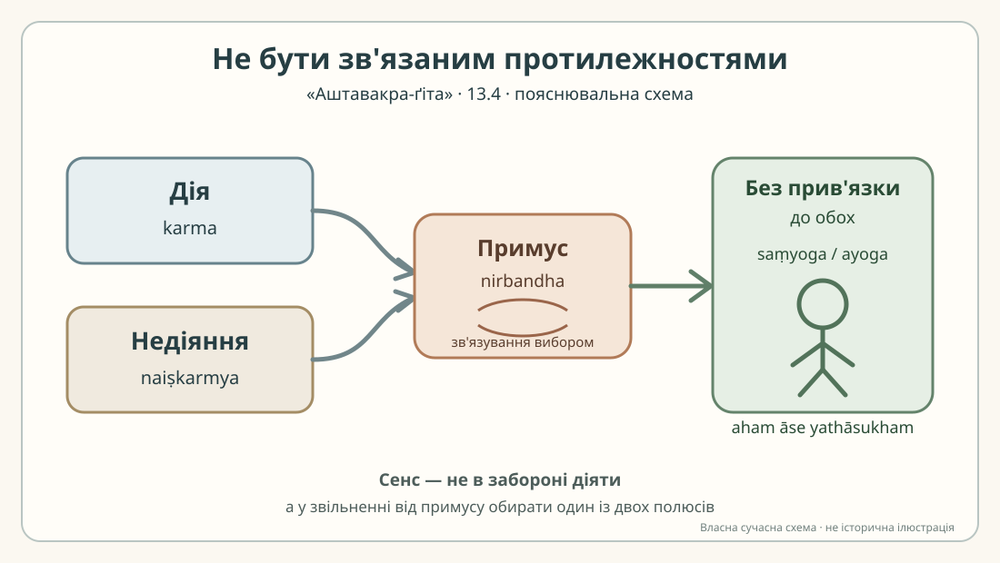

# Аштавакра-ґіта 13.4 — построкова редакторська проба

> **Статус: нерецензована науково-редакторська чернетка.** Це допоміжний розворот до одного вірша, а не заміна джерельної картки й не готова сторінка для PDF/EPUB.
>
> Деванагарі та українську практичну передачу нижче механічно відтворено з IAST чинної редакторської картки й наявного книжкового макета. Це не окремий рукописний свідок і не незалежна перевірка санскритського читання.

## Джерело та спосіб роботи

- [Редакторська картка 13.4](../cards/13.4.json), статус «чернетка», `rights.verified: false`.
- [GRETIL, `Avg_13.4`](https://gretil.sub.uni-goettingen.de/gretil/corpustei/transformations/html/sa_aSTAvakragItA.htm) — електронний запис із маркером вірша.
- [SARIT TEI, `verse_13.4`](https://github.com/sarit/SARIT-corpus/blob/master/astavakragita.xml) — електронний запис із двома елементами рядка.
- У доступному записі GRETIL перший піврядок подано як `karmanaiṣkarmyanirbandhabhāvā dehasthayoginaḥ`, другий — як `saṃyogāyogavirahād aham āse yathāsukham`. У SARIT ті самі послідовності стоять усередині двох TEI-рядків; різниця пробілів і злитого запису не доводить рукописного різночитання.
- GRETIL описує власний запис як електронне перетворення корпусу; ані GRETIL, ані SARIT тут не називаються критичним виданням.

Два піврядки нижче відповідають саме двом друкованим рядкам у картці. Їхні українські частини — **попереднє редакторське вирівнювання** наявного перекладу, а не новий затверджений послівний переклад.

## 13.4

### Рядок а

**Деванагарі.** कर्मनैष्कर्म्यनिर्बन्धभावा देहस्थयोगिनः ।

**IAST.** karmanaiṣkarmyanirbandhabhāvā dehasthayoginaḥ |

**Українська транслітерація.** карманайшкарм'янірбандгабгава дехастхайоґінах |

**Український відповідник (попереднє вирівнювання).** У йога, що перебуває в тілі, є стани, до яких його змушують дія й недіяння;

**Граматичне спостереження.** Складене `karma-naiṣkarmya` ставить поруч дію та `naiṣkarmya` — стан, пов'язаний із недіянням або відсутністю дії. `nirbandha` може передавати зв'язування, наполягання чи примус; автоматично зводити його до одного українського слова не слід. `bhāvā` — форма множини від `bhāva` («стан», «спосіб буття»). Форма `yoginaḥ` морфологічно може відповідати називному множини або родовому однини; чинна картка обирає родовий однини й пов'язує його з `dehastha` («той, хто перебуває в тілі»). Синтаксичний зв'язок із `bhāvā` потребує окремої фахової перевірки.

### Рядок б

**Деванагарі.** संयोगायोगविरहाद् अहम् आसे यथासुखम् ॥

**IAST.** saṃyogāyogavirahād aham āse yathāsukham ||

**Українська транслітерація.** самйоґайоґавірахад ахам асе ятхасукхам ||

**Український відповідник (попереднє вирівнювання).** та через відсутність з'єднання й роз'єднання я сиджу, як мені завгодно.

**Граматичне спостереження.** `saṃyoga` — з'єднання або поєднання; `ayoga` утворене заперечним префіксом `a-` і буквально означає «не-з'єднання», «відсутність поєднання». Це не тотожне слову `viyoga` («роз'єднання», «розлука»), тому переклад «роз'єднання» в чинній картці варто перевірити. `virahāt` — відмінкова форма зі значенням «через відсутність / позбавленість». `aham` — «я»; `āse` у картці прочитано як форму першої особи від `ās` («сидіти», «перебувати»); `yathāsukham` — «як зручно», «як мені до вподоби». Ці робочі відповідники не є незалежним висновком санскритолога.

## Повний переклад картки — без змін

> У йога, що перебуває в тілі, є стани, до яких його змушують дія й недіяння; та через відсутність з'єднання й роз'єднання я сиджу, як мені завгодно.

Повний текст вище дослівно зберігає поле `ukrainian_translation` картки 13.4. Поділ на два відповідники є лише пропозицією редакторського вирівнювання; джерельну картку не змінено.

## Науковий коментар

Вірш не слід читати як заклик нічого не робити. У першому рядку названо пару «дія / недіяння» та пов'язаний із нею `nirbandha` — наполягання, примус або зв'язування. У другому рядку мовець говорить про перебування без прив'язки до «з'єднання» й «не-з'єднання». Отже, предмет коментаря — не заборона праці або руху, а залежність від двох протилежних установок.

Це прочитання лишається робочим. Зокрема, треба перевірити синтаксис `bhāvā dehasthayoginaḥ`, значення `naiṣkarmya` в цьому складеному слові та точний обсяг заперечного `a-` у `ayoga`. Не переносимо сюди без застереження інші формули з глави й не перетворюємо тлумачення на твердження про те, що будь-яка діяльність є несумісною зі звільненням.

**Рефрен глави.** Кінець 13.4 — `aham āse yathāsukham`, формула, що повторюється в інших віршах цієї глави. Українське «я сиджу, як мені завгодно» зберігає тілесний образ `āse`; у ширшому коментарі варто окремо пояснити, чому цей образ не зводиться до фізичної пози.

## Український читацький контекст

Для українського читача корисно розвести «робити» і «бути змушеним доводити свою свободу через дію або бездіяльність». Це пояснювальна аналогія, не додатковий зміст санскритського рядка. Кандидатну типологічну паралель зі Сковородою досліджують окремо в [робочій нотатці про 13.3–13.4](https://github.com/juv4uk/ukrainian-books/blob/research/ch13-parallels-skovoroda-13-3-13-4-20261101/research/ashtavakra/variants/chapter-13-parallels-13-3-13-4.md). Її не перенесено сюди як підтверджений висновок: потрібні точний локатор у першоджерелі, перевірка тексту й окреслення меж порівняння. Історичного впливу не стверджуємо.

## Власна пояснювальна схема

*Сучасна авторська навчальна композиція українською мовою. Це не зображення рукопису, не традиційна іконографія й не доказ санскритського тлумачення.*

## Походження, права та статус

- Деванагарі механічно отримано з IAST чинної картки; українське читання — практична передача за таблицею проєкту. Обидва шари потребують перевірки, а не вважаються новими свідками.
- GRETIL `Avg_13.4` і SARIT `verse_13.4` — два доступні електронні записи. Збіг їхнього тексту не встановлює рукописної історії та не перетворює їх на критичне видання.
- Власний український коментар і схема не містять цитат із сучасних перекладів. Ліцензію «ВОЛЬНІСТЬ» не змінювали.
- `rights.verified=false`; правову підставу для відтворення похідного цифрового санскритського шару не встановлено. Поля незалежного рецензування залишаються незаповненими.
- **Рівень готовності:** редакторська чернетка. Незалежної санскритологічної, текстологічної чи юридичної рецензії немає. Цей файл не є дозволом до публікації PDF/EPUB.
