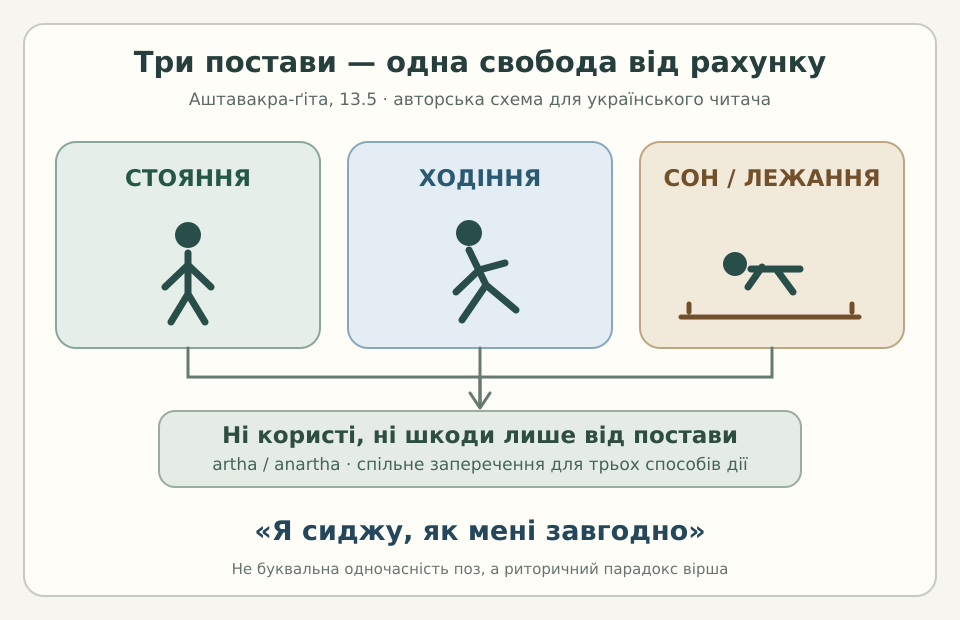

# «Аштавакра-ґіта» 13.5 — чотири пади й парадокс постави

> **Авторська построкова науково-редакторська чернетка, не затверджена сторінка видання.**
> Порівнюємо чотири метричні частини вірша (пади), а не чотири самостійні речення.
> Деванагарі — механічне представлення IAST [чинної картки 13.5](../cards/13.5.json),
> не незалежно засвідчений рукопис. Українське читання — практична,
> не рецензована фахівцем передача. Картку, генератор і книжкову главу не змінено.

## Построкове зіставлення

### Пада а — користь і шкода

**Деванагарі.** अर्थानर्थौ न मे स्थित्या

**IAST.** arthānarthau na me sthityā

**Українське читання.** артханартхау на ме стхітя

**Змістовий український рядок.** Ні користі, ні шкоди немає мені від стояння,

**Граматика.** `arthānarthau` — двоїна пари `artha / anartha` («користь / шкода»); `na me` — заперечення стосовно мовця; `sthityā` — орудний однини («стоя́нням», «від стояння»). Рядок сам по собі ще не називає інших постав тіла.

### Пада б — рух та лежання

**Деванагарі.** गत्या न शयनेन वा ।

**IAST.** gatyā na śayanena vā |

**Українське читання.** ґатя на шаянена ва |

**Змістовий український рядок.** ходіння чи лежання —

**Граматика.** `gatyā` — орудний однини від `gati` («ходіння», «рух»); `śayanena` — орудний однини від `śayana` («лежання / спання»); `vā` — «або». Заперечення й пара «користь / шкода» продовжуються з першої пади, тому український відповідник тут навмисно не створює окремого присудка.

### Пада в — три одночасні способи дії

**Деванагарі.** तिष्ठन् गच्छन् स्वपन् तस्माद्

**IAST.** tiṣṭhan gacchan svapan tasmād

**Українське читання.** тіштхан ґаччан свапан тасмад

**Змістовий український рядок.** тому, стоячи, ходячи чи сплячи,

**Граматика.** `tiṣṭhan`, `gacchan`, `svapan` — три дієприкметникові форми чоловічого роду називного однини («стоячи / ходячи / сплячи» у природному українському перекладі). `tasmād` — «тому», висновок із першого піввірша. У санскритській послідовності `tasmād` завершує паду; український відповідник переносить «тому» на початок за синтаксисом української мови.

### Пада г — парадоксальний рефрен

**Деванагарі.** अहम् आसे यथासुखम् ॥

**IAST.** aham āse yathāsukham ||

**Українське читання.** ахам асе ятхасукхам ||

**Змістовий український рядок.** я сиджу, як мені завгодно.

**Граматика.** `aham` — «я»; `āse` — особова дієслівна форма першої особи однини від кореня `ās` («сидіти»); `yathāsukham` — «як зручно / до вподоби». Три назви фізичної діяльності зіставлено з «сиджу»: це **текстовий парадокс**, а не доведення буквальної можливості трьох постав одночасно.

## Незмінений повний український переклад картки

> Ні користі, ні шкоди немає мені від стояння, ходіння чи лежання — тому, стоячи, ходячи чи сплячи, я сиджу, як мені завгодно.

Повний рядок наведено **без редакторського переписування** з поля `ukrainian_translation` чинної картки. Чотири відповідники вище — навчальне вирівнювання за падами, а не чотири автономні українські речення. Діакритичні й словоподільні різниці не приховано: SARIT подає частину другого піввірша без пробілів.

## Науковий та український читацький контекст

Мовна побудова зіставляє дві протилежності (`artha / anartha`) із трьома видами тілесної дії, а потім завершується незмінним рефреном `aham āse yathāsukham`. Опис постави не слід автоматично перетворювати на наказ відмовитися від праці, руху або сну. Тут відкинуто **рахунок користі та шкоди** від положення тіла, а не самі дії.

Для українського читача просте порівняння — три звичайні ситуації: стояння, дорога та відпочинок. Вони зображені в сучасній редакторській схемі без приписування давньому текстові української історичної символіки. У [науковій главі 13](../../books/ashtavakra-gita/rozdil-13-naukove.md) є типологічна паралель із новелою Василя Стефаника «Камінний хрест»; її **не підтверджено тут текстовою цитатою чи незалежним літературознавчим порівнянням**. Це можливий напрям дослідження, а не доведений вплив.

## Авторська ілюстрація

*Схема власна, з українськими написами; не є історичною індійською ілюстрацією або відтворенням чужого малюнка.*

## Джерела, обмеження прав і рецензування

- **Редакторська основа:** [13.5.json](../cards/13.5.json) та [наукова глава 13](../../books/ashtavakra-gita/rozdil-13-naukove.md). Чинна картка має `status=чернетка`, `review.reviewer=null`, `rights.verified=false`.
- **SARIT TEI:** [`verse_13.5`](https://github.com/sarit/SARIT-corpus/blob/master/astavakragita.xml) безпосередньо звірено: `arthānarthau na me sthityā gatyā na śayanena vā`; у другому піввірші цифровий запис зливає кілька слів.
- **GRETIL:** [локатор `Avg_13.5`](https://gretil.sub.uni-goettingen.de/gretil/corpustei/transformations/html/sa_aSTAvakragItA.htm) узято з картки, але самостійної повної колації живого тексту тут не виконано. Збіг друкарських версій не означає незалежної рукописної перевірки.
- **Права:** давність твору не означає автоматичного дозволу на копіювання чужого цифрового видання. Власні українські пояснення й схему відокремлено від електронних транскрипцій; ліцензію «ВОЛЬНІСТЬ» не змінено.
- **Статус:** навчальна науково-редакторська чернетка. Висновок санскритолога, незалежного літературного редактора та остаточне рішення про публікаційний статус **відсутні**. До академічного PDF/EPUB не включати автоматично.
