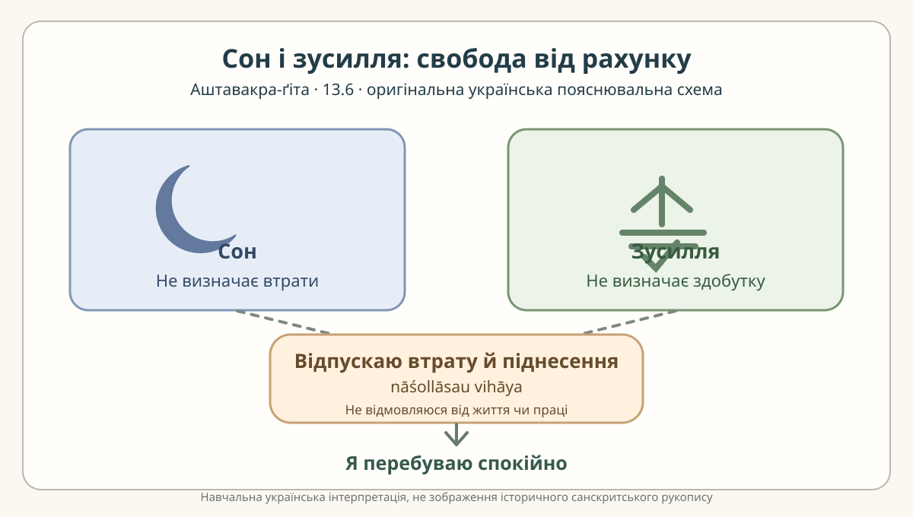

# Аштавакра-ґіта 13.6 — сон, зусилля і свобода від підрахунку

> **СТАТУС: РЕДАКТОРСЬКА НАУКОВА ЧЕРНЕТКА.** Чотири метричні пади
> відокремлено для українського читача. Деванагарі та українську практичну
> транслітерацію побудовано за робочим IAST чинної
> [картки 13.6](../cards/13.6.json), а не за незалежно перевіреним рукописом.
> Це не схвалений санскритологом переклад і не матеріал готового PDF/EPUB.

## Чотири вирівняні пади

### Рядок 1 — пада а

**Деванагарі.** स्वपतो नास्ति मे हानिः ।

**IAST.** svapato nāsti me hāniḥ |

**Українська транслітерація.** свапато насті ме ханіх |

**Український відповідник.** У сплячого немає мені втрати,

**Граматичний коментар.** `svapataḥ` (у сандгі `svapato`) — родовий однини дієприкметника «той, хто спить»; `na asti` — «немає»; `me` — «мені / в мене»; `hāniḥ` — «втрата». У першій паді відсутність втрати не є приписом постійно спати.

### Рядок 2 — пада б

**Деванагарі.** सिद्धिर् यत्नवतो न वा ।

**IAST.** siddhir yatnavato na vā |

**Українська транслітерація.** сіддгір ятнавато на ва |

**Український відповідник.** як і немає досягнення в того, хто докладає зусиль;

**Граматичний коментар.** `siddhiḥ` (у сандгі `siddhir`) — «успіх, досягнення»; `yatnavataḥ` (у сандгі `yatnavato`) — «того, хто докладає зусиль». Заперечення `na` поширюється на досягнення, а не перетворює вислів на заборону будь-якої праці. Тут зіставлено дві оцінки: втрату й здобуток.

### Рядок 3 — пада в

**Деванагарі.** नाशोल्लासौ विहायास्माद् ।

**IAST.** nāśollāsau vihāyāsmād |

**Українська транслітерація.** нашолласау віхаясмад |

**Український відповідник.** відкинувши загибель і піднесення,

**Граматичний коментар.** `nāśa-ullāsau` — парна конструкція «загибель/втрата» та «піднесення/радісний злет» у двоїні; `vihāya` — «відкинувши». Форма `vihāyāsmād` поєднує `vihāya` й `asmāt` («від цього / тому»), а в друкованій формі наступного рядка сандгі може з'єднувати її також з `aham`. Не слід називати вказану сегментацію окремим рукописним різночитанням.

### Рядок 4 — пада г

**Деванагарі.** अहम् आसे यथासुखम् ॥

**IAST.** aham āse yathāsukham ||

**Українська транслітерація.** ахам асе ятхасукхам ||

**Український відповідник.** я сиджу, як мені завгодно.

**Граматичний коментар.** `aham` — «я»; `āse` — форма першої особи «сиджу / перебуваю»; `yathāsukham` — «як зручно, спокійно, до вподоби». Це той самий редакторський рефрен, що присутній у шести з семи віршів глави 13 (за винятком 13.2).

## Суцільний український переклад чинної картки

> У сплячого немає мені втрати, як і немає досягнення в того, хто докладає зусиль; відкинувши загибель і піднесення, я сиджу, як мені завгодно.

Цей текст **дослівно відтворює** поле `ukrainian_translation` чинної
картки; рядкове розбиття вище є навчальним, не новою редакцією канонічного
перекладу.

## Академічне пояснення та українська читацька перспектива

У вірші дві протилежні побутові ситуації — сон і докладання зусиль —
не визначають для мовця втрати чи досягнення. Далі пара
`nāśa/ullāsa` називає протилежні оцінки: занепад і піднесення.
Це логіка **незалежності внутрішнього стану від підрахунку результатів**,
а не твердження, що праця марна, і не рекомендація фізичної пасивності.

Український читач упізнає контраст між «працювати задля відзнаки» та
«виконувати належне без постійного рахунку здобутків». Таке зіставлення
є **нашою сучасною дидактичною аналогією**, а не цитатою чи встановленою
позицією українського письменника. У поточній згенерованій главі згадано
«Берестечко» Ліни Костенко; **без точного місця в першотексті ми не
стверджуємо**, що цей роман у віршах формулює таку саму тріаду
сну, зусиль і підсумку. Потрібен окремий доказовий філологічний огляд.

## Власна смислова схема

*Навчальна українська композиція, не стародавнє зображення й не
реконструкція рукопису. Її підписи передають авторську сучасну
інтерпретацію, а не буквальні цитати санскритського тексту.*

## Джерельна й правова примітка

- Перший внутрішній свідок: [редакторська картка 13.6](../cards/13.6.json) і [наукова глава 13](../../books/ashtavakra-gita/rozdil-13-naukove.md).
- Незалежно переглянуті **цифрові публікації** для контролю форми вірша: [Wisdomlib 13.6](https://www.wisdomlib.org/hinduism/book/ashtavakra-gita-sanskrit/d/doc345927.html) і [Shlokam 13.6](https://www.shlokam.org/text/ashtavakra-gita.htm). Тут не передруковано чужих сучасних перекладів, аудіо або коментарів.
- Базові локатори проєкту: [GRETIL, `Avg_13.6`](https://gretil.sub.uni-goettingen.de/gretil/corpustei/transformations/html/sa_aSTAvakragItA.htm) і [SARIT, `verse_13.6`](https://github.com/sarit/SARIT-corpus/blob/master/astavakragita.xml). Вони **не є встановленим критичним виданням**; окрема колація читань і рукописної історії не виконувалася.
- **Права:** ліцензію «ВОЛЬНІСТЬ» не змінено; власні українські пояснення та схема відокремлені від сторонніх цифрових текстів. `rights.verified` у джерельній картці залишається `false`; це не надає автоматичного права на публікацію чужої цифрової транскрипції.

**Невирішено:** незалежний санскритологічний і український літературний
review, правова звірка та затвердження практичної передачі звучання.
Лише після цього можна переносити пробу в основний генератор
чи фінальний PDF/EPUB.
