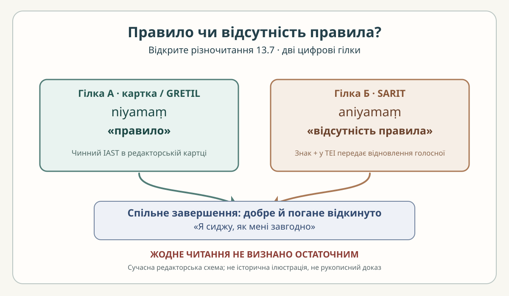

# «Аштавакра-ґіта» 13.7 — чотири пади, два читання

> **Редакторська наукова чернетка, не готова сторінка видання.** Цей розворот не замінює [чинну картку 13.7](../cards/13.7.json) й [наукову главу 13](../../books/ashtavakra-gita/rozdil-13-naukove.md). Показані нижче пади — робоче вирівнювання за метричним поділом, а не нова рукописна колація. **Розбіжність niyama / aniyama не розв'язано.**

## Джерельний паспорт і причина двох читань

- **SARIT TEI,** [`verse_13.7`](https://github.com/sarit/SARIT-corpus/blob/master/astavakragita.xml): у першому піввірші XML надруковано `sukhādirūpā+aniyamaṃ bhāveṣvālokya bhūriśaḥ`. Знак `+` у правилах цього електронного корпусу позначає відновлену початкову голосну при аваґрасі; **це не звичайна пунктуація між двома незалежними словами**. Пов'язане читання — `aniyamaṃ` («відсутність правила, нерегулярність»).
- **GRETIL,** [`Avg_13.7`](https://www.gretil.uni-goettingen.de/gretil/corpustei/transformations/html/sa_aSTAvakragItA.htm): чинна редакторська картка наводить `sukhādirūpā niyamaṃ`. За цією гілкою `niyamaṃ` позначає «правило, упорядкованість».
- **Редакторська основа:** [13.7.json](../cards/13.7.json), `status=чернетка`, `review.reviewer=null`, `rights.verified=false`. В її полі `iast` стоїть `niyamaṃ`, але власний коментар одночасно говорить про варіант SARIT з `aniyamaṃ`. Отже, **записана IAST-лінія і заявлений вибір для перекладу не узгоджені однозначно**. Це потрібно відобразити, а не приховати.
- **Незалежність джерел:** SARIT — електронна транскрипція за зазначеним у TEI друком 1971 року; GRETIL — інше цифрове представлення. Два вебфайли самі по собі не утворюють критичного видання або незалежного рукописного підтвердження. Підозру про зіпсованість `sukhādirūpā` не доведено.

Наведені далі деванагарі та українська вимова відтворюють **поточну гілку картки / GRETIL**; альтернативу SARIT **показано окремо** у першій паді. Деванагарі тут є проєкцією IAST, а не рукописним факсиміле.

## Построкове зіставлення чотирьох пад

### Пада а — місце відкритої текстологічної розбіжності

**Деванагарі (читання картки).** सुखादिरूपा नियमं

**IAST (читання картки / GRETIL).** `sukhādirūpā niyamaṃ`

**Українська транслітерація (робоча).** сукхадірупа ніямам

**Український смисловий фрагмент А.** «…правило, пов'язане з подобою задоволення…»

**Альтернатива SARIT, IAST.** `sukhādirūpā+aniyamaṃ` (позначене аваґрасою відновлення початкового `a`).

**Український смисловий фрагмент Б.** «…відсутність правила / несталість у тому, що має подобу задоволення…»

**Граматика.** `niyamaṃ` та `aniyamaṃ` різняться заперечним компонентом `a-`; `sukhādirūpā` у картці має проблемне родове узгодження із сусідніми формами. Українські фрагменти А і Б — **лише пояснювальні глоси**, не готові альтернативні повні переклади. Зміст першого піввірша без перевірки граматичного зв'язку остаточно не встановлено.

### Пада б — спостереження в різних станах

**Деванагарі.** भावेष्व् आलोक्य भूरिशः ।

**IAST.** `bhāveṣv ālokya bhūriśaḥ |`

**Українська транслітерація (робоча).** бгавешв алокя бгурішах

**Український смисловий відповідник.** «…багаторазово спостерігши у станах…»

**Граматика.** `bhāveṣu` — місцевий множини («у станах»); `ālokya` — дієприслівникова форма («побачивши»); `bhūriśaḥ` — прислівникове «багато разів». Ця пада сама не вирішує, чи мовець бачить `niyamaṃ`, чи `aniyamaṃ`.

### Пада в — відкинення двох оцінок

**Деванагарі.** शुभाशुभे विहायास्माद्

**IAST.** `śubhāśubhe vihāyāsmād`

**Українська транслітерація (робоча).** шубгашубге віхаясмад

**Український смисловий відповідник.** «…відкинувши добре й погане, тому…»

**Граматика.** `śubhāśubhe` — парна назва «добре й погане»; `vihāya` — герундій «відкинувши»; `asmāt` — «із цього, тому», у санскриті на межі слів відтворений як `-āsmād`. Це відкидання **двох оцінок**, а не наказ чинити зло.

### Пада г — завершальний рефрен глави

**Деванагарі.** अहम् आसे यथासुखम् ॥

**IAST.** `aham āse yathāsukham ||`

**Українська транслітерація (робоча).** ахам асе ятхасукхам

**Український смисловий відповідник.** «…я сиджу, як мені завгодно».

**Граматика.** `aham` — «я»; `āse` — форма першої особи однини від `ās` («сидіти / перебувати»); `yathāsukham` — «як зручно». Це рефрен 13.1, 13.3–13.7, але сама повторюваність **не виправляє** неясність у першій паді.

## Чинний авторський переклад картки — без редагування

> Побачивши не раз у всіх станах те правило, що має вигляд задоволення, — відкинувши добре й погане, я сиджу, як мені завгодно.

Це дослівний текст поля `ukrainian_translation` чинної картки. Він передає «**правило**», отже текстуально ближчий до `niyamaṃ` в записаному IAST, **хоча коментар картки заявляє вибір SARIT**. Розбіжність між самоописом картки та її формулюваннями не слід замовчувати або усувати без редакторського рішення.

## Український читацький контекст

Ключовий для читача нюанс можна пояснити звичайною українською відмінністю **«існує правило» / «правила немає»**. Одна початкова частка змінює предмет спостереження, тоді як фінальний рефрен залишається тим самим. Це **пояснювальна аналогія**, не цитата з українського твору і не підтверджена культурна паралель. Порівняння з конкретним поетом чи філософом можливе лише після перевірки точного тексту; українські цитати тут не вигадуються.

## Авторська українська ілюстрація

*Наша сучасна смислова схема показує варіанти читання, а не підтверджує один із них. Це не історична індійська ілюстрація.*

## Межі висновку та права

1. **Перевірено:** чинна картка й книжковий рядок; на сторінці SARIT XML буквально присутні `sukhādirūpā+aniyamaṃ`. Для GRETIL у цій роботі використовувалися чинна картка/адреса свідка, а не нова рукописна колація.
2. **Не встановлено:** яке розділення первинне, чи виправдана гіпотеза `sukhādirūpāṇi`, як остаточно передати узгодження, чи існує підтвердження в незалежному друкованому/рукописному свідку.
3. **Правовий статус:** власні українські пояснення та SVG не надають прав на копіювання редакторського шару SARIT/GRETIL. Їхні умови слід перевірити окремо; `LICENSE` та `VOLNOST.md` не змінено.
4. **Рецензія:** відсутня. Цей текст — редакторська чернетка, не підстава для остаточної наукової верстки PDF/EPUB.
