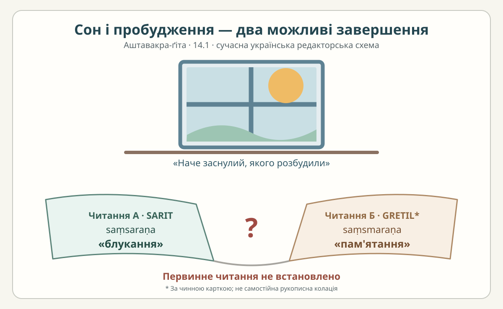

# «Аштавакра-ґіта» 14.1 — сон, пробудження і два цифрові читання

> **Статус: авторська науково-редакторська чернетка. Це не рецензована сторінка готової книги.** Чотири пади нижче — робоче построкове вирівнювання санскриту та української мови. Деванагарі й українське читання спираються на [чинну наукову главу 14](../../books/ashtavakra-gita/rozdil-14-naukove.md) та [картку 14.1](../cards/14.1.json), а не на незалежне прочитання рукопису.

## Паспорт тексту та метод

- **SARIT:** [TEI, локатор `verse_14.1`](https://github.com/sarit/SARIT-corpus/blob/master/astavakragita.xml). Чинна картка містить читання `kṣīṇasaṃsaraṇo` — буквально «той, у кого вичерпалося блукання/сансарне ходіння». Вона позначає звірку датою 31.10.2026.
- **GRETIL:** [цифровий корпус, локатор `Avg_14.1`](https://www.gretil.uni-goettingen.de/gretil/corpustei/transformations/html/sa_aSTAvakragItA.htm). Картка фіксує інше читання: `kṣīṇasaṃsmaraṇo` — «той, у кого вичерпалося пригадування/пам'ятання». Живу сторінку GRETIL під час цього внеску відкрити не вдалося; це **вторинна перевірка за наявним паспортом**, а не нова пряма колація.
- **Додаткова зовнішня звірка цифрових представлень:** [Wisdom Library 14.1](https://www.wisdomlib.org/hinduism/book/ashtavakra-gita-sanskrit/d/doc345930.html) друкує `saṃsaraṇo`, а [Vaidika Vignanam, глава 14](https://vignanam.org/english/ashtavakra-gita-chapter-14.html) — `saṃsmaraṇo`. Ці сайти **не є незалежними рукописами**; їхні пояснення та переклади тут не копіюються.
- `editorial/cards/14.1.json`: `status=чернетка`, `rights.verified=false`, `review.reviewer=null`. Цей файл **не редагуємо**.
- Мета: показати реальний сенсовий розрив `saṃsaraṇa` / `saṃsmaraṇa`, не привласнюючи неперевірений остаточний текст.

## Чотири пади

### Пада а — природна порожнеча розуму

**Деванагарі.** प्रकृत्या शून्यचित्तो यः

**IAST.** `prakṛtyā śūnyacitto yaḥ`

**Українське читання, робоче.** пракрітя шунячітто ях

**Український відповідник.** «Хто від природи має порожній розум…»

**Граматика.** `prakṛtyā` — орудний однини («за природою»); `śūnyacittaḥ` — складений прикметниковий опис, `śūnyacitto` перед `yaḥ` — наслідок сандгі; `yaḥ` — відносний займенник «хто». Йдеться про **властивість особи**, не про наказ «спорожнити голову».

### Пада б — ненавмисне плекання станів

**Деванагарі.** प्रमादाद् भावभावनः ।

**IAST.** `pramādād bhāvabhāvanaḥ |`

**Українське читання, робоче.** прамадад бгавабгаванах

**Український відповідник.** «…хоч через недбальство й плекає у собі стани…»

**Граматика.** `pramādāt` («через недбальство») перед дзвінким приголосним переходить у `pramādād`; `bhāvabhāvanaḥ` — назва особи, яка «плекає стани / уявлення». Оцінка «недбальство — чеснота» тут **не міститься**.

### Пада в — порівняння сну й пробудження

**Деванагарі.** निद्रितो बोधित इव

**IAST.** `nidrito bodhita iva`

**Українське читання, робоче.** нідріто бодгіта іва

**Український відповідник.** «…наче заснулий, якого розбудили…»

**Граматика.** `nidritaḥ` — «заснулий»; `bodhitaḥ` — «розбуджений»; `iva` — «немов, наче». Це порівняння, а не повідомлення про конкретний історичний сон чи медичний стан.

### Пада г — блукання чи пам'ятання?

**Деванагарі (картка / SARIT).** क्षीणसंसरणो हि सः ॥

**IAST (картка / SARIT).** `kṣīṇasaṃsaraṇo hi saḥ ||`

**Українське читання А, робоче.** кшінасамсарано хі сах

**Український відповідник А.** «…адже його блукання вичерпалося».

**Альтернативна деванагарі (читання, приписане GRETIL у картці).** क्षीणसंस्मरणो हि सः ॥

**IAST альтернативи.** `kṣīṇasaṃsmaraṇo hi saḥ ||`

**Українське читання Б, робоче.** кшінасамсмарано хі сах

**Український відповідник Б.** «…адже його пригадування вичерпалося».

**Граматика.** `kṣīṇa-` — «вичерпаний, виснажений»; `saṃsaraṇa` пов'язаний з «блуканням/рухом у сансарі», `saṃsmaraṇa` — із «пригадуванням». Різниця у `-sm-` суттєва: значення відрізняються не лише правописом. `hi` — частка підтвердження, `saḥ` співвідноситься з `yaḥ` у першій паді. **Визначити початкову форму без нового свідкового матеріалу не вдалося.**

## Повний український переклад чинної картки

> Хто за природою має порожній розум — навіть якщо з недбальства плекає [в собі] стани, — той наче заснув і прокинувся: блукання його вичерпане.

Це точне поле `ukrainian_translation` з [картки 14.1](../cards/14.1.json), **не змінене** цим внеском. Воно відображає **варіант А (SARIT)**. Якщо у майбутньому філолог обере варіант Б, остання частина перекладу вимагатиме редакторського рішення. Наявність двох цифрових представлень **не дає права** заявляти про встановлене рукописне різночитання або віддавати перевагу варіанту за популярністю сайтів.

## Український читацький місток та ілюстрація

Для читача доречний **звичайний образ пробудження біля вікна**: після сну в кімнату входить світло; людина не обов'язково змінила своє життя, але інакше бачить його. Ця схема допомагає відчути `nidrito bodhita iva`. Натомість дві відкриті книжки на підвіконні показують, як по-різному можна прочитати останню паду: **«блукання»** та **«пам'ятання»**.

*Власна навчальна ілюстрація; не історичне зображення, не копія індійського мистецтва й не доказ остаточного санскритського читання.*

Можлива паралель із творчістю Євгена Плужника, згадана в [главі 14](../../books/ashtavakra-gita/rozdil-14-naukove.md), **потребує конкретного звіреного місця**. У цьому зразку ми її не перетворюємо на верифіковану цитату чи твердження про вплив.

## Межі перевірки, право на використання та рецензія

- Зіставлено чинну картку, наукову главу 14 і два додаткові публічні цифрові представлення. Повного незалежного аналізу GRETIL/живого TEI проти рукописів **не здійснено**.
- Санскритський давній твір не робить будь-яке сучасне електронне видання автоматично вільним від прав. Для електронних свідків залишаються окремі умови; наші пояснення та схема — власні. `LICENSE` і `VOLNOST.md` незмінні.
- **Статус:** редакторська чернетка, без незалежного санскритологічного та літературного review. Автоматично не проголошувати готовою до публікаційного PDF/EPUB.
