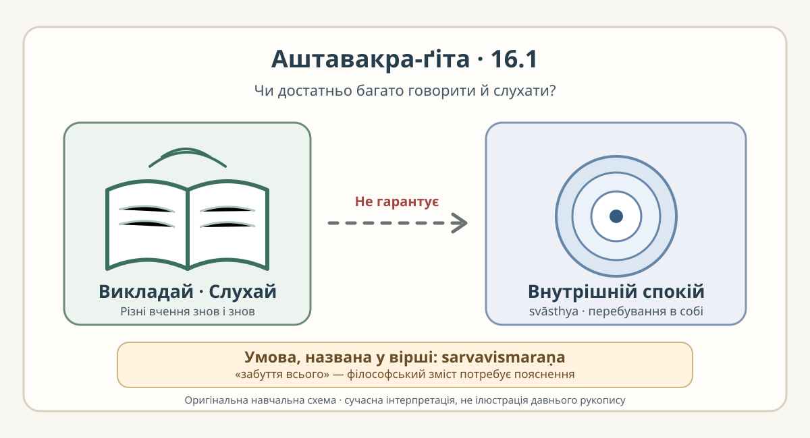

# Аштавакра-ґіта 16.1 — редакторська построкова проба

> **СТАТУС: РОБОЧА НАУКОВА ЧЕРНЕТКА.** Це построкова редакторська проба, а не рецензована сторінка готового видання. За одиницю вирівнювання взято **кожну з чотирьох надрукованих пад**, відокремлених `|` або `||` в чинній картці [16.1](../cards/16.1.json). Це не слід плутати з двома друкарськими піввіршами шлоки.

## 16.1 — чотири рядки з окремими відповідниками

### Рядок 1 — пада а

**Деванагарі.** आचक्ष्व शृणु वा तात ।

**IAST.** ācakṣva śṛṇu vā tāta |

**Українська транслітерація.** ачакшва шріну ва тата |

**Переклад.** Викладай або слухай, любий,

### Рядок 2 — пада б

**Деванагарі.** नानाशास्त्राण्यनेकशः ।

**IAST.** nānāśāstrāṇyanekaśaḥ |

**Українська транслітерація.** нанашастраньянекашах |

**Переклад.** різні вчення знов і знов;

### Рядок 3 — пада в

**Деванагарі.** तथापि न तव स्वास्थ्यं ।

**IAST.** tathāpi na tava svāsthyaṃ |

**Українська транслітерація.** татхапі на тава свастхьям |

**Переклад.** та все ж тобі немає внутрішнього спокою

### Рядок 4 — пада г

**Деванагарі.** सर्वविस्मरणाद् ऋते ॥

**IAST.** sarvavismaraṇād ṛte ||

**Українська транслітерація.** сарвавісмаранад ріте ||

**Переклад.** без забуття всього.

**Суцільний робочий переклад:** «Викладай або слухай, любий, різні вчення знов і знов; та все ж тобі немає внутрішнього спокою без забуття всього».

Це **нова допоміжна построкова редакція**, а не мовчазна заміна наявного власного перекладу у [картці](../cards/16.1.json) та [книжковому розділі](../../books/ashtavakra-gita/rozdil-16-naukove.md). Лексичну та синтаксичну точність ще має незалежно перевірити санскритолог.

## Граматика й академічне пояснення

- **ācakṣva / śṛṇu** — два наказові дієслова («викладай / слухай»). **vā** позначає альтернативу, а **tāta** — лагідне звертання, не доказ спорідненості співрозмовників.
- **nānāśāstrāṇy anekaśaḥ** — поєднання «різні вчення/писання» і «багаторазово, численними способами». Переклад «вчення» тут обережніший за сучасне вузьке значення «науки»; різниця потребує редакторського рішення.
- **tathāpi na tava svāsthyaṃ** — поступка: слухання чи викладання саме по собі **не гарантує** `svāsthya` («перебування в собі», внутрішній спокій). Не ототожнюємо це слово автоматично з усіма значеннями `ātman` у творі.
- **sarvavismaraṇād ṛte** — конструкція `ṛte` з аблативом («без / за винятком забуття всього»). Звідси фінальна умова попереднього речення. Не підмінюємо її твердженням про буквальну медичну втрату пам'яті: сам вірш не визначає психологічного механізму «забуття».

**Змістовий висновок:** тут не заперечено існування різних учень чи можливість учитися. Під сумнів поставлено **достатність накопичення й повторення знання для внутрішнього спокою**. Таке розрізнення між сказаним у тексті та нашим тлумаченням має бути збережене під час наукової редактури.

## Український філософський контекст: обережна паралель

**Григорій Сковорода, «Наркісс. Разглагол о том: Узнай себе», пролог.** У власній рамці Сковорода закликає до пізнання себе, а не до ототожнення людини із зовнішнім образом; це можна **типологічно зіставити** із розрізненням між множинністю вчень та внутрішнім станом у 16.1. Проте напрямки аргументу різні: Сковорода наполягає на самопізнанні, а цей вірш ставить парадоксальну умову «забуття всього». **Це наша сучасна аналогія, не свідчення впливу, тотожності доктрин чи історичного знайомства з текстом.**

Джерело для перевірки контексту: Г. С. Сковорода. *Повне зібрання творів*, у 2 т. Київ, 1973, т. 1, с. 154–200, [«Наркісс» (першотекст, пролог)](https://litopys.org.ua/skovoroda/skov109.htm). Жодних запозичених цитат чи сучасних охоронюваних перекладів не відтворено.

## Смислова ілюстрація

*Власна сучасна навчальна схема, не історичне зображення та не ілюстрація рукопису.* Стрілка «не гарантує» показує логічне обмеження, а не нібито заборону знань; підпис `sarvavismaraṇa` залишає відкритим філософське питання, яке саме «забуття» мається на увазі.

## Джерела, право й межі перевірки

1. [Редакторська картка 16.1](../cards/16.1.json): IAST, граматика, український переклад, локатори цифрових свідків; статус «чернетка», `rights.verified=false`, незалежної рецензії немає.
2. [GRETIL, локатор Avg_16.1](https://gretil.sub.uni-goettingen.de/gretil/corpustei/transformations/plaintext/sa_aSTAvakragItA.txt) та [SARIT TEI, локатор verse_16.1](https://github.com/sarit/SARIT-corpus/blob/master/astavakragita.xml) — **цифрові свідки**, а не встановлене критичне видання. У цьому внеску я зіставив рядки з уже прийнятою карткою та науковим Markdown, **не здійснив нового незалежного звіряння рукописів**.
3. [Правовий реєстр репозиторію](../../COPYRIGHT_AND_SOURCES.md) і [паспорт робочого видання](../../books/ashtavakra-gita/PROVENANCE.md): цифрові транскрипції GRETIL/SARIT мають окремі умови; статус поширення похідного санскритського читання не можна оголошувати доведеним без правової перевірки. Ця чернетка **не є дозволом на публікацію готового PDF/EPUB**.

**Приймання до книжки:** звірити всі чотири пади з двома свідками, переглянути смислове розбиття перекладу, встановити права, надати незалежну фахову рецензію та тільки тоді адаптувати основний генератор. Поточні книжкові файли й ліцензію «ВОЛЬНІСТЬ» цей дослідницький внесок не змінює.
