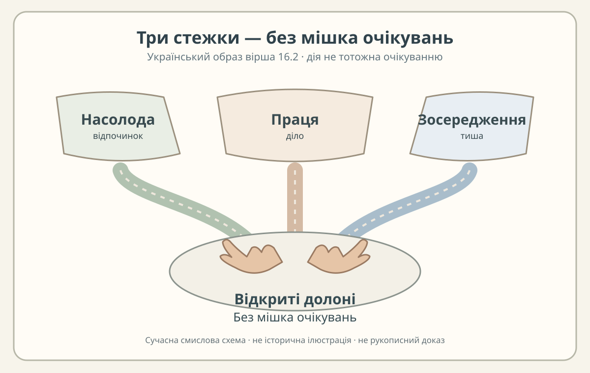

# «Аштавакра-ґіта» 16.2 — три способи дії та умова без сподівань

> **Редакторська наукова чернетка.** Чотири пади зіставлено окремо за чинним записом `editorial/cards/16.2.json`. Деванагарі та українська практична передача — механічні проєкції наявного IAST, а не нові рукописні свідки. Наведені построкові українські глоси **не підміняють** власний повний переклад у картці. Потрібен незалежний філологічний review.

## Паспорт читання

- **Чинна [редакторська картка 16.2](../cards/16.2.json)**: IAST, граматика, власний український переклад, `status=чернетка`, `rights.verified=false`, `review.reviewer=null`.
- **[SARIT, TEI `verse_16.2`](https://github.com/sarit/SARIT-corpus/blob/master/astavakragita.xml)**: електронний текст, у якому два піврядки подані як `bhogaṃ karma samādhiṃ vā kuru vijña tathāpi te` та `cittaṃ nirastasarvāśamatyarthaṃ rocayiṣyati`. Власний поділ на **чотири пади** нижче спирається на розмітку вже наявної картки; немає заяви, ніби SARIT сам окремо розмічає чотири метричні рядки.
- **[GRETIL, `Avg_16.2`](https://gretil.sub.uni-goettingen.de/gretil/corpustei/transformations/plaintext/sa_aSTAvakragItA.txt)**: чинна картка фіксує звірку 31.10.2026 та відсутність змістової різниці після нормалізації. Нової прямої незалежної звірки цього електронного представлення тут не проводили.
- **[Наукова глава 16](../../books/ashtavakra-gita/rozdil-16-naukove.md)**: джерело механічних кириличних і деванагарійських проєкцій та чинної української редакції.

## Чотири построкові зіставлення

### Пада а — три названі можливості

**Деванагарі.** भोगं कर्म समाधिं वा

**IAST.** `bhogaṃ karma samādhiṃ vā`

**Українська транслітерація.** бгоґам карма самадгім ва

**Власний смисловий відповідник.** «Насолоду, дію чи зосередження…»

**Граматика та коментар.** `bhogaṃ`, `karma`, `samādhiṃ` — знахідні однини, залежні від майбутнього наказу `kuru`. `vā` вводить можливість вибору, а не оцінку «добре/погано». У цій паді **немає** заперечення насолоди, праці чи медитації. Для читача це три знайомі царини життя — відпочинок, діло та зосередженість, але таке пояснення є сучасною українською аналогією, не новою санскритською лексемою.

### Пада б — наказ і несподіване «однак»

**Деванагарі.** कुरु विज्ञ तथापि ते ।

**IAST.** `kuru vijña tathāpi te |`

**Українська транслітерація.** куру віджня татхапі те

**Власний смисловий відповідник.** «…роби, обізнаний; проте твій…»

**Граматика та коментар.** `kuru` — наказова форма «роби», `vijña` — звертання «обізнаний / той, хто знає», `tathāpi` — «однак, навіть так», `te` — «твій». Українська фраза **свідомо незавершена**, бо граматична думка переходить у наступну паду. Наказ тут не прирівнюється до гарантії спокою.

### Пада в — до чого віднесено умову

**Деванагарі.** चित्तं निरस्तसर्वाशम्

**IAST.** `cittaṃ nirastasarvāśam`

**Українська транслітерація.** чіттам нірастасарвашам

**Власний смисловий відповідник.** «…розум, у якому полишено всі сподівання,…»

**Граматика та коментар.** `cittaṃ` — «розум» (середній рід), `nirasta-` — «відкинутий», `sarva-` — «весь», `āśā` — «надія, сподівання». Складене слово описує звільнення від **очікувань**, а не фізичне припинення трьох занять першої пади. Не підміняймо `āśā` словом «їжа» й не приписуймо віршеві вимоги забути конкретну людину чи місце.

### Пада г — невирішений відтінок дієслова

**Деванагарі.** अत्यर्थं रोचयिष्यति ॥

**IAST.** `atyarthaṃ rocayiṣyati ||`

**Українська транслітерація.** атяртхам рочаїшяті

**Власний смисловий відповідник.** «…відчує особливу втіху / стане особливо приємним».

**Граматика та коментар.** `atyartham` — «дуже, надзвичайно», `rocayiṣyati` — майбутня каузативна форма від кореня зі значенням «подобатися». Чинна картка визнає **два синтаксичні шляхи**: «розум знайде смак» або «[заняття] сподобається розумові». Цей розворот залишає обидва читання відкритими, а не видає одне за філологічно доведене.

## Незмінний повний переклад картки

> Насолоджуйся, дій або зосереджуйся, обізнаний, — та по-справжньому смакуватиме тобі лише тоді, коли розум відкине всі надії.

Це чинний `ukrainian_translation` у картці 16.2, відтворений без жодної редакторської заміни. Чотири смислові глоси вище **не мусять дослівно складатися в цей синтаксично адаптований український переклад**: санскритська та українська будови речення різняться. Для майбутньої канонічної построкової верстки слід окремо вибрати між глосами, точним безперервним українським перекладом та відміченою перекладною інверсією, а не удавати, ніби слова вирівнялися автоматично.

## Образ для українського читача

«Три стежки на подвір'ї» — відпочинок, праця, тиша. Всі три відкриті, але в руках мандрівника **немає мішка з очікуваною нагородою**. Таке зображення пояснює різницю між дією та прагненням її результату, не змушуючи санскритського автора висловлювати сучасну українську мораль.

*Власна україномовна схема до вірша 16.2. Не історична індійська ілюстрація й не документальний доказ конкретного читання.*

У [чинній науковій главі 16](../../books/ashtavakra-gita/rozdil-16-naukove.md) згадано Лесю Українку та драму «У пущі». **Точного місця в п'єсі для заявленої типологічної паралелі тут не перевірено**; не подаємо вигаданої цитати або висновку про вплив.

## Статус та права

- **Перевірено:** текст чинної картки 16.2 та її механічні проєкції у науковій главі; пряму наявність двох рядків SARIT у `verse_16.2`. Для GRETIL використано вже документований паспорт картки.
- **Не доведено:** незалежне рукописне читання, остаточне граматичне тлумачення `rocayiṣyati`, точна культурна паралель і права на передрук сучасної електронної транскрипції. Картка має `rights.verified=false`.
- **Ліцензія:** текст і схема — нові власні українські внески у межах чинної «ВОЛЬНОСТІ»; права сторонніх цифрових свідків не привласнено, `LICENSE` і `VOLNOST.md` не редагували.
- **Рецензування:** відсутнє. Це чернетка для незалежного редактора, а не дозвіл на фінальне PDF/EPUB.
