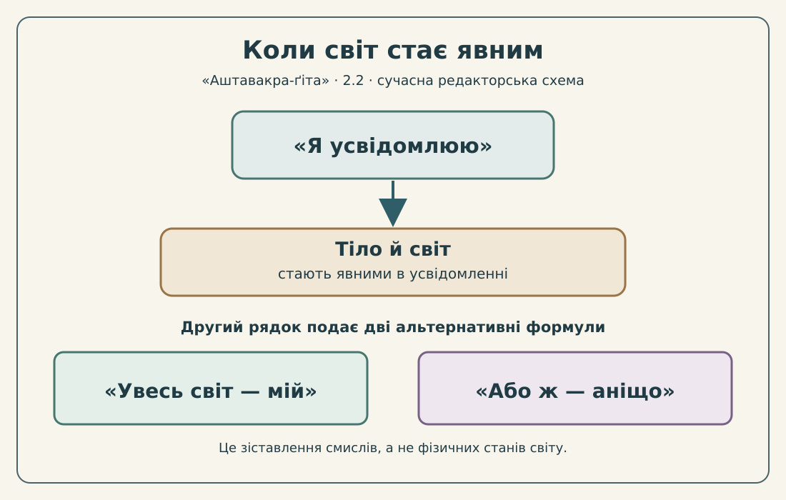

# «Аштавакра-ґіта» 2.2 — построкова науково-редакторська проба

> **Чернетка, не готове видання.** Деванагарі тут є механічним переписом чинного IAST, а не незалежно встановленим санскритським свідком. Українське звучання — незатверджена редакторська проба. Права на відтворення конкретної цифрової транскрипції, незалежна фахова рецензія та дозвіл на випуск PDF/EPUB **не підтверджені**.

## Підстава й точність

Два надруковані піврядки з [чинного наукового тексту](../../books/ashtavakra-gita/rozdil-2-naukove.md) зіставлено з [редакторською карткою 2.2](../cards/2.2.json). Поділ за `|` і `||` — **друкований рядок**, не твердження про точний метричний поділ на *pāda*. Два українські речення нижче перенесено **дослівно й у тому самому порядку** з `ukrainian_translation`; нового перекладу не вигадано.

**Цифрові орієнтири, не дозволи на видання:** [SARIT `verse_2.2`](https://github.com/sarit/SARIT-corpus/blob/master/astavakragita.xml) (у картці `checked_on: 2026-10-31`), [GRETIL `Avg_2.2`](https://gretil.sub.uni-goettingen.de/gretil/corpustei/transformations/html/sa_aSTAvakragItA.htm) (у картці `checked_on: null`). `variants_checked: false`, `rights.verified: false`, `review.reviewer: null`; це не два доведено незалежні рукописи.

## Рядок 1 — як усвідомлення робить явними тіло та світ

**Деванагарі (механічна проєкція)**

यथा प्रकाशयाम्य् एको देहम् एनं तथा जगत् ।

**IAST — окремий контрольний шар**

`yathā prakāśayāmy eko deham enaṃ tathā jagat`

**Українська практична передача звучання (проба)**

ятха пракашаямь еко дехам енам татха джаґат

**Власний український переклад із картки**

Як я один освітлюю це тіло, так освітлюю і світ.

**Науковий коментар.** `yathā … tathā` — корелятивна пара «як … так»; українське речення не слід роз'єднувати на два твердження. `prakāśayāmi` — перша особа однини теперішнього часу («освітлюю, роблю явним»), `ekaḥ` підкреслює «один»; `deham enaṃ` — «це тіло», `jagat` — «світ». У контексті цієї редакторської інтерпретації освітлення — образ усвідомлення, **не фізичне світло**.

## Рядок 2 — дві альтернативні формули

**Деванагарі (механічна проєкція)**

अतो मम जगत् सर्वं अथवा न च किञ्चन ॥

**IAST — окремий контрольний шар**

`ato mama jagat sarvaṃ athavā na ca kiñcana`

**Українська практична передача звучання (проба)**

ато мама джаґат сарвам атхава на ча кінчана

**Власний український переклад із картки**

Тому весь світ — мій; або ж — аніщо.

**Науковий коментар.** `ataḥ/ato` — «тому», `mama` — «мій», `jagat sarvam` — «увесь світ»; `athavā` — **«або ж»**, а не «тобто». `na ca kiñcana` становить заперечний полюс вислову. Перекладацька картка свідомо зберігає дві формули, а не зливає їх в одну. «Мій» не дає підстав говорити про юридичне володіння, а «аніщо» — про фізичне знищення світу. Ці філософські межі ще потребують незалежної перевірки.

## Обережний український культурний місток

У трактаті Григорія Сковороди [«Наркісс. Разглагол о том: узнай себе»](https://litopys.org.ua/skovoroda/skov109.htm) порушене питання самопізнання. Воно може допомогти українському читачеві поставити питання про суб'єкта пізнання у 2.2. **Це тільки аналогія постановки питання**, не доведений історичний вплив, не тотожність метафізики Сковороди та адвайти й не цитата з чужого перекладу.

## Авторська ілюстрація

*Сучасна редакторська схема для українського читача, не історичний малюнок і не самостійний доказ доктрини. Оригінальна векторна композиція без чужих зображень; питання авторської атрибуції й дозволу на конкретний друк перевіряється окремо.*

## До переходу з дослідницької проби в книгу

- Потрібні незалежна звірка санскритського тексту, правомірність відтворення конкретного запису деванагарі, санскритологічна рецензія й узгоджена українська практична транскрипція.
- Окремо рецензувати віднесення українських речень до друкованих санскритських рядків, філософське пояснення, українську аналогію, доступність та права ілюстрації.
- **Не підміняти** цим науковим прикладом майбутній самостійний поетичний переклад 20 глав.

**Результат: два построково зіставлені піврядки 2.2 як редакторський прототип, не готовий до випуску текст.**
